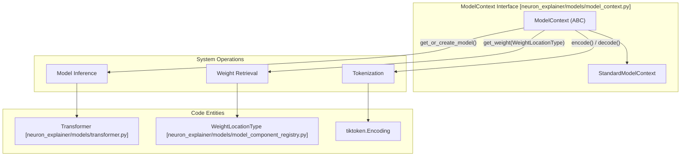
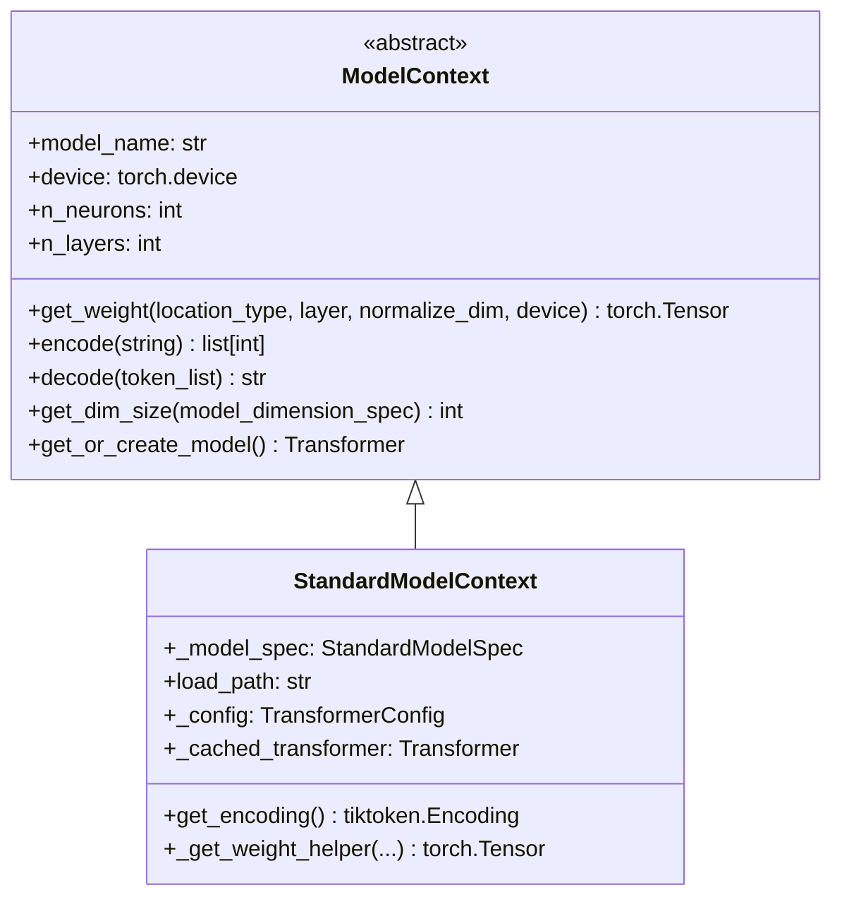
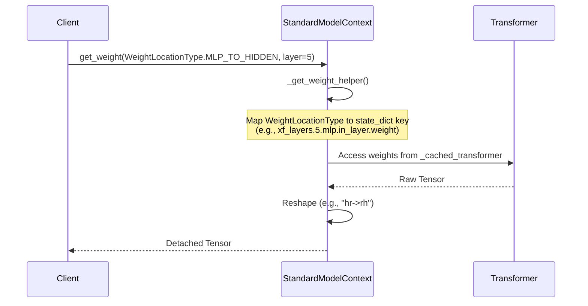
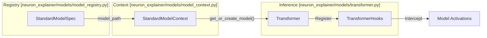

<!-- source: DeepWiki mcp.deepwiki.com · repo openai/transformer-debugger · page 2.2 Model Context Interface · fetched 2026-10-26 -->

# Model Context Interface

<details>
<summary>Relevant source files</summary>

The following files were used as context for generating this wiki page:

- [neuron_explainer/activations/derived_scalars/derived_scalar_store.py](neuron_explainer/activations/derived_scalars/derived_scalar_store.py)
- [neuron_explainer/models/model_context.py](neuron_explainer/models/model_context.py)
- [neuron_explainer/models/model_registry.py](neuron_explainer/models/model_registry.py)
- [neuron_explainer/models/transformer.py](neuron_explainer/models/transformer.py)

</details>


The Model Context Interface provides a unified abstraction layer for interacting with transformer models within the Transformer Debugger system. It acts as an intermediary between the models themselves and the various components that need to access model information, such as weights, dimensions, and tokenization capabilities. This interface enables the rest of the codebase to work with different transformer implementations in a consistent way.

## Overview and Purpose

The `ModelContext` abstract base class defines a standard interface for accessing transformer model properties and functionality. It serves several key purposes:

1.  Provides uniform access to model weights across different transformer implementations via `WeightLocationType`.
2.  Handles tokenization (encoding and decoding text) using `tiktoken`.
3.  Supplies model dimension information (e.g., number of layers, vocabulary size) via `Dimension` enums.
4.  Creates and caches model instances for inference through `get_or_create_model`.

### Natural Language to Code Entity Mapping: Interface

The following diagram maps high-level concepts to the specific classes and methods that implement them.

**Diagram: Interface Mapping**


Sources: [neuron_explainer/models/model_context.py:28-168](), [neuron_explainer/models/model_component_registry.py:15-18]().

## Class Hierarchy

The `ModelContext` is an abstract base class with a primary implementation for standard models.

*   `StandardModelContext`: The main implementation used for standard transformer models like GPT-2. It handles the loading of weights from cloud storage and local caches. [neuron_explainer/models/model_context.py:184-195]()

**Diagram: Class Relationships**


Sources: [neuron_explainer/models/model_context.py:28-168](), [neuron_explainer/models/model_context.py:184-210]().

## Core Functionality

### Model Weight Access via WeightLocationType

The `ModelContext` provides a standardized way to access model weights through the `get_weight` method [neuron_explainer/models/model_context.py:44-76](). This method uses the `WeightLocationType` enum to identify specific parameter matrices.

**Weight Retrieval Flow**


The `StandardModelContext` uses an internal mapping `info_by_type` to translate abstract weight locations into specific layer paths and required tensor transformations [neuron_explainer/models/model_context.py:227-316]().

Sources: [neuron_explainer/models/model_context.py:44-76](), [neuron_explainer/models/model_context.py:227-316]().

### Dimension Information

The interface provides access to model dimension sizes through the `get_dim_size` method [neuron_explainer/models/model_context.py:102-103]() and various convenience properties. These properties map `Dimension` enum types to actual configuration values from `TransformerConfig` [neuron_explainer/models/transformer.py:65-98]().

| Property | Dimension Type | Source in Config |
| :--- | :--- | :--- |
| `n_neurons` | `Dimension.MLP_ACTS` | `self._config.d_ff` |
| `n_layers` | `Dimension.LAYERS` | `self._config.n_layers` |
| `n_vocab` | `Dimension.VOCAB_SIZE` | `encoding.n_vocab` |
| `n_context` | `Dimension.MAX_CONTEXT_LENGTH` | `self._config.ctx_window` |

Sources: [neuron_explainer/models/model_context.py:141-163](), [neuron_explainer/models/model_context.py:212-225]().

### Tokenization and Encoding

`ModelContext` encapsulates `tiktoken` functionality to provide consistent string-to-token conversion. It explicitly allows specific special tokens like `<|endoftext|>` [neuron_explainer/models/model_context.py:21-25]().

*   `encode(string)`: Returns `list[int]` [neuron_explainer/models/model_context.py:84-85]().
*   `decode(token_list)`: Returns `str` [neuron_explainer/models/model_context.py:90-91]().
*   `encode_token_str(token_str)`: Validates that a string results in exactly one token [neuron_explainer/models/model_context.py:93-99]().

Sources: [neuron_explainer/models/model_context.py:81-126]().

## Model Registry and Loading

The `model_registry.py` file contains the `StandardModelSpec` for supported models, primarily the GPT-2 series [neuron_explainer/models/model_registry.py:19-33]().

### Standard Models
The registry points to public Azure blob storage URLs for model weights:
*   `gpt2-small`: `.../subject-models/gpt2/small`
*   `gpt2-xl`: `.../subject-models/gpt2/xl`

### TransformerHooks System
When a model is loaded via `StandardModelContext.get_or_create_model`, the underlying `Transformer` class supports `TransformerHooks` [neuron_explainer/models/transformer.py:19-24](). These hooks allow the system to intercept activations at various points (MLP, Attention, Normalization) without modifying the core model logic.

**Loading and Hooking Diagram**


Sources: [neuron_explainer/models/model_registry.py:19-33](), [neuron_explainer/models/model_context.py:318-328](), [neuron_explainer/models/transformer.py:19-24]().

## Usage in Activation Server

The `ModelContext` is a dependency for the `InteractiveModel` used in the activation server. It provides the necessary metadata and weight access for the `DerivedScalarStore` to perform computations like "Logit Lens" or "Trace Upstream" [neuron_explainer/activations/derived_scalars/derived_scalar_store.py:109-118]().

To instantiate a context:
```python
# From neuron_explainer/models/model_context.py:128-140
model_context = ModelContext.from_model_type(
    model_type="gpt2-small",
    device=get_default_device()
)
```

Sources: [neuron_explainer/models/model_context.py:128-140](), [neuron_explainer/activations/derived_scalars/derived_scalar_store.py:109-146]().

---

