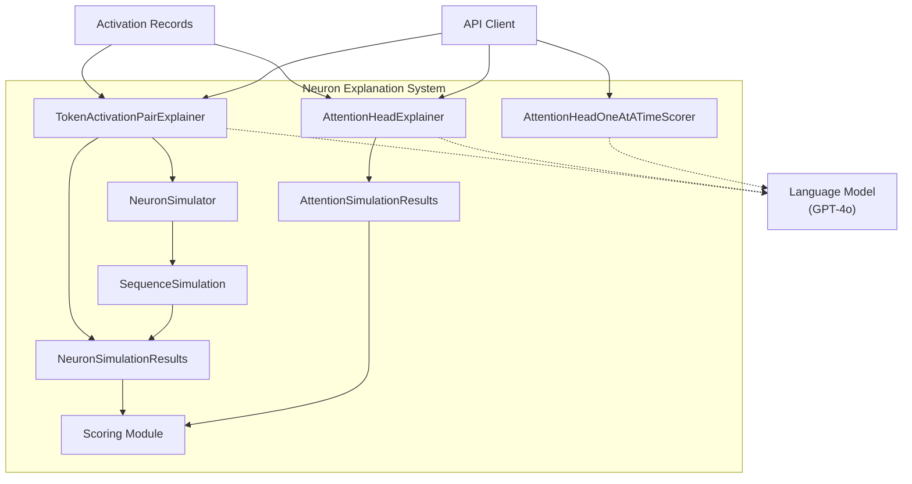
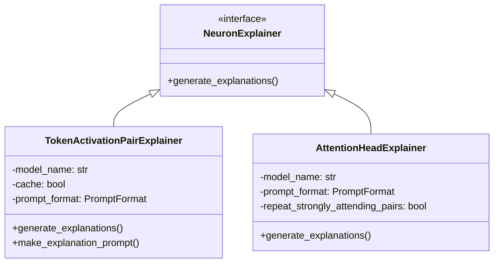
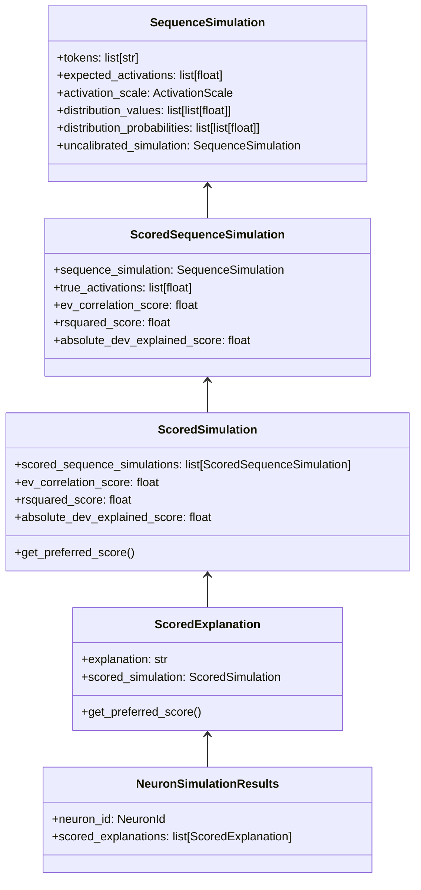
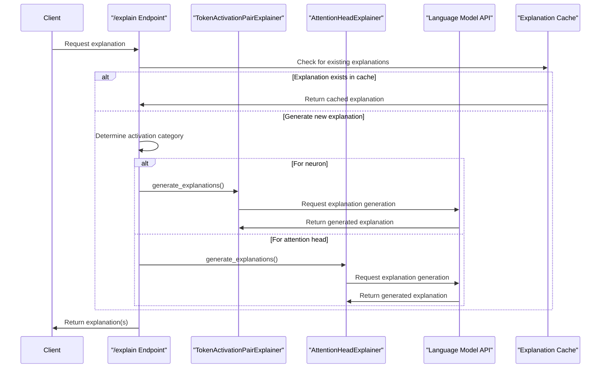
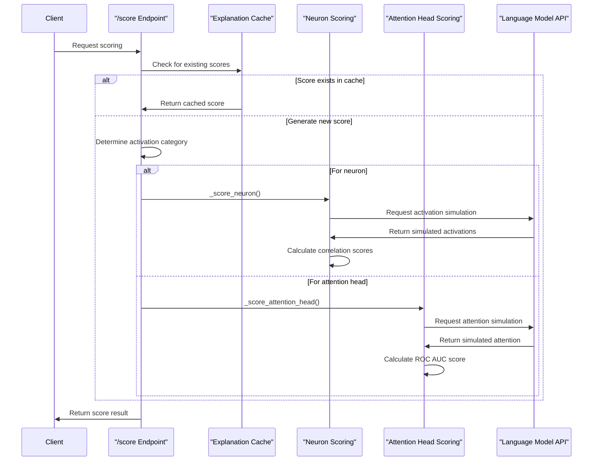

<!-- source: DeepWiki mcp.deepwiki.com · repo openai/transformer-debugger · page 3 Neuron Explanation System · fetched 2026-10-26 -->

# Neuron Explanation System

Relevant source files

The following files were used as context for generating this wiki page:

- [neuron_explainer/explanations/explanations.py](neuron_explainer/explanations/explanations.py)
- [neuron_explainer/explanations/test_explainer.py](neuron_explainer/explanations/test_explainer.py)

The Neuron Explanation System is a core component of the Transformer Debugger that generates human-understandable explanations of neuron behavior and validates their accuracy. This system is responsible for explaining what patterns neurons and attention heads detect within a transformer model.

## System Overview

The Neuron Explanation System works by analyzing activation records gathered from a transformer model and using language models to generate explanations for what patterns cause a neuron or attention head to activate. These explanations are then validated by simulating neuron activations and comparing them to actual activations.

Sources: [neuron_explainer/activation_server/explainer_routes.py:25-30](), [neuron_explainer/activation_server/explainer_routes.py:65-95]()

## Key Components

### Explanation Generators

The system includes two main types of explanation generators. For more details on the logic used to construct these prompts, see [Token Activation Pair Explainer](#3.4).

1. **TokenActivationPairExplainer**: Generates explanations for neurons by analyzing token-activation pairs [neuron_explainer/explanations/explainer.py:4-4]().
2. **AttentionHeadExplainer**: Generates explanations for attention heads by analyzing attention patterns.

Both explainers use language models like GPT-4o to generate natural language explanations of the observed activation patterns.

Sources: [neuron_explainer/activation_server/explainer_routes.py:65-70](), [neuron_explainer/activation_server/explainer_routes.py:83-93](), [neuron_explainer/explanations/explainer.py:4-55]()

### Explanation Validators and Scorers

The system includes components for validating and scoring explanations. For details on the simulation mechanics, see [Neuron Simulator](#3.2). For attention-specific scoring, see [Attention Head Scoring](#3.3).

1. **NeuronSimulator**: Simulates neuron activations based on explanations.
2. **AttentionHeadOneAtATimeScorer**: Scores explanations for attention heads using ROC AUC metrics.

Sources: [neuron_explainer/activation_server/explainer_routes.py:83-93](), [neuron_explainer/explanations/explanations.py:186-191]()

### Data Structures

The Neuron Explanation System uses several data structures to represent simulation results and scores. The `ActivationScale` enum defines whether values are raw neuron activations or simulated normalized values (0-10) [neuron_explainer/explanations/explanations.py:18-41]().

Sources: [neuron_explainer/explanations/explanations.py:18-175]()

## Explanation Workflow

The explanation workflow consists of two main phases: generation and scoring, exposed via the `/explain` and `/score` endpoints. For details on the API implementation and caching, see [Explainer Routes API](#3.1).

### Explanation Generation Process

The `TokenActivationPairExplainer` constructs prompts using either `PromptFormat.INSTRUCTION_FOLLOWING` or `PromptFormat.CHAT_MESSAGES` [neuron_explainer/explanations/test_explainer.py:53-119]().

Sources: [neuron_explainer/activation_server/explainer_routes.py:296-336](), [neuron_explainer/explanations/test_explainer.py:51-60]()

### Explanation Scoring Process

Scoring involves comparing simulated activations (derived from the explanation) against ground truth activations using metrics like correlation and R-squared [neuron_explainer/explanations/explanations.py:95-106]().

Sources: [neuron_explainer/activation_server/explainer_routes.py:338-490](), [neuron_explainer/explanations/explanations.py:135-152]()

## Prompt Formats

The system supports two primary prompt formats for interacting with LLMs [neuron_explainer/explanations/test_explainer.py:6-6]():

1. **Instruction-following format**: A single string containing instructions, few-shot examples, and the target activations [neuron_explainer/explanations/test_explainer.py:17-49]().
2. **Chat messages format**: A list of `ChatMessage` objects with defined roles (System, User, Assistant) [neuron_explainer/explanations/test_explainer.py:66-115]().

The activation format used within these prompts is `token<tab>activation`, where activations are normalized to a 0-10 scale [neuron_explainer/explanations/test_explainer.py:19-24]().

Sources: [neuron_explainer/explanations/test_explainer.py:16-133](), [neuron_explainer/explanations/explanations.py:28-32]()

---

