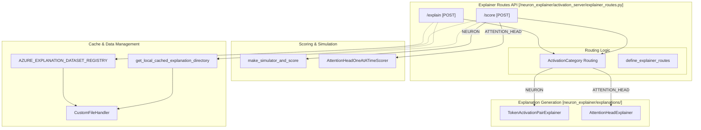
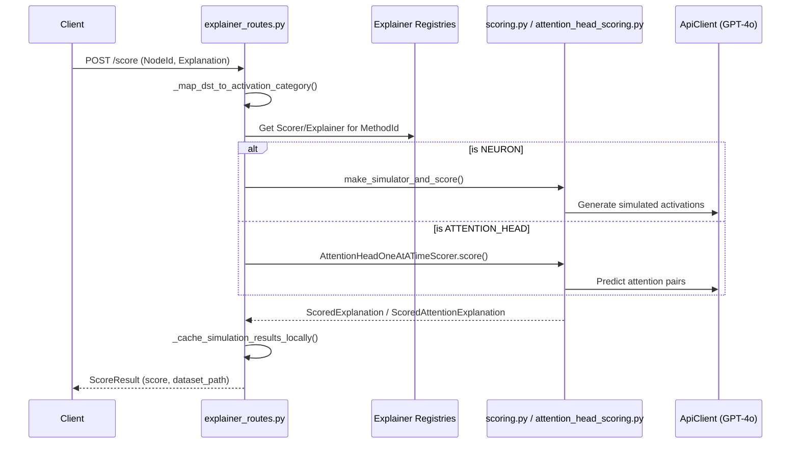

<!-- source: DeepWiki mcp.deepwiki.com · repo openai/transformer-debugger · page 3.1 Explainer Routes API · fetched 2026-10-26 -->

# Explainer Routes API

<details>
<summary>Relevant source files</summary>

The following files were used as context for generating this wiki page:

- [neuron_explainer/activation_server/explainer_routes.py](neuron_explainer/activation_server/explainer_routes.py)
- [neuron_explainer/activation_server/explanation_datasets.py](neuron_explainer/activation_server/explanation_datasets.py)

</details>


This document details the FastAPI endpoints that generate and score explanations for neurons and attention heads in transformer models. The Explainer Routes API provides two key endpoints: `/explain` for generating explanations and `/score` for evaluating explanation quality. These routes serve as the bridge between the Neuron Explanation System and client applications.

## API Architecture

The Explainer Routes API integrates several components to provide explanation services, utilizing a dual-caching strategy that checks both remote Azure storage and local filesystem caches.



Sources: [neuron_explainer/activation_server/explainer_routes.py:122-157](), [neuron_explainer/activation_server/explanation_datasets.py:6-17]()

## API Endpoints

### `/explain` Endpoint

The `/explain` endpoint generates explanations for neurons or attention heads. It follows a "cache-first" strategy, attempting to merge existing explanations from Azure and local storage before falling back to LLM-based generation.

#### Request Format
The request uses `NodeIdAndDatasets` [neuron_explainer/activation_server/read_routes.py:13-19](), which includes the `layer_index`, `activation_index`, and the `dst` (Derived Scalar Type).

#### Implementation Flow
1. **Activation Routing**: The `DerivedScalarType` is mapped to an `ActivationCategory` (NEURON or ATTENTION_HEAD) [neuron_explainer/activation_server/explainer_routes.py:137-156]().
2. **Cache Lookup**: It calls `_check_disk_for_simulation_results` to search both Azure and local paths [neuron_explainer/activation_server/explainer_routes.py:236-258]().
3. **Merging**: If results exist in multiple places, `_merge_simulation_results` combines them, deduplicating by explanation text [neuron_explainer/activation_server/explainer_routes.py:203-234]().
4. **Generation**: If no cached explanations exist, it invokes either `_explain_neuron` or `_explain_attention_head` [neuron_explainer/activation_server/explainer_routes.py:321-331]().

Sources: [neuron_explainer/activation_server/explainer_routes.py:318-336](), [neuron_explainer/activation_server/explainer_routes.py:203-258]()

### `/score` Endpoint

The `/score` endpoint evaluates an explanation's predictive power. It calculates how well an LLM, provided with the explanation, can simulate the actual activations of the node.

#### Scoring Logic
- **Neurons**: Uses `make_simulator_and_score` which creates an `ExplanationNeuronSimulator` to predict activation values (0-10 scale) [neuron_explainer/activation_server/explainer_routes.py:365-375]().
- **Attention Heads**: Uses `AttentionHeadOneAtATimeScorer` to perform binary classification on whether a token pair will have high attention [neuron_explainer/activation_server/explainer_routes.py:404-415]().

Sources: [neuron_explainer/activation_server/explainer_routes.py:436-490](), [neuron_explainer/explanations/scoring.py:38-41]()

## Caching Strategy

The system uses a dual-tier cache to minimize expensive LLM calls and latency.

| Cache Tier | Implementation | Path Logic |
| :--- | :--- | :--- |
| **Azure (Remote)** | `AZURE_EXPLANATION_DATASET_REGISTRY` | Maps neuron dataset URLs to explanation URLs [neuron_explainer/activation_server/explanation_datasets.py:6-9](). |
| **Local (Disk)** | `get_local_cached_explanation_directory` | Stores results in `cached_explanations/{dataset_short_name}/cache_{dst}_{method}/` [neuron_explainer/activation_server/explainer_routes.py:164-175](). |

### Cache Merging Logic
When retrieving cached results, the server performs a deep merge of `NeuronSimulationResults` or `AttentionSimulationResults`. 
- It prioritizes keeping the union of all `ScoredExplanation` objects found across sources [neuron_explainer/activation_server/explainer_routes.py:214-224]().
- It performs ID verification to ensure the cached file matches the requested `layer_index` and `activation_index` [neuron_explainer/activation_server/explainer_routes.py:177-201]().

Sources: [neuron_explainer/activation_server/explainer_routes.py:203-234](), [neuron_explainer/activation_server/explanation_datasets.py:12-17]()

## Explainer Registries

The behavior of the endpoints is determined by registries that define which LLM and prompt format to use for a given `MethodId`.

```python
_NEURON_EXPLAINER_REGISTRY: dict[NeuronExplainAndScoreMethodId, NeuronExplainer] = {
    NeuronExplainAndScoreMethodId.BASELINE: TokenActivationPairExplainer(
        model_name="gpt-4o",
        cache=True,
        prompt_format=PromptFormat.CHAT_MESSAGES,
    ),
}
```

- **Neuron Registry**: Maps `NeuronExplainAndScoreMethodId` to a `NeuronExplainer` implementation [neuron_explainer/activation_server/explainer_routes.py:65-71]().
- **Attention Registry**: Maps `AttentionExplainAndScoreMethodId` to a tuple of `(AttentionHeadExplainer, AttentionHeadOneAtATimeScorer)` [neuron_explainer/activation_server/explainer_routes.py:80-94]().

Sources: [neuron_explainer/activation_server/explainer_routes.py:65-94]()

## Data Flow for Scoring

This diagram traces a scoring request from the API route through the simulation logic.



Sources: [neuron_explainer/activation_server/explainer_routes.py:338-422](), [neuron_explainer/activation_server/explainer_routes.py:436-490]()

---

