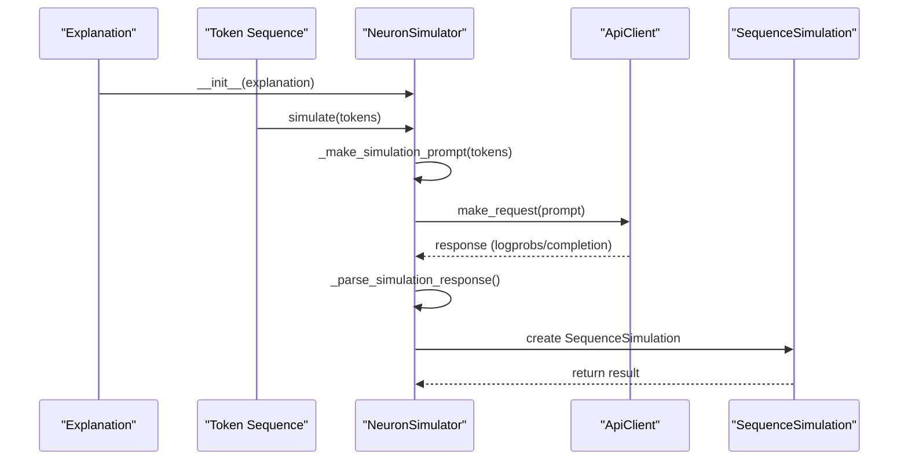

<!-- source: DeepWiki mcp.deepwiki.com · repo openai/transformer-debugger · page 3.2 Neuron Simulator · fetched 2026-10-26 -->

# Neuron Simulator

<details>
<summary>Relevant source files</summary>

The following files were used as context for generating this wiki page:

- [neuron_explainer/explanations/simulator.py](neuron_explainer/explanations/simulator.py)

</details>


The Neuron Simulator is a core component of the Transformer Debugger's Neuron Explanation System. It predicts how a neuron would activate on a given sequence of tokens based on a natural language explanation of the neuron's behavior. This enables the system to evaluate the quality of explanations and verify whether they accurately capture a neuron's function.

For more information about generating explanations, see [Token Activation Pair Explainer](#3.4). For information about scoring explanations, see [Attention Head Scoring](#3.3).

## Overview

The Neuron Simulator uses a Language Model (LLM) to predict neuron activations based on natural language explanations. It bridges the gap between human-readable explanations and quantifiable activation values, allowing the system to verify explanation quality through simulation.

```mermaid
flowchart LR
    subgraph "Natural Language Space"
        Ex["Explanation (str)"]
        style Ex fill:none
    end
    
    subgraph "Code Entity Space"
        NS["NeuronSimulator (ABC)"]
        SS["SequenceSimulation (dataclass)"]
        style NS fill:none
        style SS fill:none
    end
    
    subgraph "Activation Space"
        RA["Real Activations (ActivationRecord)"]
        PA["Predicted Activations (expected_activations)"]
        style RA fill:none
        style PA fill:none
    end
    
    Ex --> NS
    NS --> SS
    SS --> PA
    RA --> "Scoring Logic"
    PA --> "Scoring Logic"
    "Scoring Logic" --> "Explanation Quality Metric"
```

Sources: [neuron_explainer/explanations/simulator.py:8-11](), [neuron_explainer/explanations/simulator.py:294-300](), [neuron_explainer/explanations/explanations.py:42-69]()

## Simulation Types

The Neuron Simulator supports multiple simulation strategies, defined by the `SimulationType` enum, which correspond to specific subclasses of `NeuronSimulator`:

```mermaid
flowchart TD
    NS["NeuronSimulator\n(Abstract Base Class)"]
    
    ENS["ExplanationNeuronSimulator\n(ALL_AT_ONCE)"]
    ETBTS["ExplanationTokenByTokenSimulator\n(ONE_AT_A_TIME)"]
    LFETS["LogprobFreeExplanationTokenSimulator"]
    EDS["ExplanationDummySimulator"]
    
    NS --> ENS
    NS --> ETBTS
    NS --> LFETS
    NS --> EDS
    
    ENS --> |"Single prompt\nwith logprobs"| "Simulates all tokens\nat once"
    ETBTS --> |"Multiple prompts\nwith logprobs"| "Simulates one\ntoken at a time"
    LFETS --> |"JSON prompt\nno logprobs"| "Temperature=0\nsampling"
    EDS --> "Returns all\nzero activations"
```

Sources: [neuron_explainer/explanations/simulator.py:42-64](), [neuron_explainer/explanations/simulator.py:294-417]()

### ALL_AT_ONCE Simulation
The `ExplanationNeuronSimulator` implementation uses a single prompt containing all tokens, with the activations replaced by `<unknown>`. It then uses the logprobs from the LLM to calculate expected activation values for each token. This approach is efficient as it processes all tokens in a single API call.

Sources: [neuron_explainer/explanations/simulator.py:303-391]()

### ONE_AT_A_TIME Simulation
The `ExplanationTokenByTokenSimulator` makes a separate API call for each token in the sequence. While slower, this approach can be more precise as it focuses on one token at a time, potentially capturing more nuanced patterns in the explanation.

Sources: [neuron_explainer/explanations/simulator.py:420-593]()

### Logprob-Free Simulation
The `LogprobFreeExplanationTokenSimulator` doesn't rely on logprobs for prediction. Instead, it formats the input and expected output as JSON objects and uses temperature=0 sampling. This approach works with API endpoints that do not provide logprobs.

Sources: [neuron_explainer/explanations/simulator.py:680-834]()

## Simulation Process

The core simulation process involves these steps:



Sources: [neuron_explainer/explanations/simulator.py:323-345](), [neuron_explainer/explanations/simulator.py:444-479](), [neuron_explainer/explanations/simulator.py:716-743](), [neuron_explainer/api_client.py:10-15]()

### Prompt Construction
For all simulator types, the prompt construction follows this general pattern:
1. System message describing the task (predict neuron activations).
2. Few-shot examples of explanations and their activations using `FewShotExampleSet`.
3. The target explanation and tokens for which to predict activations.

The prompt format is managed via the `PromptBuilder` and `PromptFormat` (e.g., `INSTRUCTION_FOLLOWING` or `CHAT_MESSAGES`).

Sources: [neuron_explainer/explanations/simulator.py:26-31](), [neuron_explainer/explanations/simulator.py:350-391](), [neuron_explainer/explanations/simulator.py:536-593](), [neuron_explainer/explanations/simulator.py:749-834]()

### Activation Prediction and Normalization
Activation values are normalized to an integer range of 0-10 (`MAX_NORMALIZED_ACTIVATION = 10`) to standardize the simulation process. 

1. **Logprob-based prediction**: The simulator calls `compute_predicted_activation_stats_for_token`, which analyzes the probability distribution over the tokens "0" through "10" using the LLM's `top_logprobs`.
2. **Expected Value Calculation**: The expected value is calculated as the dot product of the distribution values (0-10) and their normalized probabilities.

Sources: [neuron_explainer/explanations/simulator.py:37-40](), [neuron_explainer/explanations/simulator.py:67-108](), [neuron_explainer/explanations/simulator.py:597-645]()

## Simulation Results and Data Structures

The simulation outputs are structured into a hierarchy of dataclasses in `explanations.py`:

| Class | Description |
|-------|-------------|
| `SequenceSimulation` | Stores the primary output: `tokens`, `expected_activations`, and the probability distributions. |
| `ScoredSequenceSimulation` | Wraps a `SequenceSimulation` with its comparison against `true_activations`, including metrics like `ev_correlation_score`. |
| `ScoredSimulation` | A collection of `ScoredSequenceSimulation` objects for a single explanation across multiple sequences. |
| `ScoredExplanation` | Links an explanation string to its `ScoredSimulation`. |

Sources: [neuron_explainer/explanations/explanations.py:42-195]()

### Activation Scales
The system uses the `ActivationScale` enum to distinguish between different value ranges:
- `NEURON_ACTIVATIONS`: Raw values from the model.
- `SIMULATED_NORMALIZED_ACTIVATIONS`: Values in the [0, 10] range used by the simulator.
- `HUMAN_PREDICTED_ACTIVATIONS`: Values in the [0, 2] range often used in human labeling.

Sources: [neuron_explainer/explanations/explanations.py:18-40]()

## Simulator Implementation Details

### Handling Tokenization Mismatches
A common issue occurs when the subject model and the simulator model use different tokenizers. The simulator handles this in `was_token_split` and `handle_byte_encoding`. If a token from the subject model was split into multiple tokens by the simulator model, the simulator merges the response tokens (potentially handling hex-encoded bytes like `bytes:\x0a`) to ensure the activation prediction aligns with the correct original token.

Sources: [neuron_explainer/explanations/simulator.py:112-185]()

### Response Parsing
The `_parse_simulation_response` methods in subclasses handle the logic of extracting predicted values:
- In `ExplanationNeuronSimulator`, it iterates through the tokens, looking for the `tab` delimiter that precedes the `<unknown>` activation placeholder.
- In `LogprobFreeExplanationTokenSimulator`, it parses the response as JSON to extract a list of integers.

Sources: [neuron_explainer/explanations/simulator.py:188-291](), [neuron_explainer/explanations/simulator.py:755-780]()

## Practical Considerations

### Choosing a Simulator Type
- **`ExplanationNeuronSimulator` (ALL_AT_ONCE)**: Fastest option; requires logprob access. Best for batch evaluation.
- **`ExplanationTokenByTokenSimulator` (ONE_AT_A_TIME)**: Most robust against context window limits for long sequences; requires logprob access.
- **`LogprobFreeExplanationTokenSimulator`**: Essential for models that only provide text completions (e.g., via a JSON mode).
- **`ExplanationDummySimulator`**: Returns zeros; used for baseline testing.

Sources: [neuron_explainer/explanations/simulator.py:42-64](), [neuron_explainer/explanations/simulator.py:394-417]()

### Limitations
1. **Context Window**: Long sequences with few-shot examples can exceed the LLM's context limit, especially in the `ALL_AT_ONCE` mode.
2. **Tokenization**: Complex Unicode or byte-level sequences can still cause alignment issues despite the `handle_byte_encoding` logic.
3. **Scale Calibration**: The 0-10 scale is a heuristic; `expected_activations` must be compared relatively or re-scaled for absolute comparison with raw neuron outputs.

Sources: [neuron_explainer/explanations/simulator.py:153-185](), [neuron_explainer/explanations/simulator.py:347-349]()

---

