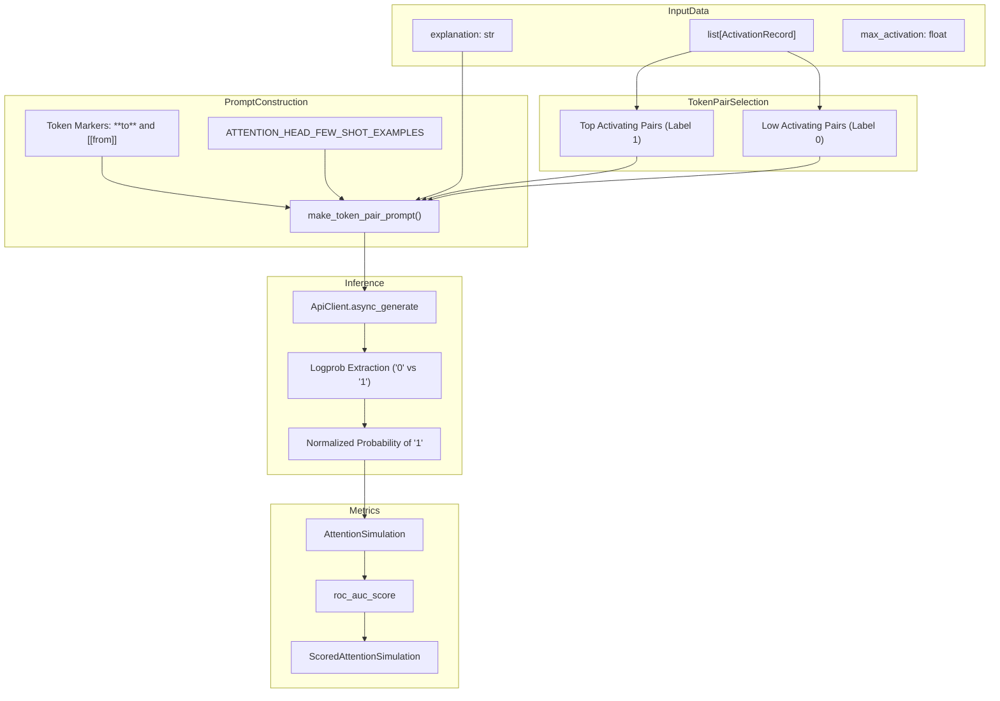
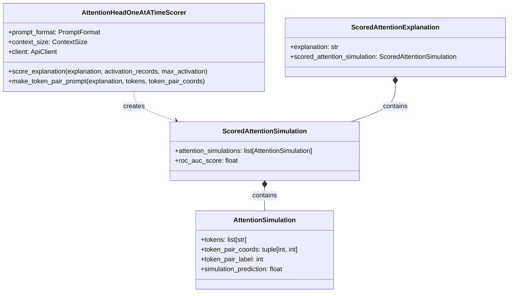

<!-- source: DeepWiki mcp.deepwiki.com · repo openai/transformer-debugger · page 3.3 Attention Head Scoring · fetched 2026-10-26 -->

# Attention Head Scoring

<details>
<summary>Relevant source files</summary>

The following files were used as context for generating this wiki page:

- [neuron_explainer/explanations/attention_head_scoring.py](neuron_explainer/explanations/attention_head_scoring.py)

</details>


This document describes the attention head scoring subsystem within the Transformer Debugger, which evaluates how well explanations of attention head behavior predict actual attention patterns. This system is a critical component of the **Neuron Explanation System** [neuron_explainer/explanations/explainer.py:20-24]().

## 1. Purpose and Overview

The attention head scoring system evaluates natural language explanations by measuring their predictive power regarding token-to-token attention. Unlike MLP neurons which activate on single tokens, attention heads operate on pairs. The scoring mechanism:

1.  **Samples token pairs**: Selects a balanced set of "strong" (high activation) and "weak" (low activation) token pairs from `ActivationRecord` data [neuron_explainer/explanations/attention_head_scoring.py:73-98]().
2.  **LLM Simulation**: Uses an LLM to predict the attention strength for these pairs based on the provided explanation [neuron_explainer/explanations/attention_head_scoring.py:109-124]().
3.  **ROC AUC Calculation**: Quantifies the explanation quality by comparing predicted probabilities against ground truth labels [neuron_explainer/explanations/attention_head_scoring.py:158-160]().

**Diagram: Attention Head Scoring System Overview**



Sources: [neuron_explainer/explanations/attention_head_scoring.py:60-164](), [neuron_explainer/explanations/explanations.py:198-222]()

## 2. Key Components

The system is centered around the `AttentionHeadOneAtATimeScorer` class, which manages the lifecycle of a scoring request.

**Diagram: Attention Head Scoring Class Structure**



Sources: [neuron_explainer/explanations/attention_head_scoring.py:38-59](), [neuron_explainer/explanations/explanations.py:198-254]()

### 2.1 Data Structures

| Class | Purpose |
|-------|-------------|
| `AttentionHeadOneAtATimeScorer` | Orchestrates the scoring process, from prompt building to API calls [neuron_explainer/explanations/attention_head_scoring.py:38](). |
| `AttentionSimulation` | Stores the results for a single token pair evaluation, including the model's predicted probability of activation [neuron_explainer/explanations/explanations.py:198](). |
| `ScoredAttentionSimulation` | Aggregates multiple `AttentionSimulation` results and computes the final `roc_auc_score` [neuron_explainer/explanations/explanations.py:215](). |

## 3. Scoring Process Details

### 3.1 Token Pair Selection

To evaluate an explanation, the scorer selects a balanced set of examples from the `activation_records` [neuron_explainer/explanations/attention_head_scoring.py:73]():

1.  **Strong Activations**: Selects the `num_activations_for_scoring` (default 5) pairs with the highest activation values across all records [neuron_explainer/explanations/attention_head_scoring.py:85-88]().
2.  **Weak Activations**: Identifies pairs where activation is below `low_activation_threshold * max_activation` (default 0.1) and randomly samples an equal number of pairs [neuron_explainer/explanations/attention_head_scoring.py:90-98]().

### 3.2 Prompt Construction with Token Markers

The scorer constructs a prompt for each pair using `make_token_pair_prompt` [neuron_explainer/explanations/attention_head_scoring.py:111](). The prompt uses specific markers to highlight the "to" and "from" tokens:

*   **Target Token**: Wrapped in double asterisks (e.g., `**token**`) to indicate the token being attended **to** [neuron_explainer/explanations/attention_head_scoring.py:204]().
*   **Source Token**: Wrapped in double brackets (e.g., `[[token]]`) to indicate the token attending **from** [neuron_explainer/explanations/attention_head_scoring.py:207]().

The prompt format is strictly `PromptFormat.CHAT_MESSAGES` [neuron_explainer/explanations/attention_head_scoring.py:51-53](), incorporating `ATTENTION_HEAD_FEW_SHOT_EXAMPLES` to guide the simulator [neuron_explainer/explanations/attention_head_scoring.py:29]().

### 3.3 Logprob Extraction and Binary Classification

The scorer performs binary classification by looking at the log-probabilities of the tokens "0" and "1" in the LLM's response [neuron_explainer/explanations/attention_head_scoring.py:127-134]():

1.  **Generate**: Requests 1 token with `logprobs=True` and `top_logprobs=15` [neuron_explainer/explanations/attention_head_scoring.py:119-121]().
2.  **Extract**: Retrieves logprobs for token "0" (weak) and "1" (strong) [neuron_explainer/explanations/attention_head_scoring.py:132-134]().
3.  **Normalize**: Calculates the probability of "1" as `prob("1") / (prob("0") + prob("1"))` [neuron_explainer/explanations/attention_head_scoring.py:138]().

This normalized probability serves as the `simulation_prediction` for the ROC AUC calculation [neuron_explainer/explanations/attention_head_scoring.py:145]().

## 4. Implementation Details

### 4.1 ROC AUC Metric

The final score is calculated using `sklearn.metrics.roc_auc_score` [neuron_explainer/explanations/attention_head_scoring.py:9](). This metric is ideal because it evaluates the model's ability to rank high-activating pairs above low-activating pairs, regardless of the absolute probability values [neuron_explainer/explanations/attention_head_scoring.py:155-160]().

### 4.2 Scoring Parameters

| Parameter | Default | Description |
|-----------|---------|-------------|
| `num_activations_for_scoring` | 5 | Number of positive and negative pairs to sample [neuron_explainer/explanations/attention_head_scoring.py:66](). |
| `low_activation_threshold` | 0.1 | Fraction of `max_activation` used to define "weak" attention [neuron_explainer/explanations/attention_head_scoring.py:69](). |
| `max_concurrent` | 10 | Limits simultaneous API requests via `ApiClient` [neuron_explainer/explanations/attention_head_scoring.py:48](). |

Sources: [neuron_explainer/explanations/attention_head_scoring.py:38-70](), [neuron_explainer/api_client.py:1-20]()

## 5. Usage Example

The following demonstrates initializing the scorer and evaluating an explanation for a specific attention head.

```python
from neuron_explainer.explanations.attention_head_scoring import AttentionHeadOneAtATimeScorer

# 1. Initialize with a target LLM (e.g., gpt-4)
scorer = AttentionHeadOneAtATimeScorer(model_name="gpt-4")

# 2. Provide explanation and activation records
# records: list[ActivationRecord] from load_neuron()
# max_act: max activation value found in dataset
scored_sim = await scorer.score_explanation(
    explanation="Attends from punctuation to the preceding noun",
    activation_records=records,
    max_activation=max_act
)

# 3. Access the ROC AUC score
print(f"Explanation Quality: {scored_sim.roc_auc_score}")
```

Sources: [neuron_explainer/explanations/attention_head_scoring.py:243-263]()

---

