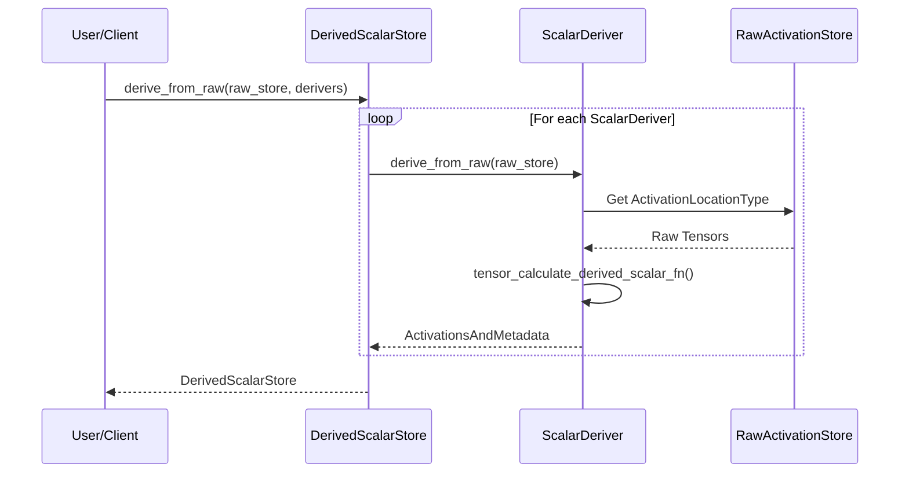

<!-- source: DeepWiki mcp.deepwiki.com · repo openai/transformer-debugger · page 4 Activation Data Management · fetched 2026-10-26 -->

# Activation Data Management

<details>
<summary>Relevant source files</summary>

The following files were used as context for generating this wiki page:

- [neuron_explainer/activations/activations.py](neuron_explainer/activations/activations.py)
- [neuron_explainer/activations/derived_scalars/README.md](neuron_explainer/activations/derived_scalars/README.md)

</details>


## Purpose and Scope

The Activation Data Management system is responsible for storing, accessing, and processing neural network activations in the Transformer Debugger. It provides data structures and utilities to efficiently handle activation values from transformer models, allowing for analysis, explanation, and visualization of neural network behavior.

This page covers the core data structures for activation storage, derived scalar computation, and the APIs for accessing and manipulating activation data.

```mermaid
graph TD
    subgraph "Activation Data System"
        [ActivationRecord]
        [NeuronRecord]
        [DerivedScalarStore]
        [DerivedScalarType]
    end
    
    subgraph "Code Entity Space"
        [activations.py]
        [derived_scalar_store.py]
        [scalar_deriver.py]
    end
    
    [activations.py] -.-> [ActivationRecord]
    [activations.py] -.-> [NeuronRecord]
    [derived_scalar_store.py] -.-> [DerivedScalarStore]
    [scalar_deriver.py] -.-> [DerivedScalarType]
    
    [ModelContext] -->|"provides raw activations"| [ActivationRecord]
    [ActivationRecord] -->|"stored in"| [NeuronRecord]
    [NeuronRecord] -->|"processes into"| [DerivedScalarStore]
    [DerivedScalarType] -->|"defines"| [DerivedScalarStore]
```

Sources: [neuron_explainer/activations/activations.py:12-249](), [neuron_explainer/activations/derived_scalars/derived_scalar_store.py:97-165]().

## Core Data Structures

The system is built around several key data structures that represent activations at different levels of abstraction. For deep technical details on these structures, see [Neuron Records and Activation Records](#4.1).

### ActivationRecord and NeuronId
`ActivationRecord` is the atomic unit, representing raw activation values for a single neuron on a specific sequence of tokens [neuron_explainer/activations/activations.py:12-22](). `NeuronId` provides the unique coordinates (layer and index) for that neuron [neuron_explainer/activations/activations.py:23-37]().

### NeuronRecord
A `NeuronRecord` aggregates activation data for a specific neuron, including summary statistics (mean, variance, skewness, kurtosis) and samples of sequences that activate the neuron [neuron_explainer/activations/activations.py:94-123](). It manages data splits (train, calibration, valid, test) using an interleaved slicing strategy to ensure representative samples for explanation generation [neuron_explainer/activations/activations.py:130-149]().

### DerivedScalarStore
`DerivedScalarStore` manages processed activations and gradients. It maps a combination of `DerivedScalarType` and `PassType` (Forward/Backward) to `ActivationsAndMetadata` [neuron_explainer/activations/derived_scalars/derived_scalar_store.py:109-138](). This structure supports advanced operations like top-k filtering and statistical aggregation across model layers [neuron_explainer/activations/derived_scalars/derived_scalar_store.py:180-296]().

Sources: [neuron_explainer/activations/activations.py:12-149](), [neuron_explainer/activations/derived_scalars/derived_scalar_store.py:109-296]().

## Derived Scalar Computation Pipeline

Derived scalars (DSTs) provide a shared interface for both raw activations (e.g., post-softmax attention) and computed functions of activations (e.g., norm of a write vector). For details on the computation graph, see [Derived Scalar Types](#4.2).

### Computation Flow
1. **Specification**: Users define `ScalarDeriver` objects using `DerivedScalarType` and `DstConfig` [neuron_explainer/activations/derived_scalars/README.md:68]().
2. **Collection**: Raw activations are collected into a `RawActivationStore` [neuron_explainer/activations/derived_scalars/README.md:72]().
3. **Derivation**: The `DerivedScalarStore` executes the deriver's logic, recursively resolving dependencies via `ScalarSource` objects [neuron_explainer/activations/derived_scalars/README.md:74-82]().



Sources: [neuron_explainer/activations/derived_scalars/README.md:1-90](), [neuron_explainer/activations/derived_scalars/derived_scalar_store.py:616-637]().

## Activation Datasets and Access Patterns

The system provides access to large-scale datasets of pre-computed activations, primarily stored in Azure Blob Storage. For a list of available models and paths, see [Activation Datasets](#4.3).

### Access Patterns
- **Collated Datasets**: Activations are often stored in a collated format where each file contains a `NeuronRecord` for a specific neuron [neuron_explainer/activations/activations.py:216-249]().
- **Async Loading**: The `CustomFileHandler` and `read_single_async` utilities are used to fetch these records efficiently over HTTPS [neuron_explainer/activations/activations.py:9]().
- **Slicing**: When loading records for explanation, the system applies `ActivationRecordSliceParams` to select the appropriate subsets of sequences [neuron_explainer/activations/activations.py:85-90]().

Sources: [neuron_explainer/activations/activations.py:216-249](), [neuron_explainer/file_utils.py:1-20]().

## Child Pages
- [Neuron Records and Activation Records](#4.1) — Details on the data structures for storing and slicing neuron activations.
- [Derived Scalar Types](#4.2) — Documentation of the computation pipeline, DST enums, and the dependency graph.
- [Activation Datasets](#4.3) — Overview of available datasets (GPT-2, Autoencoders) and storage formats.

---

