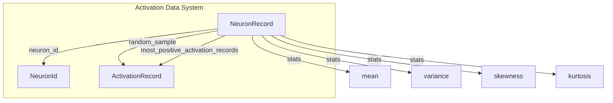
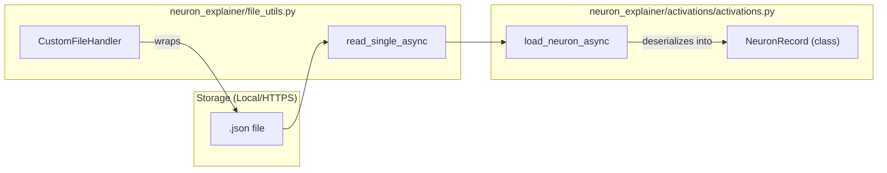

<!-- source: DeepWiki mcp.deepwiki.com · repo openai/transformer-debugger · page 4.1 Neuron Records and Activation Records · fetched 2026-10-26 -->

# Neuron Records and Activation Records

Relevant source files

The following files were used as context for generating this wiki page:

- [neuron_explainer/activations/activations.py](neuron_explainer/activations/activations.py)
- [neuron_explainer/file_utils.py](neuron_explainer/file_utils.py)

This document describes the core data structures used for storing and managing neuron activation data in the Transformer Debugger system. It explains how activation values from transformer models are captured, organized, and made available for analysis through the `ActivationRecord` and `NeuronRecord` classes.

## Purpose and Role in the System

`ActivationRecord` and `NeuronRecord` serve as the foundational data structures in the Activation Data Management system. They bridge the gap between the raw activations produced by the Model System and the analysis performed by the Neuron Explanation System:

1. `ActivationRecord` stores raw activation values and corresponding tokens for a single sequence.
2. `NeuronRecord` organizes multiple activation records for a specific neuron, along with statistical information.

### Core Data Structure Relationships

*Diagram: Core Data Structure Relationships*

Sources: [neuron_explainer/activations/activations.py:12-129]()

## Core Data Structures

### ActivationRecord
The `ActivationRecord` class [neuron_explainer/activations/activations.py:12-21]() is a container that pairs activation values with their corresponding tokens for a single text sequence.

| Field | Type | Description |
| :--- | :--- | :--- |
| `activations` | `list[float]` | Raw activation values for the neuron on each token. |
| `tokens` | `list[str]` | Tokens in the text sequence, represented as strings. |

### NeuronId
The `NeuronId` class [neuron_explainer/activations/activations.py:23-37]() uniquely identifies a neuron within the model. It includes field remapping for backward compatibility (`idx` to `neuron_index` and `layer` to `layer_index`).

| Field | Type | Description |
| :--- | :--- | :--- |
| `neuron_index` | `int` | The neuron's index within its layer (0-indexed). |
| `layer_index` | `int` | The index of the layer (0-indexed). |

### NeuronRecord
The `NeuronRecord` class [neuron_explainer/activations/activations.py:92-129]() is the primary unit of storage for neuron-indexed data. It includes summary statistics and multiple sets of activation records.

- **Statistical Moments**: Includes `mean`, `variance`, `skewness`, and `kurtosis` of the neuron's activations [neuron_explainer/activations/activations.py:113-117]().
- **Top Activations**: `most_positive_activation_records` contains the sequences where the neuron fired most strongly [neuron_explainer/activations/activations.py:119-123]().
- **Random Samples**: `random_sample` provides a baseline of typical behavior [neuron_explainer/activations/activations.py:100-104]().
- **Quantiles**: If enabled, `random_sample_by_quantile` and `quantile_boundaries` store records across the activation distribution [neuron_explainer/activations/activations.py:105-111]().

Sources: [neuron_explainer/activations/activations.py:12-129]()

## Data Splits and Slicing Strategy

To ensure robust evaluation, `NeuronRecord` partitions its records into `train`, `calibration`, `valid`, and `test` splits using an interleaved slicing strategy.

### Interleaved Slicing
The function `get_slices_for_splits` [neuron_explainer/activations/activations.py:62-81]() creates disjoint slices by using a `stride` equal to the number of splits. For example, if there are 4 splits, the first split gets indices [0, 4, 8...], the second gets [1, 5, 9...], and so on. This ensures that the data in each split is representative of the overall sample.

### Split Composition
The system uses different ratios of top-activating vs. random records depending on the split's purpose:

| Split | Source Data | Typical Use Case |
| :--- | :--- | :--- |
| **Train** | Top-activating only | Generating explanations via LLM [neuron_explainer/activations/activations.py:150-161]() |
| **Calibration** | 1:1 Top/Random | Calibrating simulation thresholds [neuron_explainer/activations/activations.py:163-178]() |
| **Valid** | 1:1 Top/Random | Evaluating explanation accuracy [neuron_explainer/activations/activations.py:180-195]() |
| **Test** | 1:1 Top/Random | Final hold-out evaluation [neuron_explainer/activations/activations.py:197-213]() |

Sources: [neuron_explainer/activations/activations.py:40-81](), [neuron_explainer/activations/activations.py:130-213]()

## Data Loading and File Handling

### Async Loading with CustomFileHandler
The system supports loading data from both local paths and remote HTTPS URLs. The `CustomFileHandler` [neuron_explainer/file_utils.py:21-59]() acts as a context manager to abstract these sources.

For high-performance retrieval, `read_single_async` [neuron_explainer/file_utils.py:61-68]() uses `aiohttp` to fetch remote files or standard async I/O for local files. This is used by `load_neuron_async` [neuron_explainer/activations/activations.py:236-249]() to fetch and deserialize `NeuronRecord` JSON files.

### Code-to-System Mapping

*Diagram: Data Flow from Storage to NeuronRecord*

Sources: [neuron_explainer/file_utils.py:21-68](), [neuron_explainer/activations/activations.py:236-249]()

## File Structure and Retrieval
`NeuronRecord` objects are typically stored in a nested directory structure: `{dataset_path}/{layer_index}/{neuron_index}.json`.

- `load_neuron`: Synchronous loader that constructs the path and reads the file [neuron_explainer/activations/activations.py:216-234]().
- `load_neuron_from_datasets`: Used by the activation server to search across multiple potential dataset locations (e.g., searching both MLP and Autoencoder datasets) for a specific `NeuronId` [neuron_explainer/activation_server/load_neurons.py:43-68]().

Sources: [neuron_explainer/activations/activations.py:216-234](), [neuron_explainer/activation_server/load_neurons.py:43-68]()

---

