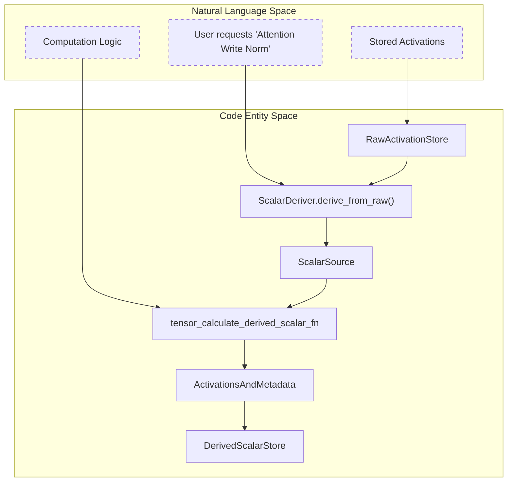
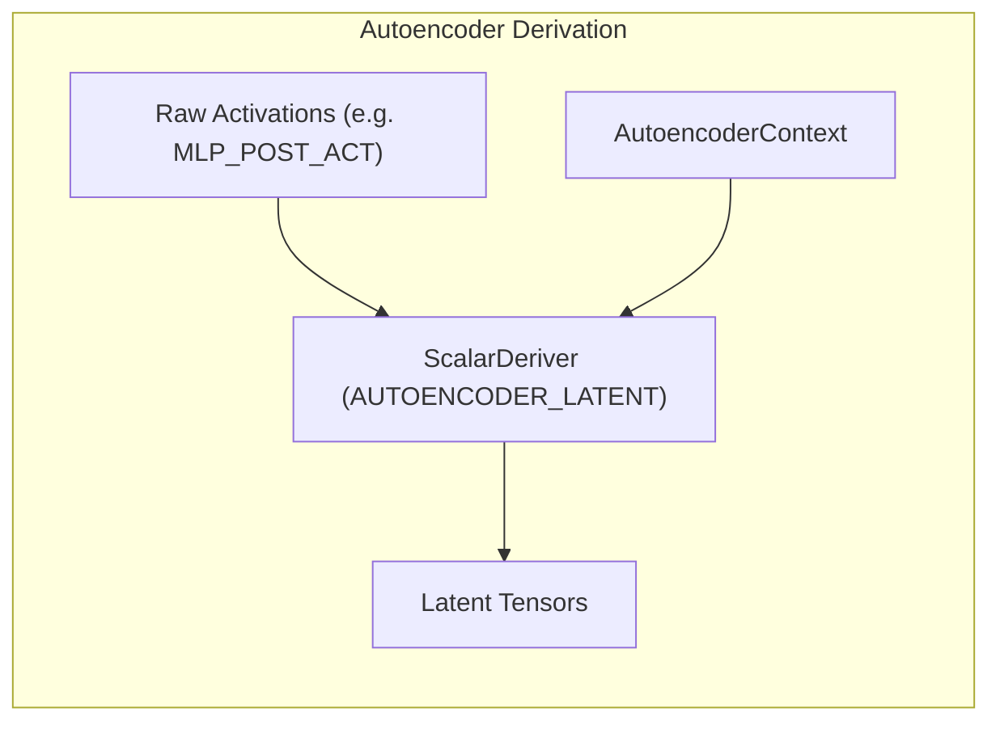

<!-- source: DeepWiki mcp.deepwiki.com · repo openai/transformer-debugger · page 4.2 Derived Scalar Types · fetched 2026-10-26 -->

# Derived Scalar Types

<details>
<summary>Relevant source files</summary>

The following files were used as context for generating this wiki page:

- [neuron_explainer/activations/derived_scalars/README.md](neuron_explainer/activations/derived_scalars/README.md)
- [neuron_explainer/activations/derived_scalars/derived_scalar_store.py](neuron_explainer/activations/derived_scalars/derived_scalar_store.py)
- [neuron_explainer/activations/derived_scalars/tests/test_derived_scalar_types.py](neuron_explainer/activations/derived_scalars/tests/test_derived_scalar_types.py)
- [neuron_explainer/models/model_context.py](neuron_explainer/models/model_context.py)

</details>


## Purpose and Scope

Derived Scalar Types (**DSTs**) provide a unified interface for processing activations that are directly instantiated during a model pass (e.g., post-softmax attention) and functions of those activations that are not directly stored (e.g., the norm of an attention write vector). This system allows for flexible computation across different model architectures and use cases, such as online inference or batch processing.

Sources: [neuron_explainer/activations/derived_scalars/README.md:1-5]()

## Core Concepts and Implementation

The DST system is built on several key abstractions that define how scalars are specified, derived, and stored.

### Key Classes

| Class | Role |
| :--- | :--- |
| `DerivedScalarType` | An enum containing names for all defined derived scalars. [neuron_explainer/activations/derived_scalars/scalar_deriver.py:14]() |
| `PassType` | Enum for `FORWARD` or `BACKWARD` passes, as scalars can depend on activations or gradients. [neuron_explainer/models/model_component_registry.py:25]() |
| `ScalarDeriver` | An object containing the logic to compute a specific `DerivedScalarType`. [neuron_explainer/activations/derived_scalars/scalar_deriver.py:32]() |
| `ActivationsAndMetadata` | A container for PyTorch tensors corresponding to a DST and `PassType` across model layers. [neuron_explainer/activations/derived_scalars/scalar_deriver.py:13]() |
| `DerivedScalarStore` | A collection of `ActivationsAndMetadata` objects, providing methods for top-k analysis and indexing. [neuron_explainer/activations/derived_scalars/derived_scalar_store.py:109-126]() |
| `DstConfig` | A dataclass specifying configuration needed for derivation (e.g., `model_name`, `autoencoder_context`). [neuron_explainer/activations/derived_scalars/scalar_deriver.py:15]() |

Sources: [neuron_explainer/activations/derived_scalars/README.md:16-61]()

## Computation Process and Data Flow

Derived scalars are calculated through a dependency graph where a `ScalarDeriver` may depend on multiple `ScalarSource` objects. A source can be "Raw" (directly from a transformer hook) or "Derived" (requiring another `ScalarDeriver`).

### Natural Language to Code Entity Space: Computation Flow


Sources: [neuron_explainer/activations/derived_scalars/README.md:64-90]()

### Computation Steps
1. **Specification**: User defines `ScalarDeriver` objects using a `DerivedScalarType` and `DstConfig`.
2. **Prerequisites**: The system identifies required `ActivationLocationType` and `PassType` via `scalar_deriver.sub_activation_location_type_and_pass_types`.
3. **Execution**: `DerivedScalarStore.derive_from_raw` iterates through layers and applies the `tensor_calculate_derived_scalar_fn` to the inputs.

Sources: [neuron_explainer/activations/derived_scalars/README.md:64-86]()

## Defining New Scalar Types

Defining a new DST involves two primary steps:

1.  **Specification**: Add the name and output shape (using `Dimension` objects) to the `DerivedScalarType` enum in `derived_scalar_types.py`.
2.  **Implementation**: Create a `make_..._scalar_deriver` function that defines the `ScalarSources` and the calculation function. These are registered in `make_scalar_derivers.py`.

Sources: [neuron_explainer/activations/derived_scalars/README.md:94-112]()

## Derived Scalar Store Operations

The `DerivedScalarStore` is the primary interface for interacting with computed scalars. It supports complex filtering and analysis.

### Top-k Analysis
The `topk` method allows finding the most significant activations across multiple layers and types. It returns `DerivedScalarIndex` objects to pinpoint the exact token and node.

```python
# Example: Finding top 10 activations for MLP post-acts
topk_values, topk_indices = store.topk(
    k=10, 
    dsts=[DerivedScalarType.MLP_POST_ACT]
)
```
Sources: [neuron_explainer/activations/derived_scalars/derived_scalar_store.py:180-227]()

### Relationship with Autoencoders
Autoencoder latents are treated as derived scalars. The system uses factories to create derivers that project raw activations into the latent space.


Sources: [neuron_explainer/activations/derived_scalars/tests/test_derived_scalar_types.py:8-11](), [neuron_explainer/activations/derived_scalars/tests/test_derived_scalar_types.py:161-170]()

## Common Derived Scalar Types

| Derived Scalar Type | Source Node Type | Calculation Detail |
| :--- | :--- | :--- |
| `MLP_POST_ACT` | `MLP_NEURON` | Standard MLP activations. |
| `ATTN_WRITE` | `ATTENTION_HEAD` | The vector written to the residual stream. |
| `AUTOENCODER_LATENT` | `AUTOENCODER_LATENT` | Activations of the sparse autoencoder. |
| `RESID_DELTA_MLP` | `RESIDUAL_STREAM_CHANNEL` | Contribution of an MLP layer to the residual stream. |

Sources: [neuron_explainer/activations/derived_scalars/tests/test_derived_scalar_types.py:128-138]()

## Indexing and Persistence

The system uses `DerivedScalarIndex` to provide a coordinate system for values.
*   **Indexing**: `DerivedScalarStore` supports `__getitem__` using these indices. [neuron_explainer/activations/derived_scalars/derived_scalar_store.py:517-547]()
*   **Persistence**: Stores can be serialized to disk using `save_to_file` and reconstructed via `load_from_file`. [neuron_explainer/activations/derived_scalars/derived_scalar_store.py:601-614]()

Sources: [neuron_explainer/activations/derived_scalars/derived_scalar_store.py:652-667]()

---

