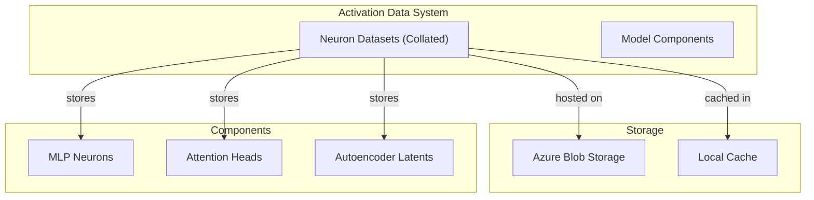
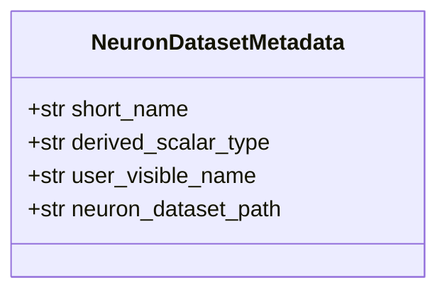
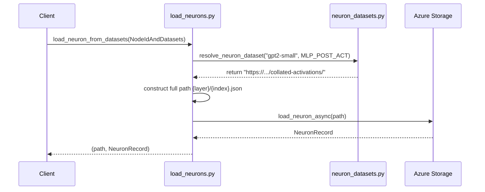

<!-- source: DeepWiki mcp.deepwiki.com · repo openai/transformer-debugger · page 4.3 Activation Datasets · fetched 2026-10-26 -->

# Activation Datasets

Relevant source files

The following files were used as context for generating this wiki page:

- [datasets.md](datasets.md)
- [neuron_explainer/activation_server/load_neurons.py](neuron_explainer/activation_server/load_neurons.py)
- [neuron_explainer/activation_server/neuron_datasets.py](neuron_explainer/activation_server/neuron_datasets.py)

## Purpose and Scope

This page documents the activation datasets available in the Transformer Debugger system, how they're structured, and how to access them. These datasets contain top-activating examples for MLP neurons, attention heads, and autoencoder latents, providing the foundation for visualization and automated interpretability [datasets.md:1-3](). This page covers the Azure Blob Storage paths, the registry system for dataset lookup, and the format of collated activations.

## Dataset Overview

The Transformer Debugger utilizes "collated activation datasets" which store a subset of highly activating sequences for various model components. These are primarily hosted on Azure Blob Storage and accessed via the `blobfile` library [datasets.md:5-6]().

Sources: [datasets.md:1-6](), [neuron_explainer/activation_server/neuron_datasets.py:1-24]()

## Neuron Dataset Registry

The system manages datasets through a centralized registry that maps a combination of a `short_name` and a `DerivedScalarType` (DST) to metadata [neuron_explainer/activation_server/neuron_datasets.py:24-37]().

### Neuron Dataset Metadata

Each dataset is described by the `NeuronDatasetMetadata` class:

- **short_name**: Identifier for the model/dataset group (e.g., "gpt2-small") [neuron_explainer/activation_server/neuron_datasets.py:11-12]().
- **derived_scalar_type**: The specific activation type stored (e.g., `mlp_post_act`, `attn_write_norm`) [neuron_explainer/activation_server/neuron_datasets.py:13-14]().
- **neuron_dataset_path**: The base URL on Azure Blob Storage where the `.json` or `.pt` files reside [neuron_explainer/activation_server/neuron_datasets.py:17-18]().

Sources: [neuron_explainer/activation_server/neuron_datasets.py:9-21]()

## Available Datasets and Storage Paths

### GPT-2 Small
GPT-2 small datasets include MLP neurons, attention heads, and multiple versions of autoencoder latents.

| Component | DST | Azure Path Template |
| :--- | :--- | :--- |
| **MLP Neurons** | `mlp_post_act` | `.../gpt2_small_data/collated-activations/{layer}/{neuron}.json` |
| **Attention Heads** | `attn_write_norm` | `.../gpt2_small/attn_write_norm/collated-activations-by-token-pair/{layer}/{head}.json` |
| **MLP Latents (v4)** | `mlp_autoencoder_latent` | `.../autoencoder_latent/mlp_post_act_v4/collated-activations/{layer}/{latent}.pt` |
| **Attn Latents (v4)** | `attention_autoencoder_latent` | `.../autoencoder_latent/resid_delta_attn_v4/collated-activations/{layer}/{latent}.pt` |

Sources: [datasets.md:12-42](), [neuron_explainer/activation_server/neuron_datasets.py:47-93]()

### GPT-2 XL
For GPT-2 XL, currently only MLP neuron activations are available [datasets.md:50-52]().

- **Path**: `https://openaipublic.blob.core.windows.net/neuron-explainer/data/collated-activations/{layer_index}/{neuron_index}.json` [datasets.md:53]()
- **Range**: Layer 0-47, Neuron 0-6399 [datasets.md:56-57]()

Sources: [datasets.md:50-58](), [neuron_explainer/activation_server/neuron_datasets.py:40-45]()

## Accessing and Loading Data

The `load_neurons.py` module provides the logic to resolve these paths and load data asynchronously.

### Resolution Logic
When a request comes in with a dataset string (e.g., "gpt2-small"), `resolve_neuron_dataset` looks up the full Azure path from the registry [neuron_explainer/activation_server/load_neurons.py:21-27]().

### Loading Strategy
The function `load_neuron_from_datasets` supports a fallback mechanism. It iterates through a list of datasets and returns the `NeuronRecord` from the first one that contains the requested neuron [neuron_explainer/activation_server/load_neurons.py:43-62](). This allows for "patchy" datasets that only cover specific neurons to be used alongside complete datasets.

Sources: [neuron_explainer/activation_server/load_neurons.py:21-69](), [neuron_explainer/activation_server/neuron_datasets.py:100-128]()

## Dataset Format and Attributions

### MLP vs. Attention Format
- **MLP Neurons**: Recorded per token [datasets.md:9]().
- **Attention Heads**: Recorded per token pair to capture the interaction between source and destination tokens [datasets.md:9]().
- **Attention Autoencoders**: Provide both per-token activations and per-token-pair *attributions* [datasets.md:37]().

### Attribution Calculation
For attention latents, attribution to a token pair $(T1, T2)$ is calculated by multiplying the attention pattern $A(T1, T2)$ with the gradient of the latent $L$ with respect to that pattern [datasets.md:37]():
$$attribution\_L(T1, T2) = A(T1, T2) \times \frac{\partial L}{\partial A(T1, T2)}$$

Sources: [datasets.md:35-42]()

---

