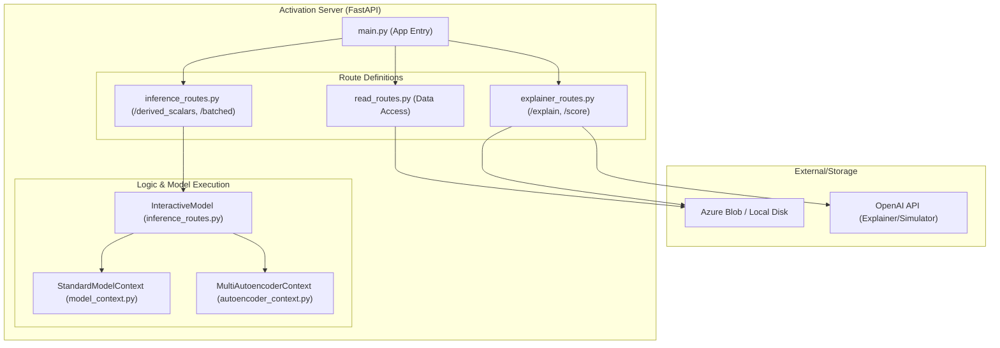
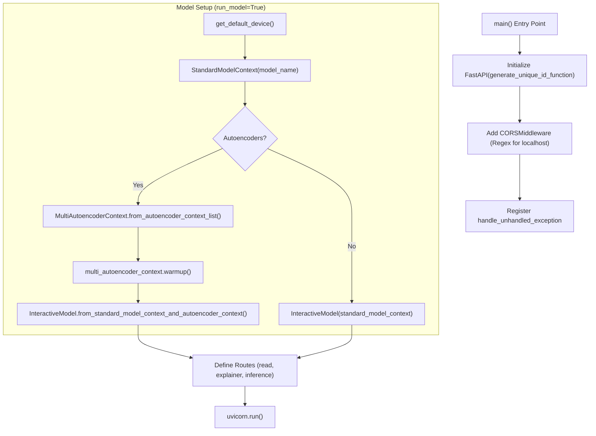

<!-- source: DeepWiki mcp.deepwiki.com · repo openai/transformer-debugger · page 5 Activation Server · fetched 2026-10-26 -->

# Activation Server

<details>
<summary>Relevant source files</summary>

The following files were used as context for generating this wiki page:

- [neuron_explainer/activation_server/README.md](neuron_explainer/activation_server/README.md)
- [neuron_explainer/activation_server/main.py](neuron_explainer/activation_server/main.py)

</details>


The Activation Server is a FastAPI-based web server that serves as the central backend component for the Transformer Debugger system. It provides API endpoints for accessing model activations, generating and scoring explanations for neurons and attention heads, and performing inference operations on transformer models [neuron_explainer/activation_server/README.md:1-7]().

For information about the specific model inference functionality, see [Interactive Model and Inference Routes](#5.1). For details about file storage and data access, see [File Utilities and Data Access](#5.2). For details on the auto-generated TypeScript clients, see [Client Integration](#5.3).

## Architecture Overview

The Activation Server connects the various subsystems of the Transformer Debugger, including the Model System, Activation Data System, and Neuron Explanation System, and exposes their functionality through a REST API.

### System Mapping: Code to Logic
This diagram bridges the high-level system concepts to the specific Python classes and files that implement them.


Sources: [neuron_explainer/activation_server/main.py:17-30](), [neuron_explainer/activation_server/README.md:64-69]().

## Server Initialization and Configuration

The server is initialized in `main.py`, which creates the `FastAPI` application [neuron_explainer/activation_server/main.py:49](), sets up `CORSMiddleware` [neuron_explainer/activation_server/main.py:53-59](), and registers routes for inference, reading, and explaining [neuron_explainer/activation_server/main.py:159-170]().

### Initialization Sequence
The following diagram describes how the server prepares its internal state, including model and autoencoder loading.


Sources: [neuron_explainer/activation_server/main.py:32-174]().

The server is typically started via CLI:
```sh
python neuron_explainer/activation_server/main.py --model_name gpt2-small --port 8000
```
Key parameters include `mlp_autoencoder_name` and `attn_autoencoder_name` to enable interpretability latents instead of raw neurons/heads [neuron_explainer/activation_server/README.md:17-24]().

## API Route Organization

The server's functionality is partitioned into specialized route groups:

### 1. Explainer Routes
Handled by `define_explainer_routes`, these endpoints manage the lifecycle of neuron explanations.
*   **`/explain`**: Generates natural language explanations using a `NeuronExplainer` [neuron_explainer/activation_server/explainer_routes.py:318-336]().
*   **`/score`**: Evaluates the quality of an explanation using a `NeuronSimulator` or `AttentionHeadOneAtATimeScorer` [neuron_explainer/activation_server/explainer_routes.py:436-490]().

### 2. Inference Routes
Handled by `define_inference_routes`, these provide real-time interaction with the model.
*   **`/derived_scalars`**: Computes activations (e.g., MLP act, Resid Post) for a given prompt [neuron_explainer/activation_server/inference_routes.py:33]().
*   **`/batched_tdb`**: A specialized endpoint for the Transformer Debugger UI to request multiple data types in one round-trip [neuron_explainer/activation_server/inference_routes.py:75]().

### 3. Read Routes
Handled by `define_read_routes`, these provide access to pre-computed datasets stored in Azure or local paths [neuron_explainer/activation_server/main.py:159]().

## Caching and Performance

The server implements a two-tier caching strategy for explanations:
1.  **Remote Cache**: Checked via `_check_disk_for_simulation_results`, typically pointing to Azure blob storage for pre-computed paper results [neuron_explainer/activation_server/explainer_routes.py:158-294]().
2.  **Local Cache**: New explanations generated during a session are stored locally to avoid redundant LLM API calls [neuron_explainer/activation_server/explainer_routes.py:255-265]().

## Error Handling and Debugging

*   **CORS**: Configured to allow `localhost` origins by default [neuron_explainer/activation_server/main.py:51-59]().
*   **CUDA Memory**: If `--cuda_memory_debugging` is enabled, the server records memory history and provides a `/dump_memory_snapshot` endpoint to export `.pkl` traces for the PyTorch memory visualizer [neuron_explainer/activation_server/README.md:70-87](), [neuron_explainer/activation_server/main.py:117-127]().
*   **OOM Protection**: The server explicitly catches `torch.cuda.OutOfMemoryError` and kills its own process with `SIGKILL` to prevent hanging in an inconsistent state [neuron_explainer/activation_server/main.py:89-92]().

## Child Pages
- [Interactive Model and Inference Routes](#5.1) — Details on `InteractiveModel` and the forward/backward pass pipeline.
- [File Utilities and Data Access](#5.2) — Details on `CustomFileHandler` and async reading.
- [Client Integration](#5.3) — Details on generating TypeScript clients and the `neuron_viewer/src/client` structure.

Sources: [neuron_explainer/activation_server/main.py:1-181](), [neuron_explainer/activation_server/README.md:1-98]().

---

