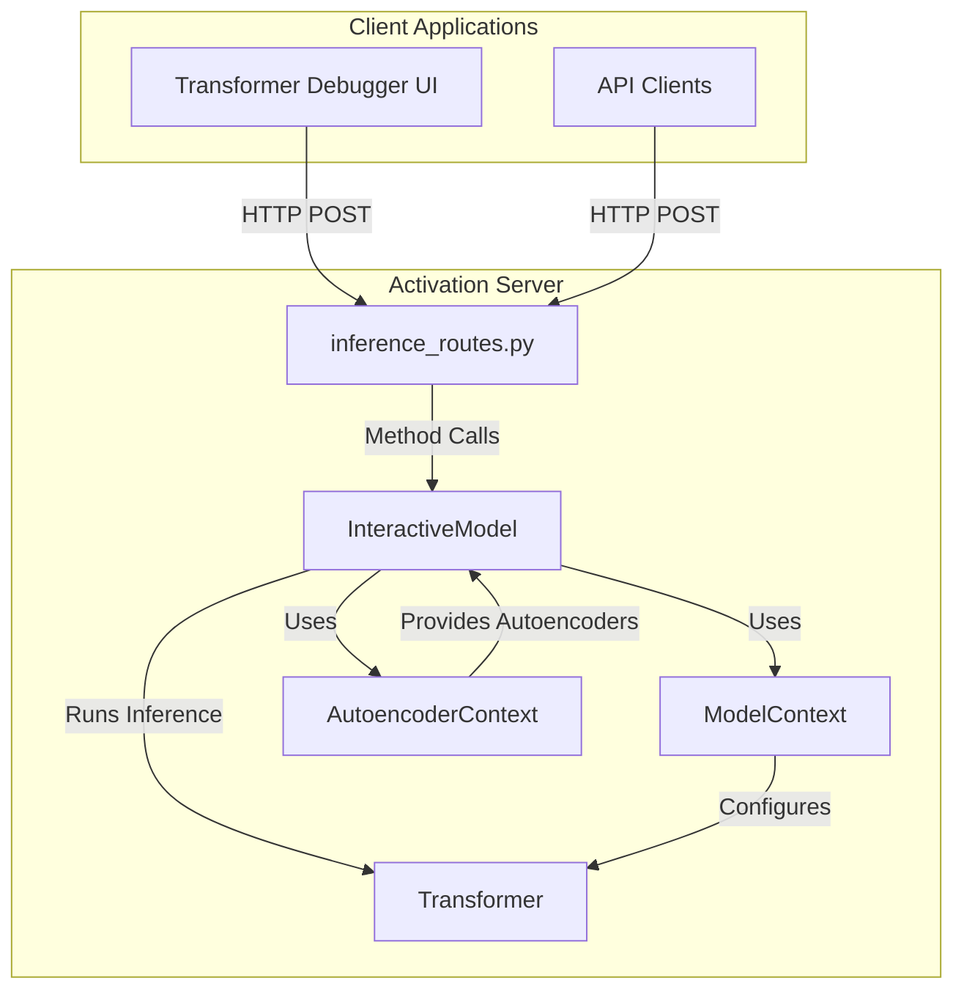
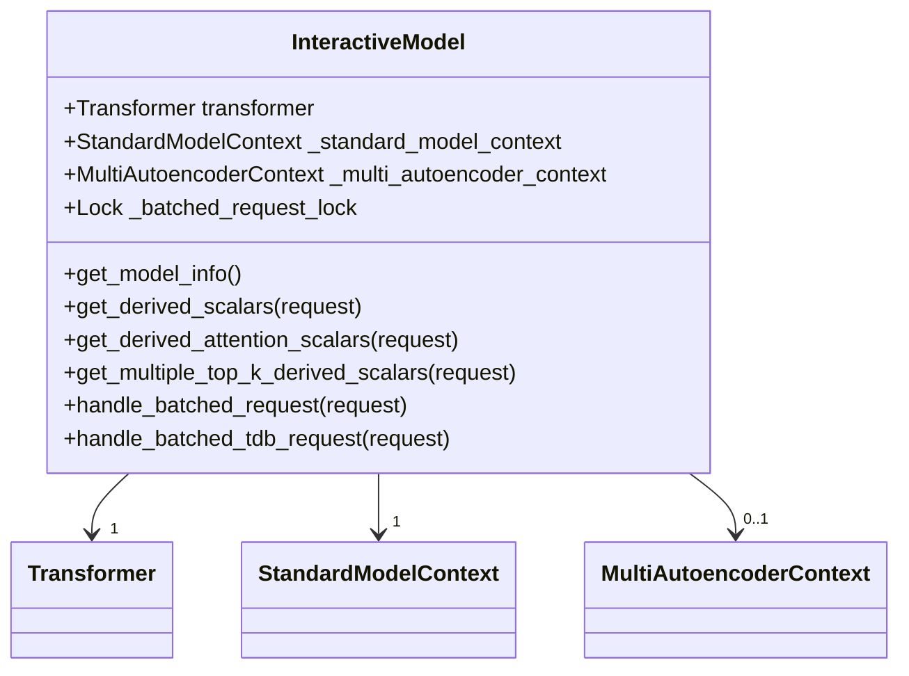
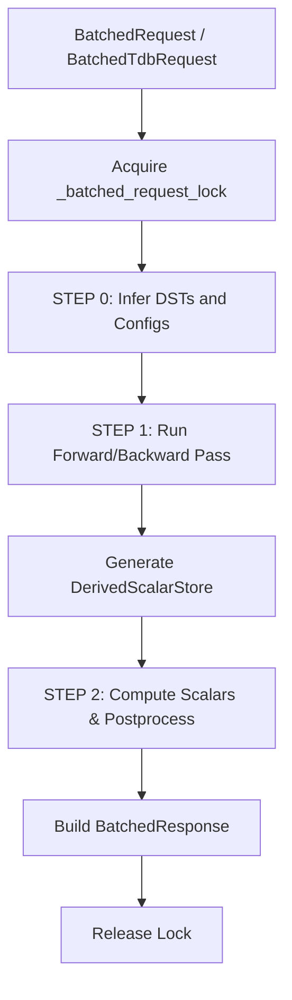

<!-- source: DeepWiki mcp.deepwiki.com · repo openai/transformer-debugger · page 5.1 Interactive Model and Inference Routes · fetched 2026-10-26 -->

# Interactive Model and Inference Routes

Relevant source files

The following files were used as context for generating this wiki page:

- [neuron_explainer/activation_server/inference_routes.py](neuron_explainer/activation_server/inference_routes.py)
- [neuron_explainer/activation_server/interactive_model.py](neuron_explainer/activation_server/interactive_model.py)
- [neuron_explainer/activation_server/requests_and_responses.py](neuron_explainer/activation_server/requests_and_responses.py)

This document explains the core components that enable real-time inference on transformer models and provide API endpoints for retrieving activation data. The Interactive Model and Inference Routes form the bridge between client applications (such as the Transformer Debugger UI) and the underlying transformer model, allowing users to run inference and examine model internals through a structured API.

## Architecture Overview

The Interactive Model and Inference Routes system consists of two main components:

1.  **`InteractiveModel`**: A class that manages the transformer model and processes inference requests [neuron_explainer/activation_server/interactive_model.py:213-213]().
2.  **Inference Routes**: FastAPI endpoints that expose the `InteractiveModel` functionality to clients [neuron_explainer/activation_server/inference_routes.py:20-81]().

Sources:
- [neuron_explainer/activation_server/interactive_model.py:213-213]()
- [neuron_explainer/activation_server/inference_routes.py:20-81]()

## Interactive Model

The `InteractiveModel` class handles real-time inference requests. These requests consist of two parts:
- **`InferenceRequestSpec`**: Contains info for computing forward/backward passes (prompt, loss function, ablation info) [neuron_explainer/activation_server/interactive_model.py:6-7]().
- **`XRequestSpec`**: Contains info for computing a derived scalar of type X (DST, layer index, etc.) [neuron_explainer/activation_server/interactive_model.py:8-10]().

Sources:
- [neuron_explainer/activation_server/interactive_model.py:5-17]()
- [neuron_explainer/activation_server/interactive_model.py:213-282]()

### Initialization
The `InteractiveModel` is initialized with a `Transformer` model, a `StandardModelContext`, and optionally a `MultiAutoencoderContext` [neuron_explainer/activation_server/interactive_model.py:213-226](). It uses an asynchronous lock `_batched_request_lock` to ensure only one batched request is processed at a time, preventing memory exhaustion [neuron_explainer/activation_server/interactive_model.py:226-226]().

## Inference Routes

Defined in `inference_routes.py`, these endpoints wrap `InteractiveModel` methods.

| Endpoint | InteractiveModel Method | Request Type | Response Type |
| :--- | :--- | :--- | :--- |
| `/derived_scalars` | `get_derived_scalars` | `DerivedScalarsRequest` | `DerivedScalarsResponse` |
| `/derived_attention_scalars` | `get_derived_attention_scalars` | `DerivedAttentionScalarsRequest` | `DerivedAttentionScalarsResponse` |
| `/multiple_top_k_derived_scalars` | `get_multiple_top_k_derived_scalars` | `MultipleTopKDerivedScalarsRequest` | `MultipleTopKDerivedScalarsResponse` |
| `/batched` | `handle_batched_request` | `BatchedRequest` | `BatchedResponse` |
| `/batched_tdb` | `handle_batched_tdb_request` | `BatchedTdbRequest` | `BatchedResponse` |
| `/model_info` | `get_model_info` | N/A | `ModelInfoResponse` |

Sources:
- [neuron_explainer/activation_server/inference_routes.py:33-81]()

## Request Processing Flow

The system uses `CombinedRequestSpec` to group `InferenceRequestSpec` with multiple `XRequestSpec` objects [neuron_explainer/activation_server/interactive_model.py:13-17]().

### Derived Scalar Computation
The core computation happens in `compute_derived_scalar_groups_for_input_token_ints`, which takes `DerivedScalarComputationParams` [neuron_explainer/activation_server/interactive_model.py:27-34](). This includes:
- Constructing loss functions for backward passes using `maybe_construct_loss_fn_for_backward_pass` [neuron_explainer/activation_server/interactive_model.py:33-34]().
- Using `MultiGroupScalarDerivers` to calculate activations across different layers and node types [neuron_explainer/activations/derived_scalars/multi_group.py:59-59]().

Sources:
- [neuron_explainer/activation_server/interactive_model.py:1-17]()
- [neuron_explainer/activation_server/interactive_model.py:944-1149]()

## Request and Response Types

The `requests_and_responses.py` file defines the Pydantic models used for communication.

### InferenceRequestSpec
The minimum specification for a model pass:
- `prompt`: The input text [neuron_explainer/activation_server/requests_and_responses.py:84-84]().
- `ablation_specs`: Optional list of nodes to ablate [neuron_explainer/activation_server/requests_and_responses.py:85-85]().
- `loss_fn_config`: Configuration for the backward pass (e.g., `logit_diff`, `probs`) [neuron_explainer/activation_server/requests_and_responses.py:67-78]().
- `trace_config`: Configuration for tracing gradients from internal points [neuron_explainer/activation_server/requests_and_responses.py:89-89]().

### Top-K Data
For requests that search for the most relevant nodes, the server returns `TopKData`, which includes:
- `activations`: Scalar values [neuron_explainer/activation_server/interactive_model.py:99-99]().
- `node_indices`: `MirroredNodeIndex` objects identifying the nodes [neuron_explainer/activation_server/interactive_model.py:100-100]().
- `vocab_token_strings_for_indices`: Token strings if the node type is `VOCAB_TOKEN` [neuron_explainer/activation_server/interactive_model.py:101-101]().

Sources:
- [neuron_explainer/activation_server/requests_and_responses.py:81-93]()
- [neuron_explainer/activation_server/interactive_model.py:96-104]()

## TDB Integration

The `/batched_tdb` endpoint is specifically designed for the Transformer Debugger UI. It uses `convert_tdb_request_spec_to_inference_sub_request` to translate UI-specific `TdbRequestSpec` objects into standard `InferenceSubRequest` and `ProcessingRequestSpec` objects [neuron_explainer/activation_server/interactive_model.py:46-48]().

This translation allows the UI to remain decoupled from the internal complexity of the inference pipeline while still providing fine-grained control over ablations and gradient tracing.

Sources:
- [neuron_explainer/activation_server/interactive_model.py:930-942]()
- [neuron_explainer/activation_server/tdb_conversions.py:47-48]()

---

