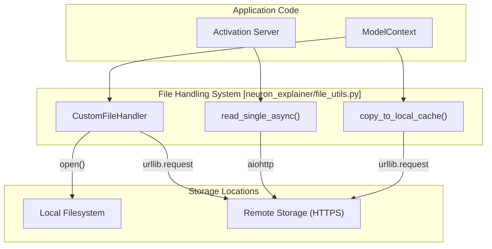
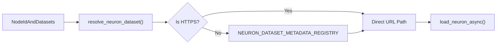

<!-- source: DeepWiki mcp.deepwiki.com · repo openai/transformer-debugger · page 5.2 File Utilities and Data Access · fetched 2026-10-26 -->

# File Utilities and Data Access

Relevant source files

The following files were used as context for generating this wiki page:

- [neuron_explainer/activation_server/load_neurons.py](neuron_explainer/activation_server/load_neurons.py)
- [neuron_explainer/file_utils.py](neuron_explainer/file_utils.py)

This document explains how the Transformer Debugger handles file operations and data access across local and remote storage systems. It covers the utilities for working with files, the dataset resolution logic, and the mechanisms for caching and accessing data efficiently.

The file utilities and data access components provide a unified interface for working with both local files and remote resources (such as Azure Blob Storage via HTTPS), enabling seamless access to model weights, activations, and explanations.

## File Handling Architecture

The Transformer Debugger implements a flexible file handling system that transparently works with local files and remote resources.

### System Data Flow

Sources: [neuron_explainer/file_utils.py:1-81]()

### CustomFileHandler

The `CustomFileHandler` class [neuron_explainer/file_utils.py:21-58]() serves as a context manager for file operations, providing a consistent interface for both local and remote files. It is particularly important for loading model weights and autoencoder state dicts.

**Key features:**
- **Remote Access**: Uses `urllib.request.urlopen` to fetch data from HTTPS URLs [neuron_explainer/file_utils.py:29-31]().
- **Automatic Directory Creation**: For local writes, it creates subdirectories if they do not exist [neuron_explainer/file_utils.py:39-41]().
- **Seekability Handling**: For binary modes, it ensures the file object is seekable (required by `torch.load`) by reading non-seekable streams into a `io.BytesIO` buffer [neuron_explainer/file_utils.py:43-50]().
- **Mode Support**: Supports both text and binary modes (`r`, `rb`, `w`, `wb`).

### Async Read Utilities

For high-performance activation loading, the system provides `read_single_async` [neuron_explainer/file_utils.py:61-68](). This function uses `aiohttp` to perform non-blocking reads from remote storage, which is critical for the FastAPI server's responsiveness when fetching `NeuronRecord` data.

Sources: [neuron_explainer/file_utils.py:21-58](), [neuron_explainer/file_utils.py:61-68]()

## Dataset Resolution and Neuron Loading

The system uses a resolution layer to map human-readable dataset names (e.g., "gpt2-small") to specific file paths.

### Dataset Mapping

The `resolve_neuron_dataset` function [neuron_explainer/activation_server/load_neurons.py:21-27]() determines if a string is already a URL or if it needs to be looked up in the `NEURON_DATASET_METADATA_REGISTRY`.

### Loading Neurons from Multiple Datasets

The `load_neuron_from_datasets` function [neuron_explainer/activation_server/load_neurons.py:43-68]() implements a fallback strategy. It accepts a `NodeIdAndDatasets` object containing a list of potential datasets. It attempts to load the `NeuronRecord` from each dataset in order, returning the first one that successfully resolves. This allows the system to try specialized datasets (e.g., small subsets) before falling back to large, comprehensive ones.

Sources: [neuron_explainer/activation_server/load_neurons.py:21-68](), [neuron_explainer/activation_server/neuron_datasets.py:4-6]()

## Caching and Weights Management

To avoid repeated expensive downloads of large model files, the system employs a `/tmp` caching pattern.

### Local Cache Management

The `copy_to_local_cache` utility [neuron_explainer/file_utils.py:71-81]() is used to move remote assets to a local disk. This is frequently used during model initialization:
1. The system checks if a weight file exists locally.
2. If not, it downloads the file from the remote source to a local cache directory.
3. Subsequent loads use the local copy.

### Read Routes API

The `read_routes.py` (referenced in the purpose) provides the server-side endpoints for these operations.

| Endpoint | Logic |
|----------|-------|
| `/get_neuron_dataset_metadata` | Returns metadata from `NEURON_DATASET_METADATA_REGISTRY`. |
| `/get_neuron_record` | Uses `load_neuron_from_datasets` to fetch activation data for a specific node. |

Sources: [neuron_explainer/file_utils.py:71-81](), [neuron_explainer/activation_server/load_neurons.py:43-68]()

## Data Access Summary

| Component | Code Entity | Storage Support |
|-----------|-------------|-----------------|
| **File Context** | `CustomFileHandler` | Local, HTTPS |
| **Async Fetch** | `read_single_async` | Local, HTTPS (via aiohttp) |
| **Dataset Registry** | `NEURON_DATASET_METADATA_REGISTRY` | Metadata mapping |
| **Neuron Loader** | `load_neuron_async` | Binary `NeuronRecord` files |
| **Cache Utility** | `copy_to_local_cache` | Source to Local Disk |

Sources: [neuron_explainer/file_utils.py:21-81](), [neuron_explainer/activation_server/load_neurons.py:43-68]()

---

