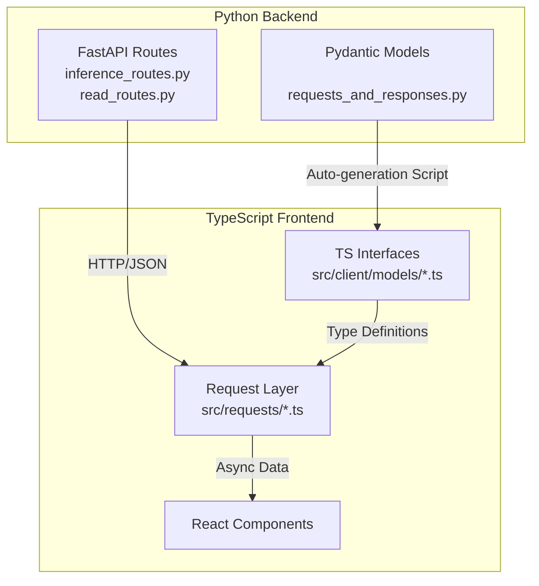
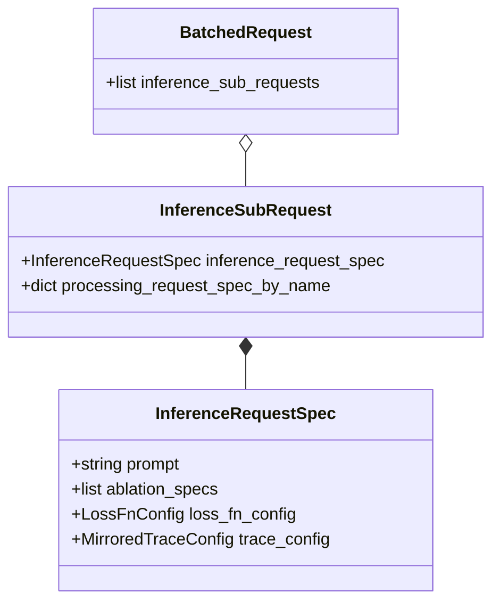
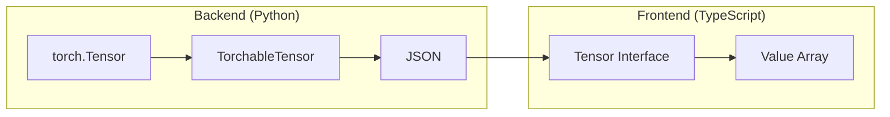

<!-- source: DeepWiki mcp.deepwiki.com · repo openai/transformer-debugger · page 5.3 Client Integration · fetched 2026-10-26 -->

# Client Integration

Relevant source files

The following files were used as context for generating this wiki page:

- [neuron_explainer/activation_server/requests_and_responses.py](neuron_explainer/activation_server/requests_and_responses.py)
- [neuron_viewer/src/client/models/ModelInfoResponse.ts](neuron_viewer/src/client/models/ModelInfoResponse.ts)

This page provides a technical guide for integrating client applications with the Activation Server. It covers the auto-generated TypeScript client libraries, the request/response architecture, and the network layers used by the Neuron Viewer frontend to communicate with the FastAPI backend.

## 1. Client-Server Communication Architecture

The integration between the React-based Neuron Viewer and the Python Activation Server is built on a contract-first approach. The backend defines Pydantic models which are then used to generate TypeScript interfaces, ensuring type safety across the network boundary.

### Data Flow and Layering
The client-side communication is organized into three distinct layers:
1.  **Model Layer**: Auto-generated TypeScript interfaces in `neuron_viewer/src/client/models` that mirror Python dataclasses.
2.  **Request Layer**: Hand-written wrapper functions in `neuron_viewer/src/requests` that encapsulate `fetch` calls, URL construction, and error handling.
3.  **UI/Consumer Layer**: React components (e.g., `TransformerDebugger.tsx`) that use the request layer to populate state.

Sources: [neuron_explainer/activation_server/requests_and_responses.py:1-20](), [neuron_viewer/src/client/models/ModelInfoResponse.ts:1-11]()

## 2. Auto-generated Client Libraries

The repository uses a generation pipeline to keep frontend types in sync with the backend. These files are located in `neuron_viewer/src/client/models` and should not be edited manually.

### Regeneration Process
When changes are made to the Pydantic models in `neuron_explainer/activation_server/requests_and_responses.py`, the TypeScript models must be regenerated.
- **Command**: See instructions in `neuron_explainer/activation_server/README.md`.
- **Target**: Files like `ModelInfoResponse.ts` are updated to reflect changes in the backend `CamelCaseBaseModel`.

### Example: ModelInfoResponse
The `ModelInfoResponse` interface provides the frontend with the structural configuration of the loaded model, such as the number of layers and available autoencoders.

| Field | Type | Description |
| :--- | :--- | :--- |
| `modelName` | `string` (optional) | The identifier of the loaded transformer. |
| `nLayers` | `number` | Total number of layers in the model. |
| `hasMlpAutoencoder` | `boolean` | Indicates if an MLP autoencoder is available for this model. |

Sources: [neuron_viewer/src/client/models/ModelInfoResponse.ts:1-19]()

## 3. Request and Response Structures

The core of the integration lies in the `InferenceRequestSpec` and its derivatives, which define how the model should be run and how activations should be processed.

### Inference and Processing Specification
Requests to the `InteractiveModel` are split into two logical parts:
1.  **InferenceRequestSpec**: Specifies the forward/backward pass (prompt, ablations, loss functions).
2.  **ProcessingRequestSpec**: Specifies how to transform raw activations into `DerivedScalarType` values for the UI.

Sources: [neuron_explainer/activation_server/requests_and_responses.py:5-20](), [neuron_explainer/activation_server/requests_and_responses.py:81-93](), [neuron_explainer/activation_server/requests_and_responses.py:592-602]()

### Specialized Request Types
The system uses a `SpecType` enum to route processing logic.

| SpecType | Purpose |
| :--- | :--- |
| `TDB_REQUEST_SPEC` | Used by the Transformer Debugger UI to request a standard set of activations. |
| `DERIVED_SCALARS_REQUEST_SPEC` | Requests specific scalar values (e.g., MLP activations) for a node. |
| `TOKEN_PAIR_ATTRIBUTION_REQUEST_SPEC` | Used for attention head analysis between specific token pairs. |

Sources: [neuron_explainer/activation_server/requests_and_responses.py:49-56]()

## 4. Tensor Serialization

Since JSON does not natively support multi-dimensional arrays with high performance, the system uses a `TorchableTensor` wrapper. This allows the backend to send tensors of various dimensions (0D to 3D) in a format the frontend can easily parse and the backend can convert back to `torch.Tensor`.

Sources: [neuron_explainer/activation_server/requests_and_responses.py:163-195]()

## 5. The Requests Layer (`neuron_viewer/src/requests`)

While the `client/models` directory contains the types, the `neuron_viewer/src/requests` directory (referenced in the system overview) contains the logic for interacting with specific API groups.

### Key Integration Points

1.  **Inference Requests**:
    - These calls target `inference_routes.py`.
    - They typically send a `BatchedRequest` and receive a `BatchedResponse`.
    - The `BatchedResponse` contains an `InferenceAndTokenData` object which includes the tokenized version of the prompt (`tokens_as_strings`).

2.  **Data Access (Read) Requests**:
    - Target `read_routes.py`.
    - Used to fetch pre-computed activations or token-level metadata like `TokenAndAttentionScalars`.

3.  **Explanation Requests**:
    - Target `explainer_routes.py`.
    - Used to request new LLM-generated explanations for specific nodes identified by `NodeIdAndDatasets`.

### Error Handling and Validation
The client-side request layer is responsible for:
- Handling 422 Unprocessable Entity errors when a `DerivedScalarType` is requested that the model doesn't support.
- Managing the `CamelCase` conversion; while Python uses `snake_case`, the generated TS models and the FastAPI configuration allow the frontend to use `camelCase` exclusively.

Sources: [neuron_explainer/activation_server/requests_and_responses.py:109-117](), [neuron_explainer/activation_server/requests_and_responses.py:41-42](), [neuron_viewer/src/client/models/ModelInfoResponse.ts:7-11]()

---

