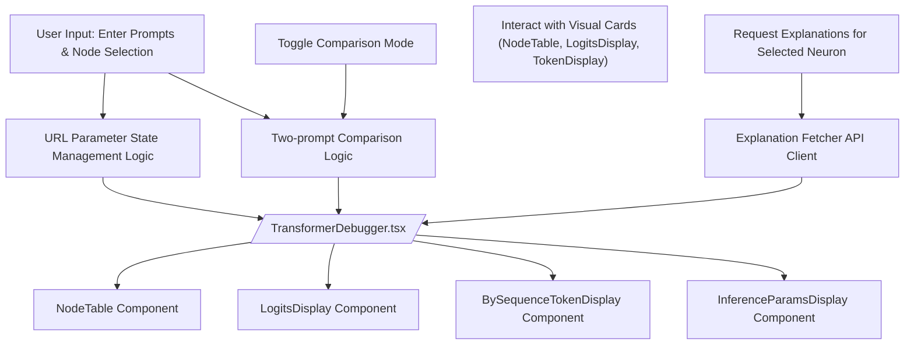
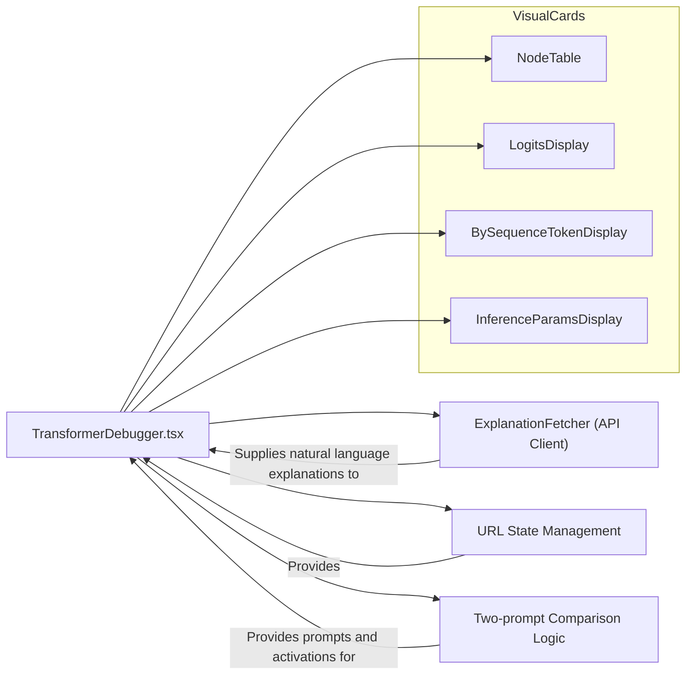

<!-- source: DeepWiki mcp.deepwiki.com · repo openai/transformer-debugger · page 6.1 Transformer Debugger UI · fetched 2026-10-26 -->

# 6.1 Transformer Debugger UI

Relevant source files

The following files were used as context for generating this wiki page:

- [neuron_viewer/src/client/models/ModelInfoResponse.ts](neuron_viewer/src/client/models/ModelInfoResponse.ts)
- [neuron_viewer/src/welcome.tsx](neuron_viewer/src/welcome.tsx)

The Transformer Debugger UI is the core interactive interface within the neuron_viewer frontend designed for detailed exploration and debugging of transformer models. This UI supports analyzing activations and neuron behaviors by displaying rich, interpretable visualizations, comparison modes, and fetching explanations to help users understand model internals.

This page documents the internal implementation and data flow of the Transformer Debugger interface, focusing on the top-level React component `TransformerDebugger.tsx` and its key UI building blocks. It also explains the URL-driven state management, two-prompt comparison feature, card-based layout, and integration with the explanation fetcher system that dynamically loads neuron explanations from the backend.

---

## Overview of TransformerDebugger.tsx Component

The Transformer Debugger interface is architected around a top-level React functional component `TransformerDebugger.tsx`. This component orchestrates the UI, manages stateful logic including URL parameters, handles comparison modes, and renders primary content cards that visualize model internics.

- **Component Role:** Acts as the parent container and the entry point for the transformer debugger view.
- **State Management:** URL query parameters encode essential UI state such as prompts, selected nodes, filters, and comparison toggles. The component derives internal state on initial render and synchronizes user interactions with URL changes to enable sharable debug sessions.
- **Two-Prompt Comparison Mode:** Supports displaying side-by-side activations and model responses for two different input prompts, enabling users to visually compare neuron activation patterns and logits.
- **Explanation Fetcher Integration:** Connects to the backend explanation API to asynchronously load human-readable explanations describing neuron or node behavior in the transformer model.

By centralizing these concerns, `TransformerDebugger.tsx` provides a modular, extensible debug interface that can incorporate multiple sub-components and data visualizations.

---

## Card-based Layout and Primary Visualization Components

The UI is composed of multiple interactive “cards,” each focusing on a distinct aspect of the transformer model debug session:

1. **NodeTable**
    - Displays a list or table of neurons or nodes sorted by selected criteria.
    - Allows filtering and inspection of activation statistics.
2. **LogitsDisplay**
    - Shows the model's predicted logits or token probabilities for the prompt, reflecting how activations influence output distribution.
3. **BySequenceTokenDisplay**
    - Visualizes token-wise activations or metrics, providing a heatmap or token-by-token activation overview.
4. **InferenceParamsDisplay**
    - Summarizes the current inference parameters such as selected input prompt, model configuration, and node selections.

Each card is designed as a reusable React component with clearly defined props and state integration managed by the top-level component. This modularity enables easy extension or replacement of individual visualization cards without disrupting the main debugger flow.

---

## URL Parameter State Management

The Transformer Debugger UI uses URL query parameters extensively to encode and restore its state. This design offers:

- **Deep Linking:** Users can share URLs with specific configurations including selected nodes, prompts, and comparison mode.
- **State Persistence:** On page reload, the component parses URL parameters to restore the previous view.
- **Synced UI State:** Any user interaction updates the URL parameters so changes can be bookmarked or revisited.

Typical URL parameters include:

- `prompt` (for main input prompt)
- `prompt2` (for second prompt in comparison mode)
- Node and layer selections identifying the neuron or component under inspection
- Filters or configuration options relevant to activation display

This ensures that the entire debug session state is captured externally in the URL rather than internal React state alone.

---

## Two-Prompt Comparison Mode

A central feature of the Transformer Debugger UI is its two-prompt comparison mode. This mode allows users to:

- Provide two distinct input sequences (`prompt` and `prompt2`).
- Observe side-by-side activations for each prompt on identical neurons or nodes.
- Compare logits, activations, or explanation differences visually.

This is particularly useful for understanding how changes in input affect neuron responses and output predictions, aiding causal and interpretability analyses.

The comparison mode logic is encapsulated within the `TransformerDebugger.tsx` component, which manages fetching and rendering activations and logits for both prompts independently while synchronizing UI controls between them.

---

## Explanation Fetcher Integration

To enhance interpretability, the Transformer Debugger UI integrates an explanation fetcher subsystem that asynchronously retrieves neuron explanations from the backend API.

- The explanations describe neuron functionality or behavior in natural language.
- Explanations are displayed within dedicated cards or panels linked to the currently selected neuron or node.
- This integration leverages a client API module for backend communication and caches explanation data for responsiveness.

This automatic explanation retrieval allows users to seamlessly transition between quantitative activation data and qualitative textual interpretations without leaving the debug interface.

---

## Mermaid Diagram: System Overview Bridging Natural Language to Code Entities

*Description:* This diagram shows how user interactions in natural language map onto code entities within the `TransformerDebugger.tsx` component. The URL parameter management and two-prompt comparison logic feed state to the main component, which renders several card components and interfaces with the explanation fetcher.

---

## Mermaid Diagram: UI Component Layout and Data Flow

*Description:* Internal composition of the Transformer Debugger UI showing `TransformerDebugger.tsx` as the container managing URL state, two-prompt logic, visualization cards, and the explanation fetcher.

---

## Summary

- The **TransformerDebugger.tsx** component is the top-level React container managing the Transformer Debugger UI, integrating URL-driven state, two-prompt comparison, and explanation fetching.
- The UI is organized into multiple **visual card components** (NodeTable, LogitsDisplay, BySequenceTokenDisplay, InferenceParamsDisplay) each responsible for showing aspects of neuron activations and inference.
- **URL parameters drive state management** allowing persistent, shareable debug sessions.
- **Two-prompt comparison mode** enables side-by-side analysis of activations and logits for two input prompts.
- The **explanation fetcher** connects to the backend to provide human-readable neuron behavior descriptions, integrated seamlessly in the UI.

These design and implementation details support a powerful, extensible debugging tool for transformer model interpretability and neuron analysis within the neuron_viewer frontend.

---

## Sources

- neuron_viewer/src/welcome.tsx: Entire file for UI linking and URL management concepts [neuron_viewer/src/welcome.tsx:1-125]()
- neuron_viewer/src/client/models/ModelInfoResponse.ts: Model info data shapes related to debugger URL generation [neuron_viewer/src/client/models/ModelInfoResponse.ts:1-20]()

---

