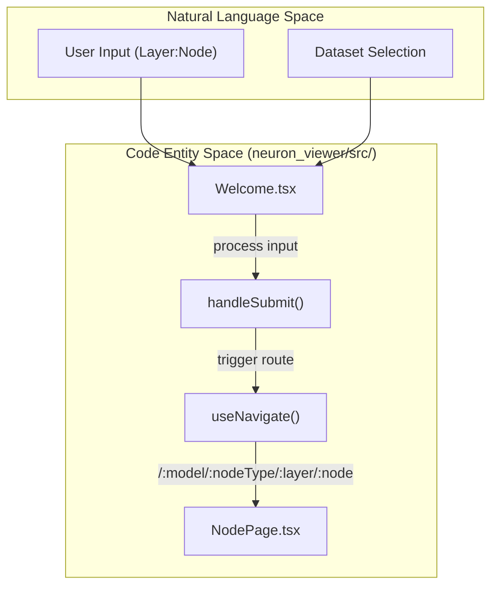
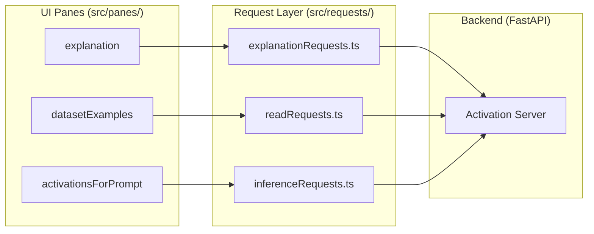

<!-- source: DeepWiki mcp.deepwiki.com · repo openai/transformer-debugger · page 6.2 Neuron Viewer Pages and Panes · fetched 2026-10-26 -->

# Neuron Viewer Pages and Panes

Relevant source files

The following files were used as context for generating this wiki page:

- [neuron_viewer/README.md](neuron_viewer/README.md)
- [neuron_viewer/src/welcome.tsx](neuron_viewer/src/welcome.tsx)

The Neuron Viewer is a React-based interface designed to visualize and analyze individual components of a transformer model, such as MLP neurons, attention heads, and autoencoder latents. While the Transformer Debugger provides a holistic view of model behavior, the **NodePage** and its associated **Panes** focus on deep-dives into specific nodes [neuron_viewer/README.md:3-4]().

## URL Routing and Navigation

The Neuron Viewer uses a structured URL pattern to identify specific model components. The `Welcome` component facilitates navigation by fetching dataset metadata and allowing users to input specific indices [neuron_viewer/src/welcome.tsx:8-12]().

### Routing Pattern
The standard routing pattern for a node deep-dive is:
`/:model/:nodeTypeStr/:layerIndex/:nodeIndex`

*   **model**: The short name of the model (e.g., `gpt2-small`).
*   **nodeTypeStr**: The type of node, derived from the `DerivedScalarType` (e.g., `mlp_post_act`, `autoencoder_latent`) [neuron_viewer/src/welcome.tsx:63-65]().
*   **layerIndex**: The integer index of the model layer.
*   **nodeIndex**: The integer index of the specific neuron or latent within that layer.

### Code-to-Entity Mapping: Routing
The following diagram illustrates how the frontend routes requests to specific node visualizations based on user input.

**Neuron Viewer Routing Flow**

Sources: [neuron_viewer/src/welcome.tsx:54-61](), [neuron_viewer/src/welcome.tsx:63-65]()

## NodePage Architecture

The `NodePage` component serves as the primary container for individual node analysis. It orchestrates data fetching from the Activation Server and distributes that data to various "Panes"—reusable UI components that visualize different aspects of the node's behavior.

### Data Flow
1.  **Initialization**: The page extracts parameters from the URL.
2.  **Requests**: It uses functions in `src/requests/` to communicate with the FastAPI backend [neuron_viewer/README.md:44]().
3.  **State Management**: Data is stored in React state and passed down as props to specific panes.

## Reusable Pane Components

Panes are modular UI elements located in `src/panes/` [neuron_viewer/README.md:43](). They are designed to be composable, allowing the `NodePage` to display different information depending on the node type.

| Pane Component | Description | Data Source |
| :--- | :--- | :--- |
| `activationsForPrompt` | Visualizes how a specific node fires across a user-provided prompt. | Inference Routes |
| `datasetExamples` | Shows top-activating examples from a pre-computed dataset (e.g., Neuroscope-style). | Read Routes |
| `explanation` | Displays the natural language explanation generated by the explainer system. | Explanation Routes |
| `scoreExplanation` | Shows the simulation score and ROC AUC for a given explanation. | Scoring Routes |
| `logitLens` | Visualizes the direct contribution of the node to the output vocabulary (Logit Lens). | Inference Routes |

Sources: [neuron_viewer/README.md:42-46]()

## Visualization Grids

The Neuron Viewer utilizes specialized grid components to render activation intensities across tokens.

### HeatmapGrid
Used for **scalar-per-token** activations. This is the standard view for MLP neurons or autoencoder latents where each token in a sequence has a single activation value.
*   **Implementation**: Maps a 1D array of scalars to a sequence of colored token boxes.
*   **Usage**: Found in `datasetExamples` and `activationsForPrompt`.

### HeatmapGrid2d
Used for **token-pair** activations. This is primarily used for attention head visualizations where activations exist between "to" and "from" token pairs.
*   **Implementation**: Renders a 2D matrix where the X and Y axes represent the sequence tokens.
*   **Usage**: Visualizing attention patterns or head-specific behaviors.

## Integration with Activation Server

The panes rely on the auto-generated client in `src/client/` to ensure type safety when communicating with the backend [neuron_viewer/README.md:42]().

**Pane Data Acquisition Flow**

Sources: [neuron_viewer/README.md:42-46](), [neuron_viewer/src/welcome.tsx:5-6]()

---

