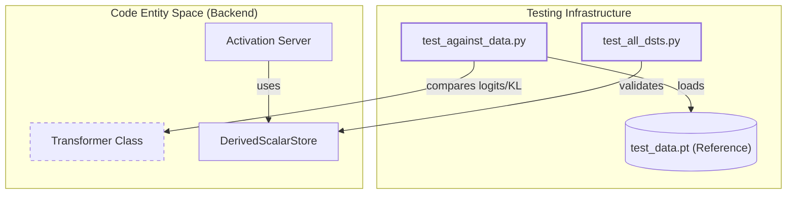
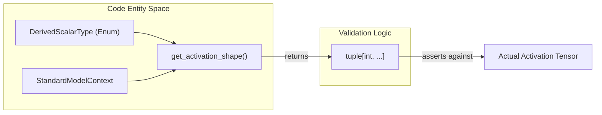

<!-- source: DeepWiki mcp.deepwiki.com · repo openai/transformer-debugger · page 7 Testing Infrastructure · fetched 2026-10-26 -->

# Testing Infrastructure

Relevant source files

The following files were used as context for generating this wiki page:

- [neuron_explainer/activations/derived_scalars/tests/utils.py](neuron_explainer/activations/derived_scalars/tests/utils.py)
- [neuron_explainer/tests/test_against_data.py](neuron_explainer/tests/test_against_data.py)
- [neuron_explainer/tests/test_all_dsts.py](neuron_explainer/tests/test_all_dsts.py)

The **Transformer Debugger** codebase employs a multi-layered testing strategy to ensure the correctness of transformer implementations, the accuracy of derived scalar computations, and the integrity of the frontend user interface. The infrastructure spans Python-based backend tests using `pytest`, TypeScript type checking for the frontend, and specialized data generation scripts for regression testing.

## Backend Testing Overview

The backend testing suite is built on `pytest` and focuses on verifying the `neuron_explainer` Python package. It includes unit tests for individual components and complex integration tests that compare model outputs against reference data.

Key testing areas include:
*   **Model Correctness**: Validating that the internal `Transformer` implementation matches reference outputs from standard libraries (e.g., Hugging Face).
*   **Derived Scalar Type (DST) Verification**: Ensuring that the complex mathematical derivations for activations and gradients are consistent across different model components.
*   **Regression Testing**: Using stored `.pt` files to ensure changes to the codebase do not break existing functionality.

For detailed information on Python test suites and fixtures, see [Backend Tests](#7.1).

### Test Data Generation
The repository includes scripts to generate ground-truth data from external models. For example, `create_hf_test_data.py` is used to pull activations and logits from Hugging Face models to create the reference files used in `test_against_data.py` [neuron_explainer/tests/test_against_data.py:43-48]().

## Frontend and Code Quality

The frontend testing infrastructure relies primarily on static analysis and type safety. The React-based Neuron Viewer uses TypeScript to catch errors at compile-time, ensuring that the complex data structures returned by the Activation Server (like `DerivedScalarStore`) are handled correctly.

Code quality is enforced via a robust set of pre-commit hooks and linting tools:
*   **Linting & Formatting**: `ruff`, `black`, and `isort` maintain a consistent Python style.
*   **Type Checking**: `mypy` provides static type analysis for the Python backend, while `npm` scripts handle TypeScript checks for the frontend.

For details on linting configurations and pre-commit setup, see [Code Quality and Formatting](#7.2).

## Core Testing Components

The following diagram illustrates how the testing infrastructure interacts with the core system entities to validate the "Natural Language Space" (prompts/explanations) against the "Code Entity Space" (tensors/models).

### System Validation Flow
This diagram shows how `test_against_data.py` and `test_all_dsts.py` bridge the gap between model definitions and expected numerical outputs.

**Sources:** [neuron_explainer/tests/test_against_data.py:10-18](), [neuron_explainer/tests/test_all_dsts.py:39-43]()

### Derived Scalar Validation Mapping
The system uses specific utilities to ensure that the shapes and values of activations generated by the code match the theoretical dimensions defined in the `DerivedScalarType` enum.

**Sources:** [neuron_explainer/activations/derived_scalars/tests/utils.py:17-23](), [neuron_explainer/activations/derived_scalars/tests/utils.py:36-47]()

## Key Test Categories

| Category | Description | Key Files |
| :--- | :--- | :--- |
| **Model Parity** | Compares `Transformer` outputs (logits, KL divergence) against Hugging Face reference data. | `test_against_data.py` |
| **DST Consistency** | Verifies that all `DerivedScalarType` values can be computed for various `PassType` (Forward/Backward) settings. | `test_all_dsts.py` |
| **Autoencoder Tests** | Validates the loading and inference of sparse autoencoders using test state dicts. | `utils.py` |
| **Static Analysis** | Ensures type safety and style compliance across Python and TypeScript. | `pyproject.toml`, `package.json` |

**Sources:** [neuron_explainer/tests/test_against_data.py:43-48](), [neuron_explainer/tests/test_all_dsts.py:38-43](), [neuron_explainer/activations/derived_scalars/tests/utils.py:8-14]()

---

