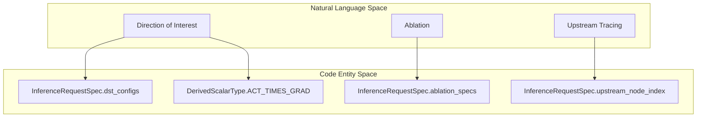
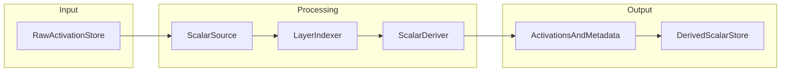
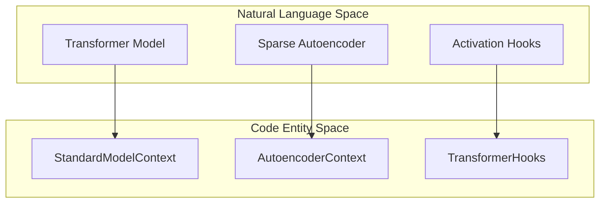

<!-- source: DeepWiki mcp.deepwiki.com · repo openai/transformer-debugger · page 8 Glossary · fetched 2026-10-26 -->

# Glossary

Relevant source files

The following files were used as context for generating this wiki page:

- [README.md](README.md)
- [neuron_explainer/activations/derived_scalars/README.md](neuron_explainer/activations/derived_scalars/README.md)
- [neuron_explainer/explanations/simulator.py](neuron_explainer/explanations/simulator.py)
- [terminology.md](terminology.md)

This page provides definitions for the specialized terminology, jargon, and abbreviations used throughout the Transformer Debugger (TDB) codebase. It covers core interpretability concepts, the derived scalar computation system, and model architecture abstractions.

## Core TDB Terminology

These terms describe the fundamental entities and operations within the Transformer Debugger interface and its underlying analysis logic.

| Term | Definition | Code Pointer |
| :--- | :--- | :--- |
| **Component** | A static model element (e.g., an attention head, MLP neuron, or autoencoder latent). Components have fixed weights. | `neuron_explainer/activations/derived_scalars/derived_scalar_types.py` |
| **Node** | A specific invocation of a **Component** at a particular token (or token pair for attention). Nodes represent dynamic activations. | [terminology.md:13-21]() |
| **Latent** | A feature direction learned by a sparse autoencoder (SAE). Latents often correspond to more semantically meaningful concepts than raw neurons. | [terminology.md:31-35]() |
| **Circuit** | A subgraph of **Nodes** that work together to produce a specific model behavior or reasoning path. | [terminology.md:27-29]() |
| **Ablate** | The process of zeroing out a node's contribution during a forward pass to observe downstream effects. | [terminology.md:36-42]() |
| **Trace Upstream** | The act of identifying which previous nodes contributed most significantly to the activation of a current node. | [terminology.md:43-47]() |
| **Direction of Interest** | A vector in the residual stream (often the difference between target and distractor token unembeddings) used to score node importance. | [terminology.md:48-55]() |

### Natural Language to Code Entity Mapping: TDB Concepts

The following diagram maps high-level TDB concepts to their specific implementations in the Python backend.

**Sources:** [neuron_explainer/activation_server/inference_routes.py:1-50](), [terminology.md:48-80]()

---

## Derived Scalar Terminology (DST)

The DST system is the mathematical engine of TDB, responsible for calculating activations, gradients, and their interactions.

*   **DST (DerivedScalarType):** An enum member representing a specific quantity to be computed (e.g., `BASE_ACTIVATION`, `ACT_TIMES_GRAD`). Defined in `DerivedScalarType` [[neuron_explainer/activations/derived_scalars/derived_scalar_types.py:18-20]]().
*   **PassType:** Specifies whether a scalar depends on the `FORWARD` pass activations or `BACKWARD` pass gradients [[neuron_explainer/activations/derived_scalars/README.md:22-24]]().
*   **ScalarDeriver:** The execution logic for a DST. It defines how to transform raw activations into the desired scalar using `tensor_calculate_derived_scalar_fn` [[neuron_explainer/activations/derived_scalars/README.md:30-33]]().
*   **ScalarSource:** Defines the input dependencies for a deriver. A source can be "Raw" (direct from a hook) or "Derived" (the output of another `ScalarDeriver`) [[neuron_explainer/activations/derived_scalars/README.md:40-47]]().
*   **ActivationsAndMetadata:** A container that holds the resulting tensors for a DST across all layers [[neuron_explainer/activations/derived_scalars/README.md:26-29]]().

### Data Flow: Scalar Derivation Pipeline

**Sources:** [neuron_explainer/activations/derived_scalars/README.md:63-88]()

---

## Model Architecture Terms

Terms related to the GPT-2 style transformer and the integrated Autoencoder system.

*   **StandardModelContext:** The primary interface for interacting with the transformer, handling hooks and weight retrieval [[neuron_explainer/models/model_context.py:50-100]]().
*   **AutoencoderContext:** Manages the lifecycle and state of sparse autoencoders associated with specific model layers [[neuron_explainer/models/autoencoder_context.py:10-40]]().
*   **Write Vector:** The vector added to the residual stream by a component (e.g., the output of an attention head before it is summed into the stream) [[terminology.md:23-25]]().
*   **Unembedding:** The linear transformation (matrix $W_U$) that maps the final residual stream to logit scores for each token in the vocabulary.

### Natural Language to Code Entity Mapping: Architecture

**Sources:** [neuron_explainer/models/model_context.py:1-50](), [neuron_explainer/models/autoencoder_context.py:1-30]()

---

## Neuron Explanation Jargon

Terms used in the automated explanation and simulation pipeline.

*   **Activation Record:** A snippet of text and its corresponding activation values for a specific neuron [[neuron_explainer/activations/activation_records.py:15-21]]().
*   **Simulation (All-at-once vs. One-at-a-time):**
    *   `ALL_AT_ONCE`: The simulator model predicts activations for all tokens in a sequence in a single prompt using logprobs [[neuron_explainer/explanations/simulator.py:45-50]]().
    *   `ONE_AT_A_TIME`: The simulator model is prompted separately for every single token [[neuron_explainer/explanations/simulator.py:52-57]]().
*   **EV (Expected Value):** In the context of simulation, this is the sum of activation values (0-10) weighted by the simulator's predicted probabilities [[neuron_explainer/explanations/simulator.py:67-77]]().
*   **Token Splitting:** Occurs when the subject model and the simulator model use different tokenizers, requiring the alignment of activation data [[neuron_explainer/explanations/simulator.py:154-180]]().

**Sources:** [neuron_explainer/explanations/simulator.py:35-110](), [neuron_explainer/activations/activation_records.py:15-21]()