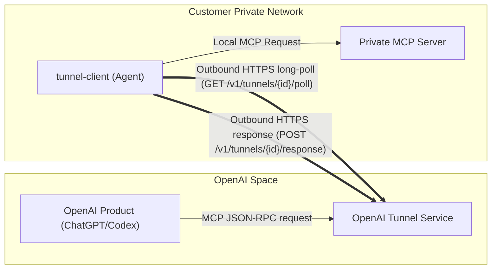
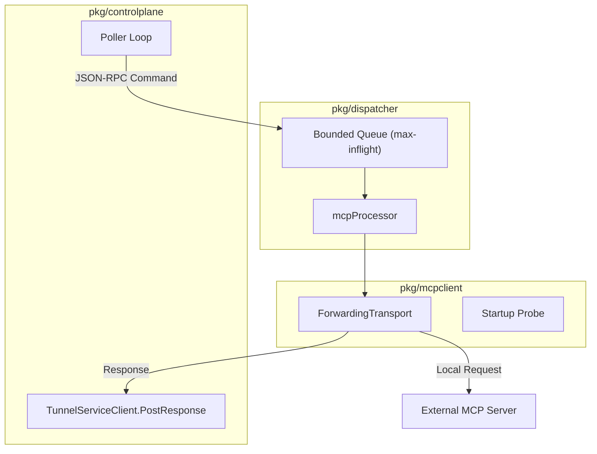

<!-- source: DeepWiki mcp.deepwiki.com · repo openai/tunnel-client · page 1 Overview · fetched 2026-10-26 -->

# Overview

Relevant source files

The following files were used as context for generating this wiki page:

- [README.md](README.md)
- [cmd/client/main.go](cmd/client/main.go)
- [docs/README.md](docs/README.md)
- [docs/architecture.md](docs/architecture.md)
- [docs/connectors.md](docs/connectors.md)
- [docs/deployment/docker.md](docs/deployment/docker.md)
- [docs/deployment/kubernetes-dedicated.md](docs/deployment/kubernetes-dedicated.md)
- [docs/deployment/kubernetes-sidecar.md](docs/deployment/kubernetes-sidecar.md)
- [docs/deployment/overview.md](docs/deployment/overview.md)
- [docs/enterprise-customer-onboarding.md](docs/enterprise-customer-onboarding.md)
- [docs/onboarding.md](docs/onboarding.md)
- [docs/troubleshooting.md](docs/troubleshooting.md)
- [go.mod](go.mod)
- [go.sum](go.sum)

The `tunnel-client` is a secure, outbound-only agent designed to connect private Model Context Protocol (MCP) servers to OpenAI-hosted products such as ChatGPT, Codex, the Responses API, and AgentKit [README.md:1-6](). It allows these products to reach MCP servers located on local machines, private virtual machines, or within Kubernetes clusters without requiring any inbound firewall rules or public internet exposure for the customer's infrastructure [README.md:8-15]().

The client functions as a bridge, long-polling the OpenAI tunnel service for MCP work, forwarding that work to the local MCP server, and returning the results back through the same established outbound connection [docs/architecture.md:3-7]().

### System Topology

The system operates in a three-tier architecture that maintains a strict trust boundary between the OpenAI public edge and the customer's private environment.

#### High-Level Request Flow
The following diagram illustrates how an OpenAI product reaches a private MCP server via the tunnel-client.

**Diagram: Three-Tier Tunnel Topology**

Sources: [docs/architecture.md:23-48](), [docs/enterprise-customer-onboarding.md:18-41]()

### Core Subsystems and Code Entities

The `tunnel-client` is composed of several modular subsystems wired together using the `fx` dependency injection framework [go.mod:21]().

| Subsystem | Key Code Entities | Responsibility |
| :--- | :--- | :--- |
| **Control Plane** | `TunnelServiceClient` | Manages the `Poll` and `PostResponse` calls with the OpenAI service [docs/enterprise-customer-onboarding.md:76-82](). |
| **Dispatcher** | `mcpProcessor` | Routes incoming commands to workers and handles JSON-RPC notifications [docs/connectors.md:101-107](). |
| **MCP Client** | `ForwardingTransport` | Implements transports for Streamable HTTP, stdio, and in-memory MCP servers [docs/connectors.md:70-80](). |
| **Harpoon** | `harpoon` channel | An embedded proxy for allowlisted outbound HTTP requests from the MCP server [docs/connectors.md:88-91](). |
| **Admin & Ops** | `adminui`, `health` | Provides a local web UI, `/healthz`, `/readyz`, and Prometheus `/metrics` [docs/troubleshooting.md:62-86](). |

**Diagram: Internal Code Entity Relationships**

Sources: [docs/architecture.md:59-82](), [docs/connectors.md:9-25](), [docs/troubleshooting.md:101-110]()

### Key Technical Concepts

*   **Outbound-Only Connectivity**: All traffic to OpenAI is initiated by the `tunnel-client` via HTTPS. No inbound ports need to be opened on the customer firewall [docs/architecture.md:11-12]().
*   **Readyz Gating**: The `/readyz` endpoint is used for orchestration, returning `503` while OAuth discovery is pending or MCP probes are failing, and `200 OK` only when ready [docs/troubleshooting.md:72-79]().
*   **Channel Routing**: The client supports multiple "channels" (e.g., `main`, `harpoon`). Traffic with an empty channel is normalized to `main` [docs/connectors.md:67-68]().
*   **Supervision and Runtimes**: For long-lived local execution, the client provides a `runtimes` command tree to manage background processes without relying on `nohup` [README.md:120-123]().

### Detailed Documentation Sections

For deeper technical dives, refer to the following child pages:

*   **[Architecture and Request Lifecycle](#1.1)**: Details the three-tier topology, the polling mechanism, and the trust boundaries between OpenAI and the customer environment.
*   **[Getting Started and Onboarding](#1.2)**: A guide for setting up prerequisites like `tunnel_id` and API keys, and using the `init` and `doctor` commands to validate connectivity.

Sources: [README.md:22-50](), [docs/onboarding.md:1-14](), [docs/architecture.md:1-20]()

---

