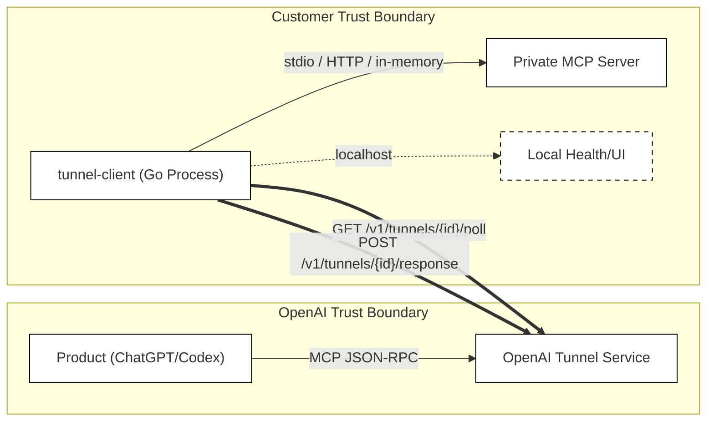
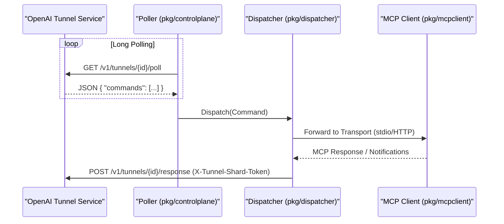
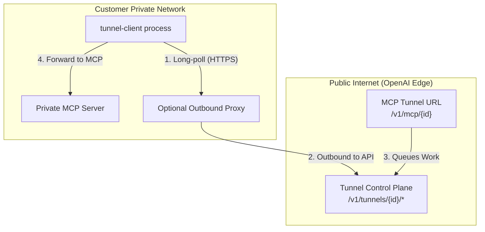

<!-- source: DeepWiki mcp.deepwiki.com · repo openai/tunnel-client · page 1.1 Architecture and Request Lifecycle · fetched 2026-10-26 -->

# Architecture and Request Lifecycle

Relevant source files

The following files were used as context for generating this wiki page:

- [README.md](README.md)
- [docs/README.md](docs/README.md)
- [docs/architecture.md](docs/architecture.md)
- [docs/connectors.md](docs/connectors.md)
- [docs/deployment/docker.md](docs/deployment/docker.md)
- [docs/deployment/kubernetes-dedicated.md](docs/deployment/kubernetes-dedicated.md)
- [docs/deployment/kubernetes-sidecar.md](docs/deployment/kubernetes-sidecar.md)
- [docs/deployment/overview.md](docs/deployment/overview.md)
- [docs/enterprise-customer-onboarding.md](docs/enterprise-customer-onboarding.md)
- [docs/onboarding.md](docs/onboarding.md)
- [docs/openapi.json](docs/openapi.json)
- [docs/protocol.md](docs/protocol.md)
- [docs/troubleshooting.md](docs/troubleshooting.md)
- [pkg/controlplane/wiretypes/openapi_contract_test.go](pkg/controlplane/wiretypes/openapi_contract_test.go)

The `tunnel-client` serves as an outbound-only agent that bridges OpenAI products (like ChatGPT or Codex) to private MCP servers. It eliminates the need for inbound firewall rules by initiating all control-plane traffic as outbound HTTPS requests to OpenAI [README.md:3-15]().

## Three-Tier Topology

The system operates across three distinct trust boundaries. The `tunnel-client` acts as the pivot point, translating public control-plane commands into private network requests [docs/architecture.md:21-48]().

1.  **OpenAI Product Tier**: ChatGPT, Codex, or the Responses API sends MCP JSON-RPC requests to the OpenAI Tunnel Service [docs/architecture.md:25-28]().
2.  **OpenAI Tunnel Service**: Acts as a buffer and relay, holding queued commands for the `tunnel_id` and streaming responses back to the product [docs/architecture.md:59-76]().
3.  **Customer Network**: The `tunnel-client` runs here, polling for work and forwarding it to the **Private MCP Server** via stdio, HTTP, or in-memory transports [docs/architecture.md:30-40]().

### System Topology Diagram

This diagram illustrates the flow from the OpenAI product tier through the client to the private MCP instance.

Sources: [docs/architecture.md:23-48](), [docs/enterprise-customer-onboarding.md:18-41](), [docs/protocol.md:25-30]()

---

## Request Lifecycle and Polling Loop

The `tunnel-client` utilizes a long-polling mechanism to receive work. This ensures that the customer network remains secure without exposing any listening ports to the public internet [docs/protocol.md:153-174]().

### The Poll-Response Sequence

1.  **Long-poll**: The `tunnel-client` initiates a `GET /v1/tunnels/{tunnel_id}/poll` request. It includes `limit` (max 25) and `timeout_ms` hints [docs/protocol.md:153-165]().
2.  **Command Delivery**: The Tunnel Service returns a `200 OK` with a JSON envelope containing a list of `commands`. If no work is available, it returns `204 No Content` [docs/protocol.md:172-180]().
3.  **Dispatcher Processing**: The client records the receipt time and dispatches commands to the appropriate MCP channel (e.g., `main` or `harpoon`) [docs/protocol.md:180-190]().
4.  **MCP Execution**: The command is forwarded to the configured MCP server. For stdio, this is a child process; for HTTP, it is a `POST` request [docs/connectors.md:70-80]().
5.  **Response Posting**: Results are posted back to `/v1/tunnels/{tunnel_id}/response`. For streaming, intermediate notifications are posted with `resp_type=jsonrpc_notify` [docs/protocol.md:220-235]().

### Sequence Diagram: Code Entities

This diagram maps the natural language lifecycle to specific system components and wire protocol operations.

Sources: [docs/architecture.md:61-76](), [docs/protocol.md:153-240](), [docs/connectors.md:100-110]()

---

## Command and Response Models

The communication protocol distinguishes between standard RPC calls, OAuth metadata discovery, and session management [docs/protocol.md:180-215]().

### Command Types (`command_type`)
| Type | Purpose |
| :--- | :--- |
| `jsonrpc` | Standard MCP tool calls, resource fetches, or list requests [docs/protocol.md:184](). |
| `oauth_discovery` | Requests to probe the MCP server for OAuth protected resource metadata [docs/protocol.md:200-210](). |
| `session_termination` | Explicit signal to close a Streamable HTTP session [docs/protocol.md:212-215](). |

### Response Types (`resp_type`)
| Type | Description |
| :--- | :--- |
| `jsonrpc_response` | A final response to a JSON-RPC request [docs/protocol.md:230](). |
| `jsonrpc_notify` | Used for streaming; maps to JSON-RPC notifications without an ID [docs/protocol.md:231](). |
| `oauth_discovery` | Returns discovered OAuth protected resource metadata [docs/protocol.md:232](). |

---

## Backpressure and Flow Control

The client implements a backpressure model to ensure it does not overwhelm the local MCP server or the system's memory.

*   **Poll Limit**: The `limit` parameter in the poll request (max 25) hints to the service how many commands the client is ready to receive in one batch [docs/protocol.md:163-165]().
*   **Shard Tokens**: Every command includes a `shard_token`. The client **must** echo this token back in the `X-Tunnel-Shard-Token` HTTP header when responding [docs/protocol.md:220-225](). This ensures the response is routed to the correct upstream worker.
*   **Connection TTL**: The connection window for Streamable HTTP is bounded by `MCP_CONNECTION_MAX_TTL` (default 10m) [docs/connectors.md:113-116]().

---

## Trust Boundaries and Security

The architecture is designed with strict isolation of credentials and network paths [docs/architecture.md:85-113]().

| Component | Security Property |
| :--- | :--- |
| **Outbound Only** | The agent initiates all traffic. No inbound firewall rules are required for the MCP server [docs/architecture.md:11-12](). |
| **API Key Isolation** | The `CONTROL_PLANE_API_KEY` is used only between the client and OpenAI. It is never forwarded to the MCP server [docs/architecture.md:126](). |
| **Private MCP URL** | The internal address of the MCP server is never shared with OpenAI; it exists only in the local client configuration [docs/architecture.md:13-14](). |
| **Header Blocking** | OpenAI-internal, IP-forwarding, and hop-by-hop auth headers are blocked at the tunnel boundary [docs/architecture.md:125](). |

### Network Path Detail

Sources: [docs/architecture.md:85-113](), [docs/enterprise-customer-onboarding.md:18-41](), [docs/protocol.md:11-30]()

---

