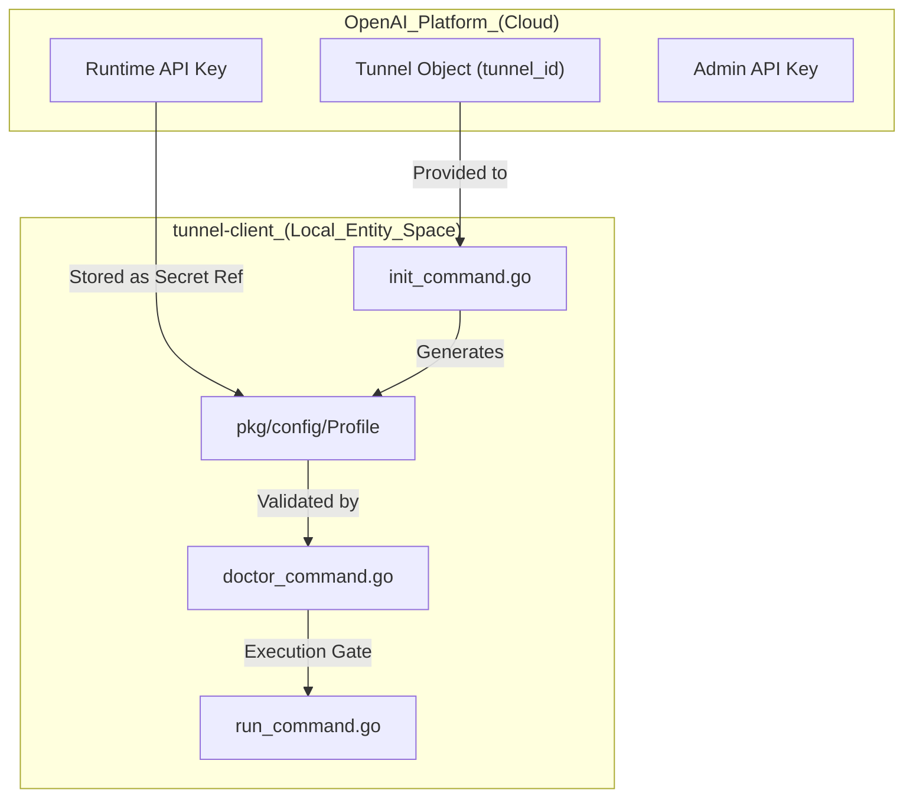
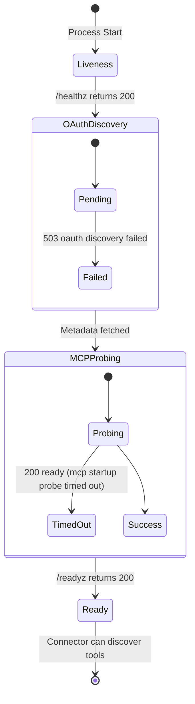

<!-- source: DeepWiki mcp.deepwiki.com · repo openai/tunnel-client · page 1.2 Getting Started and Onboarding · fetched 2026-10-26 -->

# Getting Started and Onboarding

<details>
<summary>Relevant source files</summary>

The following files were used as context for generating this wiki page:

- [README.md](README.md)
- [cmd/client/help_topics/doctor.txt](cmd/client/help_topics/doctor.txt)
- [cmd/client/help_topics/quickstart.txt](cmd/client/help_topics/quickstart.txt)
- [cmd/client/init_command.go](cmd/client/init_command.go)
- [cmd/client/profile_samples/sample_mcp_enterprise_proxy.yaml.tmpl](cmd/client/profile_samples/sample_mcp_enterprise_proxy.yaml.tmpl)
- [cmd/client/profile_samples/sample_mcp_remote_no_auth.yaml.tmpl](cmd/client/profile_samples/sample_mcp_remote_no_auth.yaml.tmpl)
- [cmd/client/profile_samples/sample_mcp_stdio_local.yaml.tmpl](cmd/client/profile_samples/sample_mcp_stdio_local.yaml.tmpl)
- [cmd/client/profile_samples/sample_mcp_with_dcr.yaml.tmpl](cmd/client/profile_samples/sample_mcp_with_dcr.yaml.tmpl)
- [docs/README.md](docs/README.md)
- [docs/architecture.md](docs/architecture.md)
- [docs/connectors.md](docs/connectors.md)
- [docs/deployment/docker.md](docs/deployment/docker.md)
- [docs/deployment/kubernetes-dedicated.md](docs/deployment/kubernetes-dedicated.md)
- [docs/deployment/kubernetes-sidecar.md](docs/deployment/kubernetes-sidecar.md)
- [docs/deployment/overview.md](docs/deployment/overview.md)
- [docs/enterprise-customer-onboarding.md](docs/enterprise-customer-onboarding.md)
- [docs/onboarding.md](docs/onboarding.md)
- [docs/troubleshooting.md](docs/troubleshooting.md)

</details>


This page provides a step-by-step technical guide for new users and operators to initialize, validate, and run the `tunnel-client`. It covers the transition from obtaining credentials in the OpenAI Platform to running a production-ready daemon.

## Prerequisites and Key Concepts

Before running the client, three primary components must be configured: a **Tunnel ID**, **API Keys** with appropriate permissions, and a target **MCP Server**.

### 1. Tunnel ID (`tunnel_id`)
A logical identifier that binds the ChatGPT connector to a specific `tunnel-client` instance [docs/enterprise-customer-onboarding.md:48-50](). It follows the format `tunnel_` followed by 32 lowercase hexadecimal characters [docs/enterprise-customer-onboarding.md:56-56]().

### 2. API Keys and Permissions
The system distinguishes between **Runtime** and **Admin** operations. It is a security best practice to never provide the Admin key to the long-lived daemon [cmd/client/help_topics/quickstart.txt:35-36]().

| Key Type | Environment Variable | Required Permissions | Usage |
| :--- | :--- | :--- | :--- |
| **Runtime Key** | `CONTROL_PLANE_API_KEY` | Tunnels **Read** + **Use** | `doctor`, `run`, `health` |
| **Admin Key** | `OPENAI_ADMIN_KEY` | Tunnels **Read** + **Manage** | `admin tunnels [create\|list\|delete]` |

Sources: [docs/onboarding.md:41-47](), [cmd/client/help_topics/quickstart.txt:30-36](), [docs/enterprise-customer-onboarding.md:123-136]()

### 3. MCP Server
The client requires a destination to forward requests. This can be:
*   **Local stdio**: A command executed by the client (e.g., `python server.py`) [cmd/client/help_topics/quickstart.txt:52-53]().
*   **Remote HTTP**: A URL reachable from the client host [cmd/client/help_topics/quickstart.txt:55-56]().
*   **In-Memory**: Used when embedding the client as a Go SDK [README.md:41-45]().

## Onboarding Data Flow

The following diagram illustrates the relationship between the OpenAI Platform entities and the local code entities during the onboarding process.

**Onboarding Entity Mapping**

Sources: [cmd/client/init_command.go:32-85](), [docs/onboarding.md:15-30](), [docs/enterprise-customer-onboarding.md:108-122]()

## First-Run Paths

### 1. Quickstart (One-Command Demo)
For testing without a real MCP server, the client includes an embedded stub.
```bash
health_url_file="$(mktemp "${TMPDIR:-/tmp}/tunnel-client-health.XXXXXX.url")"
tunnel-client run \
  --embedded-mcp-stub \
  --control-plane.tunnel-id tunnel_0123456789abcdef0123456789abcdef \
  --health.listen-addr 127.0.0.1:0 \
  --health.url-file "$health_url_file"
```
Sources: [docs/onboarding.md:62-69](), [cmd/client/help_topics/quickstart.txt:46-50]()

### 2. Initialization (`init`)
The `init` command generates a YAML profile from built-in templates. It performs preflight checks on stdio commands and validates the `tunnel_id` format [cmd/client/init_command.go:64-71]().

**Common Init Patterns:**
*   **Local Stdio**: `tunnel-client init --sample sample_mcp_stdio_local --profile local-stdio --tunnel-id tunnel_... --mcp-command "python server.py"` [docs/onboarding.md:95-96]()
*   **Remote HTTP**: `tunnel-client init --sample sample_mcp_remote_no_auth --profile remote-http --tunnel-id tunnel_... --mcp-server-url https://mcp.example.com/mcp` [docs/onboarding.md:117-118]()
*   **Enterprise (Proxy/CA)**: `tunnel-client init --sample sample_mcp_enterprise_proxy --profile corp-proxy ...` [docs/onboarding.md:119-123]()

Sources: [cmd/client/init_command.go:89-101](), [cmd/client/help_topics/quickstart.txt:52-66]()

### 3. Validation (`doctor`)
Before starting the daemon, `doctor` validates connectivity and configuration. It is the primary tool for debugging "403 Forbidden" or "Tunnel ID required" errors [cmd/client/help_topics/doctor.txt:1-6]().

**Key Checks:**
*   Resolution of secret references (e.g., `env:VAR` or `file:PATH`) [cmd/client/help_topics/doctor.txt:28-28]().
*   MCP OAuth/PRMD metadata contract (fetching `/.well-known/oauth-protected-resource/mcp`) [cmd/client/help_topics/doctor.txt:30-32]().
*   Control plane reachability and permission verification using the Runtime Key [cmd/client/help_topics/doctor.txt:39-41]().

## Operational Health and Readiness

Once running, the client exposes a health server. Understanding the difference between `/healthz` (liveness) and `/readyz` (readiness gating) is critical for deployment [docs/troubleshooting.md:71-72]().

**Health Lifecycle State Machine**

Sources: [docs/troubleshooting.md:62-80](), [docs/connectors.md:60-64]()

### Diagnostic Commands
*   **Structured Probe**: `tunnel-client health --url-file "$health_url_file"` is the fastest probe for a running daemon [docs/troubleshooting.md:67-70]().
*   **Log Export**: `curl -fsSJO "http://127.0.0.1:8080/api/logs/export?minutes=30"` returns a redacted archive containing logs, metrics, and system status for support [docs/troubleshooting.md:89-95]().

## Troubleshooting Common Startup Issues

| Error Message | Cause | Resolution |
| :--- | :--- | :--- |
| `control plane API key is required` | Missing `CONTROL_PLANE_API_KEY` | Set the env var or use `--control-plane.api-key=env:...` [docs/troubleshooting.md:5-7](). |
| `invalid tunnel ID` | Format mismatch | Ensure ID is `tunnel_` followed by 32 hex chars [docs/troubleshooting.md:12-13](). |
| `503 oauth discovery pending` | Metadata fetch in flight | Check network access to the MCP server's `.well-known` path [docs/troubleshooting.md:73-73](). |
| `unsupported_channel` | Routing mismatch | Ensure `main` channel is configured or Harpoon targets are registered [docs/troubleshooting.md:133-138](). |

Sources: [docs/troubleshooting.md:3-30](), [docs/troubleshooting.md:133-149]()

---

