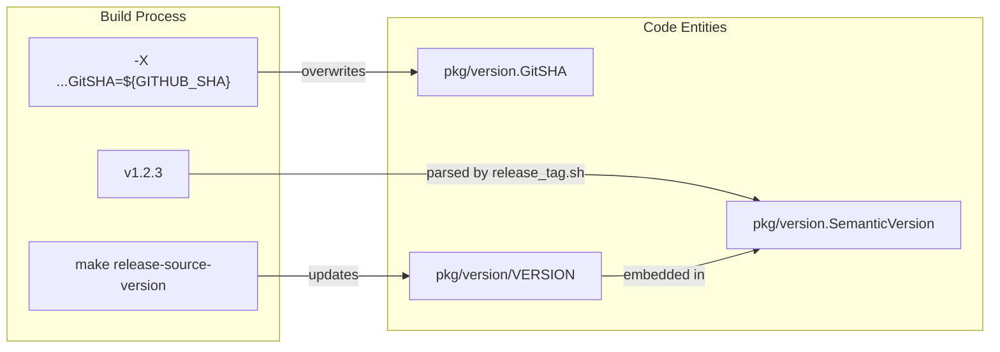

<!-- source: DeepWiki mcp.deepwiki.com · repo openai/tunnel-client · page 10 Build, Release, and Development · fetched 2026-10-26 -->

# Build, Release, and Development

<details>
<summary>Relevant source files</summary>

The following files were used as context for generating this wiki page:

- [.gitattributes](.gitattributes)
- [.github/workflows/release.yml](.github/workflows/release.yml)
- [Makefile](Makefile)
- [docs/development.md](docs/development.md)
- [pkg/version/VERSION](pkg/version/VERSION)
- [pkg/version/version.go](pkg/version/version.go)
- [pkg/version/version_test.go](pkg/version/version_test.go)
- [scripts/build_distribution_package.sh](scripts/build_distribution_package.sh)
- [scripts/release_tag.sh](scripts/release_tag.sh)
- [scripts/release_tag_test.sh](scripts/release_tag_test.sh)

</details>


This page provides a high-level overview of the `tunnel-client` build system, release automation, and the workflow for contributors. The project uses a combination of `make` for local development and GitHub Actions for cross-platform distribution.

## Development Workflow

The development environment centers around a standard Go toolchain and a `Makefile` that orchestrates common tasks. Developers primarily interact with the `cmd/client` entrypoint [cmd/client:1-1]() and the `adminui` frontend.

### Build and Test
The default build target creates a statically linked binary with `CGO_ENABLED=0` by default [Makefile:123](). Before contributing, developers are expected to run formatting, dependency tidying, and testing checks via the `all` target [Makefile:32]().

| Task | Command | Description |
| :--- | :--- | :--- |
| **Full Build** | `make all` | Cleans, tidies modules, formats, tests, and builds the binary [Makefile:32](). |
| **Unit Tests** | `make test` | Runs `go test -race ./...` after admin UI tests [Makefile:65-66](). |
| **Admin UI** | `make admin-ui` | Compiles Svelte assets using `scripts/build_admin_ui.sh` [Makefile:90-92](). |
| **Docker** | `make build-image` | Packages the binary into a container image with `GIT_SHA` tagging [Makefile:136-141](). |

### Repository Structure
- `cmd/client`: The main CLI application entrypoint [docs/development.md:131]().
- `pkg/`: Core implementation logic and libraries [docs/development.md:132]().
- `adminui/`: Source code for the Svelte-based administrative dashboard [Makefile:9]().
- `scripts/`: Automation scripts for UI builds, versioning, and packaging [docs/development.md:8,21,134]().
- `e2e/`: End-to-end tests using in-repo mocks [docs/development.md:133]().

**Sources:** [Makefile:30-64](), [docs/development.md:5-24](), [docs/development.md:129-135]()

---

## Release Pipeline

The release process is automated via GitHub Actions and supports multiple operating systems and architectures.

### CI/CD Architecture
The pipeline is triggered by pushes to `master` or tags matching the `v*` pattern [.github/workflows/release.yml:3-8](). It utilizes a build matrix to generate binaries for Linux, Darwin (macOS), and Windows across both `amd64` and `arm64` architectures [.github/workflows/release.yml:70-91]().

### Build Artifacts and Distribution
1. **Binary Compilation**: Binaries are built with `-trimpath` and custom `-ldflags` to inject `GitSHA` and `semanticVersion` [.github/workflows/release.yml:108-118]().
2. **Bundled Components**: The release includes a pinned version of `cloudflared` managed via `scripts/build_cloudflared.sh` [.github/workflows/release.yml:119-122]().
3. **Packaging**: Individual platform assets are zipped with the binary, `cloudflared`, a manifest, and the license [.github/workflows/release.yml:151-158]().
4. **Distribution Package**: The `scripts/build_distribution_package.sh` script aggregates all platform binaries into a single "all" archive [.github/workflows/release.yml:180-184]().

For a deep dive into Makefile targets and GitHub Actions steps, see **[Build System and CI/CD Pipeline](#10.1)**.

### Release Pipeline Flow
Title: Release Pipeline Sequence
```mermaid
graph TD
    "TagPush[git push v1.2.3]" --> "TestJob[Job: Test]"
    "TestJob" --> "CheckTag[scripts/release_tag.sh check-source-version]"
    "CheckTag" --> "BuildMatrix[Job: Build Matrix]"
    "BuildMatrix" --> "LDFlags[Inject GitSHA & Version]"
    "LDFlags" --> "PkgBin[Package Individual Zips]"
    "PkgBin" --> "ReleaseJob[Job: Release]"
    "ReleaseJob" --> "DistScript[scripts/build_distribution_package.sh]"
    "DistScript" --> "Checksum[Generate SHA256SUMS.txt]"
    "Checksum" --> "AzureUpload[az storage blob upload-batch]"
```
**Sources:** [.github/workflows/release.yml:1-190](), [scripts/build_distribution_package.sh:1-21]()

---

## Versioning and Metadata

`tunnel-client` uses a specialized versioning scheme to ensure traceability between binaries and the source code.

### Versioning Strategy
- **Semantic Versioning**: Releases follow SemVer (e.g., `1.2.3`) [scripts/release_tag.sh:33-39]().
- **Source Tracking**: The `pkg/version` package embeds a `VERSION` file [pkg/version/version.go:29-30]().
- **Git SHA Detection**: The system attempts to detect the Git SHA from the build metadata, the environment, or by walking the filesystem to find the `.git` directory [pkg/version/version.go:50-55](), [pkg/version/version.go:145-157]().

### Metadata Injection
The build system uses Go's `ldflags` to override `semanticVersion` and `GitSHA` in `pkg/version`. This ensures that `tunnel-client --version` accurately reports the release version and commit [.github/workflows/release.yml:108-112](). CI also validates that the built binary's `--version` output matches the expected release tag [.github/workflows/release.yml:123-132]().

For details on the tag format and the `pkg/version` logic, see **[Versioning and Release Tagging](#10.2)**.

### Version Entity Association
Title: Version Metadata Mapping

**Sources:** [pkg/version/version.go:19-41](), [scripts/release_tag.sh:109-121](), [.github/workflows/release.yml:108-114]()

---

## Sub-pages
- **[Build System and CI/CD Pipeline](#10.1)**: Details on `Makefile` targets, GitHub Actions matrix builds, `cloudflared` bundling, and distribution packaging.
- **[Versioning and Release Tagging](#10.2)**: Details on the release tag conventions, `scripts/release_tag.sh` parsing logic, and the `pkg/version` metadata provider.

---

