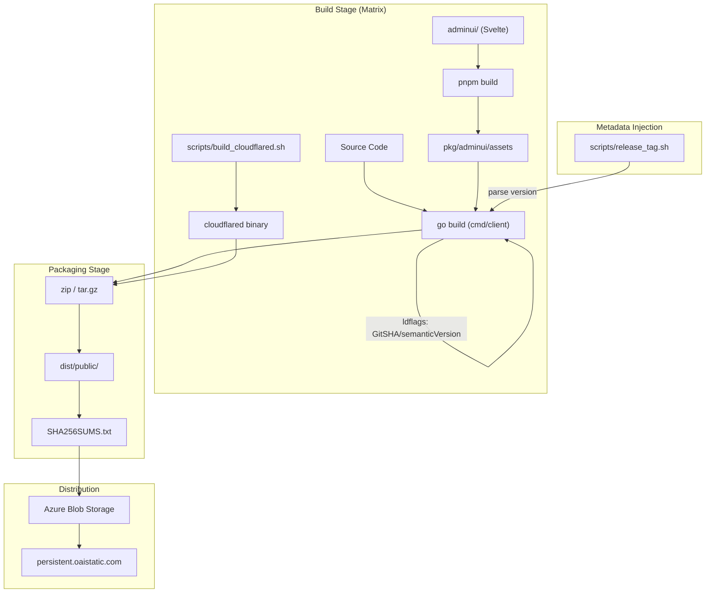
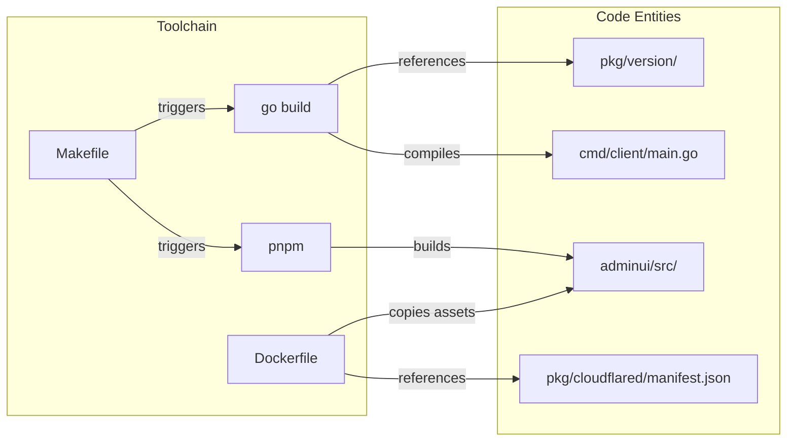

<!-- source: DeepWiki mcp.deepwiki.com · repo openai/tunnel-client · page 10.1 Build System and CI/CD Pipeline · fetched 2026-10-26 -->

# Build System and CI/CD Pipeline

Relevant source files

The following files were used as context for generating this wiki page:

- [.github/workflows/homebrew-formula-smoke.yml](.github/workflows/homebrew-formula-smoke.yml)
- [.github/workflows/release.yml](.github/workflows/release.yml)
- [Dockerfile](Dockerfile)
- [Makefile](Makefile)
- [adminui/README.md](adminui/README.md)
- [adminui/package.json](adminui/package.json)
- [adminui/pnpm-workspace.yaml](adminui/pnpm-workspace.yaml)
- [adminui/src/components/__tests__/App.test.ts](adminui/src/components/__tests__/App.test.ts)
- [docs/development.md](docs/development.md)
- [scripts/build_admin_ui.sh](scripts/build_admin_ui.sh)
- [scripts/build_distribution_package.sh](scripts/build_distribution_package.sh)
- [scripts/generate_homebrew_formula.sh](scripts/generate_homebrew_formula.sh)
- [scripts/generate_homebrew_formula_test.sh](scripts/generate_homebrew_formula_test.sh)
- [scripts/publish_homebrew_formula.sh](scripts/publish_homebrew_formula.sh)
- [scripts/publish_homebrew_formula_test.sh](scripts/publish_homebrew_formula_test.sh)

The `tunnel-client` build system is designed to produce statically linked, cross-platform binaries with embedded assets. It leverages a standard `Makefile` for local development and a complex GitHub Actions workflow for automated releases. The pipeline ensures that every release includes a complete set of binaries for major operating systems and architectures, accompanied by cryptographic checksums and distribution metadata.

## Makefile Architecture

The `Makefile` serves as the primary interface for development tasks, abstracting the Go toolchain and frontend build processes. It manages environment-specific variables like `GOOS` and `GOARCH` to facilitate cross-compilation from a local workstation.

### Key Targets

| Target | Purpose | Implementation |
|:---|:---|:---|
| `all` | Default target; cleans, tidies, formats, and builds the binary. | [Makefile:32-32]() |
| `test` | Executes Go tests (with race detection) and admin UI tests. | [Makefile:65-66]() |
| `admin-ui` | Invokes `scripts/build_admin_ui.sh` to compile Svelte assets. | [Makefile:90-92]() |
| `release-tag` | Generates a formatted release tag (e.g., `v1.2.3`) via `release_tag.sh`. | [Makefile:114-120]() |
| `build-image` | Constructs a Docker image containing the compiled binary and UI. | [Makefile:136-141]() |
| `$(TARGET)` | The core build logic; sets `CGO_ENABLED=0` and injects `ldflags`. | [Makefile:122-124]() |
| `release-source-version` | Writes the version string into `pkg/version/VERSION` for source dists. | [Makefile:107-112]() |

### Metadata Injection
The build system uses Go's `-ldflags` to inject build-time metadata into the `pkg/version` package. This allows the binary to report its exact Git SHA and version string when queried via the `--version` flag. Specifically, it populates `github.com/openai/tunnel-client/pkg/version.GitSHA` [Makefile:28-28]().

**Sources:**
- [Makefile:1-141]()
- [docs/development.md:5-24]()

---

## CI/CD Release Pipeline

The GitHub Actions workflow defined in `.github/workflows/release.yml` automates the end-to-end release process. It triggers on pushes to `master` or when a tag matching `v*` is pushed [ .github/workflows/release.yml:3-8 ]().

### Build Matrix and Environment
The pipeline performs a matrix build across six combinations of operating systems and architectures:
- **OS:** `linux`, `darwin`, `windows`
- **Arch:** `amd64`, `arm64`

All builds are performed with `CGO_ENABLED: 0` to ensure the resulting binaries are statically linked and have no external library dependencies [ .github/workflows/release.yml:102-102 ](). The pipeline also builds a pinned version of `cloudflared` for each platform using `scripts/build_cloudflared.sh` [ .github/workflows/release.yml:119-122 ]().

### Data Flow: Build to Release

The following diagram illustrates how the CI pipeline transforms source code into distributed artifacts.

**CI/CD Artifact Pipeline**

**Sources:**
- [.github/workflows/release.yml:66-160]()
- [.github/workflows/release.yml:17-28]()

---

## Distribution Packaging

The `scripts/build_distribution_package.sh` script is responsible for creating "all-in-one" distribution bundles. These bundles contain the source tree alongside binaries for all supported platforms.

### Package Composition
1. **Source Tree:** The script uses `git archive` to export the current source tree, respecting `.gitattributes` `export-ignore` rules [ scripts/build_distribution_package.sh:77-77 ]().
2. **Platform Binaries:** It iterates through the `binary-dir`, parsing the OS and architecture from filenames, and organizes them into a structured `bin/` directory within the bundle [ scripts/build_distribution_package.sh:84-110 ]().
3. **Companion Binaries:** It ensures that the matching `cloudflared` binary for each platform is included in the package [ scripts/build_distribution_package.sh:106-108 ]().
4. **Archive Generation:** The resulting directory is compressed into both `.tar.gz` and `.zip` formats [ scripts/build_distribution_package.sh:114-118 ]().

**Sources:**
- [scripts/build_distribution_package.sh:1-119]()
- [.github/workflows/release.yml:151-158]()

---

## Docker Build System

The `Dockerfile` utilizes a multi-stage build process to separate frontend, backend, and companion binary concerns.

### Build Stages
1. **`ui-builder`**: Uses `node:22-alpine` and `corepack enable pnpm` to compile the Svelte frontend into static assets [ Dockerfile:9-51 ]().
2. **`builder`**: Uses `golang:1.26.2-alpine`. It copies the compiled UI assets from `ui-builder` and performs the Go build for the target platform [ Dockerfile:53-70 ]().
3. **`cloudflared-builder`**: A specialized stage that runs `scripts/build_cloudflared.sh` to fetch and build the pinned version of the cloudflared proxy [ Dockerfile:72-87 ]().
4. **`runtime-base`**: The final production image based on `alpine:3.22`, containing both `tunnel-client` and `cloudflared` [ Dockerfile:89-93 ]().

The final image defaults to the `run` command, making it ready for deployment in containerized environments [ Dockerfile:103-103 ]().

**Entity Mapping: Build Tools to Code**

**Sources:**
- [Dockerfile:1-103]()
- [adminui/package.json:1-22]()
- [Makefile:136-141]()

---

