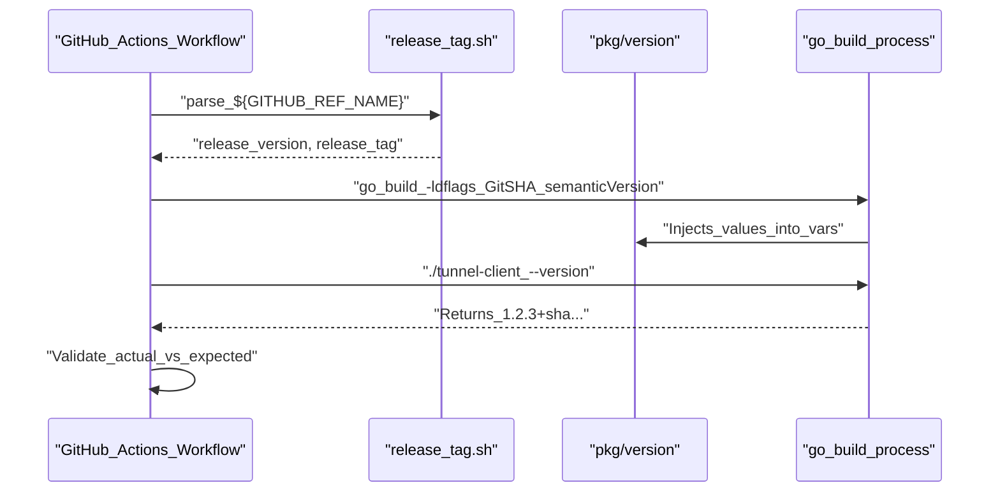

<!-- source: DeepWiki mcp.deepwiki.com · repo openai/tunnel-client · page 10.2 Versioning and Release Tagging · fetched 2026-10-26 -->

# Versioning and Release Tagging

<details>
<summary>Relevant source files</summary>

The following files were used as context for generating this wiki page:

- [.gitattributes](.gitattributes)
- [.github/workflows/release.yml](.github/workflows/release.yml)
- [Makefile](Makefile)
- [docs/development.md](docs/development.md)
- [pkg/version/VERSION](pkg/version/VERSION)
- [pkg/version/version.go](pkg/version/version.go)
- [pkg/version/version_test.go](pkg/version/version_test.go)
- [scripts/build_distribution_package.sh](scripts/build_distribution_package.sh)
- [scripts/release_tag.sh](scripts/release_tag.sh)
- [scripts/release_tag_test.sh](scripts/release_tag_test.sh)

</details>


The `tunnel-client` uses a structured versioning system that combines semantic versioning (SemVer) with Git metadata and source-level version files. This system ensures that every build—whether a local development binary, a CI artifact, or a formal release—can be uniquely identified and traced back to its source code and build context.

## Release Tag Convention

Release tags follow a specific format: `v<semver>` [scripts/release_tag.sh:82](). Note that while earlier versions or internal tools might refer to an "operator-word" suffix, the current implementation in `release_tag.sh` focuses on valid SemVer strings prefixed with `v`.

*   **`<semver>`**: A standard semantic version (e.g., `1.2.3` or `0.0.11-dev`) [scripts/release_tag.sh:33]().
*   **Validation**: The version must not include double-hyphens (`--`) as these are reserved for internal release-word logic [scripts/release_tag.sh:37]().

This convention is enforced by the `scripts/release_tag.sh` script and checked during the GitHub Actions release workflow [.github/workflows/release.yml:43-44]().

## The `pkg/version` Package

The `pkg/version` package is the central authority for version metadata within the Go binary. It resolves the version string using a hierarchy of sources: build-time flags, an embedded `VERSION` file, and Git metadata.

### Data Flow and Initialization

When the application starts, the `init()` function calls `initVersion` to populate global variables used throughout the system (e.g., for the `--version` flag and HTTP `User-Agent` headers) [pkg/version/version.go:43-45]().

| Variable | Description | Source |
| :--- | :--- | :--- |
| `GitSHA` | The Git commit hash of the build. | `-ldflags`, `vcs.revision` build info, or local `.git` [pkg/version/version.go:34, 50-55](). |
| `SemanticVersion` | The clean SemVer string (e.g., `1.2.3`). | `-ldflags` or `pkg/version/VERSION` [pkg/version/version.go:36, 62-75](). |
| `Version` | The full version string including build metadata. | `SemanticVersion + "+" + GitSHA` [pkg/version/version.go:38, 190-195](). |
| `UserAgent` | The string used for outbound requests. | `oai-tunnel-client/<Version>` [pkg/version/version.go:40, 59](). |

### Version Resolution Logic

The package determines the "effective" semantic version using the following precedence [pkg/version/version.go:62-75]():
1.  **LDFLAGS**: Values passed via `-X pkg/version.semanticVersion=...` during `go build`.
2.  **Embedded File**: The contents of `pkg/version/VERSION` (embedded via `go:embed`) [pkg/version/version.go:29-30]().
3.  **Fallback**: Defaults to `0.0.1` [pkg/version/version.go:16]().

### Versioning Logic Flow
The following diagram illustrates how the `pkg/version` package determines the final version strings.

"Version Resolution Logic"
```mermaid
graph TD
    subgraph "Input_Sources"
        A["-ldflags_semanticVersion"]
        B["pkg/version/VERSION_file"]
        C["debug.ReadBuildInfo"]
        D["git_rev-parse_HEAD"]
    end

    subgraph "Logic_initVersion"
        E{"GitSHA_via_ldflags?"}
        F["detectBuildGitSHAFrom"]
        G["detectCheckoutGitSHA"]
        H["effectiveSemanticVersion"]
    end

    A --> H
    B --> H
    C --> F
    D --> G
    
    E -- "No" --> F
    F -- "Empty" --> G
    
    H --> I["SemanticVersion_Global"]
    I --> J["buildVersion_func"]
    G --> J
    F --> J
    
    J --> K["Version_Global"]
    K --> L["UserAgent_Global"]
end
```
Sources: [pkg/version/version.go:49-75](), [pkg/version/version.go:190-195]()

## Release Tooling and Scripts

### `scripts/release_tag.sh`
This script is the primary utility for managing tags and validating the environment during the release process.

*   **`make <version>`**: Generates a formatted tag string like `v1.2.3` [scripts/release_tag.sh:79-83]().
*   **`parse <tag>`**: Deconstructs a tag into components (version, prerelease status, blob paths) and exports them as environment variables for CI [scripts/release_tag.sh:85-107]().
*   **`check-source-version <tag>`**: Ensures that the version in the tag matches the version recorded in `pkg/version/VERSION` [scripts/release_tag.sh:71-78]().

### `Makefile` Integration
The `Makefile` provides high-level targets for developers to prepare releases:

*   **`make release-source-version VERSION=x.y.z`**: Updates the `pkg/version/VERSION` file on disk using `release_tag.sh set-source-version` [Makefile:107-112]().
*   **`make release-tag VERSION=x.y.z`**: Validates the source version and creates the Git tag [Makefile:114-120]().

## CI/CD Release Pipeline

The GitHub Actions workflow [.github/workflows/release.yml]() automates the build and distribution process.

### Build and Metadata Injection
During the `build` job, the pipeline injects metadata into the binary using `-ldflags` [.github/workflows/release.yml:108-114]():
*   `GitSHA`: Set to `${GITHUB_SHA}`.
*   `semanticVersion`: Parsed from the Git tag using `release_tag.sh parse` (if triggered by a tag).

### Binary Validation
The CI pipeline performs a "self-check" on the compiled binary to prevent mislabeled releases. It executes the newly built binary with the `--version` flag and compares the output against the expected string [.github/workflows/release.yml:123-132]():
`expected_version="${release_version}+${GITHUB_SHA} (git sha: ${GITHUB_SHA})"`

### Distribution Packaging
Formal releases use `scripts/build_distribution_package.sh` to create standardized archives [.github/workflows/release.yml:151-159](). This script bundles the binary with its specific `cloudflared` dependency and a `manifest.json` [scripts/build_distribution_package.sh:103-109]().

"Release Build Pipeline"

Sources: [.github/workflows/release.yml:98-132](), [scripts/release_tag.sh:85-107]()

## Summary of Version Files
| File | Role |
| :--- | :--- |
| `pkg/version/version.go` | Implementation of version detection and global variable storage [pkg/version/version.go:1-41](). |
| `pkg/version/VERSION` | Static file containing the current development or release version [pkg/version/VERSION:1](). |
| `scripts/release_tag.sh` | CLI tool for tag generation, parsing, and consistency checks [scripts/release_tag.sh:1-26](). |
| `scripts/build_distribution_package.sh` | Bundles binaries for multiple platforms into a single release archive [scripts/build_distribution_package.sh:1-20](). |

Sources: [pkg/version/version.go:1-41](), [pkg/version/VERSION:1](), [scripts/release_tag.sh:1-26](), [scripts/build_distribution_package.sh:1-20]()

---

