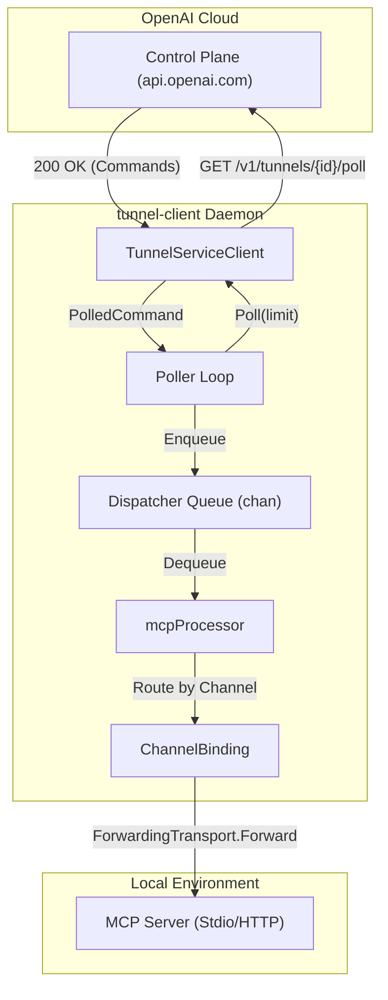
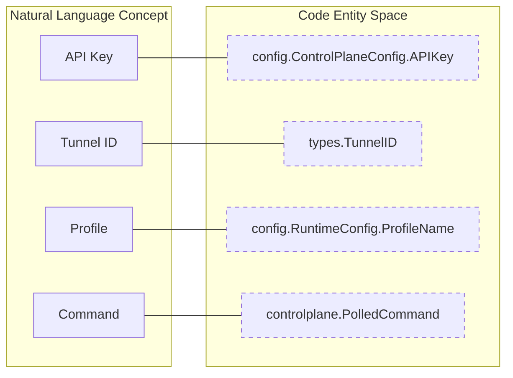

<!-- source: DeepWiki mcp.deepwiki.com · repo openai/tunnel-client · page 11 Glossary · fetched 2026-10-26 -->

# Glossary

Relevant source files

The following files were used as context for generating this wiki page:

- [README.md](README.md)
- [docs/README.md](docs/README.md)
- [docs/architecture.md](docs/architecture.md)
- [docs/configuration.md](docs/configuration.md)
- [docs/connectors.md](docs/connectors.md)
- [docs/deployment/overview.md](docs/deployment/overview.md)
- [docs/onboarding.md](docs/onboarding.md)
- [docs/openapi.json](docs/openapi.json)
- [docs/protocol.md](docs/protocol.md)
- [docs/troubleshooting.md](docs/troubleshooting.md)
- [pkg/adminui/oauth.go](pkg/adminui/oauth.go)
- [pkg/adminui/oauth_test.go](pkg/adminui/oauth_test.go)
- [pkg/config/config.go](pkg/config/config.go)
- [pkg/config/config_test.go](pkg/config/config_test.go)
- [pkg/config/file_config.go](pkg/config/file_config.go)
- [pkg/config/profile.go](pkg/config/profile.go)
- [pkg/controlplane/internal/tunnel_service_client.go](pkg/controlplane/internal/tunnel_service_client.go)
- [pkg/controlplane/internal/tunnel_service_client_test.go](pkg/controlplane/internal/tunnel_service_client_test.go)
- [pkg/controlplane/wiretypes/openapi_contract_test.go](pkg/controlplane/wiretypes/openapi_contract_test.go)
- [pkg/dispatcher/internal/processor.go](pkg/dispatcher/internal/processor.go)
- [pkg/dispatcher/internal/processor_test.go](pkg/dispatcher/internal/processor_test.go)
- [pkg/harpoon/fxmodule.go](pkg/harpoon/fxmodule.go)
- [pkg/harpoon/integration_test.go](pkg/harpoon/integration_test.go)
- [pkg/harpoon/registry.go](pkg/harpoon/registry.go)
- [pkg/harpoon/registry_test.go](pkg/harpoon/registry_test.go)
- [pkg/harpoon/server.go](pkg/harpoon/server.go)
- [pkg/harpoon/server_test.go](pkg/harpoon/server_test.go)
- [pkg/mcpclient/forwarding_transport_impl.go](pkg/mcpclient/forwarding_transport_impl.go)
- [pkg/mcpclient/forwarding_transport_impl_test.go](pkg/mcpclient/forwarding_transport_impl_test.go)
- [pkg/mcpclient/serialized_forwarding_transport.go](pkg/mcpclient/serialized_forwarding_transport.go)
- [pkg/mcpclient/serialized_forwarding_transport_test.go](pkg/mcpclient/serialized_forwarding_transport_test.go)
- [pkg/mcpclient/shared_connection_transport.go](pkg/mcpclient/shared_connection_transport.go)
- [pkg/mcpclient/shared_connection_transport_test.go](pkg/mcpclient/shared_connection_transport_test.go)
- [pkg/oauth/discovery.go](pkg/oauth/discovery.go)
- [pkg/oauth/discovery_failure.go](pkg/oauth/discovery_failure.go)
- [pkg/oauth/discovery_failure_test.go](pkg/oauth/discovery_failure_test.go)
- [pkg/oauth/discovery_test.go](pkg/oauth/discovery_test.go)
- [pkg/oauth/state.go](pkg/oauth/state.go)

This glossary defines the core domain concepts, architectural components, and technical terminology used within the `tunnel-client` codebase.

## Core Domain Concepts

### Tunnel
A logical connection between an OpenAI-hosted product (e.g., ChatGPT, Codex) and a private environment. It is identified by a unique `TunnelID`.
*   **Code Entity:** `types.TunnelID` [pkg/config/config.go:174-174]()
*   **Validation:** Must match the regex `^tunnel_[a-z0-9]{32}$` [pkg/config/config.go:82-82]()

### Control Plane
The OpenAI-hosted service (part of the Secure MCP Tunnel infrastructure) that manages tunnel metadata and acts as the rendezvous point for commands and responses. The client connects to the Control Plane via outbound long-polling.
*   **Primary Interface:** `controlplane.Fetcher` and `controlplane.Responder` [pkg/controlplane/internal/tunnel_service_client.go:48-49]()
*   **Implementation:** `TunnelServiceClient` [pkg/controlplane/internal/tunnel_service_client.go:50-69]()

### MCP (Model Context Protocol)
The protocol used to communicate between the OpenAI product and the customer-provided server. The `tunnel-client` acts as a proxy, unwrapping JSON-RPC payloads from Control Plane commands and forwarding them to the MCP server.
*   **Transports:** Supports `stdio`, `http-streamable`, and `in-memory` [pkg/config/config.go:35-39]()
*   **Code Entity:** `mcpclient.ForwardingTransport` [pkg/dispatcher/internal/processor.go:53-53]()

### Channel
A named routing path within a single tunnel. Different channels can route to different MCP servers or specialized internal services.
*   **Main Channel:** The default channel for standard MCP traffic [pkg/dispatcher/internal/processor.go:37-37]()
*   **Harpoon Channel:** A dedicated channel for the Harpoon outbound proxy [pkg/dispatcher/internal/processor.go:38-38]()
*   **Code Entity:** `types.Channel` [pkg/dispatcher/internal/processor.go:29-29]()

---

## Architectural Components

### Poller
The long-polling loop that requests new commands from the Control Plane. It implements backpressure by capping the poll limit based on available capacity in the Dispatcher's queue.
*   **Logic:** `TunnelServiceClient.Poll` [pkg/controlplane/internal/tunnel_service_client.go:235-245]()
*   **Backpressure:** The poll limit is determined by the `Dispatcher` capacity [pkg/controlplane/internal/poller_test.go:157-167]()

### Dispatcher (Processor)
The component responsible for routing `PolledCommand` objects to the correct `ChannelBinding`. It handles JSON-RPC execution, session termination, and OAuth discovery probes.
*   **Logic:** `mcpProcessor.Process` [pkg/dispatcher/internal/processor.go:45-45]()
*   **Code Entity:** `Processor` interface [pkg/dispatcher/internal/processor.go:44-46]()

### Harpoon
An embedded MCP server within `tunnel-client` that acts as an allowlisted outbound HTTP proxy. It allows OpenAI products to reach specific internal web services through the tunnel.
*   **Implementation:** `harpoon.Server` [pkg/harpoon/server.go:1-50]()
*   **Configuration:** `HarpoonConfig` [pkg/config/config.go:240-252]()

### Admin UI
An embedded Svelte-based web interface served by the `tunnel-client` daemon for monitoring health, logs, and OAuth status.
*   **Configuration:** `AdminUIConfig` [pkg/config/config.go:155-167]()
*   **Backend:** `pkg/adminui` package [pkg/adminui/oauth.go:1-20]()

---

## System Flow Diagrams

### Request Lifecycle: Control Plane to MCP Server
The following diagram illustrates how a request flows from the OpenAI Control Plane through the client's internal components to a downstream MCP server.

**Data Flow: Polled Command Processing**

*Sources: [pkg/controlplane/internal/tunnel_service_client.go:35-69](), [pkg/dispatcher/internal/processor.go:43-59](), [docs/architecture.md:61-76]()*

---

## Technical Terms & Abbreviations

| Term | Definition | Code Pointer |
| :--- | :--- | :--- |
| **DCR** | Dynamic Client Registration. Part of the OAuth discovery flow. | `pkg/oauth/discovery.go` |
| **PRMD** | Protected Resource Metadata. Metadata discovered via `/.well-known/oauth-protected-resource`. | `pkg/oauth/discovery.go` |
| **Shard Token** | An opaque token provided by the Control Plane to maintain affinity for specific request sequences. | `wiretypes.JsonRpcCommand.ShardToken` [pkg/controlplane/wiretypes/wire.go:1-50]() |
| **Guardrail** | Specifically the `PollDeadlineGuardrail`, a safety buffer subtracted from the HTTP timeout to ensure the client closes the connection before the server does. | `config.ControlPlaneConfig.PollDeadlineGuardrail` [pkg/config/config.go:179-179]() |
| **mTLS** | Mutual TLS. Used for high-security connections to `mtls.api.openai.com`. | `pkg/tlsconfig/bundle.go` |
| **Fx** | The dependency injection framework used to wire the application components at startup. | `pkg/dispatcher/internal/processor.go:20-20]()` |

---

## Mapping: Natural Language to Code Entities

This diagram maps common operational terms used in documentation to the specific Go types and file paths that implement them.

**Entity Mapping Diagram**

*Sources: [pkg/config/config.go:129-152](), [pkg/dispatcher/internal/processor.go:45-45](), [pkg/controlplane/internal/tunnel_service_client.go:50-69]()*

---

## Configuration Precedence
The configuration system resolves values in the following order (highest to lowest):
1.  **CLI Flags** (e.g., `--control-plane.tunnel-id`) [docs/configuration.md:6-6]()
2.  **Environment Variables** (e.g., `CONTROL_PLANE_TUNNEL_ID`) [docs/configuration.md:6-6]()
3.  **YAML Profile/Config File** [docs/configuration.md:6-6]()
4.  **Hardcoded Defaults** [pkg/config/config.go:49-68]()

*Sources: [docs/configuration.md:1-9](), [pkg/config/config.go:111-126](), [pkg/config/config_test.go:88-187]()*