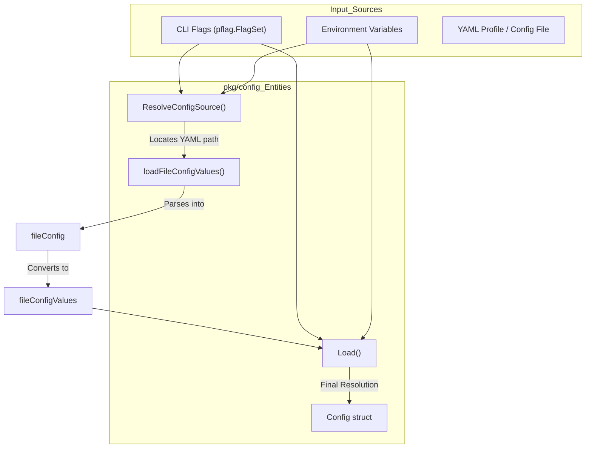

<!-- source: DeepWiki mcp.deepwiki.com · repo openai/tunnel-client · page 2 Configuration System · fetched 2026-10-26 -->

# Configuration System

Relevant source files

The following files were used as context for generating this wiki page:

- [docs/configuration.md](docs/configuration.md)
- [pkg/config/config.go](pkg/config/config.go)
- [pkg/config/config_test.go](pkg/config/config_test.go)
- [pkg/config/file_config.go](pkg/config/file_config.go)
- [pkg/config/profile.go](pkg/config/profile.go)

The `tunnel-client` configuration system is designed for flexibility across local development, enterprise proxy environments, and automated deployments. It utilizes a multi-layered approach where settings can be defined via CLI flags, environment variables, or YAML-based profiles.

## Configuration Precedence

The system follows a strict hierarchy when resolving configuration values. If a value is defined in multiple layers, the highest-priority source wins.

1.  **CLI Flags**: Highest precedence [docs/configuration.md:6-6]().
2.  **Environment Variables**: Overrides file-based settings [docs/configuration.md:6-6]().
3.  **YAML Config / Profiles**: Settings loaded from a disk-based configuration [pkg/config/profile.go:68-98]().
4.  **Defaults**: Hard-coded internal fallbacks [pkg/config/config.go:48-68]().

### Configuration Loading Flow

The diagram below illustrates how the `pkg/config` package resolves the final `Config` struct used by the application.

**Config Resolution Logic**

Sources: [pkg/config/config.go:129-141](), [pkg/config/profile.go:36-100](), [pkg/config/file_config.go:136-180]()

## Configuration Layers

### 1. YAML Profiles and Files
Users can point the client to a specific YAML file using `--config` or use named profiles. Profiles are YAML files stored in a standard directory.

*   **Named Profile**: `--profile <name>` loads `<name>.yaml` from the profile directory [pkg/config/profile.go:143-153]().
*   **Direct File**: `--profile-file <path>` or `--config <path>` [pkg/config/profile.go:68-76]().
*   **Default Directory**: Follows XDG standards, typically `$XDG_CONFIG_HOME/tunnel-client` or `~ ~/.config/tunnel-client` [pkg/config/profile.go:117-140]().

For details, see [Profiles and YAML Configuration Files](#2.2).

Sources: [docs/configuration.md:65-100](), [pkg/config/profile.go:13-19]()

### 2. Environment Variables
Most configuration options have a corresponding environment variable, typically prefixed with `CONTROL_PLANE_`, `MCP_`, or `LOG_`. For example, `CONTROL_PLANE_TUNNEL_ID` maps to the `control-plane.tunnel-id` flag [pkg/config/config_test.go:88-111]().

Sources: [pkg/config/profile.go:13-17](), [pkg/config/config_test.go:88-111]()

### 3. CLI Flags
The client provides extensive flags for overriding any setting at runtime. The `commonFlagAliases` map provides shorter aliases for nested configuration paths [pkg/config/config.go:111-126]().

Sources: [pkg/config/config.go:105-126]()

## Secret Resolution (`env:` and `file:`)

To prevent sensitive data from leaking into process trees or version control, `tunnel-client` supports dynamic resolution for secret-bearing fields like `api_key` and `extra_headers` [docs/configuration.md:169-178]().

*   **`env:VAR_NAME`**: The value is read from the specified environment variable at startup.
*   **`file:/path/to/secret`**: The value is read from the specified file on disk.

This mechanism ensures secrets stay out of `argv` and checked-in YAML files [docs/configuration.md:173-177]().

Sources: [docs/configuration.md:169-178](), [pkg/config/file_config.go:166-179]()

## Major Configuration Areas

The configuration is partitioned into several functional areas, each represented by a specific struct in `pkg/config/config.go`:

| Area | Struct | Key Responsibilities |
| :--- | :--- | :--- |
| **Control Plane** | `ControlPlaneConfig` | Base URL, Tunnel ID, Polling timeouts, and API keys [pkg/config/config.go:170-184](). |
| **MCP** | `MCPConfig` | Channel bindings, server URLs, and stdio commands [pkg/config/config.go:217-230](). |
| **Harpoon** | `HarpoonConfig` | Outbound allowlists, proxy targets, and payload capture [pkg/config/config.go:264-282](). |
| **Networking** | `ProxyHealthConfig` | Global and per-service HTTP proxy settings [pkg/config/config.go:285-288](). |
| **Observability** | `LoggingConfig` | Log levels (`slog.Level`), formats, and file paths [pkg/config/config.go:203-209](). |
| **Admin UI** | `AdminUIConfig` | Browser behavior and log buffer sizing for the embedded dashboard [pkg/config/config.go:155-167](). |

For a full list of options and validation rules, see [Configuration Reference](#2.1).

Sources: [pkg/config/config.go:129-141](), [pkg/config/config.go:170-288]()

## Diagnostic and Initialization Tools

The configuration system includes built-in commands to help users validate their setup:

*   **`init`**: Interactive generator for profiles based on templates [docs/configuration.md:23-23]().
*   **`doctor`**: Performs a pre-flight check, validating configuration syntax and connectivity [docs/configuration.md:24-25]().
*   **`profiles samples list`**: Shows all available sample templates [docs/configuration.md:26-26]().

Sources: [docs/configuration.md:20-36]()

## Networking and Security

The client supports complex networking requirements:
*   **Hierarchical Proxies**: Proxies can be defined globally (`http_proxy` in YAML root), per-service (in `control_plane` or `mcp`), or inherited from the environment [pkg/config/file_config.go:27-48]().
*   **mTLS**: Automatic switching to `https://mtls.api.openai.com` when `client_cert` and `client_key` are provided for the control plane [docs/configuration.md:112-115](), [pkg/config/config.go:49-50]().
*   **CA Bundles**: Extension of the system trust store via `ca_bundle` for intercepting enterprise proxies [pkg/config/file_config.go:27-27]().

For details, see [Networking: Proxies, TLS, and mTLS](#2.3).

Sources: [docs/configuration.md:112-115](), [pkg/config/config.go:49-50](), [pkg/config/file_config.go:27-48]()

---

