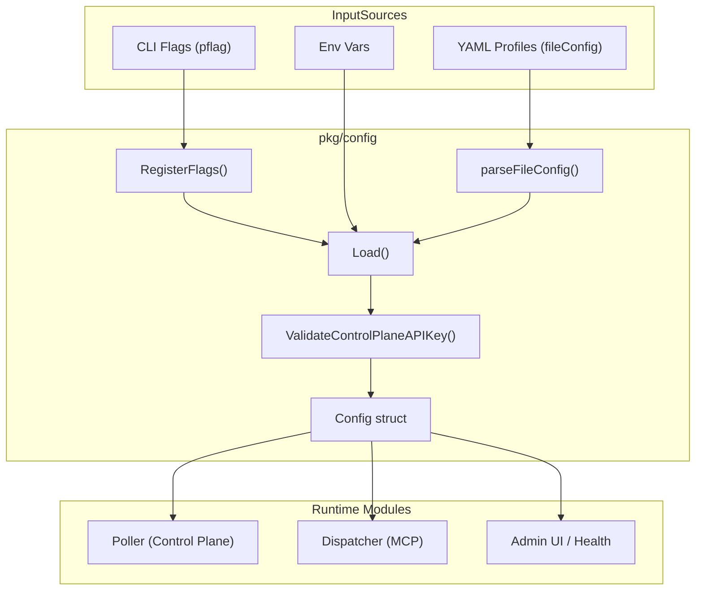

<!-- source: DeepWiki mcp.deepwiki.com · repo openai/tunnel-client · page 2.1 Configuration Reference · fetched 2026-10-26 -->

# Configuration Reference

<details>
<summary>Relevant source files</summary>

The following files were used as context for generating this wiki page:

- [cmd/client/admin/admin_command.go](cmd/client/admin/admin_command.go)
- [docs/configuration.md](docs/configuration.md)
- [pkg/config/admin.go](pkg/config/admin.go)
- [pkg/config/admin_test.go](pkg/config/admin_test.go)
- [pkg/config/config.go](pkg/config/config.go)
- [pkg/config/config_test.go](pkg/config/config_test.go)
- [pkg/config/file_config.go](pkg/config/file_config.go)
- [pkg/config/http_headers.go](pkg/config/http_headers.go)
- [pkg/config/http_headers_test.go](pkg/config/http_headers_test.go)
- [pkg/config/profile.go](pkg/config/profile.go)

</details>


The `tunnel-client` utilizes a multi-layered configuration system designed for flexibility across local development and enterprise production environments. Configuration is managed via the `Config` struct defined in `pkg/config/config.go`, which aggregates settings for the control plane, MCP (Model Context Protocol), health monitoring, and logging.

### Configuration Precedence and Resolution
The client resolves configuration using the following order of precedence (highest to lowest):
1.  **CLI Flags**: Explicitly passed arguments.
2.  **Environment Variables**: Prefixed with `TUNNEL_CLIENT_` or specific keys like `CONTROL_PLANE_API_KEY`.
3.  **YAML Profile/Config File**: Loaded via `--profile` or `--config`.
4.  **Defaults**: Hardcoded internal defaults.

[docs/configuration.md:6-8](), [pkg/config/config.go:128-141]()

#### Secret Resolution
To prevent secret leakage in process trees or checked-in YAML files, fields that support secrets (like `api_key` or `extra_headers`) support prefix-based resolution via the `dereferenceKey` logic:
*   `env:VAR_NAME`: Fetches the value from the specified environment variable. [pkg/config/admin.go:128-139]()
*   `file:/path/to/secret`: Reads the value from the specified file path and trims whitespace. [pkg/config/admin.go:140-153]()

This is supported for control-plane, MCP runtime, and MCP discovery/probe extra headers. [docs/configuration.md:169-177]()

---

## Configuration Data Flow

The following diagram illustrates how the `Config` entity is populated and consumed by the system modules.

### Config Initialization Lifecycle

**Sources:** [pkg/config/config.go:128-141](), [pkg/config/file_config.go:190-201](), [pkg/config/config.go:92-103]()

---

## Configuration Sections

### 1. ControlPlaneConfig
Defines the connection parameters for the OpenAI Tunnel Control Plane.

| Field | Flag / Env Var | Default | Validation / Notes |
| :--- | :--- | :--- | :--- |
| `BaseURL` | `--control-plane.base-url` | `https://api.openai.com` | Automatically switches to `mtls.api.openai.com` if client certs are provided. [pkg/config/config.go:171](), [docs/configuration.md:112-113]() |
| `TunnelID` | `--control-plane.tunnel-id` | Required | Must match regex `^tunnel_[a-z0-9]{32}$`. [pkg/config/config.go:82]() |
| `APIKey` | `CONTROL_PLANE_API_KEY` | Required | Supports `env:` and `file:` prefixes. [pkg/config/config.go:176]() |
| `PollTimeout` | `--control-plane.poll-timeout` | `30s` | Max allowed: `10m` (including guardrail). [pkg/config/config.go:53-56]() |
| `MaxInFlight` | `--control-plane.max-inflight-requests` | `20` | Max allowed: `10000`. [pkg/config/config.go:51-52]() |

[pkg/config/config.go:49-56](), [pkg/config/config.go:170-190]()

### 2. MCPConfig
Configures how the client interacts with Model Context Protocol servers.

| Field | Flag / Env Var | Default | Description |
| :--- | :--- | :--- | :--- |
| `ServerURL` | `--mcp.server-url` | N/A | URL for HTTP-streamable MCP servers. [pkg/config/config.go:215]() |
| `Command` | `--mcp.command` | N/A | Command string for `stdio` based MCP servers. [pkg/config/config.go:217]() |
| `ExtraHeaders` | `--mcp.extra-headers` | N/A | Map of headers sent to the MCP server. [pkg/config/config.go:224]() |
| `ConnectionMaxTTL` | `--mcp.connection-max-ttl` | `10m` | Max lifetime of an MCP connection. [pkg/config/config.go:64]() |

[pkg/config/config.go:214-231](), [pkg/config/config.go:64-65]()

### 3. HarpoonConfig
Controls the embedded Harpoon outbound proxy server.

| Field | Flag | Default | Description |
| :--- | :--- | :--- | :--- |
| `Targets` | `--harpoon.target` | N/A | List of allowlisted target URLs. [pkg/config/config.go:240]() |
| `MaxRedirects` | N/A | `5` | Maximum HTTP redirects followed. [pkg/config/config.go:67]() |
| `MaxResponseBytes`| N/A | `102400` | Max bytes buffered from a target response. [pkg/config/config.go:66]() |

[pkg/config/config.go:239-254](), [pkg/config/config.go:66-67](), [pkg/config/config.go:76]()

---

## Code Entity Mapping

This diagram maps the natural language configuration categories to their specific Go structs and validation logic in the codebase.

### Configuration Entity Space
```mermaid
classDiagram
    class Config {
        +ControlPlaneConfig ControlPlane
        +MCPConfig MCP
        +HarpoonConfig Harpoon
        +LoggingConfig Logging
        +AdminUIConfig AdminUI
    }
    class ControlPlaneConfig {
        +url.URL BaseURL
        +types.TunnelID TunnelID
        +string APIKey
        +Duration PollTimeout
    }
    class MCPConfig {
        +url.URL ServerURL
        +string Command
        +map[string]string ExtraHeaders
    }
    class HarpoonConfig {
        +[]HarpoonTarget Targets
        +int MaxRedirects
        +int MaxResponseBytes
    }
    class AdminUIConfig {
        +bool AllowRemote
        +bool OpenBrowser
        +int LogBufferEvents
    }

    Config *-- ControlPlaneConfig : [pkg/config/config.go:130]
    Config *-- MCPConfig : [pkg/config/config.go:135]
    Config *-- HarpoonConfig : [pkg/config/config.go:137]
    Config *-- AdminUIConfig : [pkg/config/config.go:136]
    
    ControlPlaneConfig ..> tunnelIDPattern : [pkg/config/config.go:82]
    HarpoonConfig ..> harpoonLabelPattern : [pkg/config/config.go:76]
```
**Sources:** [pkg/config/config.go:128-141](), [pkg/config/config.go:155-167](), [pkg/config/config.go:170-190](), [pkg/config/config.go:214-231]()

---

## Validation Rules and Guardrails

The configuration system enforces strict limits to ensure client stability and prevent control plane abuse:

1.  **Tunnel ID Format**: Validated using `tunnelIDPattern`. Must match `^tunnel_[a-z0-9]{32}$`. [pkg/config/config.go:82]()
2.  **Poll Timing**: 
    *   The sum of `PollTimeout` and `PollDeadlineGuardrail` cannot exceed `10 minutes`. [pkg/config/config.go:72]()
    *   `PollDeadlineGuardrail` must be at least `1ms` and less than `1 minute`. [pkg/config/config.go:73-74]()
3.  **Concurrency**: `MaxInFlightRequests` is capped at `10,000`. [pkg/config/config.go:52]()
4.  **Logging**: `LogFormat` supports `json` and `struct-text`. [pkg/config/config.go:23-30](), [pkg/config/config.go:83-86]()
5.  **HTTP Headers**: `NormalizeExtraHeaders` ensures header names are valid HTTP tokens and values are wire-safe (no NUL or DEL characters). [pkg/config/http_headers.go:15-41]()

### Flag Aliasing
For CLI convenience, many nested configuration fields have kebab-case aliases defined in `commonFlagAliases`:
*   `--control-plane.tunnel-id` can be written as `--control-plane-tunnel-id`.
*   `--mcp.server-url` can be written as `--mcp-server-url`.
*   `--health.listen-addr` can be written as `--health-listen-addr`.

[pkg/config/config.go:111-126]()

**Sources:** [pkg/config/config.go:48-87](), [pkg/config/http_headers.go:88-115](), [pkg/config/config_test.go:30-69]()

---

