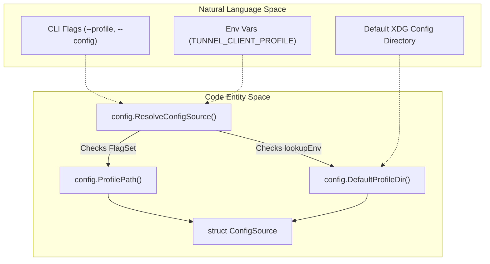
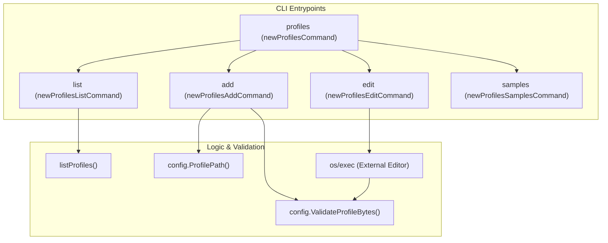

<!-- source: DeepWiki mcp.deepwiki.com · repo openai/tunnel-client · page 2.2 Profiles and YAML Configuration Files · fetched 2026-10-26 -->

# Profiles and YAML Configuration Files

Relevant source files

The following files were used as context for generating this wiki page:

- [cmd/client/help_topics/samples.txt](cmd/client/help_topics/samples.txt)
- [cmd/client/init_command.go](cmd/client/init_command.go)
- [cmd/client/profile_samples.go](cmd/client/profile_samples.go)
- [cmd/client/profile_samples/sample_mcp_enterprise_proxy.yaml.tmpl](cmd/client/profile_samples/sample_mcp_enterprise_proxy.yaml.tmpl)
- [cmd/client/profile_samples/sample_mcp_remote_no_auth.yaml.tmpl](cmd/client/profile_samples/sample_mcp_remote_no_auth.yaml.tmpl)
- [cmd/client/profile_samples/sample_mcp_stdio_local.yaml.tmpl](cmd/client/profile_samples/sample_mcp_stdio_local.yaml.tmpl)
- [cmd/client/profile_samples/sample_mcp_with_dcr.yaml.tmpl](cmd/client/profile_samples/sample_mcp_with_dcr.yaml.tmpl)
- [cmd/client/profiles_command_test.go](cmd/client/profiles_command_test.go)
- [docs/configuration.md](docs/configuration.md)
- [pkg/config/config.go](pkg/config/config.go)
- [pkg/config/config_alias_test.go](pkg/config/config_alias_test.go)
- [pkg/config/config_test.go](pkg/config/config_test.go)
- [pkg/config/file_config.go](pkg/config/file_config.go)
- [pkg/config/profile.go](pkg/config/profile.go)
- [pkg/config/profile_test.go](pkg/config/profile_test.go)

The `tunnel-client` utilizes a YAML-based configuration system designed to simplify the management of multiple tunnels and complex networking environments. Profiles allow users to encapsulate control-plane credentials, MCP server definitions, and proxy settings into named files that can be easily invoked via the CLI.

## Profile Resolution and Precedence

The configuration system employs a multi-layered precedence model. Profiles are loaded first, but their values can be overridden by explicit environment variables or CLI flags.

### Resolution Logic
The `ResolveConfigSource` function in `pkg/config/profile.go` determines which configuration file to use based on the following priority:

1.  **CLI Flags**: `--config`, `--profile`, or `--profile-file`. [pkg/config/profile.go:41-43]()
2.  **Environment Variables**: `TUNNEL_CLIENT_CONFIG`, `TUNNEL_CLIENT_PROFILE`, or `TUNNEL_CLIENT_PROFILE_FILE`. [pkg/config/profile.go:78-80]()

Profile lookup uses the following directory precedence if a directory is not explicitly provided:
1.  `--profile-dir` flag. [pkg/config/profile.go:44]()
2.  `TUNNEL_CLIENT_PROFILE_DIR` environment variable. [pkg/config/profile.go:16]()
3.  `$XDG_CONFIG_HOME/tunnel-client`. [pkg/config/profile.go:121-126]()
4.  `~/.config/tunnel-client`. [pkg/config/profile.go:128-133]()

### Precedence Diagram: Natural Language to Code Entities
This diagram illustrates how the `config` package resolves input sources into a `ConfigSource` struct.

"Configuration Resolution Flow"

Sources: [pkg/config/profile.go:27-100](), [pkg/config/profile.go:117-140](), [docs/configuration.md:82-88]()

## YAML Structure and Data Flow

Profiles are parsed into a `fileConfig` struct which mirrors the YAML hierarchy. This struct is then converted into a flat environment map via `toEnv()` to be merged with the system environment.

### Key Configuration Sections
| Section | Purpose | Code Entity |
| :--- | :--- | :--- |
| `control_plane` | Tunnel ID, API Keys, and Polling settings | `fileControlPlaneConfig` [pkg/config/file_config.go:40]() |
| `mcp` | List of server URLs or local commands | `fileMCPConfig` [pkg/config/file_config.go:85]() |
| `harpoon` | Outbound HTTP proxy allowlist targets | `fileHarpoonConfig` [pkg/config/file_config.go:111]() |
| `health` | Admin UI and metrics listener address | `fileHealthConfig` [pkg/config/file_config.go:62]() |

### Implementation of Loading
The `loadFileConfigValues` function performs the following steps:
1.  **Read**: Reads the file from the path determined by `ResolveConfigSource`. [pkg/config/file_config.go:145]()
2.  **Parse**: Unmarshals YAML into `fileConfig` using `yaml.v3` with `KnownFields(true)` to prevent silent typos. [pkg/config/file_config.go:190-201]()
3.  **Resolve Secrets**: Identifies strings prefixed with `env:` or `file:` and resolves them at runtime. [docs/configuration.md:169-177]()
4.  **Inject**: Values from the file are injected into the process environment lookup via `lookupEnvWithFileValues`. [pkg/config/file_config.go:203-205]()

Sources: [pkg/config/file_config.go:25-131](), [pkg/config/file_config.go:136-180](), [pkg/config/file_config.go:190-201]()

## Profile Generation and Samples

The `init` command and `profiles add` command leverage embedded templates to generate starting configurations for common use cases.

### Sample Templates
Templates are stored in `cmd/client/profile_samples/` and embedded into the binary.

*   **Enterprise Proxy (`sample_mcp_enterprise_proxy`)**: Configures `ca_bundle` and `http_proxy` using environment variable references (e.g., `env:HTTPS_PROXY`). [cmd/client/profile_samples/sample_mcp_enterprise_proxy.yaml.tmpl:11-12]()
*   **Local Stdio (`sample_mcp_stdio_local`)**: Designed for fast-path setup using a local command instead of a network URL. [cmd/client/profile_samples/sample_mcp_stdio_local.yaml.tmpl:22-24]()
*   **DCR/OAuth (`sample_mcp_with_dcr`)**: Standard template for HTTP MCP servers that support Dynamic Client Registration. [cmd/client/profile_samples/sample_mcp_with_dcr.yaml.tmpl:1-30]()
*   **Remote No-Auth (`sample_mcp_remote_no_auth`)**: For simple remote MCP servers without complex metadata discovery. [cmd/client/profile_samples/sample_mcp_remote_no_auth.yaml.tmpl:22-24]()

### The `init` Command Workflow
The `newInitCommand` provides an interactive experience to create a runnable profile. It validates the provided `tunnel-id` and performs a "preflight" check if a `mcp-command` is provided to ensure the executable exists. [cmd/client/init_command.go:33-71]()

Sources: [cmd/client/init_command.go:13-102](), [cmd/client/profile_samples/sample_mcp_enterprise_proxy.yaml.tmpl:1-42]()

## Profiles CLI Subcommand

The `profiles` command group provides administrative utilities for managing the local profile directory.

### Command Structure
"Profiles Command Entity Mapping"

### Key Functionalities
*   **Listing**: Scans the profile directory for `.yaml` files and returns names and paths. Can output JSON for machine readability. [cmd/client/profiles_command_test.go:35-43]()
*   **Adding**: Supports creating profiles from a file (`--from-file`) or a built-in sample (`--sample`). It enforces a `--force` flag to prevent accidental overwrites. [cmd/client/profiles_command_test.go:79-97]()
*   **Editing**: Opens the profile in the user's defined `$EDITOR`. It validates the YAML syntax and version (must be `config_version: 1`) before saving changes. [cmd/client/profiles_command_test.go:128-159]()
*   **Validation**: `ValidateProfileBytes` ensures that the configuration is syntactically correct and matches the supported version schema. [pkg/config/profile.go:180-189]()

Sources: [cmd/client/profiles_command_test.go:15-43](), [cmd/client/profiles_command_test.go:128-159](), [pkg/config/profile.go:143-168](), [pkg/config/profile.go:180-189]()

---

