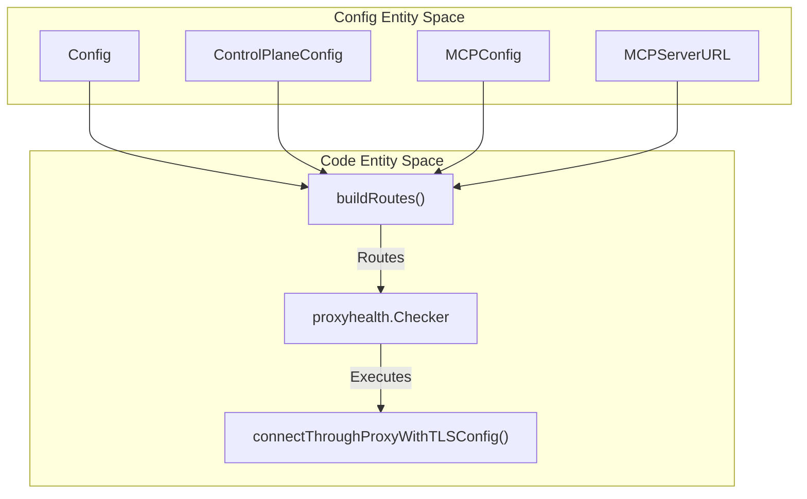
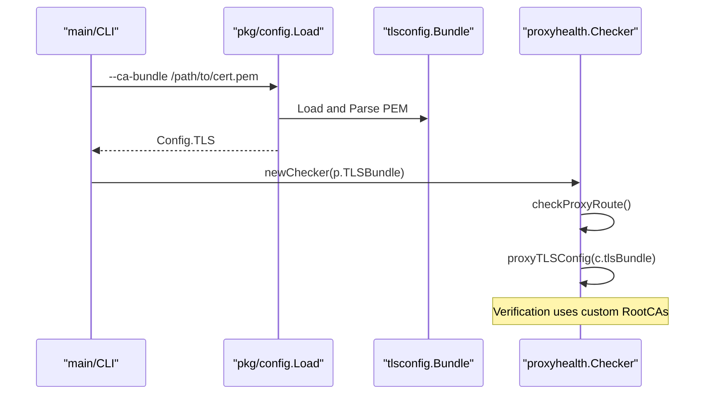
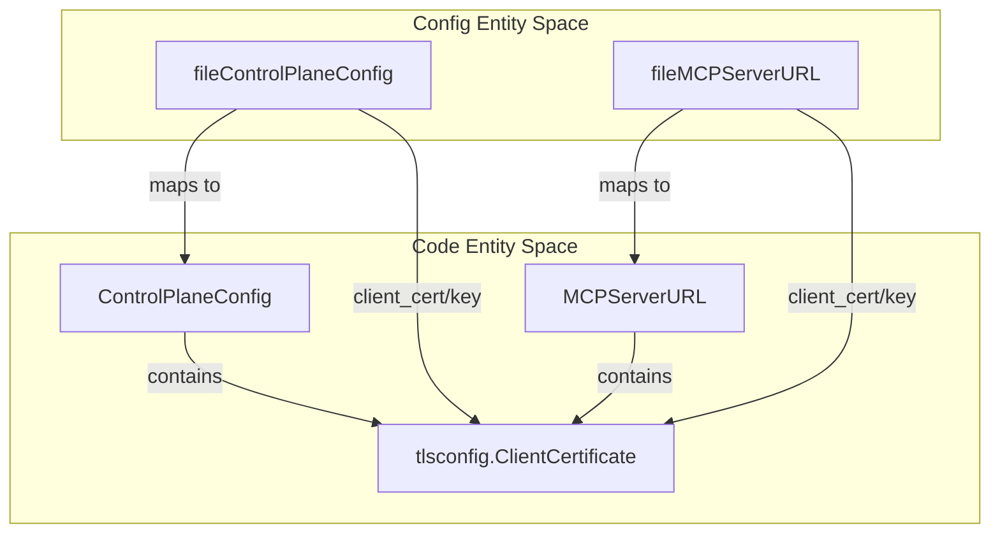

<!-- source: DeepWiki mcp.deepwiki.com · repo openai/tunnel-client · page 2.3 Networking: Proxies, TLS, and mTLS · fetched 2026-10-26 -->

# Networking: Proxies, TLS, and mTLS

Relevant source files

The following files were used as context for generating this wiki page:

- [docs/configuration.md](docs/configuration.md)
- [pkg/config/config.go](pkg/config/config.go)
- [pkg/config/config_test.go](pkg/config/config_test.go)
- [pkg/config/file_config.go](pkg/config/file_config.go)
- [pkg/config/profile.go](pkg/config/profile.go)
- [pkg/dispatcher/fxmodule.go](pkg/dispatcher/fxmodule.go)
- [pkg/dispatcher/fxmodule_test.go](pkg/dispatcher/fxmodule_test.go)
- [pkg/harpoon/metrics.go](pkg/harpoon/metrics.go)
- [pkg/harpoon/metrics_test.go](pkg/harpoon/metrics_test.go)
- [pkg/oauth/discovery_retry_policy.go](pkg/oauth/discovery_retry_policy.go)
- [pkg/proxyhealth/checker.go](pkg/proxyhealth/checker.go)
- [pkg/proxyhealth/checker_test.go](pkg/proxyhealth/checker_test.go)
- [pkg/tlsconfig/client_certificate.go](pkg/tlsconfig/client_certificate.go)
- [pkg/tlsconfig/client_certificate_test.go](pkg/tlsconfig/client_certificate_test.go)

The `tunnel-client` provides a robust networking layer designed to operate in restrictive corporate environments. It supports multi-layered proxy configurations, custom trust anchors via CA bundles, and mutual TLS (mTLS) for both the Control Plane and Model Context Protocol (MCP) connections.

## Proxy Configuration Hierarchy

The client supports a hierarchical proxy resolution model. Proxies can be configured globally, per service (Control Plane vs. MCP), or specifically for individual MCP channels.

### Precedence Rules
When determining which proxy to use for a specific outbound request, the client follows this order of precedence:
1.  **Channel-specific proxy**: Defined in `fileMCPServerURL.HTTPProxy` [pkg/config/file_config.go:101]().
2.  **Service-specific proxy**: Defined in `fileControlPlaneConfig.HTTPProxy` [pkg/config/file_config.go:48]() or `fileMCPConfig.HTTPProxy` [pkg/config/file_config.go:88]().
3.  **Global Proxy**: Defined at the top level of the configuration file [pkg/config/file_config.go:28]().
4.  **Global Environment Variables**: Standard `HTTP_PROXY`, `HTTPS_PROXY`, and `NO_PROXY`.

### Proxy Health Checking
The `proxyhealth.Checker` component performs periodic background checks on configured proxy routes [pkg/proxyhealth/checker.go:72-85](). It validates connectivity by attempting a `CONNECT` handshake through the proxy to the target host [pkg/proxyhealth/checker.go:246-252]().

Title: Proxy Route Resolution and Health Monitoring

Sources: [pkg/config/config.go:129-141](), [pkg/config/file_config.go:25-38](), [pkg/proxyhealth/checker.go:117-146](), [pkg/proxyhealth/checker.go:246-265]()

## TLS and CA Bundle Extension

To support internal services using private Certificate Authorities (CAs), `tunnel-client` allows extending the system trust store using a CA bundle.

### Implementation Details
The `tlsconfig.Bundle` struct holds parsed root certificates [pkg/config/config.go:139](). The client loads PEM-encoded data provided via the `ca_bundle` field in the YAML config [pkg/config/file_config.go:27]() or the `--ca-bundle` CLI flag.

*   **Trust Extension**: The bundle is used to initialize `tls.Config` objects for both the Control Plane and MCP transports.
*   **Proxy TLS**: When connecting to an HTTPS proxy, the `proxyTLSConfig` helper ensures the custom CA bundle is used to verify the proxy's identity [pkg/proxyhealth/checker.go:251]().

### Data Flow: CA Bundle Application
Title: CA Bundle Loading and TLS Verification

Sources: [pkg/config/config.go:139](), [pkg/config/file_config.go:27](), [pkg/proxyhealth/checker.go:117-130](), [pkg/proxyhealth/checker.go:246-252]()

## Mutual TLS (mTLS)

The client supports mTLS for high-security environments, specifically for the connection to the OpenAI Control Plane and downstream MCP servers.

### Control Plane mTLS and Automatic Switching
The client features an "automatic switching" mechanism for OpenAI endpoints. If the `control_plane.base_url` is set to the default `https://api.openai.com` [pkg/config/config.go:49]() and client certificates are provided, the client automatically uses the mTLS base URL `https://mtls.api.openai.com` [pkg/config/config.go:50](), [docs/configuration.md:112-115]().

### Configuration
mTLS is configured using `client_cert` and `client_key` fields. These fields support `file:` and `env:` resolution [docs/configuration.md:169-172]().

| Field | Description | YAML Path |
| :--- | :--- | :--- |
| `ClientCert` | Path to the client certificate (PEM) | `control_plane.client_cert` [pkg/config/file_config.go:46]() |
| `ClientKey` | Path to the private key (PEM) | `control_plane.client_key` [pkg/config/file_config.go:47]() |

### Code Implementation
The `ControlPlaneConfig` and `MCPConfig` structs store `ClientCertificate` references [pkg/config/config.go:184-185](), [pkg/config/config.go:204-205](). These are resolved at startup from the `fileControlPlaneConfig` and `fileMCPConfig` types [pkg/config/file_config.go:40-53](), [pkg/config/file_config.go:85-95]().

Title: mTLS Certificate Configuration Mapping

Sources: [pkg/config/config.go:184-185](), [pkg/config/config.go:204-205](), [pkg/config/file_config.go:46-47](), [pkg/config/file_config.go:102-103]()

## Static Header Injection

`tunnel-client` supports injecting static headers for authentication. To keep secrets out of configuration files, these fields support `env:VARNAME` or `file:/path` prefixes [docs/configuration.md:169-177]().

*   **Control Plane Headers**: Defined in `control_plane.extra_headers` [pkg/config/file_config.go:52]().
*   **MCP Runtime Headers**: Defined in `mcp.extra_headers` [pkg/config/file_config.go:91]().
*   **MCP Discovery Headers**: Used during OAuth discovery probes, defined in `mcp.discovery_extra_headers` [pkg/config/file_config.go:92]().

Sources: [docs/configuration.md:106-121](), [pkg/config/file_config.go:52](), [pkg/config/file_config.go:91-92]()

---

