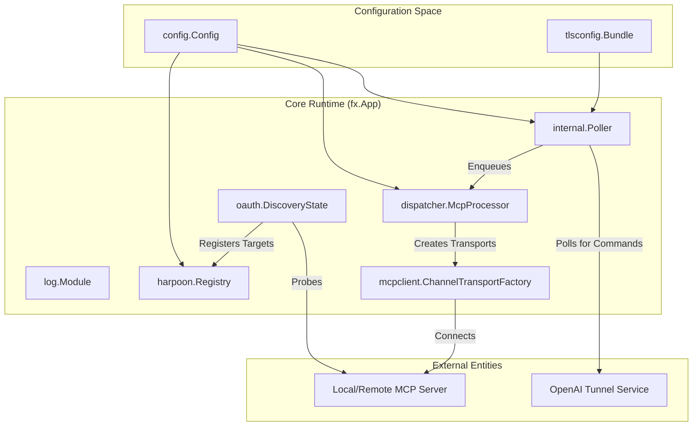

<!-- source: DeepWiki mcp.deepwiki.com · repo openai/tunnel-client · page 3 Core Runtime Architecture · fetched 2026-10-26 -->

# Core Runtime Architecture

Relevant source files

The following files were used as context for generating this wiki page:

- [client.go](client.go)
- [client_test.go](client_test.go)
- [cmd/client/main_test.go](cmd/client/main_test.go)
- [pkg/adminui/startup.go](pkg/adminui/startup.go)
- [pkg/adminui/startup_test.go](pkg/adminui/startup_test.go)
- [pkg/app/app.go](pkg/app/app.go)
- [pkg/app/app_test.go](pkg/app/app_test.go)
- [pkg/controlplane/fx/fxmodule.go](pkg/controlplane/fx/fxmodule.go)
- [pkg/controlplane/fx/fxmodule_test.go](pkg/controlplane/fx/fxmodule_test.go)
- [pkg/health/health.go](pkg/health/health.go)
- [pkg/health/health_test.go](pkg/health/health_test.go)

The `tunnel-client` is built as a modular Go application using the [Uber fx](https://github.com/uber-go/fx) dependency injection framework. This architecture allows for a decoupled design where major subsystems (polling, dispatching, MCP communication, and OAuth discovery) are composed into a single runtime through a central module registry.

## Application Lifecycle and Composition

The application entry point is in `cmd/client/main.go`, which invokes the `run` command. The `run` command initializes the configuration and constructs an `fx.App` via the `pkg/app` package [pkg/app/app.go:120-128]().

The `pkg/app.Options` function defines the core graph of the system, supplying configuration structs and registering the functional modules that make up the client [pkg/app/app.go:48-73]().

### Main Application Modules

| Module | Responsibility |
| :--- | :--- |
| `log.Module` | Structured logging (`slog`) with support for live level changes [pkg/log/log.go:17-26](). |
| `controlplane.Module` | The long-polling client that communicates with the OpenAI Tunnel Service [pkg/controlplane/fx/fxmodule.go:25-29](). |
| `dispatcher.Module` | The command processor and in-memory queue that routes requests to MCP workers [pkg/dispatcher/dispatcher.go:21-27](). |
| `mcpclient.Module` | Transport factory for connecting to local/remote MCP servers (stdio, HTTP, etc.) [pkg/mcpclient/mcpclient.go:20-25](). |
| `oauth.Module` | Automated discovery of OAuth protected resource metadata from MCP servers [pkg/oauth/oauth.go:22-27](). |
| `harpoon.Module` | The embedded Harpoon proxy for allowlisted outbound HTTP requests [pkg/harpoon/harpoon.go:26-32](). |
| `adminui.Module` | The embedded Svelte-based web interface and management API [pkg/adminui/adminui.go:20-25](). |
| `health.HealthMuxModule` | The health/readiness server and Prometheus metrics exporter [pkg/health/health.go:32-44](). |

**Sources:** [pkg/app/app.go:48-89]()

## Runtime Dependency Graph

The following diagram illustrates how the core components are wired together via `fx`. The `Config` object acts as the root provider, while the `Dispatcher` serves as the central hub connecting the outbound poller to the local MCP transports.

### System Wiring Diagram

**Sources:** [pkg/app/app.go:48-67](), [pkg/controlplane/fx/fxmodule.go:25-29](), [pkg/health/health.go:106-117]()

## Subsystem Overviews

### Control Plane Client and Poller
The `controlplane` subsystem is the client's "ear." It maintains a long-polling connection to the OpenAI Tunnel Service via `internal.Poller` [pkg/controlplane/fx/fxmodule.go:195-196](). It handles shard tokens, backpressure, and ensures that the client remains connected even under varying network conditions.
*   For details, see [Control Plane Client and Poller](#3.1).

### Dispatcher and Command Processing
The `dispatcher` acts as the "brain." It receives JSON-RPC commands from the poller and places them into a bounded in-memory queue (`PolledCommandQueue`). It manages a pool of workers that route these commands to the appropriate MCP channel and handles the lifecycle of those sessions.
*   For details, see [Dispatcher and Command Processing](#3.2).

### MCP Client and Transport Layer
The `mcpclient` package provides the "hands" of the client. It implements the Model Context Protocol (MCP) and supports multiple transport types: `stdio` (for local binaries), `HTTP SSE` (for remote servers), and `in-memory` (for internal tools like Harpoon) [pkg/controlplane/fx/fxmodule.go:164-172]().
*   For details, see [MCP Client and Transport Layer](#3.3).

### OAuth Discovery and Metadata
The `oauth` subsystem enables the client to dynamically discover how to authenticate with MCP servers. It probes servers for `WWW-Authenticate` headers and `/.well-known/oauth-protected-resource` metadata to facilitate secure tool calls [pkg/health/health.go:127]().
*   For details, see [OAuth Discovery and Protected Resource Metadata](#3.4).

## Initialization Sequence

When `tunnel-client run` is executed, the following sequence occurs:
1.  **Config Loading**: Flags, environment variables, and YAML profiles are merged.
2.  **Module Wiring**: `fx` resolves the dependency graph and starts each module in order [pkg/app/app.go:48-90]().
3.  **Trust Report**: The system logs a summary of the loaded CA bundles and TLS configuration [pkg/app/app.go:71]().
4.  **Metadata Fetch**: The client attempts to fetch its tunnel metadata from the control plane [pkg/controlplane/fx/fxmodule.go:28]().
5.  **Ready State**: The `/readyz` endpoint becomes healthy once `OAuthState`, `MCPProbeState`, and `CloudflaredState` report readiness [pkg/health/health.go:127](), [pkg/health/health.go:160-164]().

### Component Readiness Mapping
| Code Entity | System Role |
| :--- | :--- |
| `oauth.DiscoveryState` | Tracks if OAuth metadata has been successfully retrieved from the MCP server. |
| `mcpclient.ProbeState` | Tracks the success of the initial MCP `initialize` handshake. |
| `cloudflared.State` | Tracks the connectivity status of the managed Cloudflare tunnel (if enabled). |
| `health.Service` | Aggregates states to expose `/healthz` and `/readyz` [pkg/health/health.go:47-52](). |

**Sources:** [pkg/app/app.go:48-90](), [pkg/health/health.go:156-217](), [pkg/adminui/startup.go:76-138]()

---

