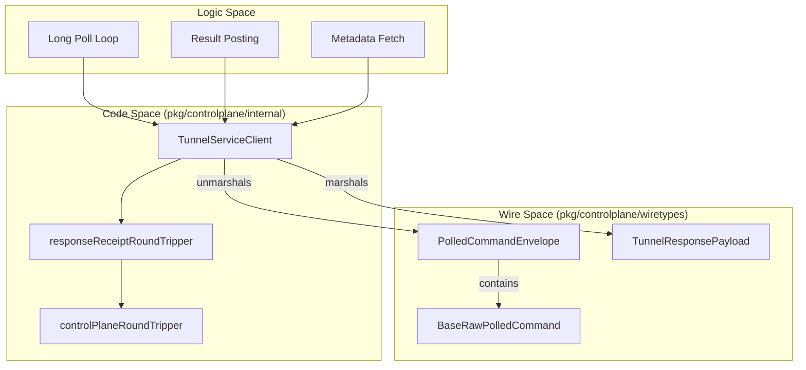
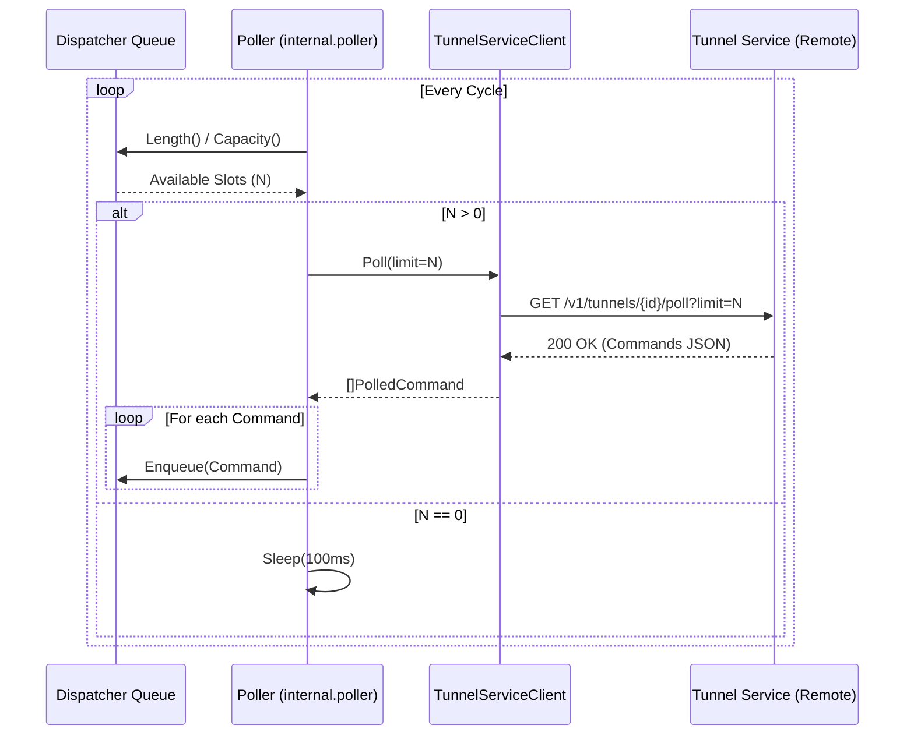

<!-- source: DeepWiki mcp.deepwiki.com · repo openai/tunnel-client · page 3.1 Control Plane Client and Poller · fetched 2026-10-26 -->

# Control Plane Client and Poller

Relevant source files

The following files were used as context for generating this wiki page:

- [docs/openapi.json](docs/openapi.json)
- [docs/protocol.md](docs/protocol.md)
- [pkg/controlplane/internal/command_parser.go](pkg/controlplane/internal/command_parser.go)
- [pkg/controlplane/internal/command_parser_test.go](pkg/controlplane/internal/command_parser_test.go)
- [pkg/controlplane/internal/command_types.go](pkg/controlplane/internal/command_types.go)
- [pkg/controlplane/internal/poller.go](pkg/controlplane/internal/poller.go)
- [pkg/controlplane/internal/poller_test.go](pkg/controlplane/internal/poller_test.go)
- [pkg/controlplane/internal/retry_after.go](pkg/controlplane/internal/retry_after.go)
- [pkg/controlplane/internal/retry_after_test.go](pkg/controlplane/internal/retry_after_test.go)
- [pkg/controlplane/internal/roundtripper.go](pkg/controlplane/internal/roundtripper.go)
- [pkg/controlplane/internal/roundtripper_test.go](pkg/controlplane/internal/roundtripper_test.go)
- [pkg/controlplane/internal/tunnel_service_client.go](pkg/controlplane/internal/tunnel_service_client.go)
- [pkg/controlplane/internal/tunnel_service_client_test.go](pkg/controlplane/internal/tunnel_service_client_test.go)
- [pkg/controlplane/polled_command.go](pkg/controlplane/polled_command.go)
- [pkg/controlplane/wiretypes/openapi_contract_test.go](pkg/controlplane/wiretypes/openapi_contract_test.go)
- [pkg/controlplane/wiretypes/wire.go](pkg/controlplane/wiretypes/wire.go)
- [pkg/controlplane/wiretypes/wire_test.go](pkg/controlplane/wiretypes/wire_test.go)
- [testsupport/mocktunnelservice/mock_tunnel_service_test.go](testsupport/mocktunnelservice/mock_tunnel_service_test.go)

The Control Plane subsystem is responsible for maintaining the outbound-only connection to the OpenAI Tunnel Service. It manages the long-polling lifecycle, command ingestion, and result delivery. This subsystem ensures that the client respects the capacity of the local dispatcher while maintaining high availability through robust retry and backoff mechanisms.

## TunnelServiceClient

The `TunnelServiceClient` is the low-level HTTP client that communicates with the OpenAI Tunnel Service API. It implements the `Fetcher` and `Responder` interfaces [pkg/controlplane/internal/tunnel_service_client.go:48-50]().

### Core Operations
*   **Poll**: Executes long-polling requests to `GET /v1/tunnels/{tunnel_id}/poll`. It requests a batch of commands (up to `limit`) and uses a configured timeout (default 20s) [pkg/controlplane/internal/tunnel_service_client.go:35|331-334]().
*   **PostResponse**: Delivers MCP results back to the control plane via `POST /v1/tunnels/{tunnel_id}/response` [pkg/controlplane/internal/tunnel_service_client.go:37|415-418]().
*   **FetchTunnelMetadata**: Retrieves tunnel details (name, description) at startup to populate logs and the Admin UI [pkg/controlplane/internal/tunnel_service_client.go:38|264-268]().
*   **FetchManagedCloudflareRuntime**: Fetches the runtime token for bundled `cloudflared` companions [pkg/controlplane/internal/tunnel_service_client.go:39|530-534]().

### Implementation Details
The client uses a custom `controlPlaneRoundTripper` to inject required headers into every request, including `Authorization` (Bearer token), `User-Agent`, `X-Tunnel-Client-Name`, and `X-Tunnel-Client-Version` [pkg/controlplane/internal/roundtripper.go:101-105](). It also includes the `X-Tunnel-MCP-Server-Info` header to declare channel affinity (e.g., stdio vs streamable HTTP) [pkg/controlplane/internal/roundtripper.go:107-115]().

### Request and Entity Mapping
The following diagram maps the logical control plane operations to the internal code entities and wire types.

**Control Plane Entity Mapping**

Sources: [pkg/controlplane/internal/tunnel_service_client.go:50-69](), [pkg/controlplane/internal/roundtripper.go:54-61](), [pkg/controlplane/internal/roundtripper.go:72-81](), [pkg/controlplane/wiretypes/wire.go:79-137]()

---

## The Poller Loop

The `poller` is a high-level coordinator that runs the infinite polling loop. It bridges the `TunnelServiceClient` (the Fetcher) and the `dispatcher` (the Queue) [pkg/controlplane/internal/poller.go:44-55]().

### Backpressure and Backoff
The poller implements a pull-based backpressure model:
1.  **Capacity Check**: Before polling, it calculates available slots in the dispatcher queue using `availableSlots()` [pkg/controlplane/internal/poller.go:128-129]().
2.  **Limit Calculation**: It requests a batch size equal to the available queue slots, capped by `maxPollBatchSize` (25) [pkg/controlplane/internal/poller.go:24|136]().
3.  **Backpressure Delay**: If the queue is full, the poller calls `waitForQueue()` which sleeps for `defaultQueueFullDelay` (100ms) [pkg/controlplane/internal/poller.go:21|265-274]().
4.  **Exponential Backoff**: On network errors or 5xx responses, it uses an exponential backoff (200ms to 10s) [pkg/controlplane/internal/poller.go:22-23|91-96](). It also honors the `Retry-After` header if provided by the service [pkg/controlplane/internal/poller.go:158-160]().

### Shard Tokens and Routing
Every command received from the control plane includes a `shard_token` [pkg/controlplane/wiretypes/wire.go:99](). This token is opaque to the client but is critical for the Tunnel Service to route responses back to the correct internal shard. The client must echo it back in the `X-Tunnel-Shard-Token` header during `PostResponse` [pkg/controlplane/internal/tunnel_service_client.go:427]().

### Poll Deadline Guardrail
To prevent requests from hanging indefinitely, the client implements a "guardrail" mechanism. The HTTP client timeout is set to a `pollDeadline` calculated as `PollTimeout` + `PollDeadlineGuardrail` [pkg/controlplane/internal/tunnel_service_client.go:102-104|118](). This ensures the client-side timeout is always slightly longer than the server-side long-poll duration (default 20s), allowing the server to close the connection gracefully first.

**Poller Data Flow**

Sources: [pkg/controlplane/internal/poller.go:121-147](), [pkg/controlplane/internal/poller.go:224-250](), [pkg/controlplane/internal/tunnel_service_client.go:331-350]()

---

## Observability and Metrics

The poller and client are instrumented with OpenTelemetry to provide visibility into the health of the tunnel connection.

### Key Metrics
| Metric Name | Type | Description |
| :--- | :--- | :--- |
| `tunnel_client.controlplane.commands_polled` | Counter | Total number of commands received from the service [pkg/controlplane/internal/metrics.go:61](). |
| `tunnel_client.controlplane.poll_errors` | Counter | Count of failed poll requests, labeled by `error_kind` [pkg/controlplane/internal/metrics.go:63](). |
| `tunnel_client.controlplane.poll_latency` | Histogram | Duration of poll requests in seconds [pkg/controlplane/internal/metrics.go:64](). |
| `tunnel_client.controlplane.commands_age` | Histogram | Time elapsed between command creation at the service and receipt at the client [pkg/controlplane/internal/metrics.go:62](). |
| `tunnel_client.controlplane.queue_length` | Gauge | Current number of commands waiting in the dispatcher queue [pkg/controlplane/internal/metrics.go:81-83](). |

### Error Handling
The client parses structured error bodies from the control plane into `APIStatusError` [pkg/controlplane/internal/tunnel_service_client.go:162-172](). These errors include the HTTP status code, an internal error code (e.g., `rate_limit_exceeded`), and a human-readable message, which are then propagated to the logs and metrics [pkg/controlplane/internal/poller.go:170-184]().

Sources: [pkg/controlplane/internal/metrics.go:19-66](), [pkg/controlplane/internal/tunnel_service_client.go:173-196](), [pkg/controlplane/internal/poller.go:154-160]()

---

