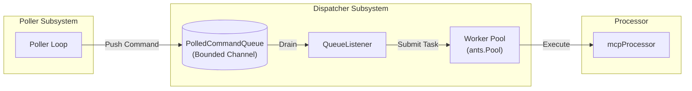
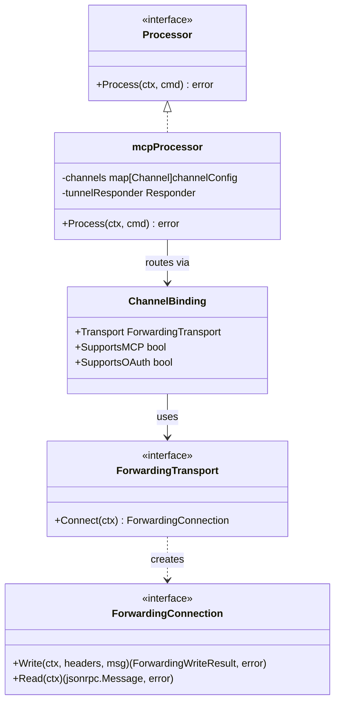

<!-- source: DeepWiki mcp.deepwiki.com · repo openai/tunnel-client · page 3.2 Dispatcher and Command Processing · fetched 2026-10-26 -->

# Dispatcher and Command Processing

Relevant source files

The following files were used as context for generating this wiki page:

- [e2e/tunnel_failure_wire_e2e_test.go](e2e/tunnel_failure_wire_e2e_test.go)
- [pkg/dispatcher/fxmodule.go](pkg/dispatcher/fxmodule.go)
- [pkg/dispatcher/fxmodule_test.go](pkg/dispatcher/fxmodule_test.go)
- [pkg/dispatcher/internal/metrics.go](pkg/dispatcher/internal/metrics.go)
- [pkg/dispatcher/internal/processor.go](pkg/dispatcher/internal/processor.go)
- [pkg/dispatcher/internal/processor_test.go](pkg/dispatcher/internal/processor_test.go)
- [pkg/dispatcher/internal/queue_listener.go](pkg/dispatcher/internal/queue_listener.go)
- [pkg/dispatcher/internal/queue_listener_test.go](pkg/dispatcher/internal/queue_listener_test.go)
- [pkg/dispatcher/internal/tunnel_failure.go](pkg/dispatcher/internal/tunnel_failure.go)
- [pkg/dispatcher/internal/tunnel_failure_test.go](pkg/dispatcher/internal/tunnel_failure_test.go)
- [pkg/harpoon/metrics.go](pkg/harpoon/metrics.go)
- [pkg/harpoon/metrics_test.go](pkg/harpoon/metrics_test.go)
- [pkg/mcpclient/forwarding_transport.go](pkg/mcpclient/forwarding_transport.go)
- [pkg/mcpclient/forwarding_transport_impl.go](pkg/mcpclient/forwarding_transport_impl.go)
- [pkg/mcpclient/forwarding_transport_impl_test.go](pkg/mcpclient/forwarding_transport_impl_test.go)
- [pkg/mcpclient/internal/context.go](pkg/mcpclient/internal/context.go)
- [pkg/mcpclient/internal/roundtripper.go](pkg/mcpclient/internal/roundtripper.go)
- [pkg/mcpclient/internal/roundtripper_test.go](pkg/mcpclient/internal/roundtripper_test.go)
- [pkg/mcpclient/serialized_forwarding_transport.go](pkg/mcpclient/serialized_forwarding_transport.go)
- [pkg/mcpclient/serialized_forwarding_transport_test.go](pkg/mcpclient/serialized_forwarding_transport_test.go)
- [pkg/mcpclient/shared_connection_transport.go](pkg/mcpclient/shared_connection_transport.go)
- [pkg/mcpclient/shared_connection_transport_test.go](pkg/mcpclient/shared_connection_transport_test.go)
- [pkg/oauth/discovery_retry_policy.go](pkg/oauth/discovery_retry_policy.go)
- [pkg/proxyhealth/checker.go](pkg/proxyhealth/checker.go)
- [pkg/proxyhealth/checker_test.go](pkg/proxyhealth/checker_test.go)
- [pkg/types/channel.go](pkg/types/channel.go)

The Dispatcher is the core orchestration layer of the `tunnel-client`. It provides a bounded in-memory queue that decouples the high-frequency polling of the OpenAI Control Plane from the execution of commands on downstream MCP servers. This decoupling ensures that network latency or slow MCP server responses do not block the polling loop, while providing a backpressure mechanism to prevent resource exhaustion.

## Work Queue and Decoupling

The dispatcher implements a producer-consumer pattern using a Go channel of type `PolledCommandQueue` [pkg/dispatcher/fxmodule.go:39-39]().

1.  **Queue Sizing**: The queue size is determined by the `MaxInFlightRequests` configuration [pkg/dispatcher/fxmodule.go:44-46]().
2.  **Producer**: The Poller (see Section 3.1) fetches commands from the tunnel service and pushes them into this channel.
3.  **Consumer**: The `QueueListener` drains the queue and distributes work to a worker pool [pkg/dispatcher/internal/queue_listener.go:45-51]().

### Worker Pool Implementation
The `QueueListener` utilizes a bounded worker pool (via the `ants` library) to limit concurrent execution [pkg/dispatcher/internal/queue_listener.go:106-113](). If the worker pool is saturated, the listener will block until a worker becomes available, naturally applying backpressure to the Poller [pkg/dispatcher/internal/queue_listener_test.go:193-215]().

### Diagram: Command Flow and Worker Decoupling

**Sources:** [pkg/dispatcher/fxmodule.go:42-51](), [pkg/dispatcher/internal/queue_listener.go:47-55](), [pkg/dispatcher/internal/queue_listener_test.go:193-215]()

---

## The mcpProcessor and Routing Logic

The `mcpProcessor` is the concrete implementation of the `Processor` interface [pkg/dispatcher/internal/processor.go:74-86](). It is responsible for routing a `PolledCommand` to the correct MCP transport based on the command's "channel" attribute.

### Channel Bindings
Channels allow the tunnel to multiplex different types of traffic. Every `tunnel-client` must support at least two required channels:
*   **MAIN** (`types.DefaultChannel`): Standard MCP traffic (JSON-RPC) and OAuth discovery [pkg/dispatcher/internal/processor.go:37-37]().
*   **harpoon**: Traffic destined for the embedded Harpoon outbound proxy [pkg/dispatcher/internal/processor.go:38-38]().

Each channel is configured via a `ChannelBinding` struct [pkg/dispatcher/internal/processor.go:52-59]():
*   **Transport**: The `mcpclient.ForwardingTransport` used to communicate with the target [pkg/dispatcher/internal/processor.go:53-53]().
*   **SupportsMCP**: Gates normal JSON-RPC forwarding [pkg/dispatcher/internal/processor.go:56-56]().
*   **SupportsOAuth**: Restricted to the main channel; gates OAuth discovery derived from the primary MCP URL [pkg/dispatcher/internal/processor.go:57-57]().
*   **SupportsSessionTermination**: Used for HTTP-based transports to signal session end [pkg/dispatcher/internal/processor.go:58-58]().

### Command Routing Logic
When `Process()` is called, the dispatcher performs the following steps:
1.  **Channel Resolution**: Identifies the target channel from the command metadata.
2.  **Routability Check**: Validates if the channel is currently active (e.g., Harpoon is only routable if it has registered targets) [pkg/dispatcher/fxmodule.go:146-148]().
3.  **Method Dispatch**:
    *   **JSON-RPC**: If the command contains a JSON-RPC request, it is forwarded via the channel's transport [pkg/dispatcher/internal/processor_test.go:189-191]().
    *   **OAuth Discovery**: The processor performs OAuth discovery probes if the channel supports it [pkg/dispatcher/internal/processor.go:57-57]().
    *   **Session Termination**: Closes the underlying transport session if supported, specifically using `terminateStreamableSession` for HTTP transports to preserve context deadlines [pkg/mcpclient/forwarding_transport_impl.go:95-118]().

**Sources:** [pkg/dispatcher/internal/processor.go:36-59](), [pkg/dispatcher/fxmodule.go:105-125](), [pkg/dispatcher/fxmodule.go:162-200]()

---

## Response Forwarding and Error Propagation

The dispatcher maintains a response loop for every command it processes. It translates MCP transport responses back into the wire format required by the OpenAI Control Plane.

### JSON-RPC Processing
For standard tool calls or notifications:
1.  **Headers**: The dispatcher propagates headers from the control plane to the MCP server via `ContextWithHeaders` [pkg/mcpclient/forwarding_transport_impl.go:139-142]().
2.  **Serialization**: Stdio and Harpoon channels use `NewSerializedForwardingTransport` to ensure only one request lifecycle is active at a time on the shared connection [pkg/dispatcher/fxmodule.go:188-190]().
3.  **Write/Read**: It writes the JSON-RPC request and waits for a response [pkg/mcpclient/forwarding_transport_impl.go:135-166]().
4.  **Error Preservation**: If the MCP server returns a non-2xx HTTP status, the dispatcher attempts to extract a valid JSON-RPC error from the body using `preservedMCPError` [pkg/mcpclient/forwarding_transport_impl.go:178-222]().

### Error Propagation
If an error occurs during processing (e.g., transport failure), the dispatcher generates a terminal JSON-RPC error response [pkg/dispatcher/internal/processor_test.go:51-68](). This ensures the Control Plane receives a definitive status. Terminal failures are structured as `tunnelFailure` data within the JSON-RPC error [pkg/dispatcher/internal/processor_test.go:70-80]().

### Diagram: Processor Entity Space

**Sources:** [pkg/dispatcher/internal/processor.go:44-59](), [pkg/mcpclient/forwarding_transport.go:15-32](), [pkg/mcpclient/forwarding_transport_impl.go:124-166]()

---

## Metrics and Observability

The dispatcher exports several OpenTelemetry metrics to monitor the health of the worker pool and command processing:

| Metric Name | Type | Description |
| :--- | :--- | :--- |
| `dispatcher_worker_pool_capacity` | Gauge | Total size of the worker pool (`MaxConcurrentRequests`) [pkg/dispatcher/internal/queue_listener_test.go:229-229](). |
| `dispatcher_worker_pool_occupancy` | Gauge | Number of workers currently processing a command [pkg/dispatcher/internal/queue_listener_test.go:230-230](). |
| `dispatcher_command_processing_duration` | Histogram | Time taken from queue drain to final response delivery [pkg/dispatcher/internal/metrics.go:1-30](). |

**Sources:** [pkg/dispatcher/internal/queue_listener.go:45-100](), [pkg/dispatcher/internal/queue_listener_test.go:226-231]()

---

