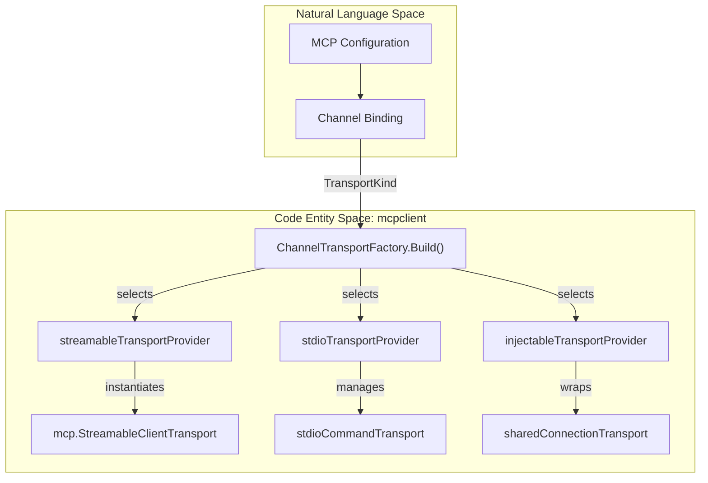
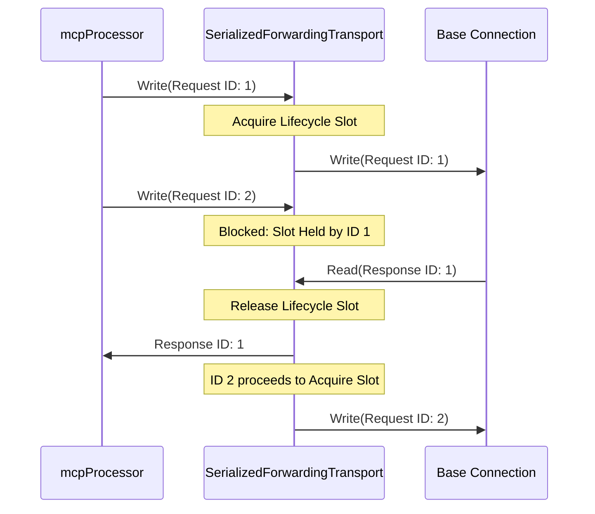

<!-- source: DeepWiki mcp.deepwiki.com · repo openai/tunnel-client · page 3.3 MCP Client and Transport Layer · fetched 2026-10-26 -->

# MCP Client and Transport Layer

Relevant source files

The following files were used as context for generating this wiki page:

- [examples/go-sdk-inmemory/README.md](examples/go-sdk-inmemory/README.md)
- [examples/go-sdk-inmemory/main.go](examples/go-sdk-inmemory/main.go)
- [examples/go-sdk-inmemory/main_test.go](examples/go-sdk-inmemory/main_test.go)
- [examples/go-sdk-inmemory/ready_file_health_check.sh](examples/go-sdk-inmemory/ready_file_health_check.sh)
- [pkg/adminui/channel_status.go](pkg/adminui/channel_status.go)
- [pkg/adminui/status_test.go](pkg/adminui/status_test.go)
- [pkg/adminui/system.go](pkg/adminui/system.go)
- [pkg/adminui/system_test.go](pkg/adminui/system_test.go)
- [pkg/dispatcher/internal/processor.go](pkg/dispatcher/internal/processor.go)
- [pkg/dispatcher/internal/processor_test.go](pkg/dispatcher/internal/processor_test.go)
- [pkg/mcpclient/channel_transport_factory.go](pkg/mcpclient/channel_transport_factory.go)
- [pkg/mcpclient/channel_transport_factory_test.go](pkg/mcpclient/channel_transport_factory_test.go)
- [pkg/mcpclient/forwarding_transport_impl.go](pkg/mcpclient/forwarding_transport_impl.go)
- [pkg/mcpclient/forwarding_transport_impl_test.go](pkg/mcpclient/forwarding_transport_impl_test.go)
- [pkg/mcpclient/fxmodule.go](pkg/mcpclient/fxmodule.go)
- [pkg/mcpclient/fxmodule_test.go](pkg/mcpclient/fxmodule_test.go)
- [pkg/mcpclient/probe_state.go](pkg/mcpclient/probe_state.go)
- [pkg/mcpclient/probe_state_test.go](pkg/mcpclient/probe_state_test.go)
- [pkg/mcpclient/serialized_forwarding_transport.go](pkg/mcpclient/serialized_forwarding_transport.go)
- [pkg/mcpclient/serialized_forwarding_transport_test.go](pkg/mcpclient/serialized_forwarding_transport_test.go)
- [pkg/mcpclient/shared_connection_transport.go](pkg/mcpclient/shared_connection_transport.go)
- [pkg/mcpclient/shared_connection_transport_test.go](pkg/mcpclient/shared_connection_transport_test.go)
- [pkg/mcpclient/stdio_command.go](pkg/mcpclient/stdio_command.go)
- [pkg/mcpclient/stdio_command_test.go](pkg/mcpclient/stdio_command_test.go)
- [pkg/mcpclient/transport_provider.go](pkg/mcpclient/transport_provider.go)
- [pkg/mcpclient/transport_provider_fx.go](pkg/mcpclient/transport_provider_fx.go)
- [pkg/transport/default.go](pkg/transport/default.go)
- [pkg/transport/default_test.go](pkg/transport/default_test.go)
- [plugins/tunnel-mcp/skills/tunnel-mcp/references/binary.md](plugins/tunnel-mcp/skills/tunnel-mcp/references/binary.md)

The `mcpclient` package implements the communication bridge between the `tunnel-client` and Model Context Protocol (MCP) servers. It abstracts various communication methods—local processes, remote HTTP services, and in-memory providers—into a unified transport interface, while managing complex networking requirements like mTLS, proxies, and request serialization.

## Transport Architecture

The `mcpclient` package uses a provider-based architecture to instantiate transports based on the `TransportKind` defined in the configuration [pkg/config/config.go:138-144]().

### Transport Kinds

| Kind | Code Entity | Description |
| :--- | :--- | :--- |
| `http-streamable` | `mcp.StreamableClientTransport` | Standard MCP over HTTP using Server-Sent Events (SSE) for downstream communication [pkg/mcpclient/fxmodule.go:102](). |
| `stdio` | `stdioCommandTransport` | Manages a local child process, communicating via `stdin` and `stdout` [pkg/mcpclient/stdio_command.go:27](). |
| `in-memory` | `sharedConnectionTransport` | Facilitates direct in-process communication, primarily used for the internal Harpoon service [pkg/mcpclient/shared_connection_transport.go:14](). |

### Entity Mapping: Configuration to Implementation
The following diagram maps configuration symbols to the specific Go structs and functions responsible for transport lifecycle.

**Transport Resolution Logic**

Sources: [pkg/mcpclient/channel_transport_factory.go:98-158](), [pkg/mcpclient/transport_provider.go:12-23](), [pkg/mcpclient/transport_provider.go:35-43]()

## ChannelTransportFactory

The `ChannelTransportFactory` is the central coordinator for all transports. It ensures that logical tunnel channels (e.g., `default`, `harpoon`) map to stable, cached transport instances [pkg/mcpclient/channel_transport_factory.go:30-44]().

### Key Responsibilities
- **Concurrency Control**: Uses `singleflight.Group` to ensure that simultaneous requests for a new channel (like a cold-start `stdio` process) only trigger a single initialization routine [pkg/mcpclient/channel_transport_factory.go:114-149]().
- **HTTP Client Scoping**: Builds specialized `http.Client` instances for each binding, applying specific proxy settings, Unix domain socket dialers, or mTLS certificates [pkg/mcpclient/channel_transport_factory.go:174-206]().
- **Transport Decoration**: Wraps base transports in a `mcp.LoggingTransport` if `HTTPRawUnsafe` is enabled in `LoggingConfig`, allowing for raw JSON-RPC inspection in debug logs [pkg/mcpclient/channel_transport_factory.go:160-172]().

Sources: [pkg/mcpclient/channel_transport_factory.go:61-73](), [pkg/mcpclient/channel_transport_factory.go:98-106](), [pkg/mcpclient/channel_transport_factory.go:188]()

## Stdio Transport Implementation

The `stdioCommandTransport` manages the lifecycle of local MCP server processes.

- **Process Lifecycle**: It integrates with `fx.Lifecycle` to start the process on application boot and ensure it is killed on shutdown [pkg/mcpclient/stdio_command.go:53-85]().
- **Error Propagation**: If the child process exits unexpectedly, the transport triggers a global application shutdown via `fx.Shutdowner` [pkg/mcpclient/stdio_command.go:89-125]().
- **Runtime Monitoring**: It provides `StdioRuntimeInfo`, exposing the process PID and command arguments to the Admin UI for monitoring [pkg/mcpclient/stdio_command.go:162-189]().

Sources: [pkg/mcpclient/stdio_command.go:27-50](), [pkg/mcpclient/stdio_command.go:182-184]()

## Forwarding and Serialized Transport

The `ForwardingTransport` interface allows the `dispatcher` to send raw JSON-RPC messages without maintaining a full `mcp.Client` session for every request.

### SerializedForwardingTransport
Certain transports (like those multiplexing over a single stream) require strict request-response ordering. The `serializedForwardingTransport` wrapper enforces this using a "lifecycle slot" [pkg/mcpclient/serialized_forwarding_transport.go:11-27]().

**Request Serialization Flow**

Sources: [pkg/mcpclient/serialized_forwarding_transport.go:64-79](), [pkg/mcpclient/serialized_forwarding_transport.go:94-114](), [pkg/mcpclient/serialized_forwarding_transport.go:168-191]()

## Probe State and Connectivity

At startup, the `mcpclient` package invokes `probeMcpServer` to verify the primary MCP server is reachable [pkg/mcpclient/fxmodule.go:40]().

- **ProbeState**: Stores the result of the startup handshake. It can be queried by the health system or Admin UI to determine if the client is "Ready" [pkg/mcpclient/probe_state.go:13-19]().
- **Auth Discovery**: If the probe fails with an `HTTP 401 Unauthorized`, `IsAuthRequiredProbeError` identifies that the server requires OAuth discovery [pkg/mcpclient/probe_state.go:98-101]().
- **Timeout**: The probe defaults to a 2-second timeout [pkg/mcpclient/fxmodule.go:43]().

Sources: [pkg/mcpclient/fxmodule.go:128-180](), [pkg/mcpclient/probe_state.go:40-51](), [pkg/mcpclient/probe_state.go:137-163]()

## Header Forwarding

The transport layer handles two categories of headers:
1. **Static Headers**: `ExtraHeaders` and `DiscoveryExtraHeaders` defined in `MCPConfig` are applied to all outbound HTTP requests [pkg/mcpclient/channel_transport_factory.go:188]().
2. **Forwarded Headers**: Headers received from the Control Plane (such as `Authorization` or `Openai-Organization`) are scoped to the specific MCP channel that received the command, preventing credential leakage across logical channels [pkg/mcpclient/fxmodule_test.go:216-223]().

Sources: [pkg/mcpclient/channel_transport_factory.go:188](), [pkg/mcpclient/fxmodule.go:183-195]()

---

