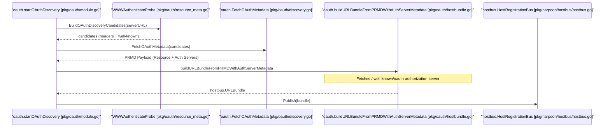
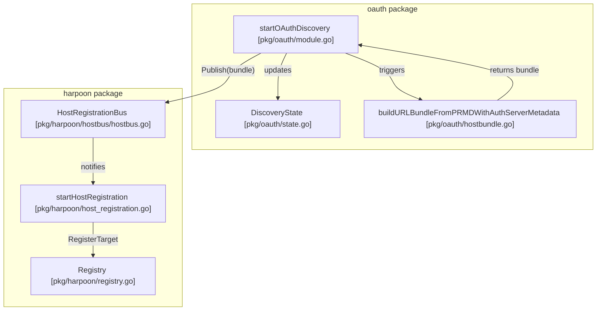

<!-- source: DeepWiki mcp.deepwiki.com · repo openai/tunnel-client · page 3.4 OAuth Discovery and Protected Resource Metadata · fetched 2026-10-26 -->

# OAuth Discovery and Protected Resource Metadata

Relevant source files

The following files were used as context for generating this wiki page:

- [e2e/notification_forwarding_e2e_test.go](e2e/notification_forwarding_e2e_test.go)
- [e2e/oauth_discovery_e2e_test.go](e2e/oauth_discovery_e2e_test.go)
- [e2e/oauth_protection_e2e_test.go](e2e/oauth_protection_e2e_test.go)
- [pkg/adminui/oauth.go](pkg/adminui/oauth.go)
- [pkg/adminui/oauth_test.go](pkg/adminui/oauth_test.go)
- [pkg/harpoon/host_registration.go](pkg/harpoon/host_registration.go)
- [pkg/harpoon/host_registration_test.go](pkg/harpoon/host_registration_test.go)
- [pkg/harpoon/hostbus/hostbus.go](pkg/harpoon/hostbus/hostbus.go)
- [pkg/harpoon/metadata.go](pkg/harpoon/metadata.go)
- [pkg/oauth/auth_meta.go](pkg/oauth/auth_meta.go)
- [pkg/oauth/auth_meta_test.go](pkg/oauth/auth_meta_test.go)
- [pkg/oauth/discovery.go](pkg/oauth/discovery.go)
- [pkg/oauth/discovery_failure.go](pkg/oauth/discovery_failure.go)
- [pkg/oauth/discovery_failure_test.go](pkg/oauth/discovery_failure_test.go)
- [pkg/oauth/discovery_test.go](pkg/oauth/discovery_test.go)
- [pkg/oauth/hostbundle.go](pkg/oauth/hostbundle.go)
- [pkg/oauth/hostbundle_test.go](pkg/oauth/hostbundle_test.go)
- [pkg/oauth/module.go](pkg/oauth/module.go)
- [pkg/oauth/module_test.go](pkg/oauth/module_test.go)
- [pkg/oauth/resource_meta.go](pkg/oauth/resource_meta.go)
- [pkg/oauth/resource_meta_test.go](pkg/oauth/resource_meta_test.go)
- [pkg/oauth/state.go](pkg/oauth/state.go)
- [testsupport/mocktunnelservice/doc.go](testsupport/mocktunnelservice/doc.go)

The `tunnel-client` implements automated OAuth discovery to identify authorization servers and protected resource boundaries associated with an MCP server. This process allows the client to dynamically configure its security context and register necessary endpoints with the Harpoon outbound proxy.

## Overview

Discovery is a background process triggered at startup for HTTP-based MCP servers [pkg/oauth/module.go:67-75](). It follows the Model Context Protocol (MCP) OAuth extension patterns, specifically searching for **Protected Resource Metadata (PRMD)**.

The discovery flow involves:
1.  **Probing**: Checking the MCP server for `WWW-Authenticate` headers or well-known metadata paths [pkg/oauth/module.go:82-87]().
2.  **Fetching**: Retrieving the PRMD JSON document [pkg/oauth/discovery.go:25-30]().
3.  **Enrichment**: Resolving RFC 8414 Authorization Server metadata for the discovered issuers [pkg/oauth/hostbundle.go:140-156]().
4.  **Registration**: Publishing the resulting URLs to the `HostRegistrationBus` for Harpoon allowlisting [pkg/oauth/module.go:129-133]().

### Discovery Data Flow

The following diagram illustrates the lifecycle of discovery from the initial probe to host registration.

**Discovery to Registration Pipeline**

Sources: [pkg/oauth/module.go:77-135](), [pkg/oauth/discovery.go:25-30](), [pkg/oauth/hostbundle.go:110-165]()

## Discovery Mechanisms

The client uses several strategies to find the PRMD document, governed by `BuildOAuthDiscoveryCandidates` [pkg/oauth/resource_meta.go:34-45]().

### 1. WWW-Authenticate Probe
The client performs a `GET` request to the MCP server root. If the server responds with a `401 Unauthorized` containing a `WWW-Authenticate` header, the client parses the `resource_metadata` parameter to find the PRMD URL [pkg/oauth/resource_meta.go:78-85]().

### 2. Well-Known Paths
If the probe does not yield a URL, the client tries standardized paths relative to the MCP server URL [pkg/oauth/resource_meta.go:12-25]():
-   `/.well-known/oauth-protected-resource/{path_to_mcp}`
-   `/.well-known/oauth-protected-resource`

### 3. Authorization Server Metadata
Once a PRMD is retrieved, the client identifies the primary authorization server (`authorization_servers[0]`) [pkg/oauth/hostbundle.go:128-135](). It then attempts to fetch RFC 8414 metadata (e.g., `token_endpoint`, `jwks_uri`) by trying [pkg/oauth/auth_meta.go:71-74]():
-   `/.well-known/oauth-authorization-server`
-   `/.well-known/openid-configuration` (fallback)

Sources: [pkg/oauth/resource_meta.go:12-25](), [pkg/oauth/auth_meta.go:71-74](), [pkg/oauth/hostbundle.go:110-165]()

## Implementation Details

### DiscoveryState
The `DiscoveryState` struct tracks the background progress and stores the final `DiscoveryResult` [pkg/oauth/state.go:29-37](). It uses a `sync.Once` and a `done` channel to allow other subsystems (like the Health check or Admin UI) to wait for discovery completion [pkg/oauth/state.go:58-81]().

### Retry Policy and Timeouts
Discovery uses a two-pass execution model:
1.  **Initial Pass**: Attempts all candidates with a standard timeout [pkg/oauth/discovery.go:54-61]().
2.  **Retry Pass**: If the first pass fails solely due to timeouts, it retries with an exponential backoff strategy (`doWithRetryForTimeout`) [pkg/oauth/discovery.go:66-77](), [pkg/oauth/discovery.go:209-220]().

### Host Bundle Construction
The `buildURLBundleFromPRMDWithAuthServerMetadata` function converts the raw PRMD and resolved auth metadata into a `hostbus.URLBundle` [pkg/oauth/hostbundle.go:110-165]().

**Entity Mapping: OAuth Metadata to HostBus**
| Code Entity | Role in Discovery | Source |
| :--- | :--- | :--- |
| `oauthex.ProtectedResourceMetadata` | Schema for the PRMD JSON payload. | [pkg/oauth/hostbundle.go:119]() |
| `oauth.AuthServerMetadataFetchResult` | Result of resolving endpoints (token, jwks, etc.). | [pkg/oauth/auth_meta.go:19-27]() |
| `hostbus.URLRecord` | A single URL with metadata tags (e.g., `role: token-endpoint`). | [pkg/oauth/hostbundle.go:197-232]() |
| `hostbus.URLBundle` | Collection of records published to Harpoon. | [pkg/harpoon/hostbus/hostbus.go:21-25]() |

Sources: [pkg/oauth/state.go:13-26](), [pkg/oauth/discovery.go:209-220](), [pkg/oauth/hostbundle.go:110-165]()

## Integration with Harpoon

The `oauth.Module` is wired via `fx` to receive a `hostbus.HostRegistrationBus` [pkg/oauth/module.go:34](). Once discovery succeeds and the bundle is built, it is published to the bus [pkg/oauth/module.go:131-133](). 

Harpoon listens to this bus via `startHostRegistration` to dynamically update its allowlist, ensuring that the `tunnel-client` can reach the newly discovered OAuth endpoints [pkg/harpoon/host_registration.go:58-101]().

**Component Interaction Diagram**

Sources: [pkg/oauth/module.go:20-24](), [pkg/oauth/module.go:125-133](), [pkg/harpoon/host_registration.go:75-89](), [pkg/oauth/state.go:29-37]()

## Error Handling

Discovery is considered **optional** for standard MCP servers. The function `IsOptionalDiscoveryFailure` determines if a failure should block system readiness [pkg/oauth/discovery_failure.go:11-15](). 
-   **Optional**: 404 Not Found on all well-known paths, or discovery being disabled for `stdio` transports [pkg/oauth/discovery_failure.go:21-43]().
-   **Critical**: Malformed PRMD JSON or 5xx errors on paths that were explicitly advertised via `WWW-Authenticate` [pkg/oauth/discovery.go:187-200]().

Sources: [pkg/oauth/discovery_failure.go:8-44](), [pkg/oauth/discovery.go:165-185]()

---

