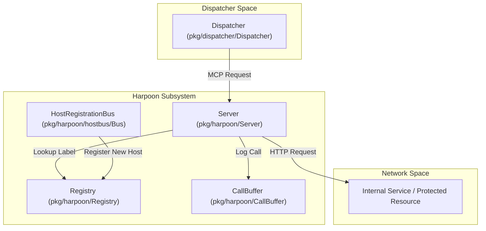
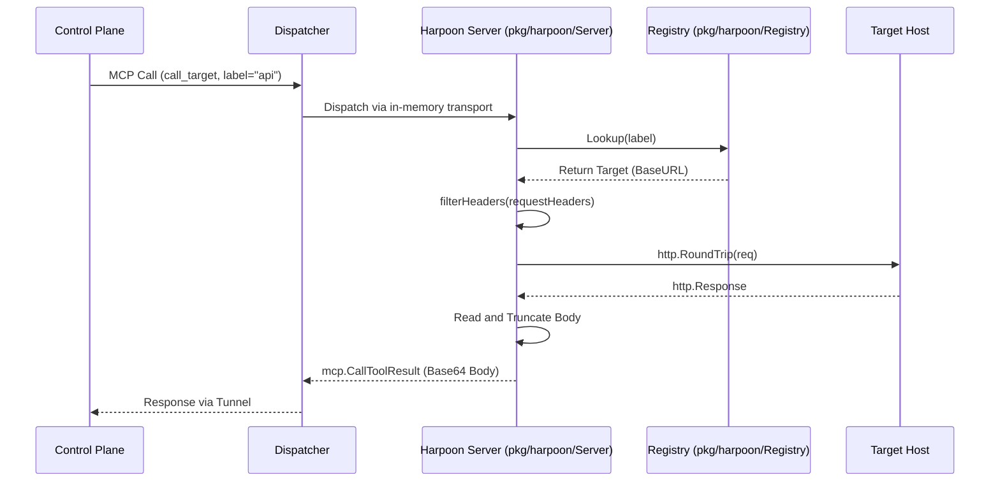

<!-- source: DeepWiki mcp.deepwiki.com · repo openai/tunnel-client · page 4 Harpoon Subsystem · fetched 2026-10-26 -->

# Harpoon Subsystem

Relevant source files

The following files were used as context for generating this wiki page:

- [pkg/harpoon/fxmodule.go](pkg/harpoon/fxmodule.go)
- [pkg/harpoon/fxmodule_test.go](pkg/harpoon/fxmodule_test.go)
- [pkg/harpoon/integration_test.go](pkg/harpoon/integration_test.go)
- [pkg/harpoon/registry.go](pkg/harpoon/registry.go)
- [pkg/harpoon/registry_test.go](pkg/harpoon/registry_test.go)
- [pkg/harpoon/server.go](pkg/harpoon/server.go)
- [pkg/harpoon/server_test.go](pkg/harpoon/server_test.go)

The Harpoon subsystem is an embedded Model Context Protocol (MCP) server within the `tunnel-client` that acts as an allowlisted outbound HTTP proxy. It enables OpenAI models to securely interact with internal services or protected resources by providing a controlled interface for making HTTP requests.

The subsystem enforces strict security boundaries by only permitting requests to targets registered in its `Registry` [pkg/harpoon/registry.go:35-47]() and applying transformations to outbound headers and response bodies [pkg/harpoon/server.go:45-81]().

## System Overview

The Harpoon subsystem is integrated into the client's runtime via the `fx` module system [pkg/harpoon/fxmodule.go:29-33](). It exposes two primary MCP tools: `list_targets` and `call_target` [pkg/harpoon/server.go:127-134]().

### Component Architecture

The following diagram illustrates how the Harpoon components interact with the central `Dispatcher` and the external network.

**Harpoon Code Entity Map**

Sources: [pkg/harpoon/server.go:87-96](), [pkg/harpoon/fxmodule.go:69-106](), [pkg/harpoon/registry.go:35-47](), [pkg/harpoon/call_buffer.go:30-35]()

## Integration with Dispatcher

The Harpoon server is connected to the `Dispatcher` using an in-memory transport [pkg/harpoon/fxmodule.go:107-109](). When the Control Plane sends a command targeting the `harpoon` channel, the `Dispatcher` routes the JSON-RPC request to the embedded `Server.MCPServer()` [pkg/harpoon/fxmodule.go:107-158]().

Key integration points include:
*   **In-Memory Transport**: Provides low-latency communication between the client's core and the embedded server [pkg/harpoon/fxmodule.go:66-67](), [pkg/harpoon/fxmodule.go:157-158]().
*   **HTTP Streamable Transport**: Optionally exposes the Harpoon MCP server over a local HTTP endpoint (typically restricted to loopback) via `mcp.NewStreamableHTTPHandler` [pkg/harpoon/fxmodule.go:190-219]().
*   **Target Registration**: Programmatic registration during startup via `TargetRegistrar` [pkg/harpoon/fxmodule.go:35-43]().

## Core Components

### Harpoon Server and Registry
The `Server` handles the execution of MCP tools. It uses the `Registry` to validate that the requested `label` corresponds to an allowlisted `BaseURL` [pkg/harpoon/server.go:87-96](). It enforces security by blocking specific headers (e.g., `Cookie`, `Authorization`, `X-Forwarded-For`) [pkg/harpoon/server.go:45-81]() and manages request timeouts and redirects [pkg/harpoon/server.go:31-33]().

For details, see [Harpoon Server and Registry](#4.1).

### Harpoon Host Registration
While targets can be statically configured via `HarpoonConfig` [pkg/harpoon/fxmodule.go:77](), Harpoon supports dynamic registration. The `HostRegistrationBus` allows other subsystems, such as OAuth Discovery, to publish newly discovered protected resources as `URLBundle` objects, which are then added to the `Registry` [pkg/harpoon/fxmodule.go:186-188](), [pkg/harpoon/fxmodule.go:222-243]().

For details, see [Harpoon Host Registration](#4.2).

## Request Lifecycle

The following sequence shows the path of a `call_target` request:

**Call Target Sequence**

Sources: [pkg/harpoon/server.go:98-115](), [pkg/harpoon/server.go:217-223](), [pkg/harpoon/registry.go:217-226](), [pkg/harpoon/server_test.go:217-223]()

## Observability

Harpoon provides visibility into its operations, which is consumed by the Admin UI and metrics systems:
*   **Registry Summary**: The `Registry` provides a summary of all allowed targets, categories, and sources [pkg/harpoon/registry.go:195-204]().
*   **Call History**: The `CallBuffer` maintains a record of recent tool executions for diagnostic purposes [pkg/harpoon/call_buffer.go:12-27]().
*   **Metrics**: The server tracks metrics such as call counts, durations, and response sizes using OpenTelemetry [pkg/harpoon/server.go:93](), [pkg/harpoon/fxmodule.go:91-93]().

Sources: [pkg/harpoon/server.go:87-96](), [pkg/harpoon/fxmodule.go:127-144](), [pkg/harpoon/call_buffer.go:30-35]()

---

