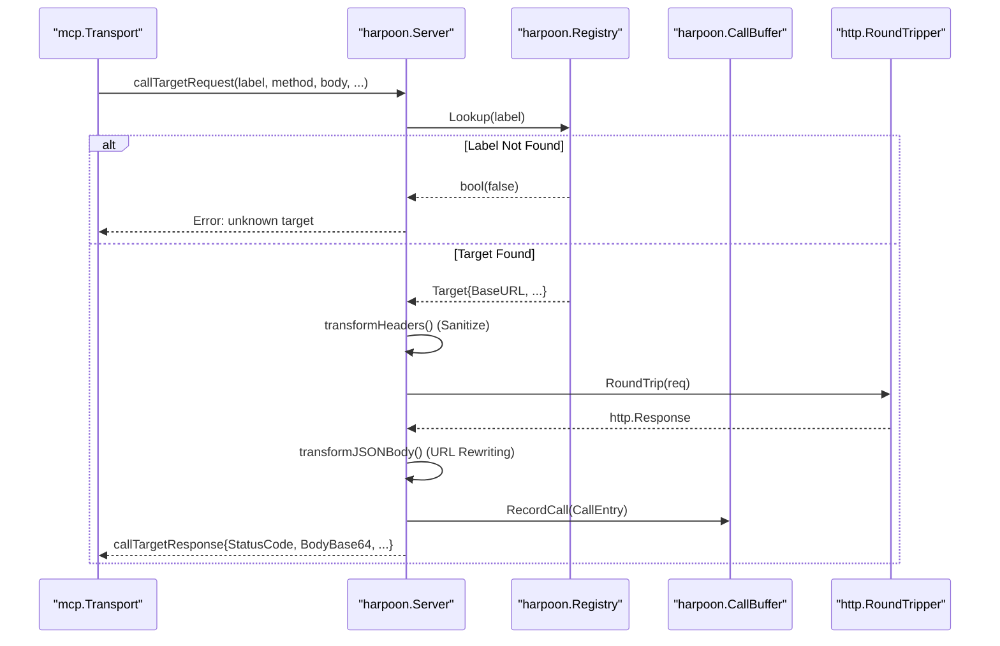

<!-- source: DeepWiki mcp.deepwiki.com · repo openai/tunnel-client · page 4.1 Harpoon Server and Registry · fetched 2026-10-26 -->

# Harpoon Server and Registry

<details>
<summary>Relevant source files</summary>

The following files were used as context for generating this wiki page:

- [e2e/harpoon_connection_ttl_e2e_test.go](e2e/harpoon_connection_ttl_e2e_test.go)
- [pkg/adminui/harpoon.go](pkg/adminui/harpoon.go)
- [pkg/adminui/harpoon_integration_test.go](pkg/adminui/harpoon_integration_test.go)
- [pkg/adminui/harpoon_test.go](pkg/adminui/harpoon_test.go)
- [pkg/harpoon/call_buffer.go](pkg/harpoon/call_buffer.go)
- [pkg/harpoon/fxmodule.go](pkg/harpoon/fxmodule.go)
- [pkg/harpoon/inmemory_transport.go](pkg/harpoon/inmemory_transport.go)
- [pkg/harpoon/inmemory_transport_test.go](pkg/harpoon/inmemory_transport_test.go)
- [pkg/harpoon/integration_test.go](pkg/harpoon/integration_test.go)
- [pkg/harpoon/registry.go](pkg/harpoon/registry.go)
- [pkg/harpoon/registry_test.go](pkg/harpoon/registry_test.go)
- [pkg/harpoon/server.go](pkg/harpoon/server.go)
- [pkg/harpoon/server_test.go](pkg/harpoon/server_test.go)
- [pkg/harpoon/transform.go](pkg/harpoon/transform.go)
- [pkg/harpoon/transform_test.go](pkg/harpoon/transform_test.go)

</details>


The Harpoon subsystem implements an embedded Model Context Protocol (MCP) server that acts as a constrained, allowlisted outbound HTTP proxy. It allows the OpenAI product to interact with internal services via the `tunnel-client` without requiring full network exposure. The Harpoon server enforces security policies such as target allowlisting, header sanitization, and response size limits.

## Harpoon MCP Server

The Harpoon server is implemented in `pkg/harpoon/server.go` and exposes two primary MCP tools: `list_targets` and `call_target`. It is wired into the application using Uber's `fx` library [pkg/harpoon/fxmodule.go:29-33]().

### MCP Tools

| Tool | Purpose | Request Type | Response Type |
| :--- | :--- | :--- | :--- |
| `list_targets` | Returns available allowlisted targets and their metadata. | `listTargetsRequest` | `listTargetsResponse` |
| `call_target` | Executes an HTTP request against a specific allowlisted target. | `callTargetRequest` | `callTargetResponse` |

Sources: [pkg/harpoon/server.go:87-96](), [pkg/harpoon/server.go:98-125](), [pkg/harpoon/server.go:136-170]()

### Call Flow Diagram
This diagram illustrates the flow of a `call_target` request from the MCP transport through the Harpoon `Server` to the final destination.

Title: Harpoon Call Flow Implementation

Sources: [pkg/harpoon/server.go:87-96](), [pkg/harpoon/registry.go:217-226](), [pkg/harpoon/transform.go:112-131](), [pkg/harpoon/server.go:200-222]()

---

## Target Registry

The `Registry` is the central authority for allowlisted targets. It stores `Target` objects keyed by a unique label. Targets can be seeded via configuration or registered dynamically (e.g., via OAuth discovery) [pkg/harpoon/registry.go:35-47]().

### Target Validation and Constraints
When a target is registered via `RegisterTarget`, the registry enforces several safety checks:
*   **Label Format**: Must match `^[a-z0-9][a-z0-9_-]{0,63}$` [pkg/harpoon/registry.go:16]().
*   **Scheme**: Defaults to requiring `https` unless `AllowPlaintextHTTP` is explicitly enabled in `HarpoonConfig` [pkg/harpoon/registry.go:124-126]().
*   **Path Traversal**: Rejects base URLs containing invalid segments [pkg/harpoon/registry.go:131-133]().
*   **Normalization**: Normalizes the scheme and host to lowercase and absolute paths [pkg/harpoon/registry.go:135-150]().
*   **Duplicate Prevention**: Rejects duplicate labels or duplicate URLs that attempt to use a different transport (e.g., switching between TCP and Unix Sockets) [pkg/harpoon/registry.go:154-159]().

### Registry Entities
Title: Harpoon Registry Code Entities
```mermaid
classDiagram
    class Registry {
        -targets map[string]Target
        -ordered []Target
        -targetURLKeys map[string]struct{}
        +RegisterTarget(Target) error
        +Lookup(string) (Target, bool)
        +Resolve(string) (*url.URL, error)
        +AllowsURL(*url.URL) bool
        +ExplainBlockedRedirect(*url.URL) *redirectMismatchDetails
    }
    class Target {
        +Label string
        +Description string
        +Category string
        +Source string
        +Tags []string
        +BaseURL *url.URL
        +UnixSocketPath string
    }
    Registry "1" *-- "n" Target : manages
```
Sources: [pkg/harpoon/registry.go:23-32](), [pkg/harpoon/registry.go:35-47](), [pkg/harpoon/registry.go:107-169]()

---

## Request and Response Transformation

To maintain the abstraction of the Harpoon "Natural Language Space," the server performs transformations on requests and responses to hide internal URLs and replace them with `harpoon://` URIs.

### URL Rewriting
The `urlRewriter` scans response bodies (specifically JSON) and headers for internal URLs that match registered targets.
*   **JSON Bodies**: Recursively traverses JSON structures via `rewriteJSONValue`. If a string value matches a registered `Target.BaseURL`, it is replaced with `harpoon://<label>` [pkg/harpoon/transform.go:133-166]().
*   **Headers**: Rewrites `Location`, `Link`, and `Content-Location` headers using `transformHeaders` [pkg/harpoon/transform.go:11-15](), [pkg/harpoon/transform.go:168-193]().
*   **OAuth Context**: When multiple targets share a URL (common in OAuth metadata), the rewriter uses JSON key hints (e.g., `token_endpoint`) to select the target with the most appropriate tag [pkg/harpoon/transform.go:47-55](), [pkg/harpoon/transform.go:97-110]().

### Blocked Headers
Harpoon maintains a `blockedOutboundHeaders` list to prevent the model from manipulating low-level HTTP transport headers or leaking sensitive client identity. Blocked headers include:
*   Transport: `Host`, `Connection`, `Content-Length`, `Transfer-Encoding`, `Upgrade`, `Via`.
*   Identity: `Cookie`, `Proxy-Authorization`, `X-OpenAI-Authorization`, `X-Forwarded-For`.
*   Cloudflare/Envoy: `CF-Connecting-IP`, `X-Envoy-External-Address`.

Sources: [pkg/harpoon/server.go:45-81](), [pkg/harpoon/transform.go:112-131](), [pkg/harpoon/transform.go:168-193]()

---

## CallBuffer and History

The `CallBuffer` provides a thread-safe, in-memory circular buffer of recent `call_target` tool invocations. It is primarily used by the Admin UI to provide visibility into Harpoon activity.

*   **Snapshotting**: Returns a slice of `CallEntry` objects, supporting filtering by `label` and result `limit` [pkg/adminui/harpoon.go:139-174]().
*   **Payload Capture**: If `CapturePayloads` is enabled in `HarpoonConfig`, the buffer stores the full request and response bodies, including transformed versions [pkg/adminui/harpoon.go:159-170]().
*   **Admin Integration**: The buffer is exposed via the `/api/harpoon/calls` endpoint [pkg/adminui/harpoon.go:71-80]().

Sources: [pkg/harpoon/fxmodule.go:89](), [pkg/adminui/harpoon.go:42-57](), [pkg/adminui/harpoon.go:139-174]()

---

## Controls and Metrics

### Timeout and Redirects
Harpoon provides granular control over request execution via `callTargetRequest` parameters:
*   **Timeout**: Defaults to 30s, configurable between 100ms and 120s [pkg/harpoon/server.go:31-33]().
*   **Redirects**: Controlled via `FollowRedirects`. If enabled, Harpoon only follows redirects to URLs that are also present in the `Registry` [pkg/harpoon/server.go:105-106]().
*   **Redirect Explanation**: The `Registry` includes an `ExplainBlockedRedirect` method to diagnose why a redirect was rejected (e.g., `scheme_mismatch_https_to_http` or `path_mismatch`) [pkg/harpoon/registry.go:49-71](), [pkg/harpoon/registry.go:229-254]().

### Metrics
The server exports OpenTelemetry metrics [pkg/harpoon/fxmodule.go:91-93]():
*   `harpoon_call_total`: Counter of tool calls, partitioned by `label`, `status_class`, and `outcome`.
*   `harpoon_call_latency_milliseconds`: Histogram of request duration.
*   `harpoon_response_size_bytes`: Histogram of response body sizes.

Sources: [pkg/harpoon/server.go:31-33](), [pkg/harpoon/registry.go:229-254](), [pkg/harpoon/fxmodule.go:91-93]()

---

