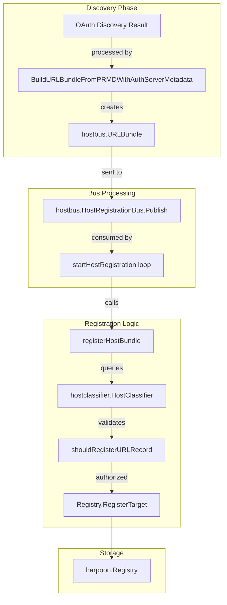

<!-- source: DeepWiki mcp.deepwiki.com · repo openai/tunnel-client · page 4.2 Harpoon Host Registration · fetched 2026-10-26 -->

# Harpoon Host Registration

<details>
<summary>Relevant source files</summary>

The following files were used as context for generating this wiki page:

- [pkg/harpoon/fxmodule.go](pkg/harpoon/fxmodule.go)
- [pkg/harpoon/host_registration.go](pkg/harpoon/host_registration.go)
- [pkg/harpoon/host_registration_test.go](pkg/harpoon/host_registration_test.go)
- [pkg/harpoon/hostbus/hostbus.go](pkg/harpoon/hostbus/hostbus.go)
- [pkg/harpoon/integration_test.go](pkg/harpoon/integration_test.go)
- [pkg/harpoon/metadata.go](pkg/harpoon/metadata.go)
- [pkg/harpoon/registry.go](pkg/harpoon/registry.go)
- [pkg/harpoon/registry_test.go](pkg/harpoon/registry_test.go)
- [pkg/harpoon/server.go](pkg/harpoon/server.go)
- [pkg/harpoon/server_test.go](pkg/harpoon/server_test.go)
- [pkg/oauth/auth_meta.go](pkg/oauth/auth_meta.go)
- [pkg/oauth/auth_meta_test.go](pkg/oauth/auth_meta_test.go)
- [pkg/oauth/hostbundle.go](pkg/oauth/hostbundle.go)
- [pkg/oauth/hostbundle_test.go](pkg/oauth/hostbundle_test.go)
- [pkg/oauth/module.go](pkg/oauth/module.go)
- [pkg/oauth/module_test.go](pkg/oauth/module_test.go)

</details>


Harpoon Host Registration is a dynamic subsystem within the `tunnel-client` that automatically allowlists network targets discovered during the OAuth discovery process. By utilizing a dedicated `HostRegistrationBus`, the client can observe metadata from protected resources and authorize the Harpoon proxy to communicate with them, provided they meet specific safety criteria defined by a host classifier.

## Overview and Purpose

The primary goal of dynamic registration is to support complex OAuth flows where authorization servers, issuers, and protected resources may reside on internal networks. Instead of requiring manual configuration for every possible endpoint, the `tunnel-client` leverages discovery results to auto-populate the Harpoon `Registry`.

### Key Components

| Component | Role | Definition |
| :--- | :--- | :--- |
| `HostRegistrationBus` | A transport-agnostic bus for publishing discovered URLs. | [pkg/harpoon/hostbus/hostbus.go:44-47]() |
| `HostClassifier` | Evaluates whether a host is safe to register (e.g., private vs public). | [pkg/harpoon/internal/hostclassifier/hostclassifier.go:18-24]() |
| `URLBundle` | A collection of discovered `URLRecord` objects with associated metadata tags. | [pkg/harpoon/hostbus/hostbus.go:13-16]() |
| `Registry` | The central store of allowlisted Harpoon targets. | [pkg/harpoon/registry.go:35-47]() |

---

## Host Registration Data Flow

The registration process begins when an external discovery mechanism (such as the OAuth discovery probe) identifies a set of URLs. These are bundled and published to the `HostRegistrationBus`.

### Data Flow Diagram: Discovery to Registry

This diagram illustrates how a `URLBundle` moves from the "Natural Language Space" of discovery into the "Code Entity Space" of the Harpoon Registry.


**Sources:** [pkg/harpoon/host_registration.go:58-90](), [pkg/harpoon/host_registration.go:103-120](), [pkg/harpoon/hostbus/hostbus.go:66-78](), [pkg/oauth/hostbundle.go:110-165]()

---

## Host Classification and Safety

To prevent accidental exposure of public internet resources or sensitive internal infrastructure, every discovered URL must pass through the `HostClassifier`.

### Classification Rules
The classifier determines if a host should be registered based on the `HarpoonHostClassifierConfig`.
1.  **RFC1918 / Loopback:** By default, private IP ranges and loopback addresses are identified as candidates for registration [pkg/harpoon/host_registration.go:70-71]().
2.  **Suffix Matching:** Custom configuration can include specific internal domain suffixes (e.g., `.internal`, `.corp`) [pkg/harpoon/host_registration_test.go:21-24]().
3.  **Regex Overrides:** Custom regular expressions can be used to allowlist specific host patterns via the `HostClassifier` [pkg/harpoon/internal/hostclassifier/hostclassifier.go:18-24]().

### The `shouldRegisterURLRecord` Logic
This function evaluates each `URLRecord` against the classifier and the `oauthProtectedResourceHostPolicy` [pkg/harpoon/host_registration.go:119-119](). If a host is deemed "public" and no specific policy allows it, registration is skipped to maintain a tight security boundary [pkg/harpoon/host_registration.go:120-128]().

---

## Implementation Details

### Host Registration Bus
The bus is implemented as a single-subscriber channel-based system using `fx` for dependency injection.

*   **Publishing:** Components call `Publish(ctx, bundle)` to send new URLs to Harpoon [pkg/harpoon/hostbus/hostbus.go:66-78]().
*   **Subscribing:** The Harpoon subsystem starts a long-running goroutine in `startHostRegistration` that listens on the subscriber channel [pkg/harpoon/host_registration.go:75-89]().

### Auto-Labeling and Collision Resolution
Registered targets require a unique `Label`. Harpoon generates these deterministically from the URL metadata:
1.  **Prefix:** Usually starts with `oauth` [pkg/harpoon/host_registration.go:22-22]().
2.  **Role/Index:** Uses tags like `TagKeyRole` and `TagKeyIndex` to create descriptive labels (e.g., `oauth-issuer-0`) [pkg/harpoon/host_registration_test.go:139-146]().
3.  **Collision Handling:** If a label already exists in the `Registry`, `resolveAutoLabelCollision` appends a deterministic suffix (e.g., `-1`, `-2`) [pkg/harpoon/host_registration.go:141-152]().

### Class Interaction Diagram

This diagram maps the code entities involved in the registration lifecycle.

```mermaid
classDiagram
    class HostRegistrationBus {
        <<interface>>
        +Publish(context.Context, URLBundle) error
        +Close() error
    }
    class hostRegistrationBus {
        -subscriber chan URLBundle
        -done chan struct{}
    }
    class URLBundle {
        +FetchedAt time.Time
        +URLs []URLRecord
    }
    class URLRecord {
        +URL *url.URL
        +Description string
        +Tags []Tag
        +UnixSocketPath string
    }
    class Registry {
        +RegisterTarget(Target) error
        +Lookup(string) (Target, bool)
        +Targets() []Target
    }
    class HostClassifier {
        +IsPrivate(string) bool
        +Matches(string) bool
    }

    HostRegistrationBus <|-- hostRegistrationBus
    hostRegistrationBus ..> URLBundle : carries
    URLBundle "1" *-- "many" URLRecord : contains
    Registry <.. hostRegistrationBus : updates via registerHostBundle
```
**Sources:** [pkg/harpoon/hostbus/hostbus.go:11-47](), [pkg/harpoon/registry.go:35-47](), [pkg/harpoon/internal/hostclassifier/hostclassifier.go:18-24](), [pkg/harpoon/host_registration.go:165-174]()

---

## Metadata and Tagging

When a host is registered, it carries metadata tags that help the Harpoon server and Admin UI categorize the target.

| Tag Key | Description | Example Value |
| :--- | :--- | :--- |
| `TagKeySource` | The origin of the discovery. | `oauth` |
| `TagKeyRole` | The functional role of the URL. | `issuer`, `prmd-resource` |
| `TagKeyGroup` | Logical grouping for related endpoints. | `auth-server:0` |

**Role-based Tag Mapping:**
The system maps internal role strings to human-readable tags:
*   `prmd-auth-server` → `authorization-server` [pkg/harpoon/host_registration_test.go:132-132]().
*   `issuer` → `auth-server-metadata` [pkg/harpoon/host_registration_test.go:84-84]().

**Sources:** [pkg/harpoon/hostbus/hostbus.go:28-40](), [pkg/harpoon/host_registration.go:160-163](), [pkg/harpoon/host_registration_test.go:64-64](), [pkg/oauth/hostbundle.go:226-232]()

---

