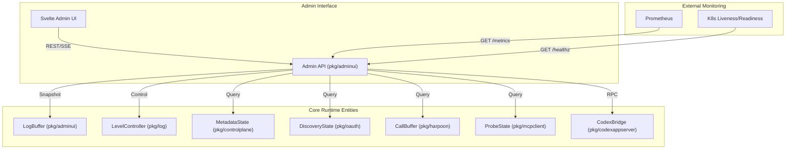

<!-- source: DeepWiki mcp.deepwiki.com · repo openai/tunnel-client · page 5 Admin UI and Observability · fetched 2026-10-26 -->

# Admin UI and Observability

Relevant source files

The following files were used as context for generating this wiki page:

- [cmd/client/main_test.go](cmd/client/main_test.go)
- [pkg/adminui/assets/app.js](pkg/adminui/assets/app.js)
- [pkg/adminui/assets/index.html](pkg/adminui/assets/index.html)
- [pkg/adminui/assets/styles.css](pkg/adminui/assets/styles.css)
- [pkg/adminui/fxmodule.go](pkg/adminui/fxmodule.go)
- [pkg/adminui/startup.go](pkg/adminui/startup.go)
- [pkg/adminui/startup_test.go](pkg/adminui/startup_test.go)
- [pkg/app/app.go](pkg/app/app.go)
- [pkg/health/health.go](pkg/health/health.go)
- [pkg/health/health_test.go](pkg/health/health_test.go)

The `tunnel-client` includes a comprehensive observability suite designed for real-time monitoring, debugging, and supportability. This system is centered around an embedded Admin UI and a set of health and metrics endpoints that provide visibility into the tunnel's internal state, connection health, and traffic flow.

## Overview of Observability Components

The observability stack is composed of three primary layers:

1.  **Admin API (Go Backend):** A set of HTTP handlers that expose internal state (e.g., active channels, OAuth status, Harpoon logs) and provide management functions like live log-level changes and support bundle generation [pkg/adminui/fxmodule.go:116-154]().
2.  **Admin UI (Svelte Frontend):** A modern, browser-based interface that consumes the Admin API to provide a visual dashboard for operators [pkg/adminui/assets/app.js:1-110]().
3.  **Health & Metrics Infrastructure:** Standardized Prometheus metrics and Kubernetes-compatible health/readiness probes [pkg/health/health.go:126-128]().

### System Architecture

The following diagram illustrates how the `adminui` package integrates with the rest of the system to provide observability.

**Observability Data Flow**

Sources: [pkg/adminui/fxmodule.go:42-67](), [pkg/adminui/fxmodule.go:116-154]()

---

## Admin API Backend
The backend observability logic is encapsulated in the `adminui` package. It leverages the `fx` dependency injection framework to gather references to all major system components [pkg/adminui/fxmodule.go:30-40]().

Key capabilities include:
*   **Status Reporting:** Aggregated view of tunnel version, uptime, configuration, and channel-specific status [pkg/adminui/fxmodule.go:69-89]().
*   **Log Management:** An in-memory `LogBuffer` stores recent logs for the UI and export [pkg/adminui/fxmodule.go:33-36](). The `LevelController` allows changing the log level (e.g., `DEBUG` to `INFO`) at runtime via `/api/log-level` [pkg/adminui/fxmodule.go:126-126]().
*   **Support Bundles:** The `/api/logs/export` endpoint generates a `.tar.gz` archive containing redacted logs, a metrics snapshot, and system state for troubleshooting [pkg/adminui/fxmodule.go:127-143]().
*   **Codex Integration:** Specialized endpoints for managing Codex sessions, device login, and event streaming [pkg/adminui/fxmodule.go:148-154]().

For details, see [Admin API Backend](#5.1).

---

## Admin UI Frontend (Svelte)
The client includes an embedded Svelte-based web interface. By default, it is served on the health port (typically `localhost:17777/ui`) [pkg/adminui/startup.go:97-105](). The frontend assets are compiled into the binary using Go's `embed` functionality.

The UI provides several specialized panels:
*   **Overview:** Real-time status of the Control Plane and MCP connections [pkg/adminui/fxmodule.go:118-120]().
*   **Harpoon:** Visibility into the embedded HTTP proxy, including allowlisted targets and recent call history [pkg/adminui/fxmodule.go:145-147]().
*   **Logs:** A live-streaming log viewer using Server-Sent Events (SSE) [pkg/adminui/fxmodule.go:144-144]().
*   **System:** Deep-dive into internal routing, TLS bundles, and proxy health [pkg/adminui/fxmodule.go:121-121]().

For details, see [Admin UI Frontend (Svelte)](#5.2).

---

## Health, Readiness, and Metrics
The `tunnel-client` implements a robust health system to support production deployments in containerized environments [pkg/health/health.go:32-44]().

### Code-to-Entity Mapping

| System Name | Code Entity | Purpose |
| :--- | :--- | :--- |
| **Liveness Probe** | `/healthz` | Returns `live` to indicate the process is running [pkg/health/health.go:126-126](). |
| **Readiness Probe** | `/readyz` | Checks `OAuthState`, `MCPProbeState`, and `CloudflaredState` to ensure the client can process requests [pkg/health/health.go:127-127](). |
| **Metrics** | `/metrics` | Prometheus-formatted OpenTelemetry metrics (e.g., `liveness`, `readiness`) [pkg/health/health.go:128-144](). |
| **Health Service** | `health.Service` | Manages the HTTP server lifecycle and listener binding [pkg/health/health.go:47-52](). |

### Redaction and Security
Observability data is strictly redacted before being exposed. The system automatically masks sensitive information in the log export and UI views to prevent credential leakage.
*   **Loopback Restriction:** By default, the Admin UI and API are restricted to loopback addresses unless `--allow-remote-ui` is set [pkg/adminui/fxmodule.go:110-114]().
*   **Same-Origin Policy:** Unsafe operations (like Codex turn/thread starts) are protected by a same-origin check [pkg/adminui/fxmodule.go:167-172]().
*   **Redacted Snapshots:** The log export process includes snapshots of status and system data that have been processed for security [pkg/adminui/fxmodule.go:131-142]().

For details, see [Health, Readiness, and Metrics](#5.3).

Sources: [pkg/adminui/fxmodule.go:42-67](), [pkg/adminui/fxmodule.go:116-154](), [pkg/health/health.go:119-154](), [pkg/adminui/startup.go:76-105](), [pkg/app/app.go:75-83]()

---

