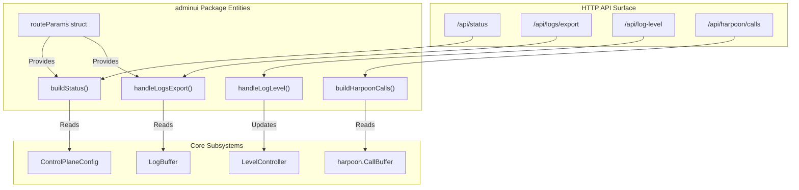
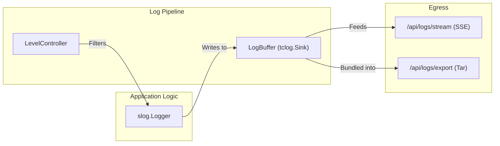

<!-- source: DeepWiki mcp.deepwiki.com · repo openai/tunnel-client · page 5.1 Admin API Backend · fetched 2026-10-26 -->

# Admin API Backend

Relevant source files

The following files were used as context for generating this wiki page:

- [adminui/src/components/HarpoonPanel.svelte](adminui/src/components/HarpoonPanel.svelte)
- [adminui/src/components/__tests__/HarpoonPanel.test.ts](adminui/src/components/__tests__/HarpoonPanel.test.ts)
- [adminui/src/lib/types.ts](adminui/src/lib/types.ts)
- [pkg/adminui/assets/app.js](pkg/adminui/assets/app.js)
- [pkg/adminui/assets/index.html](pkg/adminui/assets/index.html)
- [pkg/adminui/assets/styles.css](pkg/adminui/assets/styles.css)
- [pkg/adminui/channel_status.go](pkg/adminui/channel_status.go)
- [pkg/adminui/fxmodule.go](pkg/adminui/fxmodule.go)
- [pkg/adminui/log_export.go](pkg/adminui/log_export.go)
- [pkg/adminui/log_export_test.go](pkg/adminui/log_export_test.go)
- [pkg/adminui/status_test.go](pkg/adminui/status_test.go)
- [pkg/adminui/system.go](pkg/adminui/system.go)
- [pkg/adminui/system_test.go](pkg/adminui/system_test.go)
- [pkg/log/fxmodule.go](pkg/log/fxmodule.go)
- [pkg/log/fxmodule_test.go](pkg/log/fxmodule_test.go)
- [pkg/log/logger.go](pkg/log/logger.go)
- [pkg/log/logger_test.go](pkg/log/logger_test.go)
- [pkg/log/tee_handler.go](pkg/log/tee_handler.go)
- [pkg/mcpclient/probe_state.go](pkg/mcpclient/probe_state.go)
- [pkg/mcpclient/probe_state_test.go](pkg/mcpclient/probe_state_test.go)

The Admin API Backend is a Go-based service within the `adminui` package that provides a RESTful interface for observability, diagnostics, and runtime control of the `tunnel-client`. It serves the embedded Svelte frontend and provides a specialized log export pipeline for troubleshooting.

## Architecture and Route Registration

The backend is wired using the `fx` dependency injection framework [pkg/adminui/fxmodule.go:30-40](). It utilizes an `http.ServeMux` (specifically an `admin_mux`) to register routes that expose internal state from various subsystems like Harpoon, OAuth discovery, and the Control Plane poller [pkg/adminui/fxmodule.go:42-67]().

Access is restricted to the loopback interface by default using `httpguard.NewGuardedMux`, unless the `AdminUIConfig.AllowRemote` flag is set [pkg/adminui/fxmodule.go:110-114]().

### API Route Mapping

| Route | Function | Description |
| :--- | :--- | :--- |
| `/api/status` | `buildStatus` | High-level client health, uptime, and tunnel metadata [pkg/adminui/fxmodule.go:118-120](). |
| `/api/system` | `handleSystem` | System-level probe statuses (Main Channel, TLS trust, Proxy Health) [pkg/adminui/fxmodule.go:121](). |
| `/api/logs` | `handleLogsJSON` | Paginated retrieval of redacted in-memory logs [pkg/adminui/fxmodule.go:125](). |
| `/api/logs/stream` | `handleLogsStream` | Server-Sent Events (SSE) stream for live log updates [pkg/adminui/fxmodule.go:144](). |
| `/api/logs/export` | `handleLogsExport` | Generates a `.tar.gz` bundle for support [pkg/adminui/fxmodule.go:127-143](). |
| `/api/log-level` | `handleLogLevel` | GET/PUT for live log level changes via `LevelController` [pkg/adminui/fxmodule.go:126](). |
| `/api/harpoon/status` | `handleHarpoonStatus` | Harpoon proxy configuration and routing health [pkg/adminui/fxmodule.go:145](). |
| `/api/harpoon/calls` | `handleHarpoonCalls` | Recent outbound call history from `HarpoonBuffer` [pkg/adminui/fxmodule.go:147](). |
| `/api/codex/*` | `handleCodex...` | Integration routes for Codex plugin management and device login [pkg/adminui/fxmodule.go:148-154](). |

### Data Flow: Request to Code Entity

This diagram maps the HTTP API surface to the internal Go structures and logic providers.

"Natural Language Space" to "Code Entity Space" (API Layer)

Sources: [pkg/adminui/fxmodule.go:42-67](), [pkg/adminui/fxmodule.go:116-154](), [pkg/adminui/log_export.go:132-170]()

## Log Export Pipeline

The backend implements a diagnostic export pipeline that aggregates logs, metrics, and configuration into a compressed `tar.gz` bundle [pkg/adminui/log_export.go:132-170]().

### Bundle Contents
The export includes several files to provide a complete "point-in-time" snapshot of the client [pkg/adminui/log_export.go:216-226]():
*   `manifest.json`: Metadata about the export (window, event count, redaction status) [pkg/adminui/log_export.go:32-43]().
*   `tunnel-client.logs.ndjson`: Redacted logs in Newline Delimited JSON format [pkg/adminui/log_export.go:220]().
*   `tunnel-client.runtime.yaml`: Redacted environment variables, CLI arguments, and effective configuration [pkg/adminui/log_export.go:45-51]().
*   `tunnel-client.metrics.prom`: A snapshot of Prometheus metrics captured from the metrics exporter [pkg/adminui/log_export.go:28]().
*   `admin/*.json`: Snapshots of the various Admin API status endpoints (status, system, oauth, harpoon) [pkg/adminui/log_export.go:225]().

### Redaction and Security
Security is enforced through a strict redaction layer that processes all data before it enters the `LogBuffer` or the export bundle. 
*   **Environment Redaction**: `collectLogExportRuntime` masks sensitive environment variables referenced in the config (e.g., API keys) [pkg/adminui/log_export.go:94-98]().
*   **Log Redaction**: The `LogBuffer` (referenced as `tclog.Sink`) handles redaction of secrets within log records [pkg/adminui/fxmodule.go:36]().
*   **URL Redaction**: URLs in Harpoon call history are redacted to remove sensitive credentials or tokens [pkg/adminui/log_export_test.go:165-168]().

Sources: [pkg/adminui/log_export.go:1-170](), [pkg/adminui/log_export.go:216-226](), [pkg/adminui/fxmodule.go:36]()

## Logging and Level Control

### In-Memory Log Buffer
The `LogBuffer` (configured via `newConfiguredLogBuffer`) maintains a fixed-size ring buffer of logs [pkg/adminui/fxmodule.go:33-36](). It allows the UI to fetch logs within a specific time window via `/api/logs` or stream them in real-time [pkg/adminui/fxmodule.go:125,144]().

### LevelController
The `LevelController` (from `pkg/log`) enables live modification of the logging threshold. The `/api/log-level` endpoint allows the UI to query supported levels and update the current global level dynamically [pkg/adminui/fxmodule.go:126]().

"Natural Language Space" to "Code Entity Space" (Log Flow)

Sources: [pkg/adminui/fxmodule.go:36,49](), [pkg/adminui/log_export.go:132-143](), [pkg/log/logger.go:57-63]()

## System and Probe Status

The `/api/system` endpoint aggregates health information from across the client:
*   **TLS Trust**: A `TrustReport` generated from the `TLSBundle` [pkg/adminui/system.go:23]().
*   **Proxy Health**: Connectivity status and identity mapping for outbound proxies [pkg/adminui/system.go:24-27]().
*   **Main Channel Probe**: The status of the initial MCP connection (`pending`, `ok`, `auth-required`, `timeout`, or `failed`) [pkg/adminui/system.go:28-45]().

Sources: [pkg/adminui/system.go:13-47](), [pkg/mcpclient/probe_state.go:13-19]()

---

