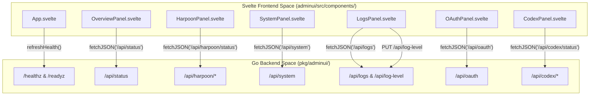
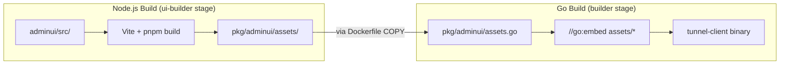

<!-- source: DeepWiki mcp.deepwiki.com · repo openai/tunnel-client · page 5.2 Admin UI Frontend (Svelte) · fetched 2026-10-26 -->

# Admin UI Frontend (Svelte)

Relevant source files

The following files were used as context for generating this wiki page:

- [Dockerfile](Dockerfile)
- [adminui/README.md](adminui/README.md)
- [adminui/package.json](adminui/package.json)
- [adminui/pnpm-workspace.yaml](adminui/pnpm-workspace.yaml)
- [adminui/src/App.svelte](adminui/src/App.svelte)
- [adminui/src/components/LogsPanel.svelte](adminui/src/components/LogsPanel.svelte)
- [adminui/src/components/__tests__/App.test.ts](adminui/src/components/__tests__/App.test.ts)
- [adminui/src/components/__tests__/LogsPanel.test.ts](adminui/src/components/__tests__/LogsPanel.test.ts)
- [adminui/src/lib/__tests__/badges.test.ts](adminui/src/lib/__tests__/badges.test.ts)
- [adminui/src/lib/api.ts](adminui/src/lib/api.ts)
- [adminui/src/lib/badges.ts](adminui/src/lib/badges.ts)
- [adminui/src/test/mockFetch.ts](adminui/src/test/mockFetch.ts)
- [docs/images/adminui-log-level-toggle.png](docs/images/adminui-log-level-toggle.png)
- [docs/screenshots/admin-log-export.webp](docs/screenshots/admin-log-export.webp)
- [package.json](package.json)
- [pkg/adminui/log_buffer.go](pkg/adminui/log_buffer.go)
- [pkg/adminui/log_buffer_test.go](pkg/adminui/log_buffer_test.go)
- [pkg/adminui/log_level.go](pkg/adminui/log_level.go)
- [scripts/build_admin_ui.sh](scripts/build_admin_ui.sh)

The `tunnel-client` includes an embedded Admin UI built with **Svelte 4** and **TypeScript**. This frontend provides a real-time operational view of the client's internal state, including connection health, OAuth discovery progress, Harpoon proxy activity, and live system logs.

## Overview and Architecture

The frontend is a Single Page Application (SPA) that communicates with the Go `adminui` backend via a REST API. It is built using **Vite** and bundled into the Go binary as static assets.

### Data Flow and Lifecycle
The application follows a polling-based model for most panels, while using a streaming-like approach for logs.

1.  **Initialization**: On mount, the app determines the active tab from the URL hash [adminui/src/App.svelte:71-71]().
2.  **Health Monitoring**: A global interval (5 seconds) fetches `/healthz` and `/readyz` to update the status badges in the top bar [adminui/src/App.svelte:74-75]().
3.  **Panel Updates**: Each panel (Overview, Harpoon, etc.) manages its own polling lifecycle, typically starting when the panel becomes `active` and stopping when it is hidden [adminui/src/App.svelte:123-149]().
4.  **API Interaction**: The `lib/api.ts` module provides wrappers for `fetch` to handle JSON and text responses with consistent error handling [adminui/src/lib/api.ts:7-26]().

### Code Entity Map: Frontend to Backend
The following diagram maps Svelte components to the Go API endpoints they consume.

**UI Component to API Mapping**

**Sources:** [adminui/src/App.svelte:47-61](), [adminui/src/components/LogsPanel.svelte:166-207](), [adminui/src/lib/api.ts:7-42]()

## Layout and Navigation

The UI uses a tab-based layout managed in `App.svelte` [adminui/src/App.svelte:14-22]().

| Tab | Label | Purpose | Key Data Entities |
| :--- | :--- | :--- | :--- |
| `overview` | Overview | General status of the client and channels. | `StatusResponse`, Uptime, Tunnel Metadata [adminui/src/components/__tests__/App.test.ts:24-64](). |
| `metrics` | Metrics | Real-time Prometheus metrics view. | `/metrics` endpoint raw text [adminui/src/App.svelte:118-121](). |
| `oauth` | OAuth | Progress of OAuth discovery and metadata. | `DiscoveryState`, `WWW-Authenticate` results [adminui/src/components/__tests__/App.test.ts:175-191](). |
| `harpoon` | Harpoon | Outbound proxy monitoring. | `HarpoonStatus`, `CallBuffer` history [adminui/src/components/__tests__/App.test.ts:192-239](). |
| `system` | System | Environment and security state. | `TLSConfig`, `ProxyIdentityMap`, `ProxyHealth` [adminui/src/components/__tests__/App.test.ts:66-123](). |
| `codex` | Assistant | Codex/Assistant integration state. | `CodexStatus`, Account Info, Thread ID [adminui/src/components/__tests__/App.test.ts:125-141](). |
| `logs` | Logs | Live log viewer and level control. | `LogEvent`, `LogLevelResponse` [adminui/src/components/LogsPanel.svelte:1-25](). |

**Sources:** [adminui/src/App.svelte:14-22](), [adminui/src/components/LogsPanel.svelte:4-25](), [adminui/src/components/__tests__/App.test.ts:24-141]()

## Component Implementation Details

### Badge System
The UI features a badge system for immediate visual feedback in the `topbar` [adminui/src/App.svelte:91-103]().
*   **Health Badge**: Derived from `/healthz`. Indicates if the HTTP server is responsive [adminui/src/App.svelte:49-49]().
*   **Ready Badge**: Derived from `/readyz`. Indicates if the client has completed initialization (e.g., OAuth discovery, MCP handshakes) [adminui/src/App.svelte:57-57]().
*   **Logs Badge**: Indicates the state of the log event stream [adminui/src/App.svelte:63-68]().
*   **Badge States**: Uses `BadgeKind` (`ok`, `warn`, `bad`) to apply CSS classes for semantic coloring [adminui/src/lib/badges.ts:1-20]().

### Log Viewer (`LogsPanel.svelte`)
The `LogsPanel` provides a sophisticated interface for interacting with the client's internal logs.
*   **Streaming**: Uses `EventSource` to receive real-time updates from the backend log buffer [adminui/src/components/LogsPanel.svelte:32-32]().
*   **Redaction**: Logs are automatically redacted in the Go backend (`pkg/adminui/log_buffer.go`) for sensitive fields like `Authorization` headers, `sk-` keys, and `Cookie` values before reaching the frontend [pkg/adminui/log_buffer.go:21-31]().
*   **Runtime Level Control**: Allows changing the client's log level (e.g., switching from `info` to `debug`) at runtime via `PUT /api/log-level` [adminui/src/components/LogsPanel.svelte:191-207]().
*   **Export**: Provides a "Download Logs" feature that triggers a `tar.gz` bundle generation from the backend [adminui/src/components/LogsPanel.svelte:137-154]().

### API Client (`lib/api.ts`)
A standardized API client ensures consistent request handling:
*   `fetchJSON<T>`: Standard GET request for JSON data [adminui/src/lib/api.ts:15-17]().
*   `postJSON<T>`: POST request with automatic JSON body serialization [adminui/src/lib/api.ts:36-42]().
*   `fetchTextResponse`: Used for health/readiness probes to capture status codes and raw text [adminui/src/lib/api.ts:19-26]().

## Build Pipeline and Integration

The frontend build is integrated into the client binary build via `pnpm` and Go's `embed` functionality.

**Build Workflow**

1.  **Dependency Management**: Managed via `pnpm` with a frozen lockfile for reproducible builds [Dockerfile:50-50]().
2.  **Asset Generation**: The `pnpm build` command runs a custom build script that outputs `app.js`, `styles.css`, and `index.html` to the Go package directory [adminui/package.json:7-7](), [adminui/README.md:28-40]().
3.  **Docker Integration**: The multi-stage `Dockerfile` uses a `node:22-alpine` image to build the UI before passing assets to the `golang` builder stage [Dockerfile:9-52]().
4.  **Verification**: A script `scripts/verify_admin_ui.sh` is used in CI to ensure the committed assets match the source code [adminui/README.md:42-48]().

**Sources:** [Dockerfile:9-70](), [adminui/package.json:1-22](), [scripts/build_admin_ui.sh:1-25]()

## Development Workflow

To work on the frontend without rebuilding the Go binary:
1.  Start the Go backend (e.g., `tunnel-client run`).
2.  Navigate to the `adminui` directory.
3.  Run `pnpm dev` [adminui/README.md:12-12]().
4.  The Vite dev server proxies API requests to `http://127.0.0.1:8080` by default [adminui/README.md:17-20]().

### Testing
Frontend tests are executed using **Vitest**.
*   **Unit Tests**: Located in `src/lib/__tests__` and `src/components/__tests__` [adminui/src/components/__tests__/App.test.ts:1-4]().
*   **Mocking**: The `mockFetch` utility provides a simulated backend for testing UI components in isolation [adminui/src/test/mockFetch.ts:1-10]().
*   **CI**: Tests are run via `make admin-ui-test` [adminui/README.md:60-62]().

**Sources:** [adminui/package.json:9-9](), [adminui/README.md:5-26](), [adminui/src/components/__tests__/App.test.ts:1-10]()

---

