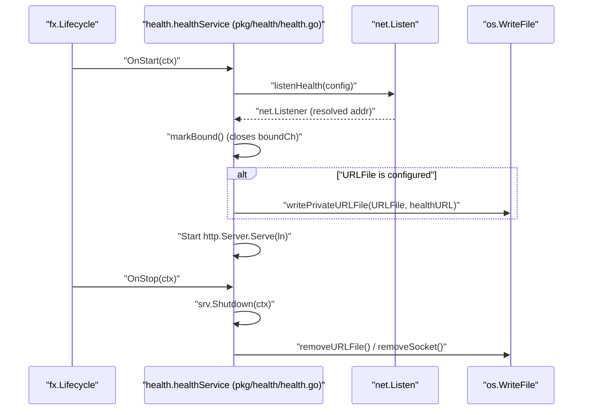
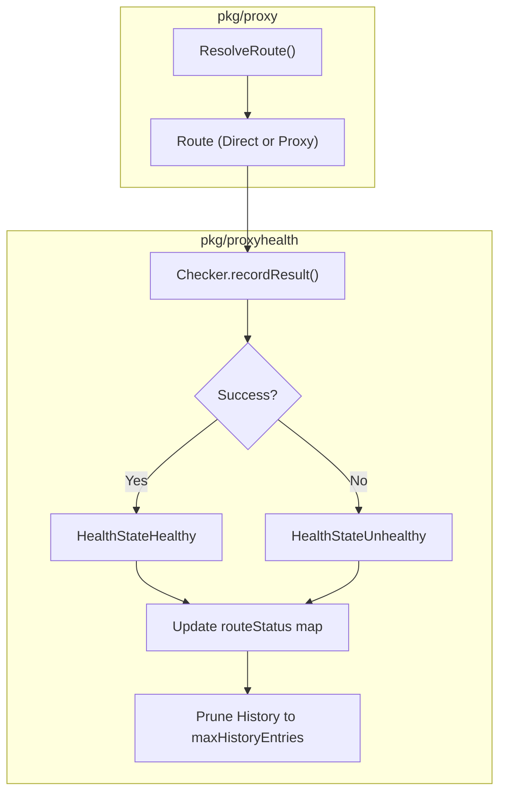
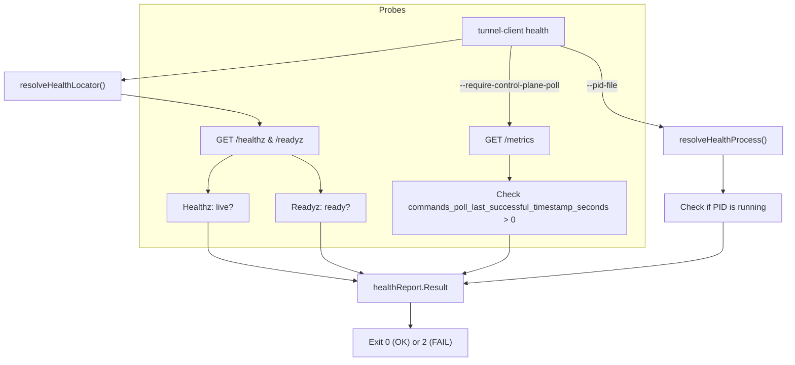

<!-- source: DeepWiki mcp.deepwiki.com · repo openai/tunnel-client · page 5.3 Health, Readiness, and Metrics · fetched 2026-10-26 -->

# Health, Readiness, and Metrics

Relevant source files

The following files were used as context for generating this wiki page:

- [cmd/client/health_command.go](cmd/client/health_command.go)
- [cmd/client/health_command_test.go](cmd/client/health_command_test.go)
- [cmd/client/help_topics.go](cmd/client/help_topics.go)
- [cmd/client/help_topics/troubleshooting.txt](cmd/client/help_topics/troubleshooting.txt)
- [cmd/client/help_topics_test.go](cmd/client/help_topics_test.go)
- [cmd/client/main_test.go](cmd/client/main_test.go)
- [pkg/adminui/startup.go](pkg/adminui/startup.go)
- [pkg/adminui/startup_test.go](pkg/adminui/startup_test.go)
- [pkg/app/app.go](pkg/app/app.go)
- [pkg/dispatcher/fxmodule.go](pkg/dispatcher/fxmodule.go)
- [pkg/dispatcher/fxmodule_test.go](pkg/dispatcher/fxmodule_test.go)
- [pkg/harpoon/metrics.go](pkg/harpoon/metrics.go)
- [pkg/harpoon/metrics_test.go](pkg/harpoon/metrics_test.go)
- [pkg/health/health.go](pkg/health/health.go)
- [pkg/health/health_test.go](pkg/health/health_test.go)
- [pkg/metrics/http_attributes.go](pkg/metrics/http_attributes.go)
- [pkg/metrics/http_attributes_test.go](pkg/metrics/http_attributes_test.go)
- [pkg/oauth/discovery_retry_policy.go](pkg/oauth/discovery_retry_policy.go)
- [pkg/proxyhealth/checker.go](pkg/proxyhealth/checker.go)
- [pkg/proxyhealth/checker_test.go](pkg/proxyhealth/checker_test.go)
- [testsupport/itest/tunnel_client_profile_preflight_probe.sh](testsupport/itest/tunnel_client_profile_preflight_probe.sh)

The `tunnel-client` provides a dedicated health server that exposes endpoints for liveness, readiness, and Prometheus-formatted metrics. This subsystem is critical for container orchestration (e.g., Kubernetes probes), monitoring via OpenTelemetry, and operational diagnostics.

## Health Server Implementation

The health server is managed by the `health` package and is wired into the application via the `HealthMuxModule` [pkg/health/health.go:32-44](). It utilizes an `http.ServeMux` (annotated as `admin_mux`) to host its endpoints [pkg/health/health.go:36-38]().

### Configuration and Lifecycle
The server's behavior is governed by `HealthConfig`, which defines the `ListenAddr`, `UnixSocket`, and an optional `URLFile` [pkg/health/health.go:106-117]().
*   **Startup**: Upon starting, the service binds to the configured TCP address or Unix socket. If a random port is requested (e.g., `:0`), it resolves the actual bound address [pkg/health/health.go:172-176]().
*   **URL Persistence**: If `URLFile` is configured, the client writes the fully qualified health URL to that file (e.g., `http://localhost:12345` or `unix://...`) and removes it on shutdown [pkg/health/health.go:181-204](), [pkg/health/health.go:215]().
*   **Binding Signal**: The `healthService` uses a `boundCh` channel and a `sync.Once` to signal when the listener is ready, allowing other components to wait for the server via the `Addr()` method [pkg/health/health.go:62-95]().

### Data Flow: Health Server Initialization
The following diagram illustrates how the `healthService` is initialized within the `fx` lifecycle and how it interacts with the configuration and networking layers.

**Diagram: Health Service Lifecycle and Binding**

Sources: [pkg/health/health.go:156-217](), [pkg/health/health.go:221-241]()

---

## Readiness Gating

The `/readyz` endpoint provides a signal that the client is fully operational and capable of processing requests. Unlike `/healthz`, which simply returns `live` [pkg/health/health.go:126](), readiness is gated by several subsystem states.

### Readiness Criteria
Readiness is determined by the `isReady` function [pkg/health/health.go:260-263](), which evaluates:
1.  **OAuth Discovery**: The `OAuthState` must not be pending. If discovery fails with a terminal error, it may still report ready if the failure is non-blocking for the transport [pkg/health/health.go:276-283]().
2.  **MCP Startup Probe**: If an MCP probe is active, the `MCPProbeState` must transition out of the pending state [pkg/health/health.go:227-242]().
3.  **Cloudflared State**: If embedded `cloudflared` is used, it must report that it is ready [pkg/health/health.go:290-297]().

### Readiness Status Mapping
| Status Code | Body | Condition |
| :--- | :--- | :--- |
| `200 OK` | `ready` | All gates passed. |
| `503 Service Unavailable` | `oauth discovery pending` | OAuth metadata fetch in progress [pkg/health/health.go:277](). |
| `503 Service Unavailable` | `mcp startup probe pending` | Initial handshake with MCP server not finished [pkg/health/health.go:234](). |
| `503 Service Unavailable` | `cloudflared starting` | Embedded tunnel process is not yet ready [pkg/health/health.go:293](). |

Sources: [pkg/health/health.go:127](), [pkg/health/health.go:260-300](), [pkg/health/health_test.go:235-270]()

---

## Prometheus Metrics

Metrics are exported via the `/metrics` endpoint using OpenTelemetry. The `MetricExporter` is registered directly to the admin mux [pkg/health/health.go:128]().

### Core Metrics
The client tracks several categories of metrics to monitor process status and poll performance.

| Metric Name | Type | Description |
| :--- | :--- | :--- |
| `liveness` | Gauge | Reports `1` while the process is live [pkg/health/health.go:131-137](). |
| `readiness` | Gauge | Reports `1` when `/readyz` would return `200` [pkg/health/health.go:138-144](). |
| `commands_poll_last_successful_timestamp_seconds` | Gauge | Unix timestamp of the last successful control plane poll. Used by CLI health checks [cmd/client/health_command.go:137-138](). |
| `harpoon_registry_targets` | Gauge | Number of targets currently in the Harpoon registry [pkg/harpoon/metrics.go:23-29](). |

### Metric Callbacks
Liveness and readiness gauges are updated via a `RegisterCallback` that executes whenever metrics are scraped [pkg/health/health.go:158-166]().

Sources: [pkg/health/health.go:128-171](), [pkg/harpoon/metrics.go:13-35]()

---

## Proxy Health Checker

The client includes a `proxyhealth.Checker` responsible for monitoring the availability of outbound HTTP proxies configured for various routes.

### Implementation Details
*   **Connectivity Probes**: The checker performs `CONNECT` requests through the proxy to the target host (e.g., `api.openai.com:443`). It captures the response status category (e.g., `2xx`, `4xx`) and duration [pkg/proxyhealth/checker_test.go:72-104]().
*   **Health State**: Routes transition between `HealthStateHealthy` and `HealthStateUnhealthy` based on probe results [pkg/proxyhealth/checker.go:34-46]().
*   **History**: The checker maintains a rolling history of `CheckRecord` entries, limited by `maxHistoryEntries` [pkg/proxyhealth/checker_test.go:19-32]().

**Diagram: Proxy Health Checking Logic**

Sources: [pkg/proxyhealth/checker.go:15-60](), [pkg/proxyhealth/checker_test.go:19-70]()

---

## Operational CLI: `health` command

The `tunnel-client health` command allows operators to probe a running daemon from the CLI [cmd/client/health_command.go:62-68]().

### Features
*   **Locators**: Probes can target a daemon via `--url`, `--url-file`, or `--port` [cmd/client/health_command.go:97-99]().
*   **Cross-checks**: Optional PID validation via `--pid` or `--pid-file` ensures the health signals belong to the expected process [cmd/client/health_command.go:100-101]().
*   **Poll Verification**: The `--require-control-plane-poll` flag checks the `/metrics` endpoint to ensure the daemon has successfully contacted the OpenAI control plane at least once [cmd/client/health_command.go:102-107]().

**Diagram: CLI Health Probe Flow**

Sources: [cmd/client/health_command.go:111-150](), [cmd/client/health_command.go:178-215](), [cmd/client/health_command_test.go:21-42]()

---

## Startup Summary and Admin UI

The `adminui` package utilizes health information to display a startup summary in the logs and populate the web interface.

*   **URL Discovery**: During startup, the `adminui` waits for the `health.Service` to bind and then constructs the base URL for the Web UI [pkg/adminui/startup.go:77-86]().
*   **Summary Logging**: It logs a structured "startup summary" including the UI URL, metrics URL, and the first failing dependency if the client is not yet ready [pkg/adminui/startup.go:101-123]().
*   **Dependency Tracking**: The `startupFirstFailingDependency` function inspects `ProbeState` and `OAuthState` to identify exactly why a client is stuck in a non-ready state [pkg/adminui/startup.go:199]().

Sources: [pkg/adminui/startup.go:56-141](), [pkg/adminui/startup.go:172-201]()

---

