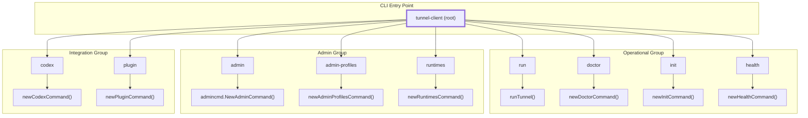
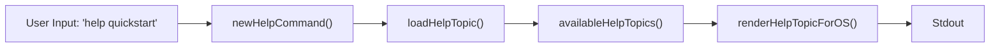

<!-- source: DeepWiki mcp.deepwiki.com · repo openai/tunnel-client · page 6 CLI Commands Reference · fetched 2026-10-26 -->

# CLI Commands Reference

Relevant source files

The following files were used as context for generating this wiki page:

- [cmd/client/doctor_command.go](cmd/client/doctor_command.go)
- [cmd/client/doctor_command_test.go](cmd/client/doctor_command_test.go)
- [cmd/client/root_command.go](cmd/client/root_command.go)
- [cmd/client/run_command.go](cmd/client/run_command.go)
- [cmd/client/run_command_test.go](cmd/client/run_command_test.go)
- [cmd/client/ux_command_test.go](cmd/client/ux_command_test.go)
- [pkg/codexappserver/bridge.go](pkg/codexappserver/bridge.go)
- [pkg/codexappserver/bridge_test.go](pkg/codexappserver/bridge_test.go)

The `tunnel-client` provides a multi-layered Command Line Interface (CLI) built on the `cobra` library. It is designed to serve three primary personas: **Operators** (running the daemon), **Administrators** (managing tunnels and profiles), and **Developers** (testing and local integration).

### Command Organization

The CLI is structured into several top-level subcommands. The root command [cmd/client/root_command.go:14-20]() acts as the entry point, providing access to operational, administrative, and plugin-related tools.

| Category | Commands | Purpose |
| :--- | :--- | :--- |
| **Operational** | `run`, `doctor`, `init`, `health` | Core lifecycle: setup, validation, and execution. |
| **Admin** | `admin`, `admin-profiles`, `runtimes` | Management of remote tunnel resources and local process lifecycles. |
| **Integration** | `codex`, `plugin` | Tools for Codex integration and plugin management. |
| **Development** | `dev` | Local testing utilities and MCP stubs. |

### CLI Structure and Code Entities

The following diagram maps the logical CLI command groups to their corresponding implementation entry points in the codebase.

**CLI Command Mapping**

Sources: [cmd/client/root_command.go:27-38](), [cmd/client/run_command.go:85-112]()

---

### Operational Commands
Operational commands are used to manage the primary `tunnel-client` daemon process. The `run` command [cmd/client/run_command.go:91-97]() is the primary execution mode, initiating the poll-response loop that connects local MCP servers to the OpenAI Control Plane.

*   **`run`**: Starts the long-polling daemon. Supports an `--embedded-mcp-stub` flag [cmd/client/run_command.go:99-99]() for instant local testing without an external MCP server.
*   **`doctor`**: Performs preflight checks on configuration, credentials, and network connectivity [cmd/client/doctor_command.go:57-83](). It validates tunnel IDs, API keys, and MCP server reachability [cmd/client/doctor_command.go:150-189]().
*   **`init`**: An interactive wizard for generating YAML configuration profiles [cmd/client/ux_command_test.go:122-152]().
*   **`health`**: Probes a running daemon's `/healthz` and `/readyz` endpoints.

For details, see [Operational Commands: run, doctor, init, health](#6.1).

---

### Admin Commands
Administrative commands interact with the OpenAI Admin API or manage the local runtime environment for managed processes.

*   **`admin`**: Provides CRUD operations for tunnels (e.g., `admin tunnels create`).
*   **`admin-profiles`**: Manages sets of administrative credentials used by the `admin` command [cmd/client/root_command.go:35-35]().
*   **`runtimes`**: Manages the lifecycle of `tunnel-client` processes running in the background (create, list, stop, status) [cmd/client/root_command.go:36-36]().

For details, see [Admin Commands: tunnels, admin-profiles, runtimes](#6.2).

---

### Codex and Integration Commands
These commands facilitate the use of `tunnel-client` as a backend for AI assistants and plugins.

*   **`codex`**: Includes an interactive assistant REPL and an app-server bridge for local development [pkg/codexappserver/bridge.go:206-234]().
*   **`plugin`**: Handles the installation and management of the `tunnel-mcp` plugin for the Codex environment [cmd/client/ux_command_test.go:98-110]().

For details, see [Codex and Assistant Commands](#6.3).

---

### Help and Troubleshooting
The CLI includes an "agent-first" help system. In addition to standard `--help` flags, it provides dedicated help topics such as `quickstart` and `doctor` [cmd/client/ux_command_test.go:15-35]().

**Help Topic Resolution**

Sources: [cmd/client/ux_command_test.go:37-65](), [cmd/client/ux_command_test.go:86-96]()

*   **Standard Help**: Accessible via `tunnel-client --help` or `tunnel-client [subcommand] --help` [cmd/client/run_command_test.go:26-39]().
*   **Topic Help**: Accessible via `tunnel-client help [topic]`. Common topics include `quickstart`, `doctor`, and `plugin` [cmd/client/ux_command_test.go:37-84]().

Sources: [cmd/client/root_command.go:13-41](), [cmd/client/run_command.go:1-112](), [cmd/client/doctor_command.go:1-197](), [cmd/client/ux_command_test.go:1-165]()

---

