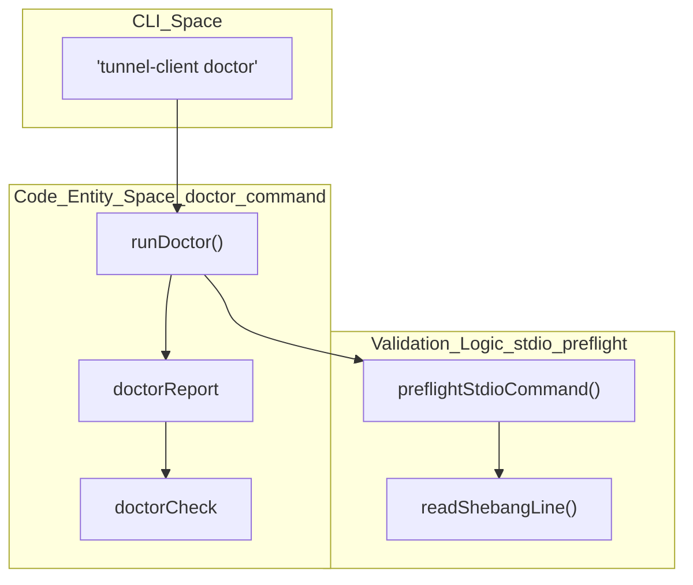
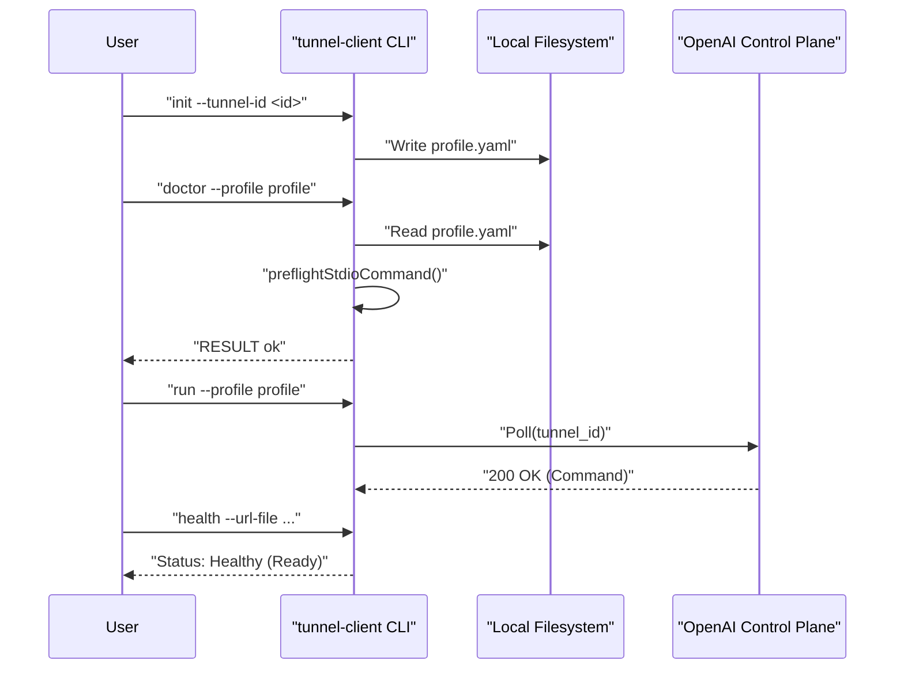

<!-- source: DeepWiki mcp.deepwiki.com · repo openai/tunnel-client · page 6.1 Operational Commands: run, doctor, init, health · fetched 2026-10-26 -->

# Operational Commands: run, doctor, init, health

Relevant source files

The following files were used as context for generating this wiki page:

- [cmd/client/doctor_command.go](cmd/client/doctor_command.go)
- [cmd/client/doctor_command_test.go](cmd/client/doctor_command_test.go)
- [cmd/client/health_command.go](cmd/client/health_command.go)
- [cmd/client/health_command_test.go](cmd/client/health_command_test.go)
- [cmd/client/help_topics.go](cmd/client/help_topics.go)
- [cmd/client/help_topics/doctor.txt](cmd/client/help_topics/doctor.txt)
- [cmd/client/help_topics/quickstart.txt](cmd/client/help_topics/quickstart.txt)
- [cmd/client/help_topics/troubleshooting.txt](cmd/client/help_topics/troubleshooting.txt)
- [cmd/client/help_topics_test.go](cmd/client/help_topics_test.go)
- [cmd/client/init_command.go](cmd/client/init_command.go)
- [cmd/client/profile_samples/sample_mcp_enterprise_proxy.yaml.tmpl](cmd/client/profile_samples/sample_mcp_enterprise_proxy.yaml.tmpl)
- [cmd/client/profile_samples/sample_mcp_remote_no_auth.yaml.tmpl](cmd/client/profile_samples/sample_mcp_remote_no_auth.yaml.tmpl)
- [cmd/client/profile_samples/sample_mcp_stdio_local.yaml.tmpl](cmd/client/profile_samples/sample_mcp_stdio_local.yaml.tmpl)
- [cmd/client/profile_samples/sample_mcp_with_dcr.yaml.tmpl](cmd/client/profile_samples/sample_mcp_with_dcr.yaml.tmpl)
- [cmd/client/root_command.go](cmd/client/root_command.go)
- [cmd/client/run_command.go](cmd/client/run_command.go)
- [cmd/client/run_command_test.go](cmd/client/run_command_test.go)
- [cmd/client/stdio_preflight.go](cmd/client/stdio_preflight.go)
- [cmd/client/ux_command_test.go](cmd/client/ux_command_test.go)
- [docs/assistantkb.go](docs/assistantkb.go)
- [pkg/codexappserver/bridge.go](pkg/codexappserver/bridge.go)
- [pkg/codexappserver/bridge_test.go](pkg/codexappserver/bridge_test.go)
- [pkg/config/proxy.go](pkg/config/proxy.go)
- [pkg/process/process_test.go](pkg/process/process_test.go)
- [plugins/assistantkb.go](plugins/assistantkb.go)
- [plugins/bundle_test.go](plugins/bundle_test.go)
- [testsupport/itest/tunnel_client_profile_preflight_probe.sh](testsupport/itest/tunnel_client_profile_preflight_probe.sh)

This section provides a detailed technical reference for the primary operational commands of the `tunnel-client` CLI. These commands form the lifecycle of a tunnel: from interactive setup (`init`) and preflight validation (`doctor`) to active execution (`run`) and runtime monitoring (`health`).

## 1. The `run` Command

The `run` command is the entry point for the long-lived daemon process. It initializes the `fx` dependency injection graph and starts the control-plane poller and MCP dispatcher.

### Implementation and Data Flow
When `run` is executed, it performs the following steps:
1.  **Configuration Loading**: Loads the active profile and environment variables using `config.LoadFromFlagSet` [cmd/client/run_command.go:127-133]().
2.  **Embedded MCP Stub (Optional)**: If `--embedded-mcp-stub` is provided, it starts a local MCP server and automatically reconfigures the `main` channel to point to this local instance [cmd/client/run_command.go:187-205]().
3.  **App Initialization**: Constructs the core application using `app.New(cfg, ...)` [cmd/client/run_command.go:136-142]().
4.  **Lifecycle Logging**: A specialized `tunnelEventLogger` monitors the `fx` startup sequence, logging the Tunnel ID, the resolved Control Plane URL, and discovered OAuth metadata URLs once the tunnel metadata is successfully fetched [cmd/client/run_command.go:39-83]().

### Embedded MCP Stub
The embedded stub provides a "zero-config" path for testing. It includes a local OAuth server and a set of demo tools (e.g., `echo`, `uppercase`).
*   **Conflict Prevention**: The command rejects combinations of `--embedded-mcp-stub` with explicit `--mcp.command` or `--mcp.server-url` to prevent ambiguous routing [cmd/client/run_command.go:191-196]().

**Sources:** [cmd/client/run_command.go:1-185](), [cmd/client/run_command.go:187-205]()

---

## 2. The `doctor` Command

The `doctor` command performs a comprehensive "preflight" check of the environment and configuration without starting the full poller loop.

### Validation Checks
`doctor` executes a series of `doctorCheck` functions, returning a `doctorReport` [cmd/client/doctor_command.go:42-47]().

| Check ID | Purpose | Implementation Detail |
| :--- | :--- | :--- |
| `config_source` | Validates that a profile or environment is set. | [cmd/client/doctor_command.go:86-103]() |
| `profile_load` | Ensures the YAML profile is readable and syntactically valid. | [cmd/client/doctor_command.go:111-140]() |
| `tunnel_id` | Validates the Tunnel ID format. | [cmd/client/doctor_command.go:150-154]() |
| `mcp_target` | Checks if the MCP target (URL or Command) is defined. | [cmd/client/doctor_command.go:162-190]() |
| `mcp_server_reachable` | Probes network reachability for HTTP-based MCP servers. | [cmd/client/doctor_command.go:170-170]() |
| `oauth_metadata` | Validates the presence of OAuth protected resource metadata. | [cmd/client/doctor_command.go:171-171]() |
| `health_listener` | Checks if the configured health port is available. | [cmd/client/doctor_command.go:192-193]() |

### Stdio Preflight
For MCP servers running via `stdio`, `doctor` performs deep inspection of the command:
1.  **Path Resolution**: Uses `exec.LookPath` to find the executable [cmd/client/stdio_preflight.go:48-51]().
2.  **Permissions**: Verifies the file is not a directory and has the `+x` bit set [cmd/client/stdio_preflight.go:60-72]().
3.  **Shebang Inspection**: For scripts, it reads the shebang line and recursively validates the interpreter (e.g., `/usr/bin/env python3`) up to a depth of 4 [cmd/client/stdio_preflight.go:74-134]().

### Diagnostics to Code Mapping
The following diagram shows how `doctor` results map to internal logic.

**Doctor Preflight Logic Map**

**Sources:** [cmd/client/doctor_command.go:85-197](), [cmd/client/stdio_preflight.go:17-45]()

---

## 3. The `init` Command

The `init` command is an interactive/automated profile generator designed to bootstrap new users.

### Profile Generation
It uses Go templates located in `cmd/client/profile_samples/` to generate YAML profiles based on user input or flags [cmd/client/init_command.go:29-86]().

*   **Sample Selection**: It automatically selects `sample_mcp_stdio_local` if a `--mcp-command` is provided, otherwise it defaults to `sample_mcp_with_dcr` [cmd/client/init_command.go:104-109]().
*   **Validation**: Before writing the file, it validates the generated bytes against the schema using `config.ValidateProfileBytes` [cmd/client/ux_command_test.go:141-141]().
*   **Standard Templates**:
    *   `sample_mcp_with_dcr`: Standard setup for Dynamic Client Registration.
    *   `sample_mcp_enterprise_proxy`: Includes `ca_bundle` and `http_proxy` configurations [cmd/client/profile_samples/sample_mcp_enterprise_proxy.yaml.tmpl:1-12]().

**Sources:** [cmd/client/init_command.go:29-86](), [cmd/client/ux_command_test.go:122-152]()

---

## 4. The `health` Command

The `health` command is a diagnostic tool used to probe a running `tunnel-client` daemon.

### Functionality
*   **Discovery**: It can discover the local daemon's health endpoint via a `--url-file` (typically written by the daemon at `/tmp/tunnel-client-health.url`) [cmd/client/health_command.go:26-30]().
*   **Probing**: It queries the `/healthz` (liveness) and `/readyz` (readiness) endpoints of the running process [cmd/client/health_command.go:50-70]().
*   **Output**: Supports JSON output for automated health checks in container orchestrators or scripts [cmd/client/health_command.go:39-40]().

### Operational Flow: Init to Run
The following diagram illustrates the standard operational sequence from configuration to a running, healthy state.

**Command Lifecycle and State Flow**

**Sources:** [cmd/client/init_command.go:75-84](), [cmd/client/doctor_command.go:217-232](), [cmd/client/health_command.go:15-45]()

---

