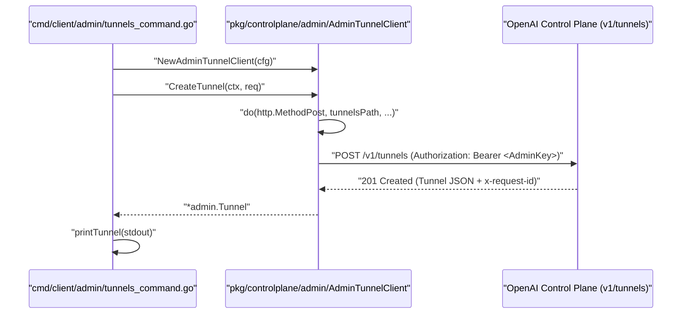
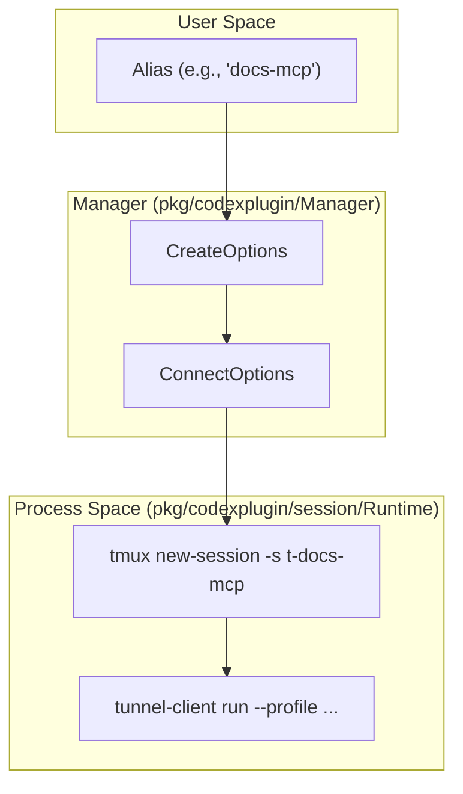

<!-- source: DeepWiki mcp.deepwiki.com · repo openai/tunnel-client · page 6.2 Admin Commands: tunnels, admin-profiles, runtimes · fetched 2026-10-26 -->

# Admin Commands: tunnels, admin-profiles, runtimes

Relevant source files

The following files were used as context for generating this wiki page:

- [cmd/client/admin/admin_command.go](cmd/client/admin/admin_command.go)
- [cmd/client/admin/tunnels_command.go](cmd/client/admin/tunnels_command.go)
- [cmd/client/admin/tunnels_command_test.go](cmd/client/admin/tunnels_command_test.go)
- [cmd/client/help_topics/plugin.txt](cmd/client/help_topics/plugin.txt)
- [cmd/client/root_command_test.go](cmd/client/root_command_test.go)
- [cmd/client/runtimes_command.go](cmd/client/runtimes_command.go)
- [cmd/client/runtimes_command_test.go](cmd/client/runtimes_command_test.go)
- [pkg/config/admin.go](pkg/config/admin.go)
- [pkg/config/admin_test.go](pkg/config/admin_test.go)
- [pkg/controlplane/admin/client_test.go](pkg/controlplane/admin/client_test.go)
- [pkg/controlplane/admin/tunnel_client.go](pkg/controlplane/admin/tunnel_client.go)
- [pkg/controlplane/admin/types.go](pkg/controlplane/admin/types.go)
- [plugins/tunnel-mcp/README.md](plugins/tunnel-mcp/README.md)
- [plugins/tunnel-mcp/skills/tunnel-mcp/SKILL.md](plugins/tunnel-mcp/skills/tunnel-mcp/SKILL.md)
- [plugins/tunnel-mcp/skills/tunnel-mcp/references/runtime-flows.md](plugins/tunnel-mcp/skills/tunnel-mcp/references/runtime-flows.md)

Administrative CLI commands provide a suite of tools for managing the tunnel lifecycle, from remote resource creation on the OpenAI control plane to local process management on the host machine. These commands are categorized into three functional groups:

1.  **`admin tunnels`**: Direct CRUD operations against the OpenAI Tunnel Management API.
2.  **`admin-profiles`**: Local management of named credential sets (Admin Keys and Base URLs).
3.  **`runtimes`**: Lifecycle management for local `tunnel-client` processes, including process supervision via `tmux` or background PIDs.

## 1. Admin Tunnels (Remote CRUD)

The `admin tunnels` subcommand is a thin wrapper around the `AdminTunnelClient` [pkg/controlplane/admin/tunnel_client.go:58-63](). It facilitates metadata management for tunnels stored in the OpenAI control plane.

### Implementation and Data Flow
The CLI uses an `AdminConfig` [pkg/config/admin.go:20-27]() to initialize the client. Authentication requires an `OPENAI_ADMIN_KEY`, which must be provided via the `--admin-key` flag (using `env:` or `file:` prefixes) or the `OPENAI_ADMIN_KEY` environment variable [cmd/client/admin/tunnels_command.go:33-37]().

**Command Hierarchy:**
*   `create`: Requires `--name`, `--description`, and at least one scope (`--organization-id` or `--workspace-id`) [cmd/client/admin/tunnels_command.go:82-95]().
*   `get <tunnel_id>`: Read-only metadata lookup. Can function with either an Admin Key or a standard Runtime Key [cmd/client/admin/tunnels_command.go:133-138]().
*   `list`: Requires exactly one scope filter (org, workspace, or tenant) [cmd/client/admin/tunnels_command.go:192-205]().
*   `update`: Allows partial updates using pointer fields to distinguish between omitting a field and clearing it [pkg/controlplane/admin/types.go:46-52]().
*   `delete`: Requires the `--confirm` flag to prevent accidental removal [cmd/client/admin/tunnels_command.go:264-270]().

### Admin API Data Flow
The following diagram illustrates the interaction between the CLI, the internal `AdminTunnelClient`, and the OpenAI Control Plane.

**Title: Admin Tunnel CRUD Sequence**

Sources: [pkg/controlplane/admin/tunnel_client.go:83-89](), [pkg/controlplane/admin/tunnel_client.go:92-98](), [pkg/controlplane/admin/tunnel_client.go:173-188](), [cmd/client/admin/tunnels_command.go:106-113]()

## 2. Admin Profiles (Local Credentials)

`admin-profiles` manage named sets of administrative credentials stored locally. This allows users to switch between different environments (e.g., `prod` vs `sandbox`) without re-entering keys.

### Operations and Logic
Administrative profiles are managed by the `Manager` class [cmd/client/runtimes_command.go:27](), which handles persistence and retrieval of credential sets.

| Command | Logic | Source |
| :--- | :--- | :--- |
| `set` | Validates secret references and saves the named profile. | [cmd/client/runtimes_command_test.go:27-30]() |
| `list` | Returns all profiles and highlights the active one. | [cmd/client/runtimes_command_test.go:33-36]() |
| `delete` | Removes the profile entry from local storage. | [cmd/client/runtimes_command_test.go:39-42]() |

Sources: [cmd/client/runtimes_command.go:36-40](), [cmd/client/runtimes_command_test.go:17-43]()

## 3. Runtimes (Process Lifecycle)

The `runtimes` command family manages the lifecycle of local `tunnel-client run` processes. It acts as a process supervisor, ensuring that the client is running, healthy, and correctly associated with a remote tunnel.

### Implementation: The `session.Runtime`
The CLI uses a `session.Runtime` abstraction to interact with the OS [cmd/client/runtimes_command.go:26](). 
1.  **Supervision**: It prefers `tmux` if available to provide a persistent, inspectable session [cmd/client/runtimes_command_test.go:100-112]().
2.  **Fallback**: If `tmux` is missing, it starts a detached background process [cmd/client/runtimes_command_test.go:125-128]().

### Core Commands
*   **`create`**: Performs the remote `admin tunnels create` and records a local alias [cmd/client/runtimes_command.go:47-75]().
*   **`connect`**: The primary "up" command. It generates a local YAML profile, launches the `tunnel-client run` process, and waits for the `/readyz` endpoint to return success [cmd/client/runtimes_command.go:95-149]().
*   **`status`**: Aggregates data from the local process (PID/tmux), the local Admin UI, and the remote Control Plane. It reports `control_plane_poll_health` separately from local health [plugins/tunnel-mcp/README.md:203-205](), [plugins/tunnel-mcp/skills/tunnel-mcp/SKILL.md:66-69]().
*   **`cleanup`**: Scans for "stale" aliases where the process is dead. Using `--apply` removes entries classified as `stale_alias` [plugins/tunnel-mcp/skills/tunnel-mcp/references/runtime-flows.md:33-34](), [plugins/tunnel-mcp/skills/tunnel-mcp/references/runtime-flows.md:51-53]().

### Runtime Process Mapping
The following diagram bridges the logical "Alias" used by the user to the physical entities and code paths involved in process management.

**Title: Runtime Alias to Code Entity Mapping**

Sources: [cmd/client/runtimes_command.go:54-64](), [cmd/client/runtimes_command.go:106-125](), [cmd/client/runtimes_command_test.go:110-117]()

### Repair Actions
The `status` command returns structured `repair_actions` if the runtime is unhealthy, providing guidance on how to fix common issues like dead processes or stale health URLs [plugins/tunnel-mcp/README.md:23-24](), [plugins/tunnel-mcp/skills/tunnel-mcp/references/runtime-flows.md:47-49]().

Sources: [plugins/tunnel-mcp/README.md:203-206](), [plugins/tunnel-mcp/skills/tunnel-mcp/references/runtime-flows.md:39-49]()

---

