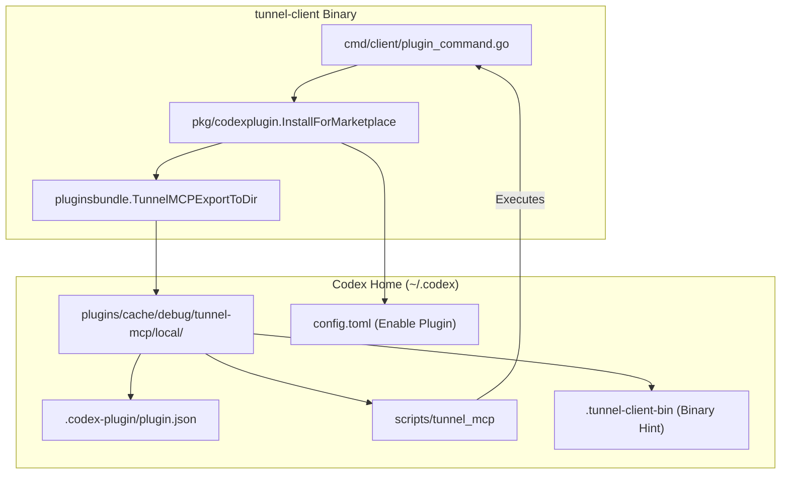
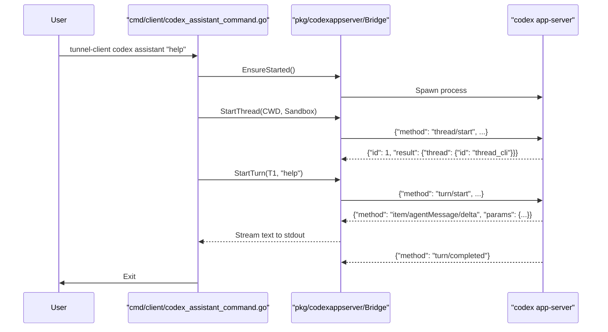

<!-- source: DeepWiki mcp.deepwiki.com · repo openai/tunnel-client · page 6.3 Codex and Assistant Commands · fetched 2026-10-26 -->

# Codex and Assistant Commands

Relevant source files

The following files were used as context for generating this wiki page:

- [adminui/src/components/CodexPanel.svelte](adminui/src/components/CodexPanel.svelte)
- [cmd/client/codex_assistant_command.go](cmd/client/codex_assistant_command.go)
- [cmd/client/codex_assistant_kb.go](cmd/client/codex_assistant_kb.go)
- [cmd/client/codex_command.go](cmd/client/codex_command.go)
- [cmd/client/codex_command_test.go](cmd/client/codex_command_test.go)
- [cmd/client/dev_command.go](cmd/client/dev_command.go)
- [cmd/client/dev_command_test.go](cmd/client/dev_command_test.go)
- [cmd/client/plugin_command.go](cmd/client/plugin_command.go)
- [docs/assistantkb_test.go](docs/assistantkb_test.go)
- [examples/python-mcp-tunnel-client-proxy/example.py](examples/python-mcp-tunnel-client-proxy/example.py)
- [pkg/adminui/codex.go](pkg/adminui/codex.go)
- [pkg/adminui/codex_test.go](pkg/adminui/codex_test.go)
- [pkg/codexplugin/codexplugin.go](pkg/codexplugin/codexplugin.go)
- [pkg/codexplugin/codexplugin_test.go](pkg/codexplugin/codexplugin_test.go)
- [pkg/localproxy/localproxy.go](pkg/localproxy/localproxy.go)
- [pkg/localproxy/localproxy_test.go](pkg/localproxy/localproxy_test.go)
- [plugins/tunnel-mcp/AGENTS.md](plugins/tunnel-mcp/AGENTS.md)
- [plugins/tunnel-mcp/scripts/tunnel_mcp](plugins/tunnel-mcp/scripts/tunnel_mcp)
- [plugins/tunnel-mcp/skills/tunnel-mcp/references/setup-and-install.md](plugins/tunnel-mcp/skills/tunnel-mcp/references/setup-and-install.md)
- [testsupport/itest/dev_proxy_health_check.py](testsupport/itest/dev_proxy_health_check.py)
- [testsupport/itest/run_tunnel_client_profile_itest_service.sh](testsupport/itest/run_tunnel_client_profile_itest_service.sh)
- [wrappers/mcp-tunnel-client-proxy/python/mcp_tunnel_client_proxy.py](wrappers/mcp-tunnel-client-proxy/python/mcp_tunnel_client_proxy.py)
- [wrappers/mcp-tunnel-client-proxy/typescript/mcp_tunnel_client_proxy.ts](wrappers/mcp-tunnel-client-proxy/typescript/mcp_tunnel_client_proxy.ts)

The `tunnel-client` includes a comprehensive suite of commands and internal bridges to integrate with the OpenAI Codex assistant environment. This includes an embedded Codex plugin (`tunnel-mcp`), a bridge to the Codex `app-server`, a local REPL for interacting with the assistant, and a specialized knowledge base to guide the assistant in managing tunnels.

## Codex Plugin Management

The `tunnel-client` binary embeds the source code and manifest for the `tunnel-mcp` Codex plugin. This allows the client to self-install or export the plugin without requiring external downloads.

### Plugin Installation and Export
The `codex plugin` command family handles the lifecycle of the plugin within the `CODEX_HOME` environment (typically `~/.codex`).

*   **Install**: `tunnel-client codex plugin install` extracts the embedded plugin to the Codex cache and updates the Codex `config.toml` to enable it [pkg/codexplugin/codexplugin.go:154-194](). It also persists a `.tunnel-client-bin` hint so the plugin knows which binary to invoke for runtime operations [pkg/codexplugin/codexplugin.go:170-183]().
*   **Export**: `tunnel-client codex plugin export --dir <path>` writes the plugin bundle to a directory for manual inspection or distribution [pkg/codexplugin/codexplugin.go:57-74]().
*   **Detection**: The `pkg/codexplugin` package implements `Detect` to identify existing installations, identify stale configuration entries, and verify if the plugin's binary hint matches the current executable [pkg/codexplugin/codexplugin.go:74-124]().

### Data Flow: Plugin Installation
The following diagram illustrates the transition from the `tunnel-client` binary to an active Codex plugin.

Title: Codex Plugin Installation Flow

Sources: [cmd/client/plugin_command.go:53-85](), [pkg/codexplugin/codexplugin.go:158-194](), [pkg/codexplugin/codexplugin.go:17-21](), [plugins/tunnel-mcp/scripts/tunnel_mcp:130-144]()

## Codex App-Server Bridge

The `codexappserver.Bridge` provides a Go interface for communicating with the Codex `app-server` via JSON-RPC over standard I/O. This bridge is the foundation for the CLI assistant REPL.

### Key Components
*   **Bridge**: Manages the lifecycle of the `codex app-server` process, handling input/output streams and JSON-RPC message ID tracking [cmd/client/codex_assistant_command.go:99-108]().
*   **Snapshot**: Provides a point-in-time view of the assistant's state, including the logged-in account, active thread, and current turn status [cmd/client/codex_command.go:30-62]().
*   **Device Code Login**: If Codex requires authentication, the bridge facilitates the `account/login/start` flow, providing a verification URL and user code [cmd/client/codex_assistant_command.go:133-184]().

### Assistant REPL and One-Shot
The `tunnel-client codex assistant` command provides two modes:
1.  **Interactive REPL**: If started in a TTY without arguments, it enters a loop where users can chat with the assistant [cmd/client/codex_assistant_command.go:201-240]().
2.  **One-Shot**: If prompts are passed as arguments or piped via stdin, it executes a single "turn" and exits [cmd/client/codex_assistant_command.go:186-199]().

Title: Assistant Command Interaction

Sources: [cmd/client/codex_assistant_command.go:87-131](), [cmd/client/codex_command_test.go:43-85]()

## Assistant Knowledge Base

To ensure the assistant provides accurate technical guidance, `tunnel-client` injects a "Knowledge Base" (KB) into the conversation. This KB is sourced from the `docs/` and `plugins/tunnel-mcp/skills/` directories, which are embedded into the binary.

### Integration Points
*   **Search**: The `assistantkb.Search` function performs keyword-based lookups across the embedded documentation [docs/assistantkb.go:153-170]().
*   **Prompt Context**: When starting a turn, the client calls `BuildPromptContext` to find relevant snippets (e.g., how to connect to ChatGPT, troubleshooting `readyz` failures) and formats them as context for the model [docs/assistantkb.go:9-28]().
*   **Deterministic Guidance**: For critical failures like a missing `tunnel-client` binary, the KB provides OS-specific instructions via `BinaryAcquisitionGuidanceForOS` (PowerShell for Windows, Shell for Unix) [docs/assistantkb.go:64-95]().

Sources: [docs/assistantkb_test.go:9-43](), [pkg/adminui/codex_test.go:44-71](), [pkg/adminui/codex_test.go:99-137]()

## Developer MCP Stub

For local testing and development, the `tunnel-client dev mcp-stub` command allows running a mock MCP server that simulates tool calls and resource access without requiring a full external MCP server.

*   **Implementation**: Located in `cmd/client/dev_command.go`, it establishes a local MCP environment for testing the client's ability to route and execute tools.
*   **Usage**: Useful for verifying the `tunnel-client` poll-response loop or the Codex plugin's routing logic in a controlled environment.

| Feature | Implementation | Command |
| :--- | :--- | :--- |
| **Plugin Install** | `pkg/codexplugin.Install` | `codex plugin install` |
| **App-Server Bridge** | `pkg/codexappserver.Bridge` | `codex assistant` |
| **Knowledge Base** | `docs/assistantkb.go` | (Internal to assistant commands) |
| **Local Testing** | `cmd/client/dev_command.go` | `dev mcp-stub` |

Sources: [cmd/client/codex_command.go:93-114](), [pkg/codexplugin/codexplugin.go:154-194](), [cmd/client/codex_assistant_command.go:51-85]()

---

