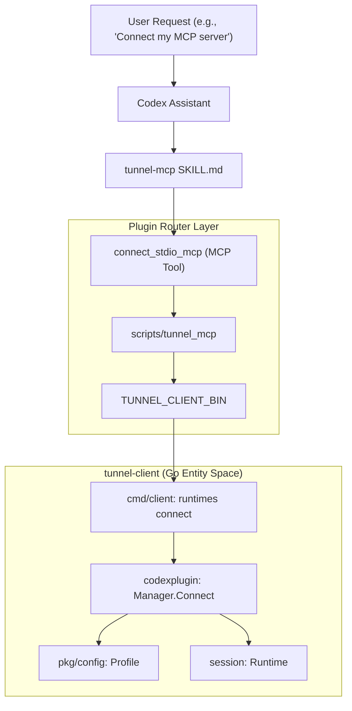
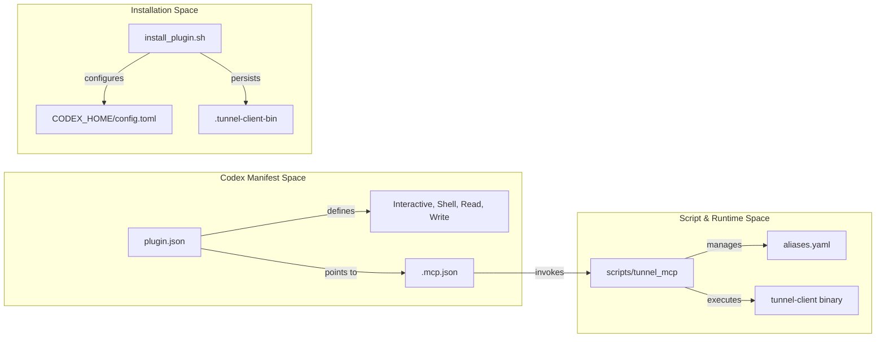

<!-- source: DeepWiki mcp.deepwiki.com · repo openai/tunnel-client · page 7 Codex Plugin (tunnel-mcp) · fetched 2026-10-26 -->

# Codex Plugin (tunnel-mcp)

Relevant source files

The following files were used as context for generating this wiki page:

- [cmd/client/help_topics/plugin.txt](cmd/client/help_topics/plugin.txt)
- [cmd/client/runtimes_command.go](cmd/client/runtimes_command.go)
- [cmd/client/runtimes_command_test.go](cmd/client/runtimes_command_test.go)
- [plugins/bundle.go](plugins/bundle.go)
- [plugins/tunnel-mcp/.codex-plugin/plugin.json](plugins/tunnel-mcp/.codex-plugin/plugin.json)
- [plugins/tunnel-mcp/README.md](plugins/tunnel-mcp/README.md)
- [plugins/tunnel-mcp/assets/tunnel-mcp-logo.png](plugins/tunnel-mcp/assets/tunnel-mcp-logo.png)
- [plugins/tunnel-mcp/scripts/install_plugin.py](plugins/tunnel-mcp/scripts/install_plugin.py)
- [plugins/tunnel-mcp/skills/tunnel-mcp/SKILL.md](plugins/tunnel-mcp/skills/tunnel-mcp/SKILL.md)
- [plugins/tunnel-mcp/skills/tunnel-mcp/references/runtime-flows.md](plugins/tunnel-mcp/skills/tunnel-mcp/references/runtime-flows.md)

The `tunnel-mcp` plugin is a local Codex extension designed to manage secure MCP tunnels via the `tunnel-client` binary. It provides a thin routing layer that bridges the Codex natural language interface and MCP tool calls to the native Go-based runtime management system.

The plugin is intentionally architected to be "thin": it delegates the heavy lifting—such as tunnel protocol logic, process lifecycle management, and control-plane polling—to the `tunnel-client` binary [plugins/tunnel-mcp/README.md:3-8]().

### Thin-Router Architecture

The plugin operates as a bridge between the Codex environment and the local operating system. Instead of reimplementing the tunnel protocol, the plugin uses a router script (`scripts/tunnel_mcp`) to invoke the native `tunnel-client` command trees, specifically `runtimes` and `admin-profiles` [plugins/tunnel-mcp/skills/tunnel-mcp/SKILL.md:8-11]().

**Core Responsibilities:**
*   **Codex Integration:** Exposes MCP tools for runtime orchestration such as `create_tunnel_runtime` and `connect_stdio_mcp` [plugins/tunnel-mcp/README.md:13-18]().
*   **Delegation:** Forwards operational actions to `tunnel-client runtimes ...` [plugins/tunnel-mcp/skills/tunnel-mcp/SKILL.md:39-40]().
*   **State Management:** Relies on the Go binary to manage `aliases.yaml`, `processes.yaml`, and `admin_profiles.yaml` [plugins/tunnel-mcp/README.md:5-8]().
*   **Diagnostic Routing:** Provides `self-check` and `diagnose` commands to verify binary and plugin compatibility [plugins/tunnel-mcp/README.md:46-47]().

#### System Topology: Natural Language to Code Entities

The following diagram illustrates how a user's natural language request flows through the plugin layers into the core Go entities.

**Request Flow: Natural Language to Go Runtime**

Sources: [plugins/tunnel-mcp/skills/tunnel-mcp/SKILL.md:8-25](), [plugins/tunnel-mcp/README.md:92-95](), [cmd/client/runtimes_command.go:27-106](), [cmd/client/runtimes_command.go:26-27]()

### Skill Guidance System

The plugin includes a curated set of "skills" (found in `skills/tunnel-mcp/`) that provide the Codex LLM with precise instructions and references. This system ensures the assistant uses the most efficient command patterns and adheres to security rules, such as never passing literal API keys [plugins/tunnel-mcp/skills/tunnel-mcp/SKILL.md:63-65]().

| Reference File | Purpose |
| :--- | :--- |
| `binary.md` | Guidance on finding, building, or acquiring the `tunnel-client` binary [plugins/tunnel-mcp/README.md:32](). |
| `setup-and-install.md` | Instructions for plugin installation, exports, and resets [plugins/tunnel-mcp/README.md:33](). |
| `profiles-state-and-keys.md` | Documentation of directory layouts and the split between admin/runtime keys [plugins/tunnel-mcp/README.md:34](). |
| `runtime-flows.md` | Step-by-step logic for creating, connecting, and stopping runtimes [plugins/tunnel-mcp/README.md:35](). |
| `troubleshooting.md` | Health check (`/healthz`) and log inspection procedures [plugins/tunnel-mcp/README.md:36](). |

### Key Components and Interactions

The plugin's functionality is partitioned into tool execution and lifecycle management. The `plugin.json` manifest defines the capabilities, while the `scripts/` directory contains the execution logic.

**Plugin Structure and Entity Mapping**

Sources: [plugins/tunnel-mcp/.codex-plugin/plugin.json:21-32](), [plugins/tunnel-mcp/README.md:107-112](), [plugins/bundle.go:91-107]()

### Details and Implementation

For in-depth technical details on the specific tools and installation procedures, refer to the following child pages:

*   **[Plugin Tools and Runtime Management](#7.1)**: Covers the MCP tool definitions (e.g., `create_tunnel_runtime`, `runtime_status`), the `Manager` implementation in `pkg/codexplugin`, and the internal state directory layout [cmd/client/runtimes_command.go:27-148]().
*   **[Plugin Installation and Scripts](#7.2)**: Covers the installation workflows for Bash and PowerShell, the Python-based installer logic in `scripts/tunnel_mcp_installer/`, and how the `TUNNEL_CLIENT_BIN` environment variable is used to anchor the plugin to a specific binary [plugins/tunnel-mcp/README.md:38-70](), [plugins/tunnel-mcp/scripts/install_plugin.py:1-15]().

Sources: [plugins/tunnel-mcp/README.md:10-26](), [plugins/tunnel-mcp/README.md:38-70](), [cmd/client/runtimes_command.go:27-28]()

---

