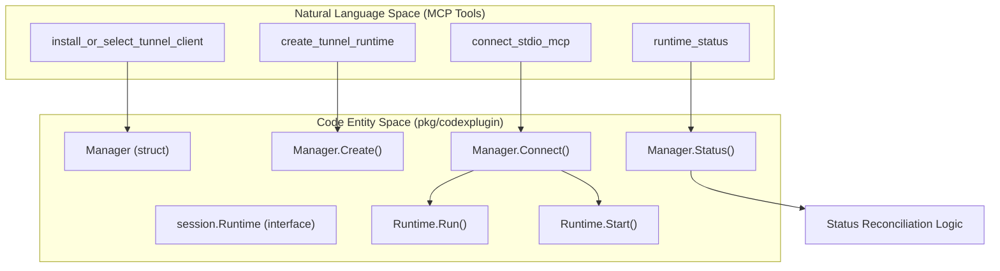
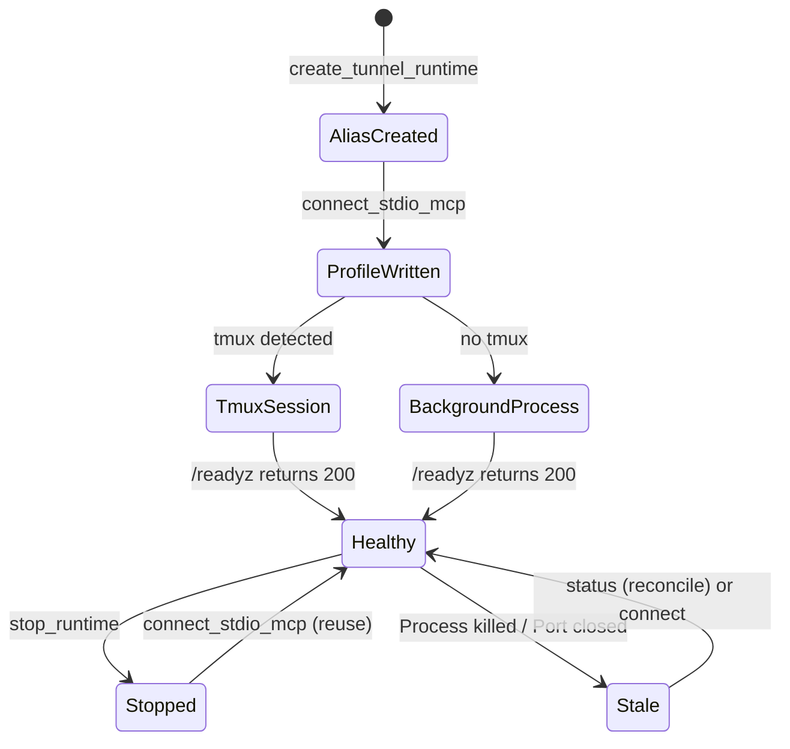

<!-- source: DeepWiki mcp.deepwiki.com · repo openai/tunnel-client · page 7.1 Plugin Tools and Runtime Management · fetched 2026-10-26 -->

# Plugin Tools and Runtime Management

Relevant source files

The following files were used as context for generating this wiki page:

- [cmd/client/help_topics/plugin.txt](cmd/client/help_topics/plugin.txt)
- [cmd/client/runtimes_command.go](cmd/client/runtimes_command.go)
- [cmd/client/runtimes_command_test.go](cmd/client/runtimes_command_test.go)
- [pkg/codexplugin/manager.go](pkg/codexplugin/manager.go)
- [pkg/codexplugin/manager_test.go](pkg/codexplugin/manager_test.go)
- [pkg/codexplugin/session/process_unix.go](pkg/codexplugin/session/process_unix.go)
- [pkg/codexplugin/session/process_windows.go](pkg/codexplugin/session/process_windows.go)
- [pkg/codexplugin/session/session.go](pkg/codexplugin/session/session.go)
- [pkg/codexplugin/session/session_test.go](pkg/codexplugin/session/session_test.go)
- [plugins/tunnel-mcp/README.md](plugins/tunnel-mcp/README.md)
- [plugins/tunnel-mcp/mcp/server.cjs](plugins/tunnel-mcp/mcp/server.cjs)
- [plugins/tunnel-mcp/mcp/server.test.cjs](plugins/tunnel-mcp/mcp/server.test.cjs)
- [plugins/tunnel-mcp/skills/tunnel-mcp/SKILL.md](plugins/tunnel-mcp/skills/tunnel-mcp/SKILL.md)
- [plugins/tunnel-mcp/skills/tunnel-mcp/references/runtime-flows.md](plugins/tunnel-mcp/skills/tunnel-mcp/references/runtime-flows.md)
- [plugins/tunnel-mcp/skills/tunnel-mcp/references/troubleshooting.md](plugins/tunnel-mcp/skills/tunnel-mcp/references/troubleshooting.md)

The Codex Plugin (`tunnel-mcp`) provides a set of high-level tools designed to manage the lifecycle of local `tunnel-client` instances. It acts as a thin orchestration layer over the native `tunnel-client runtimes` command family, providing automated configuration, process management via `tmux` or background processes, and structured health monitoring [plugins/tunnel-mcp/README.md:3-8]().

## Plugin Tools Overview

The plugin exposes several MCP tools through its app server implementation [plugins/tunnel-mcp/mcp/server.cjs:45-130](). These tools delegate operations to the `Manager` class, which interacts with the local filesystem and the `tunnel-client` binary [pkg/codexplugin/manager.go:29-32]().

| Tool Name | Purpose | Code Reference |
| :--- | :--- | :--- |
| `install_or_select_tunnel_client` | Configures the path to the native binary and persists a `.tunnel-client-bin` hint. | [plugins/tunnel-mcp/mcp/server.cjs:48-82]() |
| `create_tunnel_runtime` | Creates or reuses a remote tunnel alias through `runtimes create`. | [plugins/tunnel-mcp/mcp/server.cjs:84-93]() |
| `connect_stdio_mcp` | Launches a local runtime and connects it to a stdio MCP command. | [plugins/tunnel-mcp/mcp/server.cjs:95-104]() |
| `list_runtime_aliases` | Lists local aliases and their current runtime states. | [plugins/tunnel-mcp/mcp/server.cjs:106-111]() |
| `runtime_status` | Detailed inspection of health, readiness, and repair actions. | [plugins/tunnel-mcp/mcp/server.cjs:113-121]() |
| `stop_runtime` | Terminates a local runtime process without deleting the alias. | [plugins/tunnel-mcp/mcp/server.cjs:123-128]() |

**Sources:** [plugins/tunnel-mcp/mcp/server.cjs:45-130](), [pkg/codexplugin/manager.go:29-32](), [plugins/tunnel-mcp/README.md:13-26]()

## Manager Implementation and Data Flow

The `Manager` struct in `pkg/codexplugin` is the central coordinator for all runtime operations. It handles environment resolution, state persistence, and process execution via a `session.Runtime` interface [pkg/codexplugin/manager.go:29-32]().

### Logical Entity Mapping
The following diagram bridges the tool definitions to the internal Go structures and methods.

Title: Tool to Manager Entity Mapping

**Sources:** [pkg/codexplugin/manager.go:29-120](), [pkg/codexplugin/session/session.go:96-100](), [plugins/tunnel-mcp/mcp/server.cjs:230-245]()

## Session and Process Lifecycle

The plugin manages runtimes in two primary modes: `tmux` (preferred on Unix) and `process` (fallback or Windows) [pkg/codexplugin/session/session_test.go:81-106]().

### Process Launch Sequence
1.  **Profile Generation**: `WriteRuntimeProfile` writes a YAML profile containing control-plane and health configuration to the profile directory [pkg/codexplugin/session/session.go:154-220]().
2.  **Execution Mode Selection**: `StartOrReuse` checks for `tmux` availability. If present, it creates a named session via `TmuxSessionName` [pkg/codexplugin/session/session.go:227-230](), [pkg/codexplugin/session/session.go:343-356]().
3.  **Environment Injection**: Secrets (like `runtime_api_key`) are injected into the tmux session via `tmux source-file -` and `set-environment` to avoid exposure in the global process list [pkg/codexplugin/session/session.go:440-455]().
4.  **Health Monitoring**: The manager polls the local `/healthz` and `/readyz` endpoints using `ProbeHealthEndpoints` until they report success or reach the `launchHealthTimeout` [pkg/codexplugin/session/session.go:28-31](), [pkg/codexplugin/session/session.go:503-535]().

### Runtime State Transitions
Title: Runtime Lifecycle and State Transitions

**Sources:** [pkg/codexplugin/session/session.go:343-410](), [pkg/codexplugin/manager.go:264-320](), [plugins/tunnel-mcp/skills/tunnel-mcp/references/troubleshooting.md:45-53]()

## State Directory Layout

The plugin maintains state in a dedicated directory resolved via `ResolveRoot` [pkg/codexplugin/state/state.go:110-132]().

| File / Directory | Content Description | Struct Reference |
| :--- | :--- | :--- |
| `aliases.yaml` | Map of user-friendly names to Tunnel IDs and config paths. | `AliasRecord` [pkg/codexplugin/state/state.go:41-56]() |
| `processes.yaml` | Records of active/last-known PIDs, log paths, and launch modes. | `ProcessRecord` [pkg/codexplugin/state/state.go:58-75]() |
| `admin_profiles.yaml` | Credentials and base URLs for control-plane management. | `AdminProfilesFile` [pkg/codexplugin/state/state.go:85-88]() |
| `health/` | Contains `.url` files with dynamic admin UI ports (e.g., `docs-mcp.url`). | [pkg/codexplugin/session/session.go:223-225]() |
| `logs/` | Local logs captured for background processes. | [pkg/codexplugin/state/state.go:166]() |

**Sources:** [pkg/codexplugin/manager.go:123-152](), [pkg/codexplugin/session/session.go:223-225](), [pkg/codexplugin/state/state.go:41-88]()

## Status and Repair Actions

The `Status` tool performs "live-admin reconciliation." If a stored health URL is stale, it scans the `health/` directory for live admin UI instances and maps them back to the alias via the `control_plane_tunnel_id` [pkg/codexplugin/manager.go:465-490]().

Structured `repair_actions` are returned in the status payload, allowing the calling assistant to fix common issues [pkg/codexplugin/manager.go:98-102]():
*   `refresh_stale_health_url`: Updates the local alias to point at a running instance's new port [pkg/codexplugin/manager.go:487]().
*   `repair_control_plane_proxy`: Suggested if `control_plane_poll_health` indicates proxy failure despite local readiness [plugins/tunnel-mcp/skills/tunnel-mcp/references/troubleshooting.md:37-39]().

**Sources:** [pkg/codexplugin/manager.go:440-520](), [plugins/tunnel-mcp/skills/tunnel-mcp/references/troubleshooting.md:10-24](), [plugins/tunnel-mcp/mcp/server.cjs:19-32]()

---

