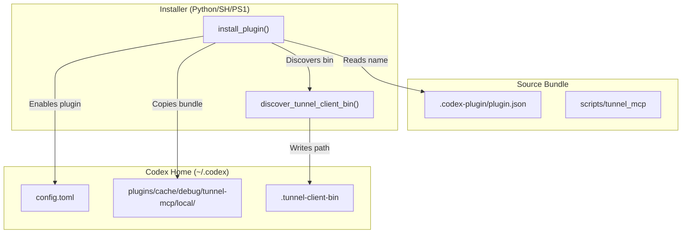
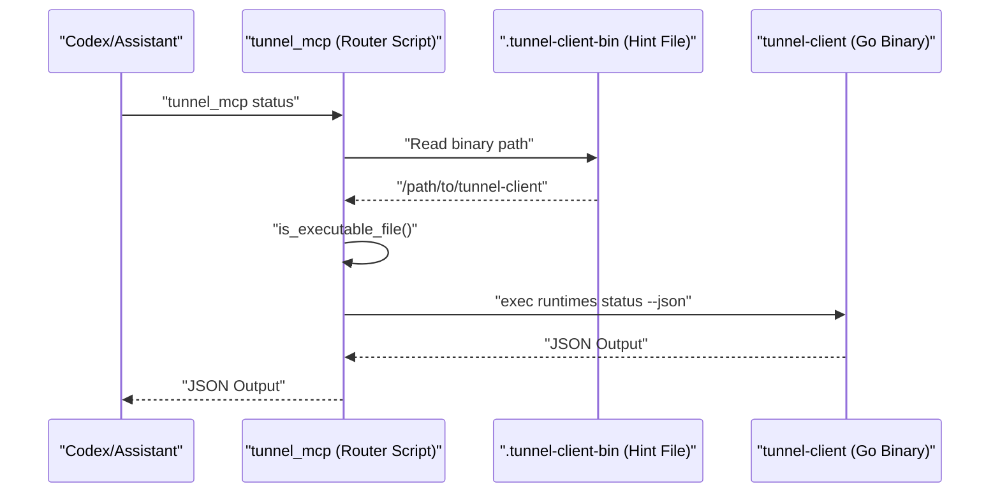

<!-- source: DeepWiki mcp.deepwiki.com · repo openai/tunnel-client · page 7.2 Plugin Installation and Scripts · fetched 2026-10-26 -->

# Plugin Installation and Scripts

<details>
<summary>Relevant source files</summary>

The following files were used as context for generating this wiki page:

- [cmd/client/codex_command.go](cmd/client/codex_command.go)
- [cmd/client/plugin_command.go](cmd/client/plugin_command.go)
- [pkg/codexplugin/codexplugin.go](pkg/codexplugin/codexplugin.go)
- [pkg/codexplugin/codexplugin_test.go](pkg/codexplugin/codexplugin_test.go)
- [plugins/bundle.go](plugins/bundle.go)
- [plugins/tunnel-mcp/.codex-plugin/plugin.json](plugins/tunnel-mcp/.codex-plugin/plugin.json)
- [plugins/tunnel-mcp/assets/tunnel-mcp-logo.png](plugins/tunnel-mcp/assets/tunnel-mcp-logo.png)
- [plugins/tunnel-mcp/scripts/install_plugin.py](plugins/tunnel-mcp/scripts/install_plugin.py)
- [plugins/tunnel-mcp/scripts/install_plugin.sh](plugins/tunnel-mcp/scripts/install_plugin.sh)
- [plugins/tunnel-mcp/scripts/tunnel_mcp](plugins/tunnel-mcp/scripts/tunnel_mcp)
- [plugins/tunnel-mcp/scripts/tunnel_mcp.ps1](plugins/tunnel-mcp/scripts/tunnel_mcp.ps1)
- [plugins/tunnel-mcp/scripts/tunnel_mcp_installer/__init__.py](plugins/tunnel-mcp/scripts/tunnel_mcp_installer/__init__.py)
- [plugins/tunnel-mcp/scripts/tunnel_mcp_installer/bazel_binary.py](plugins/tunnel-mcp/scripts/tunnel_mcp_installer/bazel_binary.py)
- [plugins/tunnel-mcp/scripts/tunnel_mcp_installer/binary.py](plugins/tunnel-mcp/scripts/tunnel_mcp_installer/binary.py)
- [plugins/tunnel-mcp/scripts/tunnel_mcp_installer/cli.py](plugins/tunnel-mcp/scripts/tunnel_mcp_installer/cli.py)
- [plugins/tunnel-mcp/scripts/tunnel_mcp_installer/config.py](plugins/tunnel-mcp/scripts/tunnel_mcp_installer/config.py)
- [plugins/tunnel-mcp/scripts/tunnel_mcp_installer/core.py](plugins/tunnel-mcp/scripts/tunnel_mcp_installer/core.py)
- [plugins/tunnel-mcp/scripts/tunnel_mcp_installer/manifest.py](plugins/tunnel-mcp/scripts/tunnel_mcp_installer/manifest.py)
- [plugins/tunnel-mcp/skills/tunnel-mcp/references/setup-and-install.md](plugins/tunnel-mcp/skills/tunnel-mcp/references/setup-and-install.md)

</details>


The `tunnel-mcp` plugin is designed as a thin router that delegates complex protocol logic and runtime management to the `tunnel-client` binary. Installation involves deploying the plugin manifest to the Codex environment, configuring the plugin to find the native binary, and setting up the `tunnel_mcp` router script to facilitate communication between the AI assistant and the tunnel client.

## Installation Overview

Installation can be performed via the native `tunnel-client` CLI or using standalone scripts provided in the plugin bundle. The process ensures that the plugin is registered in the Codex configuration and that a "hint" file exists to point the plugin to the correct `tunnel-client` executable.

### Installation Flow
The following diagram illustrates the data flow during a plugin installation using the Python-based installer.

**Diagram: Plugin Installation Data Flow**

Sources: [plugins/tunnel-mcp/scripts/tunnel_mcp_installer/core.py:17-43](), [plugins/tunnel-mcp/scripts/tunnel_mcp_installer/cli.py:49-74](), [pkg/codexplugin/codexplugin.go:158-183]()

## Installer Implementation

The primary installation logic resides in the `tunnel_mcp_installer` Python package and the Go `codexplugin` package. It handles directory management, configuration updates, and binary discovery.

### Binary Discovery Logic
The installer uses a prioritized search to locate the `tunnel-client` binary:
1.  **Explicit Flag**: The `--tunnel-client-bin` argument [plugins/tunnel-mcp/scripts/tunnel_mcp_installer/binary.py:63-64]().
2.  **Environment Variable**: The `TUNNEL_CLIENT_BIN` variable [plugins/tunnel-mcp/scripts/tunnel_mcp_installer/binary.py:66-68]().
3.  **Local Hint**: An existing `.tunnel-client-bin` file in the source directory [plugins/tunnel-mcp/scripts/tunnel_mcp_installer/binary.py:70-72]().
4.  **Adjacent Build Outputs**: Searching parent directories for common build patterns like `bin/tunnel-client` or `bazel-bin/` paths [plugins/tunnel-mcp/scripts/tunnel_mcp_installer/binary.py:74-76]().
5.  **System PATH**: Searching for `tunnel-client` or `tunnel-client.exe` in the system path [plugins/tunnel-mcp/scripts/tunnel_mcp_installer/binary.py:78-81]().

In the Go implementation, `codexplugin.InstallForMarketplace` uses `currentExecutablePath()` to identify the binary when triggered via the CLI [cmd/client/plugin_command.go:64-64]().

### Configuration Management
The Go implementation uses `updateConfig` to manage the Codex `config.toml` [pkg/codexplugin/codexplugin.go:181-183](). It ensures the plugin is enabled by adding a section formatted as `[plugins."tunnel-mcp@<marketplace>"]` with `enabled = true` [pkg/codexplugin/codexplugin_test.go:31-32]().

Sources: [plugins/tunnel-mcp/scripts/tunnel_mcp_installer/binary.py:62-83](), [pkg/codexplugin/codexplugin.go:158-194](), [cmd/client/plugin_command.go:53-85]()

## The tunnel_mcp Router Script

The `tunnel_mcp` script (available as a shell script for Unix, a `.cmd` for Windows, and a PowerShell script) acts as the entry point for all plugin actions. It resolves the `tunnel-client` binary at runtime and translates plugin commands into native CLI calls.

### Command Routing Mapping
The router maps simplified commands to the full `tunnel-client` command structure:

| Plugin Command | Native Command | Purpose |
| :--- | :--- | :--- |
| `create` | `runtimes create --json` | Provision a new tunnel instance |
| `connect` | `runtimes connect --json` | Establish a connection to an MCP server |
| `list` | `runtimes list --json` | List all local tunnel runtimes |
| `status` | `runtimes status --json` | Check health of active runtimes |
| `diagnose` | `codex diagnose --json` | Perform environment diagnostics |
| `admin-profiles`| `admin-profiles --json` | Manage control plane credentials |

Sources: [plugins/tunnel-mcp/scripts/tunnel_mcp:181-193](), [plugins/tunnel-mcp/scripts/tunnel_mcp.ps1:132-150]()

### Binary Resolution at Runtime
The router script implements a strict resolution strategy. It prefers the `.tunnel-client-bin` hint file created during installation [plugins/tunnel-mcp/scripts/tunnel_mcp:130-144](). If a binary is found on the `PATH` but no hint exists, the script logs a warning and refuses to execute unless `TUNNEL_CLIENT_BIN` is explicitly set [plugins/tunnel-mcp/scripts/tunnel_mcp:158-171]().

**Diagram: Runtime Command Routing**

Sources: [plugins/tunnel-mcp/scripts/tunnel_mcp:173-179](), [plugins/tunnel-mcp/scripts/tunnel_mcp.ps1:80-90]()

## Diagnostic and Self-Check

The plugin provides diagnostic tools to verify installation integrity and binary compatibility.

### Self-Check Diagnostic
The `self-check` command performs a multi-step verification:
1.  **Binary Presence**: Validates that the resolved `tunnel-client` binary exists and is executable [plugins/tunnel-mcp/scripts/tunnel_mcp:21-23]().
2.  **Version Compatibility**: Checks if the binary supports modern flags like `--plugin-root` [plugins/tunnel-mcp/scripts/tunnel_mcp:195-198]().
3.  **JSON Compatibility**: On systems where the binary might output non-JSON errors, the router wraps execution in a Python shim (`run_python_compat_json`) to ensure the assistant always receives valid JSON [plugins/tunnel-mcp/scripts/tunnel_mcp:200-212]().

### The .codex-plugin/plugin.json Manifest
This manifest defines the metadata for Codex, including the plugin version, skills location, and MCP server configuration [plugins/tunnel-mcp/.codex-plugin/plugin.json:1-44](). Codex uses this file to understand the plugin's capabilities (Interactive, Read, Write, Shell) [plugins/tunnel-mcp/.codex-plugin/plugin.json:27-32]().

**Diagram: Plugin Metadata Association**
```mermaid
classDiagram
    class "plugin.json" {
        name: "tunnel-mcp"
        version: "0.1.3"
        skills: "./skills/"
        mcpServers: "./.mcp.json"
    }
    class "Detection" {
        PluginInstalled: bool
        PluginBinaryHint: string
        PluginDir: string
        PluginKey: string
    }
    "plugin.json" ..> "Detection" : "Informs metadata"
```
Sources: [plugins/tunnel-mcp/.codex-plugin/plugin.json:1-20](), [pkg/codexplugin/codexplugin.go:29-46]()

Sources: [plugins/tunnel-mcp/skills/tunnel-mcp/references/setup-and-install.md:34-38](), [plugins/tunnel-mcp/scripts/tunnel_mcp:212-249](), [pkg/codexplugin/codexplugin.go:74-124]()

---

