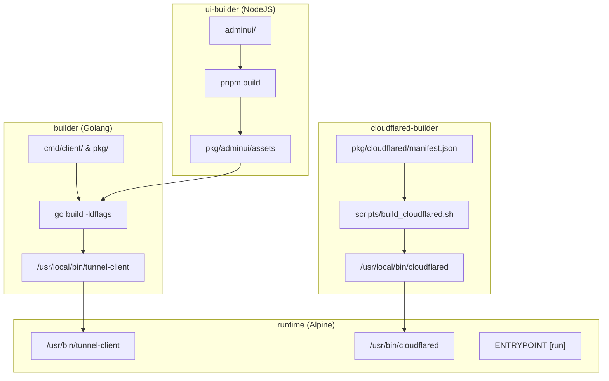
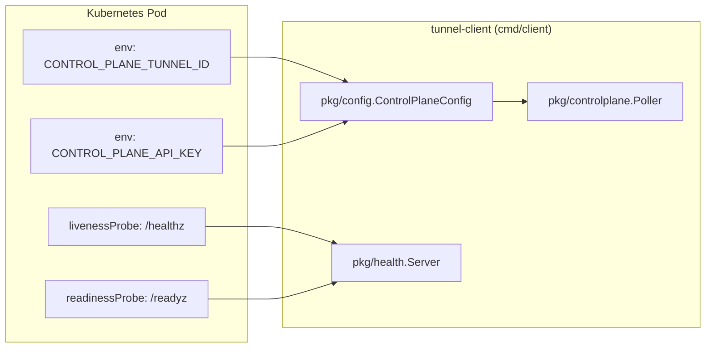

<!-- source: DeepWiki mcp.deepwiki.com · repo openai/tunnel-client · page 8.1 Docker and Kubernetes Deployment · fetched 2026-10-26 -->

# Docker and Kubernetes Deployment

<details>
<summary>Relevant source files</summary>

The following files were used as context for generating this wiki page:

- [.github/workflows/release.yml](.github/workflows/release.yml)
- [Dockerfile](Dockerfile)
- [Makefile](Makefile)
- [adminui/package.json](adminui/package.json)
- [adminui/pnpm-workspace.yaml](adminui/pnpm-workspace.yaml)
- [docs/deployment/docker.md](docs/deployment/docker.md)
- [docs/deployment/kubernetes-dedicated.md](docs/deployment/kubernetes-dedicated.md)
- [docs/deployment/kubernetes-sidecar.md](docs/deployment/kubernetes-sidecar.md)
- [docs/development.md](docs/development.md)
- [docs/enterprise-customer-onboarding.md](docs/enterprise-customer-onboarding.md)
- [scripts/build_distribution_package.sh](scripts/build_distribution_package.sh)

</details>


This page provides technical details on containerizing the `tunnel-client` and deploying it within Kubernetes environments. The `tunnel-client` is designed to be cloud-native, supporting environment-variable-driven configuration and standard health probe endpoints for orchestration.

## Docker Containerization

The `tunnel-client` uses a multi-stage Docker build process to ensure a small runtime footprint and a secure, reproducible build environment.

### Multi-Stage Build Process

The `Dockerfile` is structured into four primary stages:

1.  **UI Builder (`ui-builder`)**: Uses `node:22-alpine` to compile the Svelte-based Admin UI. It utilizes `pnpm` for dependency management and runs `pnpm build` to generate static assets [Dockerfile:9-51]().
2.  **Go Builder (`builder`)**: Uses `golang:1.26.2-alpine`. It copies the compiled UI assets from the first stage [Dockerfile:65]() and builds the Go binary with `CGO_ENABLED=0` for static linking [Dockerfile:68-70](). It injects the Git SHA into the version package via `-ldflags` [Dockerfile:69]().
3.  **Cloudflared Builder (`cloudflared-builder`)**: A specialized stage that uses a Python script `build_cloudflared.sh` to compile or fetch the pinned version of the `cloudflared` proxy required for certain tunnel operations [Dockerfile:72-87]().
4.  **Runtime (`runtime-base`)**: A minimal `alpine:3.22` image containing the final `tunnel-client` binary and the `cloudflared` binary [Dockerfile:89-93]().

### Build and Run
The image should be built with `DOCKER_BUILDKIT=1` to take advantage of the build cache mounts for Go modules and build artifacts [Dockerfile:61, 66-67]().

**Build Command:**
```bash
DOCKER_BUILDKIT=1 docker build \
  --build-arg GIT_SHA="$(git rev-parse HEAD)" \
  --build-arg PNPM_PACKAGE_MANAGER="pnpm@9.x" \
  -t tunnel-client:latest \
  -f Dockerfile .
```
[docs/deployment/docker.md:32-39]()

**Execution:**
The container's `ENTRYPOINT` is configured to execute `tunnel-client run` by default [Dockerfile:103](). Configuration is typically injected via environment variables.

```bash
docker run --rm \
  -e CONTROL_PLANE_API_KEY="sk-..." \
  -e CONTROL_PLANE_TUNNEL_ID="tunnel_0123456789abcdef0123456789abcdef" \
  -e MCP_SERVER_URL="https://mcp.internal.example.com/mcp" \
  -e HEALTH_LISTEN_ADDR=":8080" \
  -p 8080:8080 \
  ghcr.io/openai/tunnel-client:v1.2.3
```
[docs/deployment/docker.md:43-53]()

### Docker Build Data Flow
The following diagram illustrates how source code and assets flow through the Docker build stages to produce the final image.

**Title: Docker Image Assembly Flow**

Sources: [Dockerfile:1-103](), [adminui/package.json:5-10](), [scripts/build_cloudflared.sh:1-10]()

---

## Kubernetes Deployment Patterns

There are two primary patterns for deploying `tunnel-client` in Kubernetes: the **Dedicated Deployment** and the **Sidecar Pattern**.

### Dedicated Deployment
This pattern is used when the `tunnel-client` needs to connect to an MCP server that is already exposed as a Kubernetes Service within the cluster.

*   **Connectivity**: The client connects to the MCP server via its internal DNS name (e.g., `http://mcp-server.default.svc.cluster.local:3000/mcp`) [docs/deployment/kubernetes-dedicated.md:29]().
*   **Scalability**: Supports `replicas > 1` (active-active) provided the MCP server target is stateless or supports sticky sessions [docs/deployment/kubernetes-dedicated.md:53-68]().
*   **Probes**: Kubernetes `livenessProbe` and `readinessProbe` target the `/healthz` and `/readyz` endpoints [docs/deployment/kubernetes-dedicated.md:40-45]().

### Sidecar Pattern
This pattern is preferred when the MCP server is a private service that should not be exposed via a Kubernetes Service. The `tunnel-client` runs in the same Pod as the MCP server.

*   **Connectivity**: The client communicates with the MCP server over `127.0.0.1` [docs/deployment/kubernetes-sidecar.md:26]().
*   **Security**: Lock down egress with `NetworkPolicy` to allow only `api.openai.com:443` and local MCP traffic [docs/deployment/kubernetes-sidecar.md:58]().

### Kubernetes Resource Mapping
The following diagram maps Kubernetes resource definitions to the internal runtime components of the `tunnel-client`.

**Title: Kubernetes to Code Entity Mapping**

Sources: [docs/deployment/kubernetes-dedicated.md:23-45](), [docs/deployment/kubernetes-sidecar.md:20-53](), [Dockerfile:103]()

---

## Network and Security Considerations

### Health Endpoint Configuration
By default, the `tunnel-client` binds its health listener to `127.0.0.1:8080` [docs/deployment/docker.md:82](). In a Kubernetes environment, this must be changed to `:8080` so that the Kubelet can reach the probes on the Pod IP [docs/deployment/kubernetes-dedicated.md:48-50]().

### Secret Management
While environment variables are common, the `tunnel-client` supports loading secrets from files to avoid leaking credentials in process listings.
*   **Flag Syntax**: Use `--control-plane.api-key=file:/path/to/token` to read the key from a mounted volume [docs/deployment/docker.md:77]().

### Multi-Architecture Support
The release pipeline builds images for both `linux/amd64` and `linux/arm64` [.github/workflows/release.yml:73-79](). These are published as multi-architecture manifests to `ghcr.io/openai/tunnel-client` [docs/deployment/docker.md:5-6]().

Sources: [docs/deployment/docker.md:1-86](), [docs/deployment/kubernetes-dedicated.md:1-69](), [docs/deployment/kubernetes-sidecar.md:1-62](), [.github/workflows/release.yml:1-167]()

---

