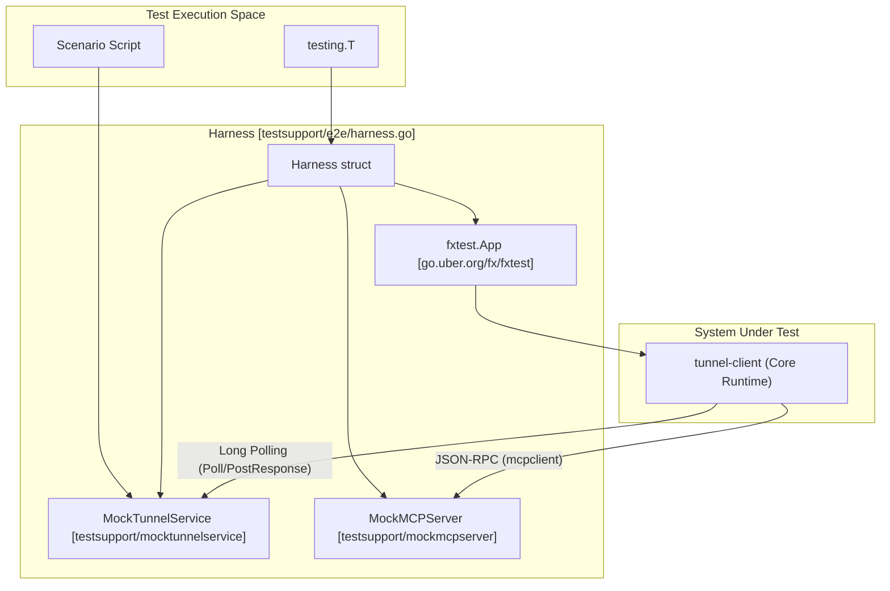
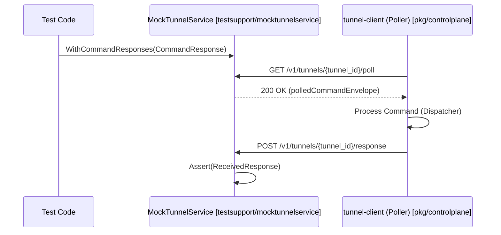

<!-- source: DeepWiki mcp.deepwiki.com · repo openai/tunnel-client · page 9 Testing Infrastructure · fetched 2026-10-26 -->

# Testing Infrastructure

Relevant source files

The following files were used as context for generating this wiki page:

- [e2e/harpoon_channel_tools_list_e2e_test.go](e2e/harpoon_channel_tools_list_e2e_test.go)
- [e2e/proxy_e2e_test.go](e2e/proxy_e2e_test.go)
- [e2e/simple_tool_e2e_call_test.go](e2e/simple_tool_e2e_call_test.go)
- [e2e/static_headers_e2e_test.go](e2e/static_headers_e2e_test.go)
- [testsupport/e2e/harness.go](testsupport/e2e/harness.go)
- [testsupport/mockmcpserver/doc.go](testsupport/mockmcpserver/doc.go)
- [testsupport/mockmcpserver/mock_mcp_server.go](testsupport/mockmcpserver/mock_mcp_server.go)
- [testsupport/mockmcpserver/mock_mcp_server_test.go](testsupport/mockmcpserver/mock_mcp_server_test.go)
- [testsupport/mocktunnelservice/mock_tunnel_service.go](testsupport/mocktunnelservice/mock_tunnel_service.go)

The `tunnel-client` testing infrastructure is designed to provide high-fidelity simulation of the entire three-tier topology (OpenAI Control Plane → `tunnel-client` → MCP Server). The strategy combines standard Go unit tests with a sophisticated End-to-End (E2E) harness that uses mock services to verify complex asynchronous behaviors, such as long-polling, OAuth discovery, and multi-channel command dispatching.

## Testing Strategy Overview

The codebase utilizes four primary testing layers:

| Layer | Implementation | Scope |
| :--- | :--- | :--- |
| **Unit Tests** | Standard `testing` package | Isolated logic in packages like `config`, `tlsconfig`, and `harpoon`. |
| **E2E Harness** | `testsupport/e2e.Harness` | Full lifecycle testing of the client using `fxtest.App`. |
| **Mock Services** | `mocktunnelservice` & `mockmcpserver` | Scriptable simulations of external HTTP and Stdio dependencies. |
| **Integration Scripts** | `Makefile` & Shell scripts | Validation of CLI binaries and build artifacts. |

Sources: [testsupport/e2e/harness.go:192-212](), [testsupport/mocktunnelservice/mock_tunnel_service.go:220-240]()

## The E2E Test Harness

The `Harness` struct in `testsupport/e2e` is the central entity for integration testing. It orchestrates the lifecycle of the mock control plane, the mock MCP server, and the `tunnel-client` application itself via Uber's `fxtest` framework.

### Harness Architecture

The diagram below illustrates how the `Harness` bridges the gap between the test code and the running system components.

**Harness Component Mapping**

Sources: [testsupport/e2e/harness.go:192-212](), [testsupport/e2e/harness.go:235-265]()

### Transport Injection Patterns
The harness supports testing different MCP transport layers by injecting specific configurations via `HarnessOption`:
*   **HTTP Streamable:** The default mode using `httptest.Server` [testsupport/mockmcpserver/mock_mcp_server.go:235-265]().
*   **Stdio:** Simulates local process execution using pipes [testsupport/mockmcpserver/mock_mcp_server.go:223-232]().
*   **In-Memory:** Uses `mcp.InMemoryTransport` for high-speed, same-process testing [testsupport/mockmcpserver/mock_mcp_server.go:185-221]().

For details, see [E2E Test Harness](#9.1).

## Mock Services

To facilitate deterministic testing of asynchronous loops, the infrastructure provides two primary mock services that allow for "scripted" interactions.

### MockTunnelService (Control Plane)
Simulates the OpenAI Tunnel Service. It allows tests to queue `CommandResponse` objects that define what the client should receive during its next long-poll cycle and what assertions should be made on the client's subsequent response.

**Key Entity: Command-Response Loop**

Sources: [testsupport/mocktunnelservice/mock_tunnel_service.go:187-196](), [testsupport/mocktunnelservice/mock_tunnel_service.go:220-240]()

### MockMCPServer
Hosts an MCP server (HTTP, Stdio, or In-Memory) that can be configured with specific tool behaviors. It supports:
*   **DynamicResult:** Function-based handlers for tool calls [testsupport/mockmcpserver/mock_mcp_server.go:38-38]().
*   **Progress Notifications:** Emitting `ProgressUpdate` notifications during tool execution [testsupport/mockmcpserver/mock_mcp_server.go:49-53]().
*   **OAuth Metadata:** Serving `/.well-known/oauth-protected-resource` to test discovery [testsupport/mockmcpserver/mock_mcp_server.go:128-136]().

For details, see [Mock Services: MockMCPServer and MockTunnelService](#9.2).

## Key Test Scenarios

The infrastructure is used to validate several critical client behaviors:

*   **Simple Tool Calls:** Verifies the end-to-end path from a poll command to an MCP tool execution and response post-back [e2e/simple_tool_e2e_call_test.go:18-41]().
*   **Static Headers:** Ensures that `ExtraHeaders` and `DiscoveryExtraHeaders` are correctly scoped to MCP runtime or discovery requests and not leaked to the control plane [e2e/static_headers_e2e_test.go:23-64]().
*   **Proxy and TLS:** Validates that the client can reach both the control plane and MCP servers through an HTTP proxy, including mTLS and custom CA bundle trust [e2e/proxy_e2e_test.go:17-72]().
*   **Harpoon Integration:** Validates the routing of commands to the internal `harpoon` channel and the listing of Harpoon targets [e2e/harpoon_channel_tools_list_e2e_test.go:17-213]().

Sources: [e2e/simple_tool_e2e_call_test.go:43-54](), [e2e/static_headers_e2e_test.go:172-184](), [e2e/proxy_e2e_test.go:31-46]()

---

