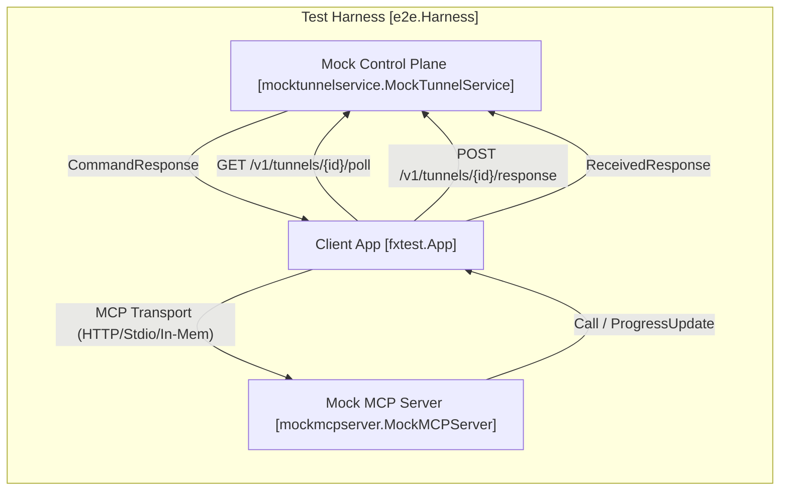
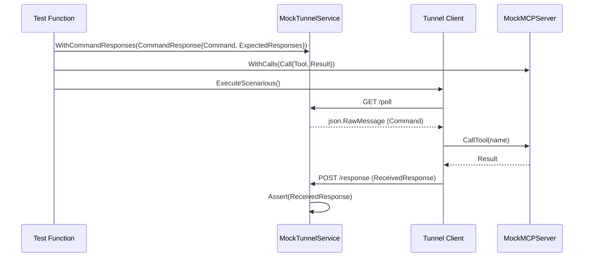

<!-- source: DeepWiki mcp.deepwiki.com · repo openai/tunnel-client · page 9.1 E2E Test Harness · fetched 2026-10-26 -->

# E2E Test Harness

Relevant source files

The following files were used as context for generating this wiki page:

- [e2e/ca_bundle_e2e_test.go](e2e/ca_bundle_e2e_test.go)
- [e2e/harpoon_channel_tools_list_e2e_test.go](e2e/harpoon_channel_tools_list_e2e_test.go)
- [e2e/max_inflight_e2e_test.go](e2e/max_inflight_e2e_test.go)
- [e2e/notification_forwarding_e2e_test.go](e2e/notification_forwarding_e2e_test.go)
- [e2e/oauth_discovery_e2e_test.go](e2e/oauth_discovery_e2e_test.go)
- [e2e/oauth_protection_e2e_test.go](e2e/oauth_protection_e2e_test.go)
- [e2e/parallel_limit_test.go](e2e/parallel_limit_test.go)
- [e2e/proxy_e2e_test.go](e2e/proxy_e2e_test.go)
- [e2e/session_termination_e2e_test.go](e2e/session_termination_e2e_test.go)
- [e2e/simple_tool_e2e_call_test.go](e2e/simple_tool_e2e_call_test.go)
- [e2e/static_headers_e2e_test.go](e2e/static_headers_e2e_test.go)
- [e2e/testdata/test_ca_bundle.pem](e2e/testdata/test_ca_bundle.pem)
- [e2e/testdata/test_server_cert.pem](e2e/testdata/test_server_cert.pem)
- [e2e/testdata/test_server_key.pem](e2e/testdata/test_server_key.pem)
- [testsupport/e2e/harness.go](testsupport/e2e/harness.go)
- [testsupport/mockmcpserver/doc.go](testsupport/mockmcpserver/doc.go)
- [testsupport/mockmcpserver/mock_mcp_server.go](testsupport/mockmcpserver/mock_mcp_server.go)
- [testsupport/mockmcpserver/mock_mcp_server_test.go](testsupport/mockmcpserver/mock_mcp_server_test.go)
- [testsupport/mockmcpserver/parallel_limit_test.go](testsupport/mockmcpserver/parallel_limit_test.go)
- [testsupport/mocktunnelservice/doc.go](testsupport/mocktunnelservice/doc.go)
- [testsupport/mocktunnelservice/mock_tunnel_service.go](testsupport/mocktunnelservice/mock_tunnel_service.go)
- [testsupport/mocktunnelservice/parallel_limit_test.go](testsupport/mocktunnelservice/parallel_limit_test.go)
- [testsupport/testctx/deadline.go](testsupport/testctx/deadline.go)
- [testsupport/testctx/deadline_test.go](testsupport/testctx/deadline_test.go)

The `tunnel-client` End-to-End (E2E) test infrastructure provides a comprehensive framework for validating the entire request lifecycle, from the OpenAI Control Plane through the tunnel to local MCP servers. The core of this infrastructure is the `Harness` struct, which orchestrates the lifecycle of mock services and the client application itself.

## Harness Architecture and Lifecycle

The `Harness` struct integrates three primary components into a single testable unit:
1.  **Mock Control Plane (`MockTunnelService`)**: Simulates the OpenAI tunnel service endpoints (`/poll`, `/response`) [testsupport/mocktunnelservice/mock_tunnel_service.go:220-240]().
2.  **Mock MCP Server (`MockMCPServer`)**: Simulates the local tool-providing server with support for HTTP, Stdio, and In-Memory transports [testsupport/mockmcpserver/mock_mcp_server.go:179-213]().
3.  **Tunnel Client App**: The actual `tunnel-client` binary logic, wired via `fxtest.App` to enable dependency injection and lifecycle hooks [testsupport/e2e/harness.go:192-212]().

### Component Interaction Diagram

This diagram illustrates how the `Harness` wires the system components using specific code entities.

"Harness Component Wiring"

Sources: [testsupport/e2e/harness.go:192-212](), [testsupport/mocktunnelservice/mock_tunnel_service.go:220-240](), [testsupport/mockmcpserver/mock_mcp_server.go:179-213]()

### Lifecycle Management
The `Harness` manages startup and shutdown sequences to ensure clean test execution:
*   **Startup**: Mocks are initialized first. The `Harness` then derives a `config.Config` that points the client to the local mock listeners [testsupport/e2e/harness.go:345-420]().
*   **Execution**: Tests use `ExecuteScenarious(t)` which starts the `fxtest.App`, waits for scripted commands to be processed, and then stops the app [testsupport/e2e/harness.go:503-540]().
*   **Hooks**: Provides `WithBeforeClientStart`, `WithAfterClientStart`, and `WithBeforeClientStop` hooks for fine-grained state manipulation [testsupport/e2e/harness.go:123-141]().

## Transport Injection Patterns

The harness supports multiple transport modes to validate different deployment scenarios:

| Transport Kind | Harness Option | Implementation Detail |
| :--- | :--- | :--- |
| **HTTP Streamable** | Default | Uses `httptest.Server` and `mcp.StreamableClientTransport` [testsupport/mockmcpserver/mock_mcp_server.go:235-267]() |
| **Stdio** | `WithMCPCommand` | Simulates a subprocess by piping stdin/stdout to the mock via `StartStdio` [testsupport/mockmcpserver/mock_mcp_server.go:303-334]() |
| **In-Memory** | `WithInMemoryMCPTransport` | Uses `mcp.InMemoryTransport` for high-performance, direct-call testing [testsupport/e2e/harness.go:169-173]() |
| **Harpoon** | `WithHarpoonInMemoryTransport` | Routes traffic to the internal `harpoon.Registry` instead of an external mock [testsupport/e2e/harness.go:176-181]() |

Sources: [testsupport/e2e/harness.go:169-189](), [testsupport/mockmcpserver/mock_mcp_server.go:235-334]()

## Scenario Scripting

Testing logic is driven by "scripting" the mocks to expect certain sequences of events.

### CommandResponse and WaitUntilIdle
The `MockTunnelService` uses `CommandResponse` to define what the client should receive when it polls and what the mock expects in return [testsupport/mocktunnelservice/mock_tunnel_service.go:187-196]().

"Scenario Data Flow"

Sources: [testsupport/mocktunnelservice/mock_tunnel_service.go:187-196](), [testsupport/mockmcpserver/mock_mcp_server.go:35-42](), [e2e/simple_tool_e2e_call_test.go:114-132]()

## Key E2E Test Scenarios

### 1. OAuth Discovery and Protection
Validates that the client can discover OAuth metadata from an MCP server and report it back to the control plane. It also tests 401 challenge handling.
*   **Entities**: `NewOAuthDiscoveryCommand`, `WithOAuthDiscoveryResources`, `WithOAuthProtection`.
*   **Verification**: Ensures `wiretypes.ResponsePayloadOAuth` contains correct resource metadata and that the client forwards `WWW-Authenticate` headers [e2e/oauth_discovery_e2e_test.go:22-77](), [e2e/oauth_protection_e2e_test.go:17-74]().

### 2. Session Termination
Tests the ability to close specific MCP sessions via control plane commands.
*   **Flow**: Control plane sends `ResponsePayloadSessionTermination` -> Client sends `DELETE` to MCP server with the session ID.
*   **Verification**: Validates that for Stdio transports, the client returns `405 Method Not Allowed` as sessions are tied to process lifecycle [e2e/session_termination_e2e_test.go:16-83](), [e2e/session_termination_e2e_test.go:85-196]().

### 3. Max-Inflight and Proxy Configuration
Ensures the client respects concurrency limits and correctly routes traffic through proxies.
*   **Logic**: Tests `MaxInFlightRequests` capping [e2e/max_inflight_e2e_test.go:17-29]().
*   **Proxy**: Validates `HTTP_PROXY` and `CA_BUNDLE` integration using `mockproxy` and `tlsconfig.Bundle` [e2e/proxy_e2e_test.go:17-72](), [e2e/ca_bundle_e2e_test.go:23-57]().

### 4. Notifications and Progress
Validates asynchronous events like MCP progress notifications.
*   **Implementation**: `MockMCPServer` emits `ProgressUpdate` [testsupport/mockmcpserver/mock_mcp_server.go:49-53](); the client must forward these as `ResponsePayloadJSONRPCNotify` to the control plane [e2e/notification_forwarding_e2e_test.go:16-111]().

## Operational Constraints
To prevent resource exhaustion and port conflicts during CI, the harness enforces parallel execution limits:
*   **TestMain**: Caps `test.parallel` to 2 in the `e2e` and `mockmcpserver` packages to avoid listener binding collisions.
*   **Sources**: [e2e/parallel_limit_test.go:12-23](), [testsupport/mockmcpserver/parallel_limit_test.go:12-23]()

---

